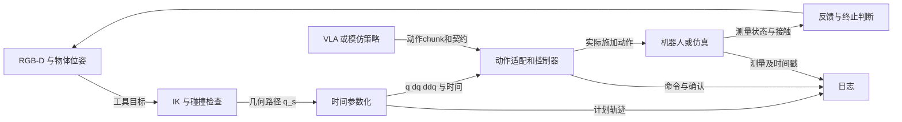
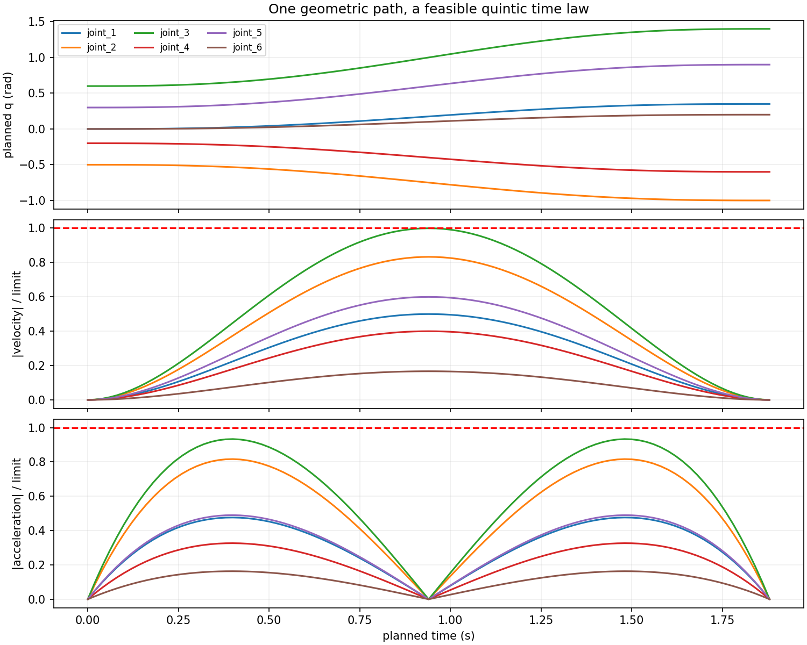
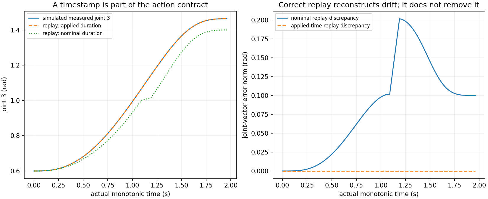

# D54 · 从关节路径到可执行轨迹，再到可复核动作日志

[返回学习入口](../_index.md) ｜ [本周日程](../P3-项目实战-日程.md) ｜ [上一课 D53](../day53/Daily-Learning-Pack.md) ｜ [CPU 实验](demo.py)

**路径回答“经过哪里”，轨迹回答“什么时候经过”，动作接口回答“这些数怎样作用到机器人”，日志回答“最后实际发生了什么”。给同一条路径换一个时间尺度，就可能超出速度和加速度限制；给同一串速度换一个执行周期，就会得到不同的运动。**

本课属于 P3 / Π-1 / W8-D5，保留原课程日期 2026-10-28，实际于 2026-10-29 补写并验证。D53 已把物体位姿、工具变换和六关节 IK 接起来；今天不再停留于一个目标关节构型，而是构造有时间的运动，并把命令与执行记录分开保存。D55 将利用这些接口检查 RGB-D 或仿真闭环中的成功与失败。

<details>
<summary>个人学习记录（自动更新时保留）</summary>

<!-- learner-notes:start -->

- 我对路径、轨迹、执行三层的理解：
- 我改变的延迟参数与回放结果：
- 我的自测答案、实际控制器接口与疑问：

<!-- learner-notes:end -->

</details>

<!-- daily-pack-generated:start -->

## 学习目标与路线

今天你应当能推导一条关节路径的速度与加速度；从边界条件得到五次时间律；根据各关节限制计算运动时长；区分关节位置、速度、增量与动作 chunk；最后用实际执行时间戳回放日志，指出为什么“回放到目标”不一定代表真实执行到目标。

| 顺序 | 知识主线 | 必须回答的问题 |
|---|---|---|
| 1 | 路径与时间 | IK 给了终点，为什么还不能开始执行？ |
| 2 | 时间参数化 | 同一路径的速度和加速度怎样受时长控制？ |
| 3 | 采样与控制契约 | 曲线满足限制，离散命令是否也满足？ |
| 4 | VLA 动作 chunk | 一次预测多少步，与一次执行多少步有什么不同？ |
| 5 | 日志与回放 | 该用计划周期、发送时间还是实际施加时间？ |

## 1 宏观：把“我发过动作”拆成可检查的系统链



图中有两条产生动作的入口：规划器输出带时间的参考轨迹，学习策略输出有特定语义的动作序列。它们都需要适配控制器，也都需要执行反馈。把一个 `[H,7]` tensor 放到网络外面并不会自动具备坐标、单位、采样周期和终止逻辑。

D53 的 IK 目标只是一个 $q^*$。从当前 $q_0$ 到 $q^*$ 的直线可能穿过障碍，途中的姿态可能不可接受；即使已有无碰撞路径，运动过快也可能超限。今天的实验使用**给定的关节空间直线路径**，研究时间和日志；它不运行路径规划器，也没有证明该路径在任何真实场景中无碰撞。

## 2 微观：路径 $q(s)$ 与轨迹 $q(s(t))$

### 2.1 两个变量分别回答几何与时间

令 $s\in[0,1]$ 表示无量纲路径进度，$q(s)\in\mathbb R^6$ 表示六个转动关节角，单位 rad。关节空间直线为

$$q(s)=q_0+s\Delta q,\qquad\Delta q=q_1-q_0.$$

它没有秒这个单位。给出单调时间律 $s(t)$ 后，$q(t)=q(s(t))$ 才是一条轨迹。对一般路径使用链式法则：

$$\dot q=q_s\dot s,\qquad
\ddot q=q_{ss}\dot s^2+q_s\ddot s.$$

$q_s=\partial q/\partial s$，$q_{ss}=\partial^2q/\partial s^2$。直线路径 $q_s=\Delta q,q_{ss}=0$，于是

$$\dot q=\Delta q\dot s,\qquad\ddot q=\Delta q\ddot s.$$

这两个公式说明：控制运动时长可以缩放速度与加速度，但对弯曲路径，还必须考虑 $q_{ss}\dot s^2$。不能把直线段的时长公式不加修改地套给所有样条路径。

### 2.2 关节直线不保证夹爪走直线

假设平面双连杆初始构型与终止构型只差一个肩关节角。关节空间中只需要沿一维线段变化，末端却绕肩关节沿圆弧运动。这说明“所有关节匀速插值”和“夹爪以直线接近杯子”是不同约束。

若要求 TCP 直线接近，通常先在任务空间定义位置与姿态路径，再对连续采样位姿求 IK、维持分支连续性并检查关节限制与碰撞。姿态插值应尊重旋转几何；直接逐元素线性插值旋转矩阵通常会离开 SO(3)。路径连续不保证其 IK 解序列连续，跳分支可能产生关节突变。

静态场景中，严格保留同一条 $q(s)$ 的单调时间重参数化不会改变路径经过的构型集合。但重采样、平滑、路径拟合可能改变几何；动态障碍与接触又依赖具体时间，必须重新评价相应约束。

## 3 微观：从六个边界条件推导五次时间律

### 3.1 为什么选择五次多项式

为了从静止平滑出发并在终点静止，希望

$$s(0)=0,\ s(T)=1,\ \dot s(0)=\dot s(T)=0,\ \ddot s(0)=\ddot s(T)=0.$$

令 $\tau=t/T\in[0,1]$，采用五次多项式 $s(\tau)=\sum_{i=0}^5a_i\tau^i$。起点三条件给 $a_0=a_1=a_2=0$；终点三条件给

$$a_3+a_4+a_5=1,\quad3a_3+4a_4+5a_5=0,\quad6a_3+12a_4+20a_5=0.$$

联立得到 $a_3=10,a_4=-15,a_5=6$：

$$\boxed{s=10\tau^3-15\tau^4+6\tau^5},$$

$$\dot s=\frac{30\tau^2-60\tau^3+30\tau^4}{T}
=\frac{30\tau^2(1-\tau)^2}{T},$$

$$\ddot s=\frac{60\tau-180\tau^2+120\tau^3}{T^2}.$$

因 $\dot s\ge0$，进度不会反向。速度包含 $1/T$，加速度包含 $1/T^2$；这也是把运动压缩一半时速度加倍、加速度变四倍的来源。

三次时间律只约束起终点位置和速度，端点加速度通常非零，接到静止状态时会突变。五次让位置、速度、加速度能与静止段连续衔接，但仍未保证 jerk（加加速度）跨段连续或满足额外 jerk 上限。需要限制 jerk 时可进一步研究 S 曲线、相应在线轨迹生成器及其边界条件；不能把“用了五次”当成所有动力学要求都满足。

### 3.2 先求连续峰值，再决定时长

$\dot s$ 在 $\tau=1/2$ 取最大值：

$$\max\dot s=\frac{15}{8T}=\frac{1.875}{T}.$$

令 $\dddot s=0$，解得加速度极值处 $\tau=(3\pm\sqrt3)/6$，于是

$$\max|\ddot s|=\frac{10\sqrt3}{3T^2}\approx\frac{5.7735}{T^2}.$$

对每个关节给速度上限 $v_i^{max}$（rad/s）和加速度上限 $a_i^{max}$（rad/s²），要满足

$$T\ge\frac{1.875|\Delta q_i|}{v_i^{max}},\qquad
T\ge\sqrt{\frac{5.7735|\Delta q_i|}{a_i^{max}}}.$$

因此本直线段、指定五次时间律下的最小时长为

$$\boxed{T_{min}=\max_i\left\{\frac{1.875|\Delta q_i|}{v_i^{max}},\sqrt{\frac{5.7735|\Delta q_i|}{a_i^{max}}}\right\}}.$$

这是**该时间律族**内满足给定运动学峰值限制的结果，不是所有可能时间律的全局最短时间，更没有检查电机力矩、负载、摩擦和接触。

只检查采样点可能漏掉样本之间的峰值。实验直接用上述解析峰值验算，再绘制离散曲线。实际复杂路径则需要对应算法的连续约束保证或足够保守的检查。

### 3.3 手算：第三关节决定本例的时长

本例第三关节从 $0.6$ 到 $1.4rad$，$|\Delta q_3|=0.8rad$；速度上限 $0.8rad/s$，加速度上限 $1.4rad/s^2$：

$$T_v=1.875\times0.8/0.8=1.875s,$$

$$T_a=\sqrt{5.7735\times0.8/1.4}\approx1.816s.$$

检查全部六关节后，最大要求仍是 1.875 s。控制采样名义周期 $\Delta t=0.02s$，取向上整周期 $T=1.88s$，对应 94 个区间、95 个轨迹点。不能简单向下取 1.86 s，因为第三关节就会超速。

> [!question] 先算
> 如果沿同一路径改用 $T=0.94s$，最大速度与上限之比、最大加速度与上限之比会怎样变化？“动作更快一点”在两种限制上是同样代价吗？



上图依次显示计划位置、速度绝对值/对应上限、加速度绝对值/对应上限。红虚线为 1；第三关节速度接近限制，加速度仍有余量。曲线展示采样值，结果表中的最大比例来自连续解析峰值。

| 同一条路径 | $T$ / s | 最大速度/上限 | 最大加速度/上限 |
|---|---:|---:|---:|
| 合规五次时间律 | 1.88 | 0.99734 | 0.93344 |
| 时长减半 | 0.94 | 1.99468 | 3.73375 |

运动学时间参数化是规划与执行间的独立处理层。真实机器人还要读取一致的关节速度/加速度配置，检查控制器是否使用相同限制；参阅 [MoveIt Trajectory Processing](https://moveit.picknik.ai/main/doc/concepts/trajectory_processing.html)。本例手写五次直线段，不是 TOTG 或其他完整路径时间参数化算法的复现。

## 4 微观：从连续参考到离散动作，必须再确认一次契约

### 4.1 位置、速度与增量不是三种等价数组

设关节当前 $q=0.2rad$，某个输出数为 0.1：

| 动作语义 | 数值的单位 | 该步代表什么 |
|---|---|---|
| 绝对关节位置 | rad | 目标为 0.1 rad，而非前进 0.1 |
| 关节增量 | rad/次动作 | 本次增加 0.1 rad，参考是哪个状态要写清 |
| 关节速度 | rad/s | 若作用 0.02 s，理想积分增加 0.002 rad |

时间间隔为 0.02 s 时，把速度数值当作每步角增量会引入约 50 倍位移尺度错误。对于基座/工具系的末端增量，还必须说明左乘或右乘关系、旋转表示及夹爪动作单位。D53 解决的是静态目标变换，不能替代这里的动作语义。

### 4.2 本例把两种问题分开验证

第一部分验证连续五次参考曲线 $q(t),\dot q(t),\ddot q(t)$ 的运动学峰值。第二部分为了研究日志，构造区间平均速度命令：

$$u_k=\frac{q(t_{k+1})-q(t_k)}{\Delta t_{nom}},\qquad
q_{k+1}^{sim}=q_k^{sim}+u_k\Delta t_k^{actual}.$$

只要实际周期等于名义周期，按这些平均速度积分就能精确到达每个采样点；周期变了，积分位移就变了。这个模型是**理想关节速度积分器**，没有电机、电流、接触或刚体动力学。

> [!warning] 计划加速度合规不等于速度阶梯实际合规
> 本例日志部分对区间平均速度采用零阶保持，命令在边界可能跳变，理想瞬时切换并不满足有限加速度。前面的加速度保证只属于连续五次参考。真实控制器需要按约定插值、跟踪并限制速度/加速度；加入滤波后也要重新检查实际运动，不能直接继承规划层结论。

若使用 ROS，`JointTrajectory` 的 `joint_names` 顺序必须与每个 point 的数值顺序一致；`time_from_start` 是相对轨迹起点的到达时间，不是“这条消息发出的系统时间”。转动关节位置用 rad、速度用 rad/s、加速度用 rad/s²；移动关节则用 m 及其导数。正式字段以 [JointTrajectory](https://raw.githubusercontent.com/ros2/common_interfaces/rolling/trajectory_msgs/msg/JointTrajectory.msg) 和 [JointTrajectoryPoint](https://raw.githubusercontent.com/ros2/common_interfaces/rolling/trajectory_msgs/msg/JointTrajectoryPoint.msg) 的定义为准，具体控制器是否接收并怎样插值这些字段还要核对实现。

### 4.3 Shape 一致还不够

| 量 | 本例 shape | 必须一并保存的语义 |
|---|---|---|
| 轨迹 `q,dq,ddq` | 各 `[95,6]` | 关节名称顺序与 rad、rad/s、rad/s² |
| `planned_time_s` | `[95]` | 同一参考起点的计划到达时间 |
| 区间平均速度命令 | `[94,6]` | `joint_velocity`、rad/s、保持区间 |
| 实际施加时刻 | `[95]` | 同一单调时钟上的边界时刻 |
| 合成反馈状态 | `[95,6]` | 积分器状态；不是实际编码器反馈 |
| action chunk | 通常 `[10,6]` | 末块仅 4 步，不能补齐后误执行 |

不要把不同关节类型的位置直接放进同一个未归一化欧氏距离中。本实验全为转动关节，所以报告关节向量的 rad 范数；它不是 TCP 米误差。若要知道夹爪偏了多少，还需对不同状态做 FK 并比较对应物理点。

## 5 微观：VLA/模仿策略的动作 chunk 如何进入执行器

动作 chunk 是一次预测的未来动作序列 $A_t=[a_t,\ldots,a_{t+H-1}]$。它把时序关联放进模型输出，但不会自动确定控制周期。令预测长度为 $H$、每次真正执行的长度为 $K\le H$，名义周期为 $\Delta t$，则预测覆盖 $H\Delta t$，下次依赖新观测重新规划前执行 $K\Delta t$；推理、通信和排队延迟还会增加信息陈旧程度。

比如 $H=10,K=2,\Delta t=0.02s$：预测覆盖 0.20 s，只执行前 0.04 s，再读取反馈。如果直接执行完整十步，执行窗口就变长，外部扰动发生后可能要更久才反应。但频繁重规划也可能产生序列接缝、推理预算和动作连续性问题，需要任务实验而非一律偏向越短越好。

ACT 的核心是由 Transformer 预测动作序列；官方展示使用关节位置动作，这与本例用于日志教学的关节速度不同。不要因为都叫 chunk 就复用同一个反归一化与控制适配。具体动作表示与周期以模型配置和演示数据为准。[ACT/ALOHA 原始项目](https://tonyzhaozh.github.io/aloha/) 的 Learning Algorithm 部分可以对照这一点。

本脚本不调用 VLA 或 ACT，不训练模型。它仅把确定性的 94 条速度命令每十条分组，记录 `chunk_id` 和 `chunk_index`，完整执行当前可用块，末块四条；用它检查**序列包装后的执行契约**。真实 VLA 接入时另外记录输入观测时间、模型/归一化版本、推理起止、所选预测段、取消/覆盖原因及实际执行长度。本例没有这些真实事件，相应 `observation_time_s` 与 `policy_inference_ms` 明确为 `null`。

Learning 五格卡也能帮助区分层次：若是 ACT，数据来自演示轨迹，学习条件动作序列，训练目标来自模仿监督及其生成建模结构，推理输出动作块，泛化用新物体初态/扰动等测试；而本课时间参数化和回放模块没有可学习参数、没有训练集与训练 loss，只有明确的运动约束和一致性验证。

## 6 微观：日志必须保留“实际施加”而不只是“计划发出”

### 6.1 三种时间与两个不同问题

计划时间表示轨迹想什么时候到达；发送时间表示软件什么时候把命令交出去；实际施加时间表示控制器从什么时候开始使用它。三者可能不同。只有发送记录而没有接收确认或控制反馈时，不应声称已准确知道实际施加时间。

本文合成环境直接知道每条速度的实际保持区间 $[t_k^{apply},t_{k+1}^{apply})$。日志包括连续 `sequence`、关节名称、动作类型/单位、计划开始、实际开始结束、名义与实际周期、命令、前后合成状态及模拟确认。所有时间来自一个合成单调时钟，避免把网络时钟同步问题偷偷混入实验。

回放更新为

$$\hat q_{k+1}=\hat q_k+u_k(t_{k+1}^{apply}-t_k^{apply}).$$

它回答“这套动作与时序在指定动力学假设下，会重建什么状态”。它没有把机器人重新控制回正确目标。**回放正确性**看 $\hat q$ 与记录状态是否一致；**执行效果**看记录状态与目标是否一致。两个指标可能一个完美、另一个失败。

### 6.2 单次延迟怎样放大位移

假设速度 $0.8rad/s$ 原本保持 20 ms，因为下一条替换迟到而持续约 100 ms，额外位移约

$$0.8\times(0.10-0.02)=0.064rad\approx3.67^\circ.$$

本例在每步施加平滑周期抖动（15–25 ms），再在中间一条命令上额外增加 4 个名义周期，即 80 ms。那条命令保持约 99.833 ms。它不改变命令值，只改变实际保持时长，适合把单位/周期问题与感知或模型误差隔离。



左图中“实际周期回放”与合成测量状态重合；固定名义周期的回放则看似准时完成参考位移。右图画的是回放与同一条合成测量轨迹之间的关节向量差。它说明错误回放不仅可能隐藏终点偏差，还会掩盖中途的执行变化。

| 默认实验，94 条动作 | 实测结果 | 解释 |
|---|---:|---|
| 计划 / 实际总时长 | 1.88 / 1.96 s | 额外保持 80 ms |
| 按实际周期回放最大逐元素误差 | $6.66\times10^{-16}rad$ | 浮点误差范围内复现同一积分器 |
| 按名义周期回放的终点偏差范数 | 0.100022 rad | 与记录状态不一致 |
| 按名义周期回放的全程最大偏差范数 | 0.201567 rad | 中间偏差比终点更大 |
| 合成执行状态相对目标的终点误差范数 | 0.100022 rad | 正确回放不会消除执行漂移 |
| 把 rad/s 值当作每步 rad 增量的目标误差范数 | 61.445687 rad | 单位契约错，远超合理运动范围 |

最后一行只是错误算式的离线结果，程序没有将其送入控制器，更没有宣称它通过限位或安全检查。它的教学意义是数量级诊断。

### 6.3 为什么无终点偏差也不代表没有问题

把 `--stall-periods` 改为 0，保留同一组平滑周期抖动，终点误差约为浮点零，但全程回放最大偏差仍为 **0.101753 rad**。原因是本例抖动和速度剖面具有对称性，前后位移偏差在终点相互抵消。这样的终点抵消不意味着中途不碰撞，也不意味着跟踪误差小。

因此不要只存最后一帧，也不要只用“最终抓到”抹去中途超限。至少同时关注轨迹误差、最大值、异常时间段、超时/取消记录和任务结果。D55 会把它们放进闭环评价。

### 6.4 可重放记录的完整性检查

脚本检查序号连续、无重复、关节顺序一致、单位/动作类型正确、时间区间连续且为正、命令 shape 与数值有限。随后故意重复一条记录，验证回放器拒绝处理。这比静默去重更适合审计：重复可能是网络重试，也可能真的执行了两次，要靠确认编号区分，不能猜。

真实系统应记录单调时间用于间隔、墙钟时间用于跨文件定位，并说明跨设备时钟同步误差。编码器反馈、控制器内部插值、饱和、滤波和丢帧都会使简单积分器与测量不同；这时差异是需要解释的模型残差，不应修改反馈数据让二者强行一致。

## 7 动手：先预测压缩和延迟，再检查完整日志

### 7.1 运行入口与实际结果

依赖只有 NumPy 与 Matplotlib。进入本课目录执行：

```bash
python demo.py
python demo.py --stall-periods 0 --out-dir ../../_assets/3d_learning/day54/no-stall
```

本次已用 Python 3.11.15、NumPy 1.26.4、Matplotlib 3.10.9 在 CPU 完成这两组运行。输入完全确定，无随机采样；初态、终态和六关节速度/加速度限制都写入结果 JSON。训练更新数 0、真实机器人交互数 0；模拟有 94 个施加区间。测得的总运行时间包含绘图写文件，不是控制延迟。

先手算第三关节要求的时长，并预测时间减半的两种超限比例；运行后检查 95 个轨迹点、94 条日志与末块 4 个动作；读取发生额外保持的那一行，按实际周期手算一次关节变化；最后只移除额外延迟，对比终点和全过程误差，解释为何二者不是同一个结论。

产物入口：[完整结果](../../_assets/3d_learning/day54/results.json)、逐动作 JSONL 日志 (not exported: unsupported or generated file type)、轨迹与回放数组 (not exported: excluded by publication policy)。这些文件共同描述本地教学实验，不包含真实相机观测、真实编码器、真实接触或真实 VLA 推理。

已归档的[无额外延迟对照结果](../../_assets/3d_learning/day54/no-stall/results.json)可与默认结果逐项核对。

### 7.2 完整可复制代码

> [!note]- 展开完整 demo.py
> ```python
> """D54: quintic timing and timestamp-aware replay; CPU kinematic teaching model."""
> from pathlib import Path
> import argparse, json, platform, time
> import numpy as np
> import matplotlib
> matplotlib.use("Agg")
> import matplotlib.pyplot as plt
> 
> Q0 = np.array([0., -.5, .6, -.2, .3, 0.])
> Q1 = np.array([.35, -1., 1.4, -.6, .9, .2])
> VMAX = np.array([.7, .6, .8, 1., 1., 1.2])
> AMAX = np.array([1.2, 1., 1.4, 2., 2., 2.])
> DT = .02
> JOINTS = [f"joint_{i}" for i in range(1, 7)]
> 
> 
> def profile(t, duration):
>     tau = np.asarray(t)/duration
>     s = 10*tau**3-15*tau**4+6*tau**5
>     ds = (30*tau**2-60*tau**3+30*tau**4)/duration
>     dds = (60*tau-180*tau**2+120*tau**3)/duration**2
>     return Q0+s[:, None]*(Q1-Q0), ds[:, None]*(Q1-Q0), dds[:, None]*(Q1-Q0)
> 
> 
> def replay(records, actual_time=True):
>     q = Q0.copy(); states = [q.copy()]; expected_start = 0.
>     for k, row in enumerate(records):
>         if row["sequence"] != k or row["joint_names"] != JOINTS:
>             raise ValueError("sequence gap/duplicate or joint order mismatch")
>         if row["action_type"] != "joint_velocity" or row["unit"] != "rad/s":
>             raise ValueError("unsupported action contract")
>         if not np.isclose(row["apply_start_s"], expected_start, atol=1e-12, rtol=0):
>             raise ValueError("applied intervals are not contiguous")
>         applied_dt = row["apply_end_s"]-row["apply_start_s"]
>         if applied_dt <= 0 or not np.isclose(applied_dt, row["dt_applied_s"], atol=1e-12, rtol=0):
>             raise ValueError("invalid applied duration")
>         dt = applied_dt if actual_time else row["dt_nominal_s"]
>         velocity = np.asarray(row["command"], dtype=float)
>         if velocity.shape != (6,) or not np.all(np.isfinite(velocity)):
>             raise ValueError("invalid command")
>         q += velocity*dt
>         states.append(q.copy()); expected_start = row["apply_end_s"]
>     return np.array(states)
> 
> 
> def main():
>     parser = argparse.ArgumentParser()
>     parser.add_argument("--stall-periods", type=float, default=4.)
>     parser.add_argument("--out-dir", type=Path, default=Path(__file__).resolve().parents[2]/"_assets/3d_learning/day54")
>     args = parser.parse_args()
>     if args.stall_periods < 0:
>         raise ValueError("stall periods must be nonnegative")
>     args.out_dir.mkdir(parents=True, exist_ok=True)
>     start = time.perf_counter()
>     distance = np.abs(Q1-Q0)
>     velocity_bound = 1.875*distance/VMAX
>     acceleration_bound = np.sqrt((10*np.sqrt(3)/3)*distance/AMAX)
>     tmin = float(max(velocity_bound.max(), acceleration_bound.max()))
>     duration = float(np.ceil(tmin/DT)*DT)
>     n = int(round(duration/DT))
>     planned_t = np.arange(n+1)*DT
>     q, dq, ddq = profile(planned_t, duration)
>     analytic_vratio = float(np.max(1.875*distance/duration/VMAX))
>     analytic_aratio = float(np.max((10*np.sqrt(3)/3)*distance/duration**2/AMAX))
>     assert analytic_vratio <= 1+1e-12 and analytic_aratio <= 1+1e-12
>     assert np.allclose(q[0], Q0) and np.allclose(q[-1], Q1)
>     assert np.allclose(dq[[0, -1]], 0) and np.allclose(ddq[[0, -1]], 0)
>     command = np.diff(q, axis=0)/DT  # exact interval-average velocity of the sampled path
>     durations = DT*(1+.25*np.sin(2*np.pi*(np.arange(n)+.5)/n))
>     durations[n//2] += args.stall_periods*DT  # delayed next replacement: hold the active command longer
>     actual_t = np.r_[0., np.cumsum(durations)]
>     measured = np.vstack([Q0, Q0+np.cumsum(command*durations[:, None], axis=0)])
>     rows = []
>     for k in range(n):
>         rows.append(dict(sequence=k, chunk_id=k//10, chunk_index=k%10,
>             nominal_horizon=10, executed_horizon=min(10, n-(k//10)*10), planned_start_s=float(planned_t[k]),
>             apply_start_s=float(actual_t[k]), apply_end_s=float(actual_t[k+1]),
>             dt_applied_s=float(durations[k]), dt_nominal_s=DT,
>             clock="single synthetic monotonic clock", observation_time_s=None, policy_inference_ms=None, joint_names=JOINTS,
>             action_type="joint_velocity", unit="rad/s", command=command[k].tolist(),
>             measured_before_rad=measured[k].tolist(), measured_after_rad=measured[k+1].tolist(),
>             feedback_source="ideal kinematic integrator; not encoder feedback", ack="applied_in_simulation"))
>     logfile = args.out_dir/"action-log.jsonl"
>     logfile.write_text("".join(json.dumps(r)+"\n" for r in rows), encoding="utf-8")
>     loaded = [json.loads(line) for line in logfile.read_text().splitlines()]
>     replayed, nominal = replay(loaded), replay(loaded, actual_time=False)
>     exact_error = float(np.max(np.abs(replayed-measured)))
>     assert exact_error < 1e-12
>     duplicate = loaded[:5]+[loaded[4]]+loaded[5:]
>     try:
>         replay(duplicate)
>     except ValueError:
>         duplicate_rejected = True
>     else:
>         duplicate_rejected = False
>     assert duplicate_rejected
>     # An action-unit bug: treat each rad/s value as a rad displacement.
>     wrong_increment = Q0+command.sum(axis=0)
>     fig, axes = plt.subplots(3, 1, figsize=(10, 8), sharex=True, constrained_layout=True)
>     axes[0].plot(planned_t, q); axes[0].set(ylabel="planned q (rad)", title="One geometric path, a feasible quintic time law")
>     axes[1].plot(planned_t, np.abs(dq)/VMAX); axes[1].axhline(1, color="red", ls="--")
>     axes[1].set(ylabel="|velocity| / limit")
>     axes[2].plot(planned_t, np.abs(ddq)/AMAX); axes[2].axhline(1, color="red", ls="--")
>     axes[2].set(ylabel="|acceleration| / limit", xlabel="planned time (s)")
>     for ax in axes: ax.grid(alpha=.2)
>     axes[0].legend(JOINTS, ncol=3, fontsize=8)
>     fig.savefig(args.out_dir/"time-parameterization.png", dpi=150); plt.close(fig)
>     fig, axes = plt.subplots(1, 2, figsize=(11, 4.5), constrained_layout=True)
>     axes[0].plot(actual_t, measured[:, 2], label="simulated measured joint 3")
>     axes[0].plot(actual_t, replayed[:, 2], "--", label="replay: applied duration")
>     axes[0].plot(actual_t, nominal[:, 2], ":", label="replay: nominal duration")
>     axes[0].set(xlabel="actual monotonic time (s)", ylabel="joint 3 (rad)", title="A timestamp is part of the action contract")
>     axes[0].legend(fontsize=8)
>     axes[1].plot(actual_t, np.linalg.norm(nominal-measured, axis=1), label="nominal replay discrepancy")
>     axes[1].plot(actual_t, np.linalg.norm(replayed-measured, axis=1), "--", label="applied-time replay discrepancy")
>     axes[1].set(xlabel="actual monotonic time (s)", ylabel="joint-vector error norm (rad)", title="Correct replay reconstructs drift; it does not remove it")
>     axes[1].legend(fontsize=8)
>     for ax in axes: ax.grid(alpha=.2)
>     fig.savefig(args.out_dir/"log-replay.png", dpi=150); plt.close(fig)
>     report = dict(environment=dict(python=platform.python_version(), numpy=np.__version__, matplotlib=matplotlib.__version__),
>         seed="deterministic; no random sampling", model="ideal joint-velocity integrator; no rigid-body dynamics or contact",
>         joint_names=JOINTS, q0_rad=Q0.tolist(), q1_rad=Q1.tolist(), velocity_limits_rad_s=VMAX.tolist(), acceleration_limits_rad_s2=AMAX.tolist(),
>         nominal_dt_s=DT, minimum_duration_s=tmin, rounded_duration_s=duration, intervals=n,
>         time_scalings={"feasible":dict(duration_s=duration, maximum_velocity_ratio=analytic_vratio, maximum_acceleration_ratio=analytic_aratio),
>             "half_duration":dict(duration_s=duration/2, maximum_velocity_ratio=2*analytic_vratio, maximum_acceleration_ratio=4*analytic_aratio)},
>         stall_periods=args.stall_periods, actual_duration_s=float(actual_t[-1]), largest_applied_dt_s=float(durations.max()),
>         replay_max_abs_rad=exact_error, nominal_replay_terminal_error_rad=float(np.linalg.norm(nominal[-1]-measured[-1])),
>         nominal_replay_max_error_rad=float(np.max(np.linalg.norm(nominal-measured, axis=1))), simulated_terminal_goal_error_rad=float(np.linalg.norm(measured[-1]-Q1)),
>         velocity_as_increment_terminal_goal_error_rad=float(np.linalg.norm(wrong_increment-Q1)), duplicate_rejected=duplicate_rejected,
>         chunk_contract="10 rows per chunk except final partial chunk; velocity rad/s; nominal 50 Hz; full available chunk executed; no learned VLA invoked",
>         collision_checked=False, torque_checked=False, actual_hardware_feedback=False, training_steps=0, robot_interactions=0,
>         synthetic_applied_intervals=n, elapsed_ms=(time.perf_counter()-start)*1000)
>     (args.out_dir/"results.json").write_text(json.dumps(report, indent=2), encoding="utf-8")
>     np.savez(args.out_dir/"trajectory.npz", q=q, dq=dq, ddq=ddq, planned_time_s=planned_t, actual_time_s=actual_t, simulated_measured=measured, replayed=replayed)
>     print(json.dumps(report, indent=2))
> 
> 
> if __name__ == "__main__":
>     main()
> ```

## 8 回到宏观：从抓杯子的运动目标到证据链

D53 给出的关节目标经过路径规划与连续可行性检查后，才能进入时间参数化；带时间的参考还要经过具体控制器的插值与执行。学习策略的动作块则通过自己的动作适配路径进入控制器，同样需要确认单位、周期和反馈。最终日志要同时保留计划、实际施加和测量，才能分清失败发生在几何、时间、动作语义还是动力学。

今天最重要的四点及原因是：**路径与时间分离**使你能单独定位几何可行性与速度问题；**峰值公式**提供比单纯看采样曲线更清楚的约束检查；**动作类型和周期**决定数字变成多少运动；**回放与任务误差分开**防止一个自洽但执行失败的系统被误判成功。

边界要同时保留：连续参考满足加速度限制，不代表速度阶梯命令实际满足；按已知模型完美重放，不代表真实机器人模型准确；终点误差消失，不代表途中无偏差。你应留下带限制的轨迹图、一份可以拒绝损坏记录的日志、一个延迟对照说明，以及实际项目控制器采用何种插值与反馈的接口笔记。

## 9 自测：从链式法则到工程故障归因

1. $q(s)$ 和 $q(s(t))$ 的区别是什么？IK 输出一个 $q^*$ 为什么还不是轨迹？
2. 对一般路径推导 $\dot q$ 与 $\ddot q$；为什么直线路径少了一项？
3. 关节位移 0.8 rad，速度上限 0.8 rad/s，加速度上限 1.4 rad/s²，用本文五次时间律需要的两项时长下界各是多少？
4. 固定同一路径、将时长减半，速度和加速度各变几倍？为什么五次时间律也不能自动保证力矩限制？
5. 输出数 0.1 分别表示位置、增量与速度时，在当前角度 0.2 rad、作用周期 0.02 s 下有什么不同？
6. $H=10,K=2,\Delta t=0.02s$ 时，预测覆盖与每次执行窗口分别是多少？模型推理晚到时还要检查什么？
7. 正确回放与记录状态完全一致，但记录状态离目标偏 0.1 rad，是否算执行成功？错误名义周期回放为什么可能看起来更接近目标？
8. 无额外延迟对照的终点误差接近零，但中间偏差约 0.102 rad，说明什么？若还发生日志重复，应该如何处理？

## 10 未理解问题与次日衔接

如果仍分不清采样轨迹与控制器插值，先画出一段速度零阶保持和一段连续五次速度，比较边界加速度；真实实现要回查自己的驱动与控制器配置。对复杂路径的时间优化、jerk 限制和扭矩约束，后续 W12–W14 仿真控制与迁移时继续扩展，今天的直线公式不能替代它们。

D55 的第一步是明确一次闭环实验的初态、目标、成功/失败终止条件以及反馈来源，再用今天日志解释失败，而不是只保存最后一张演示图。

精读：[Modern Robotics 9.1–9.2 第二部分](https://modernrobotics.northwestern.edu/nu-gm-book-resource/9-1-and-9-2-point-to-point-trajectories-part-2-of-2/) 中三次、五次、梯形与 S 曲线的边界条件比较，自己重建六个条件的线性方程；对照上述 ROS 两份消息定义确认单位和时间字段；阅读 ACT 项目的 Learning Algorithm 部分，只提取“模型输出的动作语义、序列长度与执行配置”三个事实，避免将模型名称当作通用控制接口。

> [!note]- 自测参考答案与判分（每题 0/1/2 分）
> 关键概念或数值正确得 1 分，能给出推导、边界或反例再得 1 分；建议达到 12/16。个人是否完成仍待你的作答。
>
> 1. 前者只有构型随进度的几何关系，后者加入物理时间；单个 IK 解缺少途经路径、时间及执行限制。
> 2. $\dot q=q_s\dot s$，$\ddot q=q_{ss}\dot s^2+q_s\ddot s$；直线的 $q_{ss}=0$。
> 3. 速度下界 1.875 s，加速度下界约 1.816 s；全关节取最大，再按控制周期向上取整，本例为 1.88 s。
> 4. 2 倍与 4 倍；力矩还与质量惯性、重力、速度耦合、负载及接触有关。
> 5. 绝对位置目标 0.1 rad；增量后目标 0.3 rad；理想速度积分后为 0.202 rad。真实位置控制的到达过程还取决于控制器。
> 6. 0.20 s 与 0.04 s；还要检查观测陈旧、推理/排队延迟、过期动作取消、接缝连续性及反馈。
> 7. 不算，仅证明日志与积分模型自洽；固定名义周期忽略额外保持，可能重建计划目标而隐藏实际漂移。
> 8. 误差可能在终点抵消，需检查全过程与约束；重复记录应被标记并结合执行确认判定，不能无依据去重后声称还原了真实运动。

<!-- daily-pack-generated:end -->
