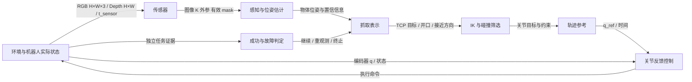
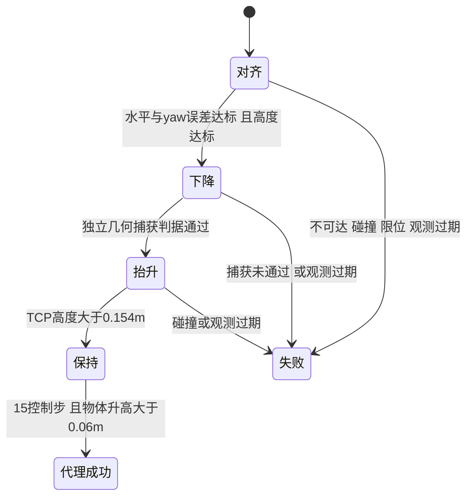
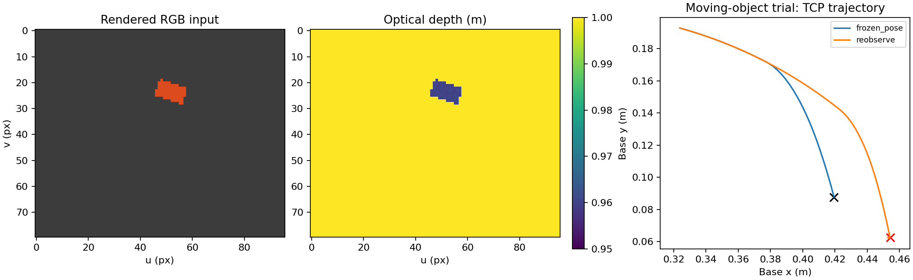
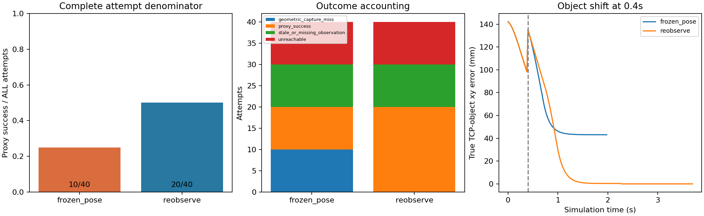

# D55 · 从能运行的模块到有证据的机器人闭环

[返回学习入口](../_index.md) ｜ [本周日程](../P3-项目实战-日程.md) ｜ [上一课 D54](../day54/Daily-Learning-Pack.md) ｜ [CPU 集成实验](demo.py)

**闭环测试要证明的是：从传感器得到的估计，经过抓取、运动与控制，真的改变了环境，并且下一次观测能发现偏差、修正动作或终止失败。仅仅把模块串起来、看到末端到达某个坐标，还没有证明抓取成功。**

本课是 Π-1 / W8-D6，承接 D54 的路径、轨迹与动作日志，把本周 RGB-D、ROI、位姿、抓取变换、IK 和执行记录接成一个可检查的系统。贯穿问题仍是“机械臂怎样可靠地抓起桌上的杯子”。为使没有硬件的环境也能实际运行，今天的 CPU 实验使用矩形块和一个具有平面双连杆、升降轴、腕部旋转的教学机器人。它会真的生成 RGB-D 像素，再从像素估计目标并执行控制；它的附着规则仍是人工几何判据，不能冒充接触物理。

原定课程要求的“真实 RGB-D 或高质量仿真闭环测试”继续保留。本课先把接口与证据链跑通，并给出正式接入及验收条件。当前检查的两个 Python 环境没有 MuJoCo 或 PyBullet，未安装新包、未连接真机，正式物理抓取测试因此仍待完成。下一课 D56 将汇总 Π-1 的可复现代码、文档、演示和未完成项目项。

<details>
<summary>个人学习记录（自动更新时保留你的作答）</summary>

<!-- learner-notes:start -->

- 我的运行记录、变量修改与结果解释：
- 我的自测答案：
- 仍未理解的问题与项目接入记录：

<!-- learner-notes:end -->

</details>

<!-- daily-pack-generated:start -->

## 0. 学习目标与路线

完成本课后，应能沿着一条试验日志定位感知、坐标、可达性、轨迹跟踪、接触和观测更新中的失败；能推导 RGB-D 反投影与本例 IK，算清控制周期、相机周期和数据年龄；能明确“更新视觉目标”和“关节闭环跟踪”的区别；能用全部尝试的分母比较两种系统，并判断教学代理结果与正式抓取证据的边界。

| 顺序 | 知识主线 | 需要回答的问题 |
| --- | --- | --- |
| 宏观 | 观测—动作—环境—再观测 | 系统在哪里获得新信息，在哪里检验结果？ |
| 微观一 | RGB-D、位姿与抓取契约 | 一个像素怎样变成有单位、有参考系的抓取目标？ |
| 微观二 | IK、参考轨迹与控制 | 可解的目标为什么仍然可能无法执行？ |
| 微观三 | 状态机与成功判据 | 到达、捕获、抬升、保持分别需要什么证据？ |
| 实验 | 同场景配对与单变量干预 | 更新观测改善什么，什么误差仍然存在？ |
| 回到宏观 | 正式仿真或真实系统接入 | 还缺哪些证据，才能完成 Π-1 的系统验收？ |

## 1. 宏观：闭环里至少有三个不同的“误差”

机器人抓杯子时，感知模块报告杯子在某处，规划模块选择夹爪目标，控制模块试图跟踪参考关节状态。这里存在三个不同误差：**估计与真实环境的误差、执行目标与当前机器人状态的误差、最终任务与要求的误差**。三个误差相关，但任何一个很小都不能替代另外两个。



图中传感器回到感知形成视觉更新，编码器回到控制形成关节跟踪反馈，任务判定又形成更慢的阶段反馈。说“这是闭环”时，应说明闭的究竟是哪一条环。

### 1.1 两种方法都有关节反馈

今天只改变**视觉目标是否更新**，其他模块尽量相同：

| 方法 | 视觉目标 | 关节跟踪反馈 | 观测过期检查 | 实际测量 |
| --- | --- | --- | --- | --- |
| `frozen_pose` | 固定第一次有效位姿 | 有 | 有 | 已运行 |
| `reobserve` | 每次有效新帧更新位姿 | 有 | 有 | 已运行 |

冻结视觉目标的机器人依然能够纠正关节偏离轨迹的误差，但目标物体移动以后，它仍向旧目标前进。重新观测的机器人得到新目标，才有机会修正这一类误差。因此这里应称“冻结视觉目标与重新观测更新目标的比较”，不能笼统称“纯开环与闭环”。

两种方法还都持续检查新图像，观测失效时停止；冻结的是目标位姿，不是所有传感器输入。实验代码中开口估计也随有效帧更新，矩形块大小固定，因此这不构成目标更新对照之外的独立处理差异。

### 1.2 把不可见的真实状态与控制输入隔开

仿真环境知道物体真值。若直接把它喂给规划器，系统就绕过了你要验证的感知链。今天的真值仅用于生成 RGB-D、施加场景扰动，以及独立记录误差和几何捕获判据；控制器拿到的目标来自 RGB-D 像素。

> [!warning] 不能把仿真真值悄悄接回策略
> “仿真中有物体位置”不意味着部署中也有同样的观测。正式评价应列明每个模块可见的字段：策略可用图像、深度、关节状态；评估器可以额外使用物体真值，但只能打分和判终止。否则你测到的是带真值辅助的系统。

## 2. 微观：从 RGB-D 像素到抓取目标

### 2.1 深度的含义决定反投影公式

本例深度 $D(u,v)$ 是相机光轴方向的 $z_C$，单位米，不是沿射线的欧氏距离。内参和图像尺寸为

$$
K=\begin{bmatrix}180&0&48\\0&180&40\\0&0&1\end{bmatrix},\qquad(H,W)=(80,96).
$$

忽略镜头畸变时，针孔模型为 $u=f_xx_C/z_C+c_x$、$v=f_yy_C/z_C+c_y$。移项得到

$$
\mathbf p_C=\begin{bmatrix}(u-c_x)D/f_x\\(v-c_y)D/f_y\\D\end{bmatrix}.
$$

$u,v,c_x,c_y,f_x,f_y$ 使用像素；$D$ 以米输入，结果才以米输出。本例像素坐标直接使用数组整数索引，渲染与反投影一致。实际相机应遵循标定模型约定，不能随意加减半个像素。

相机位于机器人基座系的 $(0.4,0,1)$ m，朝向桌面。光学系 $x_C$ 对应基座 $+x_B$，$y_C$ 对应 $-y_B$，$z_C$ 对应 $-z_B$，故

$$
R_{BC}=\operatorname{diag}(1,-1,-1),\quad\mathbf t_{BC}=(0.4,0,1)^\top,
\quad\mathbf p_B=R_{BC}\mathbf p_C+\mathbf t_{BC}.
$$

这是绕 $x$ 轴旋转 $\pi$ 的正常旋转，$\det R=+1$；不是只翻转一个轴造成的镜像。

> [!question] 先算：像素 $(u,v)=(57,25)$、深度 $0.96$ m 对应哪里？
> $x_C=9\times0.96/180=0.048$ m，$y_C=-15\times0.96/180=-0.080$ m。
> 因而 $\mathbf p_B=(0.448,0.080,0.040)$ m。最后的 $4$ cm 是物体顶面高度，不能直接当作物体中心高度。

一个像素在此深度下约对应 $0.96/180=5.33$ mm。取很多点的中心可以使随机误差部分抵消，但分割边缘的系统偏差、深度偏置、外参偏差不会因为点数多自动消失。

### 2.2 颜色分割和 PCA 究竟估计了什么

今天用橙色阈值产生 ROI：红通道大于160、绿通道小于110，并要求深度有效。它是一条明确可检查的最小感知基线，不是一个已经具备真实场景泛化能力的检测网络。矩形块顶面像素投影成 $N\times3$ 点集，先取质心，再对平面坐标计算协方差：

$$
\bar{\mathbf p}=\frac1N\sum_i\mathbf p_i,\qquad
C_{xy}=\frac1N\sum_i(\mathbf p_{i,xy}-\bar{\mathbf p}_{xy})(\mathbf p_{i,xy}-\bar{\mathbf p}_{xy})^\top.
$$

$C_{xy}$ 的最大特征值对应长轴方向 $\mathbf v_1$，由 $\operatorname{atan2}(v_{1y},v_{1x})$ 得 yaw。特征向量 $\mathbf v_1$ 与 $-\mathbf v_1$ 表示同一条轴，因此 yaw 只在模 $\pi$ 的意义上确定。平行夹爪绕竖直轴旋转 $\pi$ 常对应相同夹持方向，但杯柄朝向、工具插入方向、非对称夹爪未必允许这样的等价。

对于正方形顶面，两个特征值接近，微小噪声就可能大幅改变主轴方向。对于圆杯顶面，PCA 本来就无法推断杯柄方向。这是观测不可辨识，不是增加控制增益能补救的问题。

本例假设物体稳定放在水平桌面，roll/pitch 为0，顶面高度已知，因此估计的是**具有平面支撑先验的四自由度目标 $(x,y,z,\psi)$**。它没有实现 NOCS 或 EPro-PnP，也不是一个一般6D位姿基线；原项目的物体级/类别级数据与模型选择仍须按先前协议完成。

### 2.3 物体位姿与夹爪位姿之间仍有一层几何

一般系统应显式组合

$$
{}^BT_G={}^BT_C\ {}^CT_O\ {}^OT_G.
$$

左侧是基座系下夹爪 TCP 的目标，最后一项是相对于物体选择的抓取位姿。它表达的是抓哪里、以什么朝向接近，而不是感知器输出的另一个名字。

教学实现将顶面质心作为水平抓取中心，把 yaw 作为夹爪方向，TCP 的下降目标设为顶面上方10 mm。沿短轴投影的点范围加12 mm 作为夹爪开口估计。物体真实宽度36 mm，开口还要大于等于36 mm。这里的10 mm、12 mm和后面的捕获门限是**教学夹爪坐标与规则的约定**；正式夹爪必须用指尖、掌部、TCP、可达开口和接触几何确定这些量。

| 量 | 本例 shape | 单位 / 约定 | 下游用途 |
| --- | --- | --- | --- |
| RGB | `[80,96,3]` | `uint8`，RGB顺序 | 分割 ROI |
| Depth | `[80,96]` | 光轴深度，m | 反投影 |
| mask | `[80,96]` | 布尔 | 有效观测筛选 |
| points | `[N,3]` | 基座系，m | 质心与方向估计 |
| grasp target | `[4]` | `x,y,z` m；yaw rad | IK |
| opening | scalar | m | 捕获规则与正式夹爪接口 |
| q / q_ref | `[4]` | `rad,rad,m,rad` | 控制与跟踪 |
| trace | `[T,9]` | 时间、TCP、物体真值、误差、观测年龄 | 离线诊断，不回馈目标估计 |

真实 RGB-D 接入要先完成深度单位、RGB/Depth 对齐、时间戳、畸变与裁剪后的内参检查。ROS 的 [image_pipeline 官方模块](https://github.com/ros-perception/image_pipeline)提供标定、校正与深度处理的工程入口，但接入这些模块不自动证明你的外参、单位和时间同步正确。

## 3. 微观：可达性、轨迹参考和执行反馈

### 3.1 两连杆 IK：目标可解不等于路径可走

本例平面连杆长度 $l_1=0.28$ m、$l_2=0.26$ m。由三角形余弦定理，令 $r^2=x^2+y^2$，

$$
c_2=\frac{r^2-l_1^2-l_2^2}{2l_1l_2},\qquad
q_2=\pm\arccos c_2,
$$

$$
q_1=\operatorname{atan2}(y,x)-\operatorname{atan2}(l_2\sin q_2,l_1+l_2\cos q_2).
$$

正负号给肘部两种配置；腕部角为 $q_w=\operatorname{wrap}(\psi-q_1-q_2)$，升降轴直接使用目标 $z$。若 $|c_2|>1$，三角形不存在，应明确报告不可达，而不是把 $c_2$ 强行裁剪到 $[-1,1]$ 后假装找到可执行解。

手算 $x=0.4$ m、$y=0.08$ m，有 $r^2=0.1664$，$l_1^2+l_2^2=0.1460$，$2l_1l_2=0.1456$，故 $c_2\approx0.1401$，$q_2\approx\pm1.4302$ rad。两个解的末端位置相同，连杆经过的空间不同。实验的不可达分组把物体 $x$ 放到0.60 m，而机械臂总长0.54 m；相机仍看得到目标，不能因此推断机械臂抓得到它。

代码对两条候选关节直线路径各采样21个配置，检查两段平面连杆到圆障碍的距离，并施加部分关节/升降限位，再选择角度变化较小的可用分支。它解决的是一个很小的几何筛选问题。

> [!warning] 这里的碰撞通过有明确范围
> 检查对象只有平面两连杆及一个圆障碍，不包含完整机械臂外壳、自碰撞、夹爪、附着物、桌面接触和连续时间碰撞。21个采样点也不是连续碰撞证明；各关节独立限速产生的实际轨迹还可能不同于候选直线。因此执行中再次检查当前几何配置，但仍只得到采样条件下的教学结论。

### 3.2 从目标到参考，再从参考到命令

控制周期 $\Delta t=0.02$ s，相机周期 $T_c=0.1$ s。相机每5个控制步产生新帧。把目标关节角直接写入机器人状态会跳过真实执行，本例则先限制参考变化：

$$
q^{ref}_{k+1}=q^{ref}_k+\operatorname{clip}(q^{goal}_k-q^{ref}_k,-v_{max}\Delta t,v_{max}\Delta t).
$$

$v_{max}=(0.7,0.7,0.12,1.2)$，前两项及最后一项为rad/s，第三项为m/s。控制器再根据状态反馈计算

$$
u_k=\operatorname{clip}\bigl(8(q^{ref}_{k+1}-q_k),-v_{max},v_{max}\bigr),\qquad
q_{k+1}=q_k+0.85u_k\Delta t.
$$

$u$ 是本例期望关节速度；0.85是预设的速度跟踪比例。实际设备可能接收位置、速度、力矩或专用动作消息，不能把同一数组无解释地发给任意接口。这里没有质量、惯量、电机力矩和接触力，也没有加速度、jerk约束。

当参考恒定且没有饱和时，设 $e_k=q^{ref}-q_k$，代入可得

$$
e_{k+1}=(1-0.85\times8\times0.02)e_k=0.864e_k.
$$

例如10 mm的升降误差一步后变成8.64 mm。系数绝对值小于1说明**这个一阶教学跟踪器**在这些假设下误差衰减；它不是实际机械臂动力学稳定性证明。参考运动、速度饱和、传感延迟或柔性接触会改变分析条件。

从工程上看，参考限速避免跳变，反馈纠正参考与实际状态之间的差异，IK和碰撞过滤约束目标。三个模块承担不同工作。可参照 [Modern Robotics 速度输入运动控制](https://modernrobotics.northwestern.edu/nu-gm-book-resource/11-3-motion-control-with-velocity-inputs-part-1-of-3/)对照“上层假定速度输入可跟踪”这一建模前提，再思考真机驱动内部还有哪些控制环。

### 3.3 新帧不是“最近读到的任意数据”

本例记录最后一次有效感知时间 $t_{seen}$，观测年龄为

$$
\operatorname{age}=t_{control}-t_{seen}.
$$

年龄超过0.25 s时停止，缺少首帧也停止。模拟中所有模块共用一个时间轴，真实ROS系统则要区分传感器采集时间、主机接收时间、控制发送时间和执行反馈时间；主机现在读到旧帧，不能把旧帧改标为“现在”。

如果物体横向速度0.1 m/s，仅0.25 s未知运动就可能造成25 mm位移，明显大于本例8 mm横向捕获门限。因此0.25 s只是演示超时机制的固定阈值，不是通用安全界限。实际容许年龄应由物体运动上界、感知不确定性、控制响应和抓取余量共同决定。

## 4. 微观：成功必须跨过阶段边界

### 4.1 一个最小可解释状态机



本例先在 $z=0.14$ m对齐，下降到估计顶面上方10 mm，满足捕获条件后抬升到0.16 m，再保持15步即0.3 s。代码还规定总步数上限300，超出则记录超时。这里的秒数是算法采样与实验定义，不是学习时间安排。

几何捕获条件同时检查真实横向误差小于8 mm、TCP与真实目标高度误差小于6 mm、yaw在模 $\pi$ 意义下误差小于0.26 rad，以及开口不小于36 mm。控制阶段的对齐门限则是相对于估计目标的5 mm与0.12 rad，二者不能混为一谈：**估计坐标系里已对齐，真实环境里仍可能抓空。**

捕获一旦通过，仿真把物体位置强制附着到TCP。此后没有滑移、脱落、力不足或破坏物体的过程。因而日志里捕获后物体与TCP的水平误差变为0，是规则赋值的结果，不能拿来证明真实抓取很稳定。

### 4.2 正式成功判据应该有独立证据

对一个正式“抓起并保持”任务，可以预注册

$$
S_i=I_{capture,i}\,I_{lift,i}\,I_{hold,i}\,I_{allowed\ contact,i},
$$

各项都是0或1。捕获可以由接触/夹爪状态与物体运动共同确认；抬升测量物体相对初态的高度；保持要求一个指定区间内持续满足条件；允许接触约束区分正常指尖接触与机械臂撞桌等情况。门限须在比较前确定，并与场景、物体和任务一致。

真实RGB-D可以提供独立物体轨迹，触觉或夹爪反馈可以补充接触证据。若成功判断与策略使用同一份偏置位姿，二者可能一起错：控制器认为已到目标，评估器也认为已抓起。这时需要独立观测、标记系统、额外视角或人工审核过的回放样本。

本例只实现“几何捕获 + 强制附着 + 高度增加 + 保持步数”的代理成功，没有完整接触允许性证据，所以字段名明确为 `proxy_success`，所有记录中 `physical_grasp_validated=False`。

## 5. 工程实验：同一初态、全部尝试、可归因失败

### 5.1 四种场景各10次，不在看到结果后换分母

每种方法运行40次。种子为 `5500 + case_id`，每种方法重置对应种子；初态、预设扰动和共同时间段内的噪声流一致，方法早停以后不强求继续产生相同长度的序列。每次都从相同机器人配置开始。

| 场景 | 每方法尝试数 | 干预 | 测什么 |
| --- | --- | --- | --- |
| 静态目标 | 10 | 不移动 | 基本感知—执行链能否完成 |
| 目标移动 | 10 | 0.4 s时水平移动 $(35,-25)$ mm | 视觉目标更新能否纠偏 |
| 观测丢失 | 10 | 0.4 s起目标在图像中消失 | 能否按过期规则停止 |
| 不可达目标 | 10 | 目标 $x=0.60$ m | 是否报告不可达并保留试验记录 |

这是预先设计的均衡压力测试组合，不代表用户实际部署的场景频率。若部署中不可达目标只有1%，不能直接把这里25%的占比外推成产品表现。

总体代理成功率为

$$
\widehat p=\frac{N_{proxy\ success}}{N_{all\ attempts}},\qquad
N_{all\ attempts}=N_{proxy\ success}+\sum_cN_{failure,c}.
$$

失败采用一个互斥的最终原因归档，并保留轨迹用于追查早先诱因。观测丢失后安全停止仍是本次抓取任务失败；可以另报“按要求停止”的保护机制指标，但不能把这些尝试从任务成功分母删掉。同样，可以另报可达分组结果，不能悄悄用可达分母替换总体分母。

### 5.2 实际结果：收益来自移动目标分组

本课于2026-10-29在CPU执行，Python3.11.15、NumPy1.26.4、Matplotlib3.10.9。默认配置共80次，两方法各40；完整逐次记录见 [trials.csv](../../_assets/3d_learning/day55/trials.csv)，结构化摘要见 [results.json](../../_assets/3d_learning/day55/results.json)。

| 场景 | 冻结视觉目标 | 重新观测更新目标 |
| --- | --- | --- |
| 静态 | 10/10 | 10/10 |
| 移动 | 0/10 | 10/10 |
| 观测丢失 | 0/10 | 0/10 |
| 不可达 | 0/10 | 0/10 |
| 全部尝试 | **10/40** | **20/40** |

因此本组差异来自移动目标：新观测修正了目标位置。两方法的关节跟踪器没有改变。无法把这一结果解释成所有反馈问题均被解决，也不能推断真实杯子抓取率50%。40个初态和规定扰动只支持这个教学场景的结论。



左图是控制器实际使用的合成RGB，中图是轴向深度，右图是同一移动试验的TCP轨迹。黑色叉号是初始物体位置，红色叉号是移动后的目标。此图回答“感知输入是什么，更新后的目标有没有改变执行路径”，不证明接触质量。渲染器只画桌面和物体顶面，没有画机械臂，因此不存在手臂遮挡造成的图像挑战。



第一幅使用全部40次尝试作为分母；第二幅堆叠结果应恰好加到40；第三幅标出0.4 s目标移动，展示同一场景的真实水平误差。重新观测方法后段误差为0受人工附着规则影响，不能当作接触动力学验证。原始轨迹保存为 traces.npz (not exported: excluded by publication policy)。

### 5.3 单变量实验：视觉闭环也会追着错误标定走

保持初态、场景、随机种子、控制参数和判据不变，只在反投影之前给深度加一个固定偏置 $b$。渲染的真实深度和独立评估器不改变：

$$
\widetilde D=D+b,\qquad
\widetilde z_B=1-\widetilde D=z_B-b.
$$

横向坐标还会因 $\widetilde D$ 改变比例，因此偏置并非只影响高度。不过在本例，较大的高度偏差已经足以让捕获门限失败。

| 深度偏置 | 冻结视觉目标 | 重新观测更新目标 | 实际输出 |
| --- | --- | --- | --- |
| 0 mm | 10/40 | 20/40 | [默认结果](../../_assets/3d_learning/day55/results.json) |
| +8 mm | 10/40 | 20/40 | [8 mm结果](../../_assets/3d_learning/day55/depth_bias8/results.json) |
| +16 mm | 0/40 | 0/40 | [16 mm结果](../../_assets/3d_learning/day55/depth_bias16/results.json) |

三组各80次，共240次教学仿真尝试。+16 mm时，两方法都记录20次几何捕获失败、10次观测过期、10次不可达。**重复观测同一偏置传感器，不会凭空建立正确的绝对几何。**

为什么8 mm不一定失败？下降阶段在TCP距离估计目标小于4 mm时就触发捕获，而TCP仍可能处于下降目标上方；独立高度容许误差为6 mm，瞬态位置可能仍落入容许范围。因此不能只看“8大于6”就断言失败，必须把阶段触发条件、动态状态和最终门限一起代入。8 mm结果没有证明标定正确，只说明这些有限场景仍通过代理规则。

这也是为什么门限应提前固定：如果看到16 mm失败后把门限改到20 mm，就改变了成功定义，不能再说算法已经学会补偿偏置。

## 6. 动手：先预测，再运行，再解释边界

### 6.1 先写下三条预测

先回答：目标移动后哪个模块首先需要改变输出？两方法在观测消失时是否都应停止？将深度统一加16 mm后，增加重观测次数能否恢复正确高度？再打开图和计数检验你的推断。

脚本依赖 `numpy` 和 `matplotlib`，不依赖GPU、ROS、机器人、训练权重或外部数据。若你的Python尚无依赖，可在你自己的实验环境安装 `numpy matplotlib`；本次验证使用已有环境，没有执行安装。

在笔记库根目录运行：

```bash
python3 3d_learning/day55/demo.py
python3 3d_learning/day55/demo.py --depth-bias-mm 8 --out-dir /tmp/day55-bias8
python3 3d_learning/day55/demo.py --depth-bias-mm 16 --out-dir /tmp/day55-bias16
```

默认结果保存到本课附件目录；变量实验可指定独立输出目录，避免覆盖默认结果。本次已验证的变量实验另外归档到上述 `depth_bias8` 和 `depth_bias16`。每次输出 `results.json`、全部尝试CSV、一个移动场景的NPZ轨迹及两张PNG图。

默认配置用于执行80次试验的本机墙钟记录约3.46 s，8 mm约3.53 s，16 mm约2.58 s；计时在绘图之前结束。它包括合成渲染与整套试验循环，不能解释为单次真实模型推理延迟。仿真控制周期0.02 s是逻辑时间，也不由墙钟运行速度决定。

### 6.2 只改一个变量，再画一张解释图

先只改 `--depth-bias-mm`，把两种方法成功数随偏置的变化整理为图；不要同时提高门限或调整控制增益。若想进一步研究丢帧，可另开一组独立实验，把连续失效起点或过期阈值作为唯一变量，并注明与本课默认结果不可混并。

检查这四条守恒/接口条件：每个方法的结果计数总和等于尝试数；每种条件的数量一致；观测过期时没有继续执行；控制器没有读取物体真值来更新目标。最后解释至少一次失败的“最早诱因→阶段触发→终止原因”，不要只把终止字符串翻译成中文。

### 6.3 完整可复制代码

[独立脚本 demo.py](demo.py) 与下方代码内容一致。代码的核心不是训练网络，而是把观测、动作、环境、判据和记录连接成可检查的最小系统。

<details>
<summary>展开完整 CPU 实验代码</summary>

```python
"""D55: RGB-D -> pose -> IK -> rate-limited control -> sensor feedback.
This is a kinematic teaching simulator with an explicit geometric attachment rule.
It has NO rigid-body contact dynamics and does NOT validate physical grasp success.
"""
from pathlib import Path
from collections import Counter
import argparse, csv, json, platform, time
import numpy as np
import matplotlib
matplotlib.use('Agg')
import matplotlib.pyplot as plt

H,W=80,96
K=np.array([[180.,0,48],[0,180.,40],[0,0,1]])
CAM=np.array([.4,0,1.])
L=np.array([.28,.26]); DT=.02; SENSOR_EVERY=5
OBJECT_HALF=np.array([.03,.018]); HEIGHT=.04
MAX_RATE=np.array([.7,.7,.12,1.2])  # rad/s, rad/s, m/s, rad/s
Q0=np.array([1.3,-1.6,.14,.3])
OBSTACLE=np.array([.14,-.16]); OBSTACLE_R=.025


def wrap(a): return (np.asarray(a)+np.pi)%(2*np.pi)-np.pi


def fk(q):
    elbow=L[0]*np.array([np.cos(q[0]),np.sin(q[0])])
    end=elbow+L[1]*np.array([np.cos(q[0]+q[1]),np.sin(q[0]+q[1])])
    return elbow,end,float(wrap(q[0]+q[1]+q[3]))


def segment_distance(p,a,b):
    v=b-a;s=np.clip(np.dot(p-a,v)/np.dot(v,v),0,1)
    return float(np.linalg.norm(p-a-s*v))


def clear(q):
    elbow,end,_=fk(q)
    return min(segment_distance(OBSTACLE,np.zeros(2),elbow),segment_distance(OBSTACLE,elbow,end))>OBSTACLE_R+.012


def ik(target,q):
    x,y,z,yaw=target
    c=(x*x+y*y-np.dot(L,L))/(2*np.prod(L))
    if abs(c)>1:return None,'unreachable'
    candidates=[]
    for q2 in [np.arccos(c),-np.arccos(c)]:
        q1=np.arctan2(y,x)-np.arctan2(L[1]*np.sin(q2),L[0]+L[1]*np.cos(q2))
        g=np.array([q1,q2,z,float(wrap(yaw-q1-q2))])
        if abs(q2)>2.8 or not (.01<=z<=.25):continue
        path=q+np.linspace(0,1,21)[:,None]*(g-q)
        if all(clear(p) for p in path):candidates.append(g)
    if not candidates:return None,'collision_or_limit'
    return min(candidates,key=lambda g:np.linalg.norm(g[[0,1,3]]-q[[0,1,3]])),None


def render(obj,noise,hidden=False):
    # Camera optical x -> base x; optical y -> -base y; optical z -> -base z.
    vv,uu=np.indices((H,W));ztop=obj[2]+HEIGHT/2;d=1-ztop
    worldx=CAM[0]+(uu-K[0,2])*d/K[0,0]
    worldy=-(vv-K[1,2])*d/K[1,1]
    dx=worldx-obj[0];dy=worldy-obj[1];c,s=np.cos(obj[3]),np.sin(obj[3])
    mask=(abs(c*dx+s*dy)<OBJECT_HALF[0])&(abs(-s*dx+c*dy)<OBJECT_HALF[1])
    if hidden:mask[:]=False
    rgb=np.full((H,W,3),60,dtype=np.uint8);rgb[mask]=[220,75,30]
    depth=np.ones((H,W));depth[mask]=d+noise[mask]
    return rgb,depth


def perceive(rgb,depth,bias_m):
    mask=(rgb[:,:,0]>160)&(rgb[:,:,1]<110)&(depth>0)&(depth<1.1)
    v,u=np.nonzero(mask)
    if len(u)<12:return None
    d=depth[v,u]+bias_m
    points=np.c_[CAM[0]+(u-K[0,2])*d/K[0,0],-(v-K[1,2])*d/K[1,1],1-d]
    center=points.mean(0);xy=points[:,:2]-center[:2]
    _,vectors=np.linalg.eigh(xy.T@xy/len(xy));axis=vectors[:,-1]
    yaw=(np.arctan2(axis[1],axis[0])+np.pi/2)%np.pi-np.pi/2
    minor=np.array([-np.sin(yaw),np.cos(yaw)])
    opening=float(np.ptp(xy@minor)+.012)
    if not .02<opening<.07:return None
    return np.array([center[0],center[1],center[2]+.01,yaw]),opening


def trial(case,policy,bias_m):
    # Each method sees identical initial state, shifts and sensor noise stream.
    rng=np.random.default_rng(5500+case)
    obj=np.array([rng.uniform(.37,.44),rng.uniform(.05,.11),.02,rng.uniform(-.4,.4)])
    mode=['static','object_shift','sensor_loss','unreachable'][case%4]
    if mode=='unreachable':obj[0]=.60
    initial=obj.copy();q=Q0.copy();reference=q.copy();stage='align'
    latest=None;fixed=None;last_seen=-np.inf;opening=0;attached=False;hold=0;reason='timeout'
    trace=[];images=None
    for step in range(300):
        t=step*DT
        if mode=='object_shift' and step==20:obj[:2]+=np.array([.035,-.025])
        if step%SENSOR_EVERY==0:
            noise=rng.normal(0,.0005,(H,W))
            rgb,depth=render(obj,noise,hidden=mode=='sensor_loss' and step>=20)
            if images is None:images=(rgb.copy(),depth.copy())
            estimate=perceive(rgb,depth,bias_m)
            if estimate is not None:
                latest,opening=estimate;last_seen=t
                if fixed is None:fixed=latest.copy()
        if latest is None or t-last_seen>.25:reason='stale_or_missing_observation';break
        goal=(latest if policy=='reobserve' else fixed).copy()
        if stage=='align':goal[2]=.14
        elif stage in ['lift','hold']:goal[2]=.16
        g,fail=ik(goal,q)
        if g is None:reason=fail;break
        reference+=np.clip(g-reference,-MAX_RATE*DT,MAX_RATE*DT)
        velocity=np.clip(8*(reference-q),-MAX_RATE,MAX_RATE)
        q+=.85*velocity*DT  # explicitly prescribed first-order velocity tracking
        elbow,ee,yaw=fk(q)
        if not clear(q):reason='sampled_collision';break
        if attached:obj=np.array([ee[0],ee[1],q[2]-.03,yaw])
        error=float(np.linalg.norm(ee-obj[:2]))
        trace.append([t,ee[0],ee[1],q[2],obj[0],obj[1],obj[2],error,t-last_seen])
        aligned=np.linalg.norm(ee-goal[:2])<.005 and abs(float(wrap(yaw-goal[3])))<.12
        if stage=='align' and aligned and abs(q[2]-.14)<.004:stage='descend'
        elif stage=='descend' and aligned and abs(q[2]-goal[2])<.004:
            # Privileged simulator truth is used ONLY for this geometric contact proxy.
            yaw_error=abs((yaw-obj[3]+np.pi/2)%np.pi-np.pi/2)
            attached=error<.008 and abs(q[2]-(obj[2]+HEIGHT/2+.01))<.006 and yaw_error<.26 and opening>=.036
            if not attached:reason='geometric_capture_miss';break
            stage='lift'
        elif stage=='lift' and q[2]>.154:stage='hold'
        elif stage=='hold':
            hold+=1
            if hold>=15:
                reason='proxy_success' if attached and obj[2]-initial[2]>.06 else 'lift_check_failed'
                break
    result=dict(case=case,condition=mode,policy=policy,outcome=reason,proxy_success=reason=='proxy_success',
                simulation_seconds=round(step*DT,3),sensor_frames=step//SENSOR_EVERY+1,
                final_true_xy_error_mm=float(trace[-1][7]*1000) if trace else None,
                physical_grasp_validated=False)
    return result,np.asarray(trace),images,initial


def main():
    ap=argparse.ArgumentParser();ap.add_argument('--depth-bias-mm',type=float,default=0)
    ap.add_argument('--trials',type=int,default=40)
    ap.add_argument('--out-dir',type=Path,default=Path(__file__).resolve().parents[2]/'_assets/3d_learning/day55')
    args=ap.parse_args()
    if args.trials<4 or args.trials%4:raise ValueError('trials must be a positive multiple of 4')
    out=args.out_dir;out.mkdir(parents=True,exist_ok=True);start=time.perf_counter()
    rows=[];traces={};snap=None
    for policy in ['frozen_pose','reobserve']:
        for case in range(args.trials):
            row,trace,images,initial=trial(case,policy,args.depth_bias_mm/1000);rows.append(row)
            if case==1:traces[policy]=trace;snap=images;start_object=initial
    summary={}
    for policy in ['frozen_pose','reobserve']:
        subset=[r for r in rows if r['policy']==policy]
        summary[policy]=dict(attempts=len(subset),proxy_successes=sum(r['proxy_success'] for r in subset),
                            outcomes=dict(Counter(r['outcome'] for r in subset)),
                            by_condition={c:dict(successes=sum(r['proxy_success'] for r in subset if r['condition']==c),
                            attempts=sum(r['condition']==c for r in subset)) for c in ['static','object_shift','sensor_loss','unreachable']})
    results=dict(seed_rule='5500 + case_id, reset separately for each method',python=platform.python_version(),
      numpy=np.__version__,matplotlib=matplotlib.__version__,depth_bias_mm=args.depth_bias_mm,
      control_dt_s=DT,camera_period_s=DT*SENSOR_EVERY,summary=summary,wall_seconds=time.perf_counter()-start,
      scene='analytic RGB-D pinhole camera, rectangular block, planar 2R plus vertical and wrist axes',
      success_definition='geometric capture AND synthetic attachment AND >60mm rise AND 15-step hold',
      limitations=['no MuJoCo/PyBullet','no contact/friction/inertia','no real RGB-D','no official pose model','not project physical-grasp acceptance'])
    (out/'results.json').write_text(json.dumps(results,indent=2),encoding='utf-8')
    with (out/'trials.csv').open('w',newline='') as f:
        writer=csv.DictWriter(f,fieldnames=list(rows[0]));writer.writeheader();writer.writerows(rows)
    np.savez(out/'traces.npz',**traces)
    fig,axes=plt.subplots(1,3,figsize=(13,4),layout='constrained')
    axes[0].imshow(snap[0]);axes[0].set(title='Rendered RGB input',xlabel='u (px)',ylabel='v (px)')
    im=axes[1].imshow(snap[1],vmin=.95,vmax=1,cmap='viridis');axes[1].set(title='Optical depth (m)',xlabel='u (px)');fig.colorbar(im,ax=axes[1])
    for policy,trace in traces.items():axes[2].plot(trace[:,1],trace[:,2],label=policy)
    axes[2].scatter([start_object[0],start_object[0]+.035],[start_object[1],start_object[1]-.025],c=['black','red'],marker='x',s=70)
    axes[2].set(xlabel='Base x (m)',ylabel='Base y (m)',title='Moving-object trial: TCP trajectory');axes[2].axis('equal');axes[2].legend(fontsize=8)
    fig.savefig(out/'sensor_to_control.png',dpi=160);plt.close(fig)
    fig,axes=plt.subplots(1,3,figsize=(13,4),layout='constrained')
    policies=list(summary)
    axes[0].bar(policies,[summary[p]['proxy_successes']/args.trials for p in policies],color=['#da6d3e','#2878a1'])
    for i,p in enumerate(policies):axes[0].text(i,.03,f"{summary[p]['proxy_successes']}/{args.trials}",ha='center')
    axes[0].set(ylim=(0,1),ylabel='Proxy success / ALL attempts',title='Complete attempt denominator')
    reasons=sorted(set(r['outcome'] for r in rows));bottom=np.zeros(2)
    for reason in reasons:
        values=np.array([summary[p]['outcomes'].get(reason,0) for p in policies]);axes[1].bar(policies,values,bottom=bottom,label=reason);bottom+=values
    axes[1].set(ylabel='Attempts',title='Outcome accounting');axes[1].legend(fontsize=6,loc='upper left')
    for policy,trace in traces.items():axes[2].plot(trace[:,0],trace[:,7]*1000,label=policy)
    axes[2].axvline(.4,ls='--',c='gray');axes[2].set(xlabel='Simulation time (s)',ylabel='True TCP-object xy error (mm)',title='Object shift at 0.4s');axes[2].legend(fontsize=8)
    fig.savefig(out/'closed_loop_results.png',dpi=160);plt.close(fig)
    print(json.dumps(results,indent=2))

if __name__=='__main__':main()
```

</details>

## 7. 回到宏观：接入正式 RGB-D 或高质量仿真

### 7.1 哪些接口可以保持，哪些模块必须替换

教学实验已经验证了数据流、方法配对、故障分母和一部分状态机逻辑。正式项目应保持这些记录与协议，同时替换下列模块：

| 教学模块 | 正式接入要求 | 必须重新验证的证据 |
| --- | --- | --- |
| 顶面解析渲染 | 真实RGB-D，或物理仿真相机与遮挡 | 深度含义、标定、对齐、可见性、时间戳 |
| 颜色阈值与平面PCA | 已选检测/分割及物体级或类别级位姿模型 | 数据条件匹配、真实误差、对称协议 |
| 平面2R+升降+腕 | 与实际机器人一致的URDF/MJCF、运动学和约束 | FK/IK、关节顺序、单位、完整碰撞体 |
| 一阶速度跟踪 | 实际驱动控制接口，或带执行器的动力学 | 命令语义、饱和、时延、跟踪误差 |
| 强制附着 | 物理接触、摩擦、夹爪运动与物体自由动力学 | 是否真夹住、滑移、掉落、抬升和保持 |
| 几何成功代理 | 独立任务评估器 | 全部尝试计数、允许接触、全过程证据 |

MuJoCo的 [Python文档](https://mujoco.readthedocs.io/en/stable/python.html)给出模型/数据对象及步进接口；[仿真循环说明](https://mujoco.readthedocs.io/en/stable/programming/simulation.html)解释模型、状态与控制的关系。下面是接入契约伪代码，**不是本次已经运行的物理实验**：

```python
# 伪代码：具体模型、相机和执行器映射必须由项目提供。
model = mujoco.MjModel.from_xml_path("project_robot_and_scene.xml")
data = mujoco.MjData(model)
reset_with_registered_initial_state(model, data, seed)
while not terminal:
    observation = camera_and_joint_observation(model, data)
    # 图像/深度/关节可见；物体真值不直接给 perception 或 policy。
    estimated_pose = perception(observation)
    command = pipeline(observation, estimated_pose, previous_feedback)
    data.ctrl[:] = map_to_declared_actuator_semantics(command)
    mujoco.mj_step(model, data)
    previous_feedback = read_execution_feedback(data)
    terminal = independent_task_evaluator(model, data, logs)
```

`data.ctrl` 的物理意义由执行器模型决定，可能是力矩或某类伺服目标；不是通用的关节位置数组。相机深度也必须确认渲染输出的量与单位，再接入反投影。若环境提供相机观测与物体状态两套输入，正式“由感知驱动”的实验不能同时让策略访问物体真值。可阅读 [robosuite环境接口](https://robosuite.ai/docs/modules/environments.html)中的相机/物体观测、控制频率和episode长度参数，设计你的适配层；本次没有安装或执行robosuite。

物理引擎还需要正确的质量、惯量、关节限位、接触几何、摩擦、求解器及步长设置。[MuJoCo计算与接触模型](https://mujoco.readthedocs.io/en/stable/computation/index.html)说明其建模方法。使用物理引擎会引入更丰富的动力学约束，但不会自动消除仿真到真实的差异；过大的摩擦或穿透容忍可能让错误抓取看起来可行。

### 7.2 正式测试计划：保留原项目验收，不虚构已通过

以下是 D56 应核对的待验证项。今天不把它们勾选成完成：

- 在实际RGB-D或高质量物理仿真中，运行已选定的感知与位姿基线；记录物体级/类别级假设、数据版本与模态，不能用本课PCA替代正式模型结果。
- 明确TCP与抓取坐标变换、夹爪宽度和接近方向，验证完整机器人、夹爪与附着物的碰撞范围，以及实际控制频率与动作保持方式。
- 预注册抓取、抬升、保持或放置的成功门限，记录全部初始尝试，包括感知失败、不可达、超时、碰撞和掉落；保护性停止与任务成功分别报告。
- 保存配对初态、随机种子、模型/依赖版本、标定、动作日志、图像及独立评估证据；回放一次成功和每类代表性失败，确认成功判据未读取错误字段。
- 比较观察更新策略时固定模型与控制器，比较模型时固定观察模态、数据/交互预算与任务协议；报告端到端时延分布及观测年龄，不能只报网络前向耗时。

真实硬件实验还需在具备相应操作授权和环境条件下开展，本课未连接或操纵真机。没有真实/物理实验时，项目报告应明确列出缺项，而不是把教学脚本次数填进真实抓取次数。

### 7.3 VLA 与世界模型怎样进入同一证据链

VLA 可以替代部分从观测到动作目标的决策；世界模型可以根据候选动作预测结果，辅助打分或规划。两者都需要声明动作参考系、单位、周期、chunk执行范围及终止条件。

```text
统一观测包：RGB-D + 关节/夹爪状态 + 时间戳 + 标定版本
    ├─ 模块化感知 → 抓取/IK/轨迹目标
    ├─ VLA → 动作 chunk → 统一动作适配器
    └─ 候选动作 → 世界模型预测 → 评分/选择 → 统一动作适配器
统一执行与独立评估：相同初态、动作周期、任务判据、失败分母与日志
```

一个长度10的chunk若每步0.02 s，就是覆盖0.2 s的动作计划；若期间不重规划，视觉信息再新也未必进入执行决策。世界模型若只在正常观测上训练，却用来评分丢帧后的场景，也要报告分布变化与预测不确定性。比较时需要同时报告成功数、尝试数、动作调用次数、计算延迟、训练数据/环境交互预算。

本课只实际执行了冻结/更新视觉目标两种模块化方法。未运行VLA、未训练世界模型、未进行三方法排行榜。这里提供的是接入位置与公平对照契约，后续W11–W14再落实模型与同任务实验。

## 8. 今日总结与产出物

感知输出必须经过坐标、抓取、运动和执行环节才能作用于环境；重新观测能纠正环境变化造成的旧目标错误，但不自动消除标定偏置。成功判断必须由独立证据跨过捕获、抬升和保持阶段，并把每次失败保留在完整分母中。教学闭环的价值是让接口与因果关系可检查，正式物理抓取能力仍须用原定真实RGB-D或高质量仿真测试建立证据。

今天最值得保留的五个结论：

1. **先说明反馈闭在哪一层。** 否则会把关节跟踪收益错误归因给视觉更新，无法决定应该修哪个模块。
2. **估计目标与真实任务要分开。** 估计坐标中的残差很小，仍可能因系统偏置错过物体。
3. **状态机门限要联合理解。** 8 mm偏置仍通过的现象依赖下降触发和捕获门限，不能只比较一个数。
4. **每次尝试都有去处。** 保留不可达、过期和捕获失败，才能同时评估任务完成率与故障处理行为。
5. **成功证据与建模能力对应。** 强制附着只能验证代理流程，无法评价摩擦、接触、滑移或夹持力。

最容易混淆的三个边界是：冻结视觉目标并不取消关节反馈；TCP到达并不等于物体被抓起；使用仿真工具并不自动得到真实可靠的抓取评价。

今日应留下：一张标明数据、时间戳和真值边界的系统图；默认与单变量实验记录；一个失败的逐阶段归因；一份正式接入仍缺哪些证据的清单。讲义和脚本已准备、CPU教学实验已验证，用户个人学习与正式项目验收均未据此判定完成。

## 9. 自测：从接口到实验判断

每题0–2分，共16分。先独立作答，文末再核对；建议至少12分且第4、6、8题不能为0，作为继续整理项目报告的参考条件。

1. 为什么本课 `frozen_pose` 仍是具有关节反馈的系统？它冻结的是什么，保留了哪些观察与控制机制？
2. 用本例内参，算像素 $(57,25)$、深度0.96 m在基座系的三维位置。为什么结果的 $z$ 不是物体中心高度？
3. 目标 $x=0.4,y=0.08$ m时，计算 $c_2$ 和两种 $q_2$；两种解为什么不能只按末端误差选择？
4. 恒定参考、未饱和时，推导 $e_{k+1}=0.864e_k$。这是否证明真实机械臂接触抓取稳定？给出两条缺失假设。
5. 为什么8 mm深度偏置仍可能通过，而16 mm全部失败？分别从状态触发和真实几何解释，不能只写“噪声不同”。
6. 某方法20次代理成功、10次观测过期、10次不可达。应报告哪一个总体比例？怎样额外评价保护性停止而不污染抓取成功率？
7. 图中TCP与物体误差后来变为0，可以证明没有滑移吗？如果要正式验证物理抓取，需要替换哪条规则，并增加哪类证据？
8. 设计一个模块化方法与VLA动作chunk方法的公平对照，列出固定项、记录项，以及防止仿真真值泄漏的一项检查。

## 10. 未理解问题与次日衔接

若还不能区分观察过期、模型计算延迟与执行时延，回查D41的时间戳契约和D54的动作日志，把同一次试验的四个时间点画在同一轴上。若仍不清楚抓取变换或完整碰撞，回查D53及W7可达性筛选；若想理解接触力、滑移与控制，接续W9–W10的触觉与接触模块。VLA部署和模型辅助决策分别将在W11及W13用统一协议实作。

下一课 **D56 / W8-D7：Π-1 可复现代码、系统文档、演示与验收**。第一步从全部结果中抽出“已经运行”“已验证范围”“仍缺证据”三列，整理项目入口与失败复现；不能因为日历到了验收日，就自动把正式物理测试勾选为完成。

### 精读任务与来源核验

本课精读围绕接口和机制，不增加一篇尚未执行的模型复现记录：读 [Modern Robotics 11.3速度输入控制](https://modernrobotics.northwestern.edu/nu-gm-book-resource/11-3-motion-control-with-velocity-inputs-part-1-of-3/)的比例反馈与运动目标讨论，写出它与本例一阶跟踪器共同的假设；读 [MuJoCo仿真循环](https://mujoco.readthedocs.io/en/stable/programming/simulation.html)的初始化、状态和控制步进部分，画出你的观测与执行边界；对照 [robosuite环境接口](https://robosuite.ai/docs/modules/environments.html)的 `use_camera_obs`、`use_object_obs`、控制频率与horizon，写出哪些字段允许策略看见、哪些只允许评估器看见。以上官方页面本次已核验；物理环境接口未在本机执行。

> [!note]- 自测参考答案与判分标准（作答后展开）
> 统一标准：0分为关键概念或结果错误；1分为结论基本正确但缺少推导/边界；2分为同时说明结果、理由和题目要求的工程条件。以下不是你的实际成绩。
>
> 1. 冻结首次有效目标位姿；仍读取新帧用于有效性/开口，持续使用关节状态跟踪参考，并在观测过期时停止。说清“目标更新反馈”与“关节反馈”得2分。
> 2. 相机点为 $(0.048,-0.080,0.96)$ m，基座点为 $(0.448,0.080,0.040)$ m。它来自顶面像素，本例物体中心为顶面下方20 mm；完整算出并说明表面/中心差别得2分。
> 3. $c_2=0.0204/0.1456\approx0.1401$，$q_2\approx\pm1.4302$ rad。还要比较限位、路径/执行碰撞和配置变化；末端同一点不意味着连杆占据相同空间。
> 4. 将 $q_{k+1}=q_k+0.85\times8(q^{ref}-q_k)\times0.02$ 代入误差定义得到0.864。只对应恒定参考、未饱和的一阶离散跟踪模型；没有惯量、接触、延迟、力矩约束等真实因素。推导和限制都正确得2分。
> 5. 下降阶段在距偏置目标4 mm内触发，当前位置未必已经到偏置目标；独立捕获高度门限为6 mm，8 mm偏置在本组瞬态中仍可通过。16 mm导致真实捕获几何不满足，两方法都无法靠重复读取同一偏置自行校准。说清联合作用得2分。
> 6. 总体应为20/40；另报观测丢失分组的按期停止次数/该类尝试数，并保留这些试验为任务失败。不得把不可达和停止从总体分母移除；能区分任务指标与保护机制指标得2分。
> 7. 不能，附着后物体被强制赋值为TCP相对位置。应替换成人工附着之外的物理接触与夹爪执行模型，并用独立物体运动/接触/保持或滑移记录检验；不能把同一规则的输出作为其可靠性证据。
> 8. 固定初态、观测模态、动作单位/参考系/周期、任务与成功判据，并注明训练数据/交互预算；记录全部尝试、失败原因、chunk长度/重规划频率、端到端延迟和动作日志。检查策略输入中没有模拟器物体真值，真值只在独立评估器中使用；列出固定、记录与隔离三类内容得2分。

<!-- daily-pack-generated:end -->
