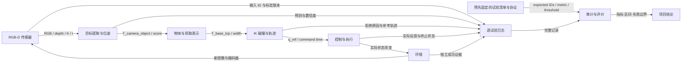
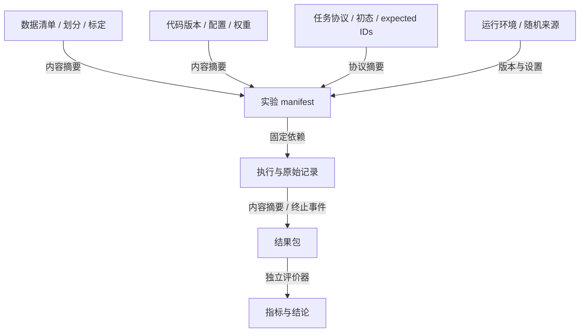
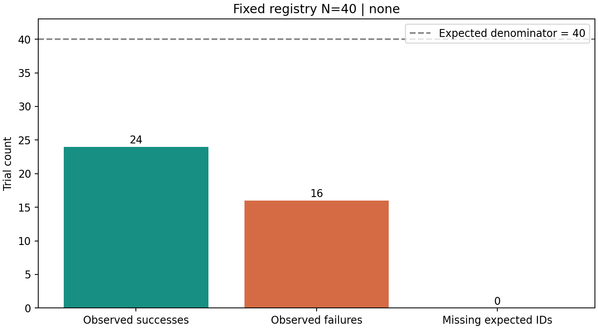
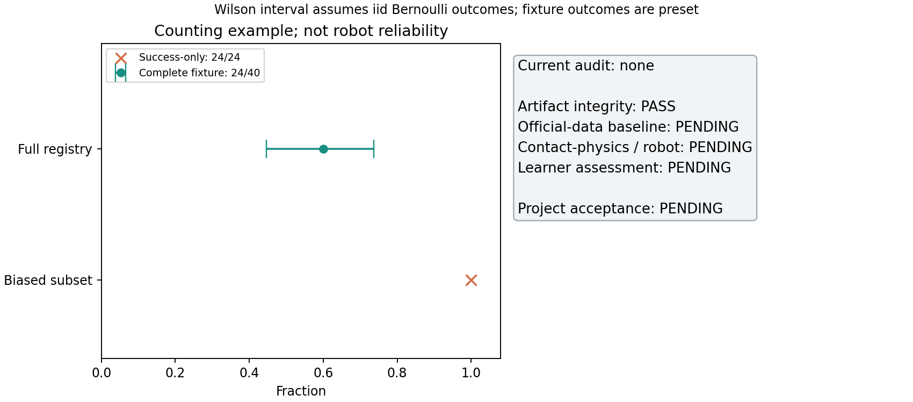

# D56 · 从一次成功演示到可复现、可核验的项目交付

[返回学习入口](../_index.md) ｜ [本周日程](../P3-项目实战-日程.md) ｜ [上一课 D55](../day55/Daily-Learning-Pack.md) ｜ [CPU 审计实验](demo.py)

**一个可交付的机器人感知系统，必须让另一位工程师沿着相同的数据、坐标约定、模型版本和评价规则，重建你的结论，并找到结论成立与失效的条件。能运行、能复跑、评估有效和任务成功，是四个需要分别证明的命题。**

本课是 Π-1 / W8-D7。D50–55 把 RGB-D 输入、目标提取、6D 位姿、抓取坐标变换、IK、轨迹和闭环反馈逐步展开；今天把这些机制收束成可以审查的代码、系统说明和演示证据。贯穿案例仍是“机械臂抓起桌上的杯子”：成功视频说明某次发生了什么，完整实验记录才允许讨论系统在什么条件下可靠。

今天的独立 CPU 实验刻意不增加一种抓取算法，而是实现一个**实验台账审计器**：给定事先登记的 40 个试验 ID，核对结果是否齐全、成功标签是否符合判据、单位与时间是否一致、内容是否发生变化。所有试验结果均为预设合成记录，不是新执行的机器人或物理仿真试验。Π-1 的正式基准与物理闭环证据仍有待补齐，个人掌握情况也仍待你的作答与实践证明。

<details>
<summary>个人学习记录（自动更新时保留你的作答）</summary>

<!-- learner-notes:start -->

- 我的运行记录、变量修改与结果解释：
- 我的自测答案：
- 我的正式项目仓库、数据协议与验收证据：
- 仍未理解的问题：

<!-- learner-notes:end -->

</details>

<!-- daily-pack-generated:start -->

## 0. 学习目标与路线

学完本课，你应能把一个“成功率提升”的说法还原为可检查的实验协议；为 RGB-D→位姿→抓取链写出含坐标、单位和时间的接口；手算完整分母、缺失结果界限和成功率区间；实现重复、遗漏、标签与内容错误检查；区分教学示例、标准数据实验、物理闭环和个人学习验收。

| 顺序 | 知识主线 | 需要回答的问题 |
| --- | --- | --- |
| 宏观 | 机器人闭环与证据链 | 一个结论由哪些实际记录支持？ |
| 微观一 | 接口与误差预算 | shape 正确为什么仍可能抓偏？ |
| 微观二 | 复现与内容身份 | 种子、哈希、环境各自保证什么？ |
| 微观三 | 分母、失败与统计 | 24/40 为什么不能变成 24/24？ |
| 微观四 | 标准协议与因果边界 | 位姿更准能否推出抓取更好？ |
| 工程组合 | Π-1 文档与演示 | 怎样让别人实际检查系统？ |
| 动手与总结 | 合成台账故障注入 | 程序检查通过后还有什么未被证明？ |

## 1. 宏观：在机器人闭环旁边建立一条证据链

先区分两个流。运行时，系统把观测转换为动作，动作改变环境，再获取新观测。评价时，系统把输入身份、每步中间量、终止状态和独立结果保存下来，供另一套规则判断。



图中上方传递运行量，下方传递证据。关键是 **试验清单不能由成功日志反推出来**。如果系统只在成功时保存文件，再把文件数当尝试数，下方证据链已经断了，即使上方每个模块都能运行。

对于一次抓取，至少要分别回答：

- 感知输出是否对应正确物体，是否使用正确的相机与时间？
- 规划器是否实际找到满足约束的轨迹，拒绝了多少次？
- 控制器执行的是哪一个目标，实际反馈与参考相差多少？
- 物体是否被抬升并保持，还是只有夹爪到达了目标位置？

“没有发生碰撞”可能来自经过检查的运动，也可能来自系统从未运动；“成功预测的平均误差很小”可能来自准确模型，也可能来自难例全部没输出。**结果解释必须包含系统选择了哪些情况、拒绝了哪些情况。**

## 2. 微观：接口不是数组形状，而是数组的物理意义

### 2.1 一份足够定位错误的接口契约

同样是 `(4,4)` 的矩阵，`T_base_camera` 与 `T_camera_base` 的意义完全不同。同样是深度数值 650，单位为毫米时是 0.65 m，单位为米时已经不是桌面场景。代码不一定报 shape 错，但机器人目标会错误。

本课约定列向量，`T_A_B` 将 B 系坐标变换到 A 系：

$$
{}^A p={}^A T_B\,{}^B p,\qquad
{}^B T_A=({}^A T_B)^{-1}.
$$

平移单位统一为 m，旋转矩阵无量纲；使用齐次点时最后一维为 1。下面是系统设计示例，不是对你现有项目架构的断言。

| 边界 | 数据与 shape | 必须同时保存的语义 |
| --- | --- | --- |
| 传感器→感知 | RGB `H×W×3`，depth `H×W`，K `3×3` | 通道顺序、深度尺度、畸变/去畸变状态、各自时间戳、是否已配准 |
| ROI→位姿 | mask `H×W`；点云 `N×3`；可选对应 `M×2 / M×3` | mask 属于原图还是裁剪图、K 如何变化、点与对应的来源 |
| 位姿→抓取 | `T_camera_object:4×4`；候选 `G×4×4`；width `G` | 物体系原点、对称约定、TCP 定义、夹爪开口 m |
| 抓取→规划 | `T_base_tcp:4×4`；q `J` | 关节顺序、rad 或 m、工具外参、碰撞几何、限位 |
| 规划→控制 | `q_ref:K×J`；time `K` | 绝对时间或相对时间、插值规则、速度/加速度约束 |
| 执行→评价 | 事件与时间序列，不强行堆成一个 tensor | reference/actual 区分、终止原因、独立成功证据、全部试验 ID |

可变点数 `N` 若 padding 成 `B×N_max×3`，必须传 `B×N_max` 的有效 mask。把 padding 零点送进中心估计，会把物体中心向相机原点拉偏；这个错误无法靠“batch shape 正确”发现。

### 2.2 沿坐标链追踪误差

物体相对相机的估计、手眼标定和物体到抓取的相对变换组合为：

$$
{}^B T_G={}^B T_C\,{}^C T_O\,{}^O T_G.
$$

这里 B 为机器人基座，C 为相机，O 为物体，G 为抓取 TCP。若控制接口要求法兰 F，还要使用工具外参：

$$
{}^B T_F={}^B T_G({}^F T_G)^{-1}.
$$

省略最后一步，不能靠提高位姿网络精度补救。D53 的工具外参实验正是这一反例。

小角度误差的工程影响可以用一阶近似计算。设物体系抓取偏置为 $r$，旋转误差向量为 $\delta\theta$（rad），平移误差为 $\delta t$（m），则：

$$
\delta p_G\approx\delta t-R[r]_\times\delta\theta,\qquad
\|\delta p_G\|\lesssim \|\delta t\|+\|r\|\,\|\delta\theta\|.
$$

$[r]_\times x=r\times x$。近似来自
$R\exp([\delta\theta]_\times)r\approx Rr+R[\delta\theta]_\times r$；
保留一阶项，要求角度足够小。上界是保守加和，不代表每次误差都会同方向。

> [!question] 先算
> 位置误差 3 mm，抓取点距物体原点 0.12 m，姿态误差 2°。抓取点误差上界约多少？

$2^\circ=0.0349$ rad，旋转项约 $0.12\times0.0349=4.19$ mm，加上平移约 7.19 mm。若夹爪容许误差只有 5 mm，单报“物体中心误差 3 mm”就遗漏了决定性的误差源。若 r 与旋转轴平行，实际旋转位移还可能很小；这说明必须关注抓取几何和误差方向。

### 2.3 时间也是几何误差的来源

设观测采集时刻 $t_s$，动作实际应用时刻 $t_a$，观测年龄 $\Delta t=t_a-t_s$。物体以近似恒速 v 移动时：

$$
\delta p_{\rm age}\approx v\Delta t.
$$

v 单位 m/s，时间单位 s。0.1 m/s 的目标遇到 80 ms 观测年龄，会移动 8 mm，足以超过上述夹爪余量。这里假设运动速度可近似恒定；加速度、网络抖动与控制排队会引入更多误差。

时间戳必须来自可比较的时钟。ROS 消息的采集时间、节点收到时间和控制器应用时间不是同一个量。单靠日志“按顺序写入”，不能证明观测新鲜。D55 的过期观测停止机制避免继续追逐陈旧目标，但停止本身应记录为终止结果，不能从成功率分母消失。

## 3. 微观：复现到底在复现什么

### 3.1 四种层次，不混用“复现成功”

| 层次 | 检查对象 | 通过示例 | 仍不能推出 |
| --- | --- | --- | --- |
| 内容一致 | 输入、配置、代码与权重字节 | SHA-256 一致 | 内容真实、算法正确 |
| 数值一致 | 相同环境运行的输出 | 位姿在约定容差内一致 | 换设备也逐位相同 |
| 统计结论稳定 | 独立场景/种子下的趋势 | 配对差值方向稳定并报告区间 | 所有新环境有效 |
| 任务有效 | 真实任务与成功定义 | 独立证据确认抬升保持 | 超出测试域的可靠性 |

设求解器两次输出 $T_1,T_2$。比较时应拆成平移差和旋转差，而不是对整个 4×4 矩阵使用一个无单位阈值：

$$
e_t=\|t_1-t_2\|_2,\qquad
e_R=\arccos\!\left(\operatorname{clip}\frac{\operatorname{tr}(R_1^\top R_2)-1}{2}\right).
$$

$e_t$ 是 m，$e_R$ 是 rad；clip 到 $[-1,1]$ 避免浮点舍入使 arccos 越界。对称物体的任务等价性还需另行判断，不能把数值不相同全部当失败。

固定种子只是复现条件之一。Python、NumPy 的独立 Generator、模型框架、数据加载 worker 和非确定性算法都可能引入不同随机来源；版本、设备和运算顺序也会改变结果。官方 [PyTorch 复现说明（版本化文档）](https://docs.pytorch.org/docs/2.15/notes/randomness.html) 明确说明跨版本、平台或 CPU/GPU 的完全一致并无普遍保证。这里引用的是文档版本，不表示本课使用该版本 PyTorch；本课脚本只用 NumPy 与 Matplotlib。

### 3.2 manifest：把“这是哪次实验”说完整

manifest（实验清单）保存输入与产物身份，使结果不会在几周后变成来源不明的数字。



这张图回答：指标变化时，究竟有哪些输入发生了变化。模型文件相同、标定文件不同，已经是不同条件的实验；只保存模型权重无法重建坐标链。

本课将 JSON 按键排序，用紧凑分隔符序列化，然后计算 SHA-256：

```python
raw = json.dumps(value, sort_keys=True, separators=(",", ":"), allow_nan=False)
sha = hashlib.sha256(raw.encode()).hexdigest()
```

`allow_nan=False` 防止不可移植的 NaN/Infinity 被悄悄放入协议。浮点序列化的约定也应固定；这段实现是课程内部的确定表示，不能直接宣称跨所有语言的规范化 JSON 标准。

内容哈希回答“与这份参考内容是否一致”，**不回答“内容是否真的来自传感器”**。如果参考台账本来就是捏造的，哈希只会稳定地证明捏造内容没有变。本课故意预设台账，正好揭示这条边界。

运行时间戳属于来源信息，但不适合作为数值复现的逐位比较目标：两次运行 `generated_utc` 和计时通常不同。脚本把稳定协议、参考记录摘要与运行时间分开；比较时应明确哪些字段要求相同，哪些只要求存在并解释。

### 3.3 缓存、AI Coding 与隐藏依赖

一个常见复现失败是：代码改变了，但缓存仍使用旧预测。解决方法是在缓存键中纳入影响结果的依赖，例如数据划分、输入预处理、权重、标定和代码版本；遇到键不匹配重新生成。单用文件名 `prediction.npy` 不足以判断结果来源。

AI Coding 能快速生成接口和评价代码，但应先做三个可验证的小例子：已知 90° 变换的方向测试、毫米/米的比例测试、失败样本不能消失的分母测试。它们验证物理语义与评价规则，比“所有函数都返回正确 shape”更接近真正风险。审计器本身也要接受故障注入，不能因为写了检查函数就认为检查有效。

## 4. 微观：从完整试验清单计算结果

### 4.1 分母必须先于结果存在

令事先登记的试验集合为 $\mathcal I$，大小 $N=|\mathcal I|$；结果记录的 ID 多重集合为 $\mathcal R$。为什么使用多重集合？因为同一个 ID 可能被重复写入，而普通集合会隐藏重复。

完整性要求至少包括：

$$
\operatorname{set}(\mathcal R)=\mathcal I,\qquad
\forall i\in\mathcal I:\operatorname{count}_{\mathcal R}(i)=1.
$$

第一条检查遗漏和陌生 ID，第二条检查重复。若还有复试，需事先定义 `trial_id / attempt_id` 与计分规则；失败后重试十次取最好一次，不能仍称一次独立试验。

今天 fixture（预设测试样本）固定 40 个 ID，其中 24 个成功，16 个失败，失败原因分成感知、IK、碰撞停止、捕获失败四类，每类 4 个。完整记录中的成功比例：

$$
\hat p=\frac{\sum_{i\in\mathcal I}y_i}{N}=\frac{24}{40}=0.60,
\quad y_i\in\{0,1\}.
$$

若只保存成功记录，错误计算会变成 $24/24=1$。这不是算法改善，而是分母改变。

> [!warning] “只评估进入最后阶段的试验”必须命名清楚
> 可以报告“已执行抓取中的成功比例”，但它是条件指标。若另有感知失败、无 IK 解或规划拒绝，必须同时报告端到端分母和各阶段流失；不能用条件成功率替代系统成功率。

### 4.2 连乘需要条件概率

设 A=目标被正确定位，B=规划被接受，C=任务成功，则：

$$
P(A\cap B\cap C)=P(A)\,P(B\mid A)\,P(C\mid A,B).
$$

这是概率链式法则，不要求模块独立。假设 100 次初态中 80 次定位正确，其中 60 次规划被接受，其中 45 次最终成功，则 $0.8\times(60/80)\times(45/60)=0.45$。

把来自不同数据集的“感知准确率 80%、规划通过率 75%、抓取率 75%”直接相乘，通常没有该链式含义。它们的分母与条件可能不同；复杂场景还会让误差相关。系统日志应记录同一 cohort（同批试验）中的阶段转移，才能解释瓶颈。

### 4.3 缺失是未知，不自动等于失败

如果预登记 40 次，但只读到 24 条成功记录，其余 16 次没有可靠终止信息，已知成功数为 $s=24$，未知数为 $m=16$。在剩余记录可信、ID 唯一、未知结果只能为 0/1 的条件下：

$$
\frac{s}{N}\le p_{\rm cohort}\le\frac{s+m}{N},
\quad\text{得到 }[0.60,1.00].
$$

这是**有限试验集合的逻辑界限**，不是统计置信区间，也不是已验证成功率。下界将未知全部取 0，上界全部取 1，仅表示当前信息允许的范围。若预先协议规定某类超时算失败，则应保存超时证据并按协议计分；不能事后根据结果喜好决定缺失算什么。

本课删除失败记录的实验已知删除行为的真相，但审计器只应根据它能读到的证据做结论：检出缺失，拒绝发布有效成功率。`results.json` 的 `validated_success_rate` 和 `wilson_95` 因此为 `null`，避免下游误把残缺台账当完整实验。

### 4.4 成功标签也必须被核对

本课标签规则是抬升不少于 0.08 m、保持不少于 1 s、无碰撞。形式化为：

$$
y_i=\mathbf1[
h_i\ge0.08\ {\rm m}
\land \tau_i\ge1\ {\rm s}
\land \neg c_i].
$$

h 是相对初始高度的抬升量，$\tau$ 是满足保持条件的持续时间，c 是碰撞事件。正式系统还应定义允许接触与禁止碰撞，必要时定义力阈值、持续性和物体身份。合成台账用布尔值演示逻辑，未实现接触物理。

`success=True` 与 `lift_m=0` 同时出现时，要拒绝这份记录。更深一层，真实实验中的抬升高度也应来自独立观测或物理状态，而不是把期望目标抄作测量值；否则标签和证据只是同一个错误的两种写法。

## 5. 微观：一次成功比例为什么需要区间

### 5.1 从 Bernoulli 模型到 Wilson 区间

假设每次试验独立同分布，成功变量 $Y_i\sim\operatorname{Bernoulli}(p)$，则：

$$
E[\hat p]=p,\qquad
\operatorname{Var}(\hat p)=\frac{p(1-p)}N.
$$

这里 p 是目标试验分布下未知成功概率。把它与固定 40 条记录的比例分开：前者关心重复采样的推断，后者是当前台账的描述。

Wilson score interval（Wilson 得分区间）从待检验的 p 出发，反解近似得分不等式：

$$
\frac{(\hat p-p)^2}{p(1-p)/N}\le z^2.
$$

整理成关于 p 的二次不等式：

$$
(N+z^2)p^2-(2N\hat p+z^2)p+N\hat p^2\le0.
$$

两个根给出：

$$
p_{\pm}=
\frac{\hat p+\frac{z^2}{2N}
\pm z\sqrt{\frac{\hat p(1-\hat p)}N+\frac{z^2}{4N^2}}}
{1+\frac{z^2}{N}}.
$$

z 为标准正态分位数，双侧 95% 取约 1.96。符号都无量纲，N 是独立试验数。这个区间是近似覆盖方法，不是精确二项区间；不能解释为“给定本次数据，固定参数 p 有 95% 概率落在区间内”。频率学派的覆盖解释是按相同程序反复采样构造区间时，其覆盖真值的频率约为设定水平。公式依据见 [NIST 比例区间说明](https://www.itl.nist.gov/div898/handbook/prc/section2/prc241.htm)。

代入 $N=40,\hat p=0.6,z\approx1.96$，分母约 1.096，修正中心约 0.5912，半宽约 0.1453，得到 $[0.4460,0.7365]$。即使点估计为 60%，40 次独立试验也不能支持很精细的可靠性断言。

**本课结果是预设的 24/40，因此绘图区间只演示计算公式，不构成任何机器人成功概率的证据。** 不能把合成 fixture 包装成 40 次独立物理试验。

### 5.2 视频帧不是独立试验

同一次抓取的 100 帧高度相关。若 10 次抓取各抽 100 帧，你有 1000 帧观测，但通常只有 10 次抓取层面的结果。把 N 写成 1000 会人为缩窄区间。

多场景、多物体重复测量时，统计单元应对应想推广的对象。若比较两个方法，应在相同初态配对，按场景或物体组做重采样，而不是随机打散相关帧。D49 的场景级 bootstrap 已展示这一点：30 场景×4 视图不是 120 个独立场景。

> [!question] 先判断
> 方法 A 在 20 个容易初态上 18 成功，方法 B 在另一组 20 个困难初态上 12 成功，能否说 A 更好？
>
> 两者同时改变了方法和试验分布。比例可以各自描述结果，但比较不能把差异单独归因于方法；应固定或配对初态，并保留失败、扰动和预算。

## 6. 微观：标准位姿评价与操作评价如何连接

### 6.1 不同指标回答不同问题

6D 位姿误差衡量几何估计，抓取成功衡量整个任务，端到端延迟衡量系统新信息转化为行动的速度。它们相关，却不互相等价。

ADD 的常见定义为：

$$
e_{\rm ADD}=\frac1{|\mathcal M|}\sum_{x\in\mathcal M}
\|\hat R x+\hat t-(Rx+t)\|_2.
$$

模型点集 $\mathcal M$ 必须具有已知尺度；若模型单位为 m，误差也是 m。对称物体要使用适当对称约定或相应指标，不能仅凭名称切换；带杯柄的杯子是否允许绕轴任意旋转，要按任务与模型定义判断。

作为固定协议示例，[BOP 2019 官方协议](https://bop.felk.cvut.cz/challenges/bop-challenge-2019/) 使用 VSD、MSSD、MSPD 的多阈值召回及其汇总。它的位姿 CSV 包含场景、图像、物体 ID、分数、R、t 和时间，t 使用毫米，R 按行展开；图像耗时包含上游检测/分割处理。**本地 ADD 阈值召回不能改名为官方 BOP AR。** 本课引用 2019 版本以固定语义，不暗示它代表所有后续挑战规则。

真实系统报告至少应并列保留“位姿任务的规定指标、全部尝试上的操作成功与终止原因、端到端延迟分布”。内部计算统一 m，导出指定评估器时集中转换 mm；转换代码与导出样本一起检查。

### 6.2 原候选方法必须按其输入条件复现

Π-1 保留 NOCS / EPro-PnP 原候选。NOCS 侧重类别级规范坐标与尺度/姿态恢复，EPro-PnP 原版 6DoF 路径使用学习的对应和权重后进行概率 PnP；它们的数据条件与输出语义不同，不能只用“都输出位姿”来替换。

[EPro-PnP 原版官方实现](https://github.com/tjiiv-cprg/EPro-PnP/tree/main/EPro-PnP-6DoF) 描述了基于修改 CDPN 分支的稠密对应与二维权重图。D39/D52 中用已知合成对应调用几何求解器，可以验证几何与单位，却没有运行这个学习系统。正式复现需要固定仓库 revision、权重、对象模型、数据划分、预处理与官方评价路径，并记录环境兼容修改。历史官方环境不能直接当作本机已安装条件。

### 6.3 改进必须回答“改善什么、代价是什么”

例如多尺度方法可能改善小目标对应，却增加延迟；更强几何先验可能改善平面放置物体，却让抬高物体产生系统偏差。D46 与 D49 已给出类似教学反例。

一个可解释的对照至少固定观测模态、数据划分、初态集合、训练/交互预算和评价协议。若同时换模型、相机、分辨率、控制周期与成功阈值，就只能称系统版本比较，不能把全部差异归因于某个模型结构。

VLA 或世界模型也遵守相同原则。VLA 换了动作接口时，需要核对反归一化、坐标与时间；世界模型评分改变候选选择时，需要评价同批候选及实际执行结果。Π-1 目前可以完成这些接口准备，**不预设加入模型会更好，也不把尚未开展的同任务实验写成已完成结论**。

Learning 五格卡可用于归档原位姿基线：

| 五格 | 本项目需要说清的内容 |
| --- | --- |
| 数据从哪来 | 对象级/类别级数据条件、训练验证测试划分、真实或合成来源 |
| 学什么 | 对应、权重、规范坐标或其他明确输出；不把求解器名称等同学习目标 |
| 改善信号 | 对应/位姿相关目标及其权重；与最终评价指标分开 |
| 训练与推理 | 哪些参数更新，哪些模块固定；推理怎样生成位姿 |
| 泛化怎样测 | 新场景、新视角、遮挡、类别/实例范围以及操作误差传播 |

## 7. 回到宏观：把 Π-1 写成别人能接手的系统

### 7.1 系统说明必须回答真实接口问题

完整工程在 vault 外的 `robot_pose_estimation` 目录维护。下面是**建议交付布局**，不是声称这些工程文件已经创建。每日教学脚本仍保留在各课目录，不在笔记库初始化 Git。

```text
robot_pose_estimation/
  README.md                 # 任务、边界、安装和运行入口
  configs/                  # 数据、标定、模型、控制与评价配置
  src/
    io/                     # 原始数据、时间戳、单位适配
    perception/             # 检测/分割、对应与位姿
    planning/               # 抓取变换、IK、碰撞、轨迹
    evaluation/             # 固定目标清单与标准评估器适配
  experiments/
    protocol.json           # 运行前固定：数据、初态、指标、阈值
    manifest.json           # 版本、依赖与内容身份
    trials.jsonl            # 每次试验均有记录，包括拒绝与失败
    metrics.json            # 由原始记录计算，带统计假设
  docs/system.md            # 坐标图、数据流、状态机、失败定位
  demos/                    # 回放入口、示例数据说明与演示材料
```

一份有效 `system.md` 不能只是贴架构图。可围绕“杯子从图像进入系统”写出连续执行说明：

1. 相机适配器输出 RGB、配准深度、K 与时间；无效深度保留 mask，不填成真实零距离。
2. 目标提取器输出原图坐标中的实例 mask；若使用裁剪，记录裁剪与缩放矩阵并更新 K。
3. 位姿模块输出物体到相机的变换、置信信息与失败原因；对应来源必须可追溯。
4. 抓取模块组合手眼和工具外参，对各候选做可达性、碰撞与轨迹检查。
5. 执行器记录参考和实际状态；观测陈旧、跟踪失效或碰撞事件进入明确终止状态。
6. 评价器读取独立任务证据，与运行前固定的 expected IDs 对齐，再统计完整分母。

这段说明每一步都连接了数据与失败行为，所以读者能够针对错误定位模块。若真实实现有不同选择，应修改文档使它与代码一致，而不是为了符合图而隐瞒实现差异。

### 7.2 可复跑演示应让关键误差可见

教学演示已经有三个互补入口：[D52 位姿与投影](../day52/Daily-Learning-Pack.md)、[D53 工具外参与 IK](../day53/Daily-Learning-Pack.md)、[D55 观测更新与闭环](../day55/Daily-Learning-Pack.md)。可以分别检查像素/点云上的预测、TCP/法兰坐标关系、以及目标变化后参考和实际状态的响应。

这些是可运行教学脚本与静态图解，不能直接记作已经完成的正式演示视频。P3 全程原要求至少三个技术演示视频；不是 Day56 当天强制三个，也不是每项目三个。四项目各至少一篇文档，合计至少四篇。

正式演示应同时显示输入时间、目标身份、位姿坐标轴、夹爪候选、规划/执行状态和最终判定。至少保留一个失败例：例如深度偏置造成抓偏或丢帧触发停止。播放成功片段的同时给出该实验的完整台账入口，读者才能判断视频在全部试验中的位置。

### 7.3 目前证据支持到哪一层

以下是对已归档课程材料的核对，不是对你个人学习成绩的评判。

| 已有材料与证据 | 可以支持的判断 | 正式项目仍需的证据 |
| --- | --- | --- |
| D36–42 数据、划分、坐标与评价教学模块 | 能研究划分泄漏、单位、完整分母与转移契约 | 选定真实数据、固定协议并运行原候选官方路径 |
| D43–49 多尺度、损失、几何约束与配对消融 | 教学受控对照可观察收益与失效条件 | 标准基线上的原 3–5 种改进及数据/预算受控结果 |
| D50–52 合成配准、人工概率 mask、已知对应位姿 | 输入适配与几何接口可检查 | 真实 RGB-D 或正式数据流中的检测/分割与对应生成 |
| D53–54 工具外参、IK、轨迹与日志 | 工具坐标和时间参数化机制有教学证据 | 完整机器人、夹爪、附着物碰撞及设备约束；两课未完成碰撞验证 |
| D55 几何闭环：冻结目标 10/40，重观测 20/40 | 该合成设定中观测更新改变结果 | 真实 RGB-D 或高质量接触物理仿真闭环；几何捕获与强制附着不等于物理抓取 |
| D56 预设台账审计器 | 能检查若干完整性与标签错误 | 原始传感器/仿真证据、正式项目验收和个人掌握记录 |

D36–55 已有 20 份讲义与 20 个独立教学脚本，本课增加一份验收讲义与独立审计脚本。文件齐全意味着学习材料可用，不意味着上述正式实验自动完成。D55 的不同模式虽然比较视觉目标更新，两者都具有底层关节反馈和过期观测停止，不能将它们误标成“所有反馈全关 / 全开”。

## 8. 动手：先预测，再删除失败记录

### 8.1 依赖、输入与输出

脚本为 [demo.py](demo.py)，Python + NumPy + Matplotlib，CPU 运行，不需要下载模型、数据或连接设备。固定随机种子 56 只生成初态坐标；每个试验还带 `5600+i` 的身份种子，成功/失败结果则全部预设。每组 40 条记录，硬件试验和物理仿真交互预算都为 0。

从 vault 根目录运行：

```bash
python 3d_learning/day56/demo.py
python 3d_learning/day56/demo.py --corruption drop_failures --out _assets/3d_learning/day56/drop_failures
```

若当前 `python` 没有依赖，可选用你已具备 NumPy/Matplotlib 的环境。本次实际执行使用 `/path/to/python/environment/bin/python`，Python 3.11.15、NumPy 1.26.4、Matplotlib 3.10.9；不要求你新建同名环境。

输出包含 [协议与环境清单](../../_assets/3d_learning/day56/manifest.json)、[完整台账](../../_assets/3d_learning/day56/ledger.csv)、[审计结果](../../_assets/3d_learning/day56/results.json)，故障版单独保存在 [drop_failures 结果](../../_assets/3d_learning/day56/drop_failures/results.json)。`initial_xyz_m` 的 CSV 单元格是便于阅读的列表表示，严谨的跨语言结构化初态以 manifest 的 JSON 为准。

### 8.2 先预测：三个问题

> [!question] 不运行先回答
> ① 默认 40 条记录中有 24 个成功，删除失败行后，朴素比例与预登记分母分别是多少？  
> ② 一份记录的成功标签为 true，但抬升高度为 0，哪一项检查应失败？  
> ③ 所有台账检查都通过，能否宣布官方位姿基线或物理抓取验收通过？

本课审计主要使用集合、计数和规则，不需要训练网络。核心实现分三层：

```python
counts = Counter(row["trial_id"] for row in rows)
missing = set(expected) - set(counts)
unique = all(n == 1 for n in counts.values())
# 再检查单位、协议、初态、时间顺序、成功语义与参考内容。
# 有效成功率只有在完整性检查通过时才发布。
validated_success_rate = successes / len(expected) if all_checks_pass else None
```

`expected` 来自预登记协议，不能从 `rows` 生成。实际脚本还检查多余 ID；简短片段只突出分母与集合的关系。

### 8.3 实测结果与两张图

2026-10-30 已执行默认、删除失败行，以及重复 ID、单位错误、成功标签错误、哈希不匹配四个额外故障模式。默认和删除失败版共四张图已查看。各注入缺陷均触发相应检查；这证明审计器覆盖了这些具体缺陷，不证明能发现所有日志造假或物理错误。

| 实验 | 记录行数 / 预登记数 | 朴素行成功比例 | 完整性 | 可发布成功比例 | 区间或界限 |
| --- | --- | --- | --- | --- | --- |
| 默认预设台账 | 40/40 | 0.60 | 8 项通过 | 0.60，仅描述 fixture | Wilson 算式演示 [0.445959, 0.736517] |
| 删除失败记录 | 24/40 | 1.00 | 未通过：缺 16 个 ID、内容变化 | null | 缺失结果逻辑界限 [0.60, 1.00]；Wilson 为 null |



第一张图传递试验计数，虚线是运行前固定的 40。观察失败柱并非为了惩罚失败，而是确认 40 个初态都保留了结果。对照 [删除失败后的计数图](../../_assets/3d_learning/day56/drop_failures/ledger_counts.png)，缺失柱会升为 16，分母虚线不变。



第二张图左侧固定演示完整 fixture 的 24/40 Wilson 算式与错误子集 24/24；右侧显示本次检查状态。**即使查看故障版，左侧仍是固定算式示例，不是故障台账的有效置信区间。** 以 JSON 的 `wilson_95` 为准。右侧项目验收始终 pending，因为当前合成账本不提供官方数据基线、接触物理/真机或个人掌握证据。

默认一次运行的合成台账生成与审计合计约 3.58 ms（整批 40 条），不含绘图与文件 I/O，也不包含任何模型推理或机器人运动。它不能写入系统端到端推理性能表。重复运行计时会变化。

### 8.4 改变一个变量并解释边界

第一轮只将 `--corruption` 从 `none` 改为 `drop_failures`，其他设置不变。保留两份 JSON，解释“更高的朴素比例为何是错误，而不是提升”。

第二轮选择一种独立注入：

```bash
python 3d_learning/day56/demo.py --corruption false_success --out _assets/3d_learning/day56/false_success
```

不要同时修改单位和标签，否则很难判断哪项检查捕获了哪个问题。可用选项还包括 `duplicate`、`wrong_unit`、`hash_mismatch`。脚本退出 0 表示程序运行完成；是否通过审计看 `artifact_integrity_pass`。在 CI 中应根据该字段另行设置退出状态，而不能直接把脚本退出 0 当项目通过。

还有一个需要理解的限制：本课 reference hash 在合成输入生成后、故障注入前固定，因此它能证明本例内容发生了变化。真实采集不能提前知道尚未测量的结果哈希，需要在采集完成后封存、保留可信来源并控制后续修改。预登记的是试验和协议，封存的是实际结果，两者不要混为一谈。

### 8.5 完整可复制脚本

<details>
<summary>展开完整 demo.py（与同目录脚本一致）</summary>

```python
#!/usr/bin/env python3
"""Day56: synthetic acceptance ledger, never a robot experiment.

Python 3.11, NumPy, Matplotlib. --corruption injects one ledger defect.
Exit 0 means this audit script ran; read artifact_integrity_pass in results.json.
"""
import argparse
from collections import Counter
import csv
from datetime import datetime, timezone
import hashlib
import json
from pathlib import Path
import platform
import time

import matplotlib
matplotlib.use("Agg")
import matplotlib.pyplot as plt
import numpy as np


def digest(value):
    raw = json.dumps(value, sort_keys=True, separators=(",", ":"), allow_nan=False)
    return hashlib.sha256(raw.encode()).hexdigest()


def wilson(k, n, z=1.959963984540054):
    p = k / n
    den = 1 + z*z/n
    center = (p + z*z/(2*n)) / den
    half = z*np.sqrt(p*(1-p)/n + z*z/(4*n*n)) / den
    return [float(center-half), float(center+half)]


def fixture():
    rng = np.random.default_rng(56)
    expected = [{"trial_id": f"t{i:03d}", "seed": 5600+i,
                 "initial_xyz_m": np.round(rng.uniform([.3, -.1, .04], [.5, .1, .1]), 6).tolist()}
                for i in range(40)]
    protocol = {"schema": "day56-v1", "source": "preset_synthetic_fixture",
                "frame": "robot_base", "length_unit": "m", "time_unit": "s",
                "success_rule": {"min_lift_m": .08, "min_hold_s": 1., "no_collision": True},
                "timeout_s": 5., "expected_trials": expected}
    rows = []
    reasons = ["perception_failure", "ik_failure", "collision_stop", "capture_failure"]
    for i, trial in enumerate(expected):
        ok = i < 24
        reason = "success" if ok else reasons[(i-24)//4]
        rows.append({**trial, "protocol_sha256": digest(protocol), "frame": "robot_base",
                     "length_unit": "m", "time_unit": "s", "obs_stamp_s": 0.,
                     "command_stamp_s": .02, "end_stamp_s": 2. if ok else 1.,
                     "lift_m": .10 if ok else 0., "hold_s": 1.2 if ok else 0.,
                     "collision": reason == "collision_stop", "success": ok,
                     "terminal_reason": reason})
    return protocol, rows


def main():
    parser = argparse.ArgumentParser(description=__doc__)
    parser.add_argument("--corruption", choices=["none", "drop_failures", "duplicate", "wrong_unit",
                                                "false_success", "hash_mismatch"], default="none")
    parser.add_argument("--out", type=Path,
                        default=Path(__file__).resolve().parents[2]/"_assets/3d_learning/day56")
    args = parser.parse_args()
    args.out.mkdir(parents=True, exist_ok=True)
    start = time.perf_counter()
    protocol, rows = fixture()
    # Seal reference fixture BEFORE fault injection. This is an integrity check, not authentication.
    reference_sha = digest(sorted(rows, key=lambda r: r["trial_id"]))
    if args.corruption == "drop_failures":
        rows = [r for r in rows if r["success"]]
    elif args.corruption == "duplicate":
        rows.append(dict(rows[0]))
    elif args.corruption == "wrong_unit":
        rows[0]["length_unit"] = "mm"
    elif args.corruption == "false_success":
        rows[24]["success"] = True
    elif args.corruption == "hash_mismatch":
        rows[0]["end_stamp_s"] += .1
    expected = {r["trial_id"]: r for r in protocol["expected_trials"]}
    counts = Counter(r["trial_id"] for r in rows)
    missing, extra = sorted(expected.keys()-counts.keys()), sorted(counts.keys()-expected.keys())
    semantic = lambda r: (r["lift_m"] >= .08 and r["hold_s"] >= 1. and not r["collision"])
    checks = {
        "unique_ids": all(n == 1 for n in counts.values()),
        "complete_expected_ids": not missing and not extra,
        "protocol_hash": all(r["protocol_sha256"] == digest(protocol) for r in rows),
        "units_and_frame": all((r["length_unit"], r["time_unit"], r["frame"]) == ("m", "s", "robot_base") for r in rows),
        "initial_state_and_seed": all(r["trial_id"] in expected and all(r[k] == expected[r["trial_id"]][k]
                                      for k in ["seed", "initial_xyz_m"]) for r in rows),
        "time_order_and_deadline": all(0 <= r["obs_stamp_s"] <= r["command_stamp_s"] <= r["end_stamp_s"] <= 5. for r in rows),
        "success_definition": all(r["success"] == semantic(r) and (r["terminal_reason"] == "success") == r["success"] for r in rows),
        "reference_content_hash": digest(sorted(rows, key=lambda r: r["trial_id"])) == reference_sha,
    }
    passed = all(checks.values())
    valid = {r["trial_id"]: r for r in rows if r["trial_id"] in expected and counts[r["trial_id"]] == 1
             and r["success"] == semantic(r) and r["length_unit"] == "m"}
    observed_successes = sum(r["success"] for r in valid.values())
    n = len(expected)
    result = {"source": "preset_synthetic_fixture", "corruption": args.corruption, "checks": checks,
              "artifact_integrity_pass": passed, "project_acceptance": "pending",
              "pending_evidence": ["official_dataset_baseline", "real_or_contact_physics_closed_loop", "learner_assessment"],
              "expected_trials": n, "recorded_rows": len(rows), "missing_ids": missing, "extra_ids": extra,
              "observed_successes": observed_successes,
              "naive_row_success_rate": sum(r["success"] for r in rows)/len(rows),
              "validated_success_rate": observed_successes/n if passed else None,
              "missing_outcome_bounds": [observed_successes/n, (observed_successes+len(missing))/n]
                  if all(checks[k] for k in checks if k not in ["complete_expected_ids", "reference_content_hash"]) else None,
              "wilson_95": wilson(observed_successes, n) if passed else None,
              "terminal_counts": dict(Counter(r["terminal_reason"] for r in rows)),
              "audit_compute_ms": (time.perf_counter()-start)*1000}
    manifest = {"protocol": protocol, "reference_records_sha256": reference_sha,
                "actual_records_sha256": digest(sorted(rows, key=lambda r: r["trial_id"])),
                "script_sha256": hashlib.sha256(Path(__file__).read_bytes()).hexdigest(),
                "generated_utc": datetime.now(timezone.utc).isoformat(),
                "environment": {"python": platform.python_version(), "numpy": np.__version__, "matplotlib": matplotlib.__version__},
                "interaction_budget": {"hardware_trials": 0, "physics_rollouts": 0, "synthetic_records_expected": n}}
    for name, obj in [("manifest", manifest), ("results", result)]:
        (args.out/f"{name}.json").write_text(json.dumps(obj, indent=2, ensure_ascii=False)+"\n")
    with (args.out/"ledger.csv").open("w", newline="") as f:
        writer = csv.DictWriter(f, fieldnames=rows[0].keys())
        writer.writeheader()
        writer.writerows(rows)
    fig, ax = plt.subplots(figsize=(8, 4.4), layout="constrained")
    labels = ["Observed successes", "Observed failures", "Missing expected IDs"]
    values = [observed_successes, len(valid)-observed_successes, len(missing)]
    ax.bar(labels, values, color=["#178f82", "#d46b45", "#9586ba"])
    for i, v in enumerate(values):
        ax.text(i, v+.5, str(v), ha="center")
    ax.set(ylim=(0, 43), ylabel="Trial count", title=f"Fixed registry N=40 | {args.corruption}")
    ax.axhline(n, ls="--", c="gray", label="Expected denominator = 40")
    ax.legend(loc="upper right")
    fig.savefig(args.out/"ledger_counts.png", dpi=170)
    plt.close(fig)
    fig, axes = plt.subplots(1, 2, figsize=(10, 4.4), layout="constrained")
    lo, hi = wilson(24, 40)
    axes[0].errorbar([.6], [1], xerr=[[.6-lo], [hi-.6]], fmt="o", capsize=7, color="#178f82", label="Complete fixture: 24/40")
    axes[0].scatter([1.], [0], color="#d46b45", marker="x", s=70, label="Success-only: 24/24")
    axes[0].set(xlim=(0, 1.08), ylim=(-.6, 1.8), yticks=[0, 1], yticklabels=["Biased subset", "Full registry"], xlabel="Fraction", title="Counting example; not robot reliability")
    axes[0].legend(loc="upper left", fontsize=8)
    axes[1].axis("off")
    text = (f"Current audit: {args.corruption}\n\nArtifact integrity: {'PASS' if passed else 'FAIL'}\n"
            "Official-data baseline: PENDING\nContact-physics / robot: PENDING\nLearner assessment: PENDING\n\nProject acceptance: PENDING")
    axes[1].text(.02, .95, text, va="top", fontsize=11, linespacing=1.6,
                 bbox={"boxstyle": "round", "facecolor": "#f1f4f7", "edgecolor": "#a0abb5"})
    fig.suptitle("Wilson interval assumes iid Bernoulli outcomes; fixture outcomes are preset", fontsize=10)
    fig.savefig(args.out/"evidence_gates.png", dpi=170)
    plt.close(fig)
    print(json.dumps(result, indent=2))


if __name__ == "__main__":
    main()
```

</details>

## 9. 今日总结：交付的是有边界的结论

第一，机器人系统的可靠性来自传感器、表示、规划、执行与反馈共同满足接口约定，单个精度数字不够。第二，完整试验清单、稳定的实验身份和独立评价，使“结果不错”变成可以检查的说法。第三，教学代码运行与正式项目验证分别需要证据，未完成项明确保留，才能继续推进。

本课最值得掌握的五点：

1. **接口包含坐标、单位和时间。** 它们直接改变 TCP 误差，shape 检查发现不了全部物理错误。
2. **分母在结果之前固定。** 否则系统可通过漏记失败得到虚假的高成功率。
3. **缺失界限与置信区间不同。** 前者处理信息不完整，后者在采样假设下描述推断的不确定性。
4. **可复现与有效性分开。** 错误程序也能稳定复跑，哈希也不会证明数据来自真实世界。
5. **评价必须服务于任务并保留标准协议。** 位姿误差、操作成功、延迟与失败类型共同决定系统价值。

最易混淆的三个边界是：控制参考不等于实际测量；条件成功率不等于端到端成功率；默认审计通过不等于 Π-1 正式验收通过。

今天应留下：两份默认/故障审计结果；一段解释分母变化的笔记；一张含坐标与时间的系统图；一份按真实证据填写的 Π-1 状态表。若正式工程已经存在，再补齐可复跑入口与 manifest；没有完成的官方基线、真实/物理仿真验证如实标记待完成，不填虚构仓库、视频或成绩。

## 10. 自测：从定义到工程判断

每题 0/1/2 分：0=核心错误或无依据；1=能说明结论但缺计算、条件或例子；2=结论、依据与边界完整。共 20 分，建议达到 16 分且能独立解释故障实验，再进入下一课；这只是学习回查建议，不替代正式项目验收。

1. “脚本运行成功”“数值可复现”“评价有效”“任务成功”各需要什么证据？举一个前者成立而后者不成立的例子。
2. 写出物体位姿到抓取 TCP、再到法兰的变换链，说明每个矩阵将哪个坐标系映射到哪个坐标系。
3. 平移误差 3 mm、抓取偏置 0.12 m、旋转误差 2°，一阶误差上界约多少？为什么实际值可能更小？
4. 事先登记 40 次试验，只有 24 条成功记录，没有其他结果。能否报告 100% 或 60% 的有效成功率？应该输出什么？
5. 100 次试验中 80 次定位正确，其中 60 次规划被接受，其中 45 次成功。写出正确概率分解，并解释为什么不能用三个独立榜单百分比代替。
6. 24/40 的 Wilson 区间约 [0.446, 0.737]。它依赖什么采样假设？为什么本课不能据此推断机器人可靠性？
7. 同一次抓取有 100 帧，10 次抓取共 1000 帧。任务成功率区间的基本样本单位应是什么？两方法比较怎样设计更有解释力？
8. 参考内容哈希相同能否证明标定正确或日志真实？哪些实验字段需要稳定比较，哪些允许每次变化？
9. 几何求解器在已知合成对应上 ADD 很低，为什么不能称完成 EPro-PnP 官方基线，也不能直接称 BOP AR 很高？
10. 默认审计全部通过但项目状态仍 pending，接下来应补哪三类证据？如何让演示包含可追溯的失败例？

## 11. 未理解问题与次日衔接

如果你还无法区分 `T_base_tcp` 和法兰目标，回查 D53 并先完成工具偏置算例；若无法解释观测年龄，回查 D41/D54/D55 的时间记录；若对条件指标与标准位姿协议仍有混淆，回查 D40/D49 和本课第 4–6 节。未完成的正式项目实验继续列在 Π-1 状态表中，不因课程日期进入下一周而自动勾选。

下一课 **D57 / W9-D1（2026-10-31）** 开始 Π-2：触觉数据与时间对齐。第一步把“视觉看见的接触”与“触觉测到的接触”分别附上采集时刻、坐标系与采样频率，思考为何不同步的模态可能提供互相矛盾的信息。今天建立的输入身份、单位和完整记录约定，将直接用于多模态对齐。

### 原文精读与核对

- [BOP 2019 官方协议](https://bop.felk.cvut.cz/challenges/bop-challenge-2019/)：读任务、提交格式与评价部分，写出任务已知条件、t 的单位、图像总耗时和多阈值汇总方式；不将本地教学召回换名为官方结果。
- [EPro-PnP 原版 6DoF 官方实现](https://github.com/tjiiv-cprg/EPro-PnP/tree/main/EPro-PnP-6DoF)：读方法介绍、环境与评价入口；画出图像→对应/权重→概率 PnP 的路径，标记 D39/D52 尚未覆盖的学习模块。
- [PyTorch Reproducibility](https://docs.pytorch.org/docs/2.15/notes/randomness.html)：读随机源控制与确定性算法段落，分别记录种子、环境和算法约束。
- [NIST 比例区间](https://www.itl.nist.gov/div898/handbook/prc/section2/prc241.htm)：核对 Wilson 公式与符号，自己代入 24/40；讨论为何预设 fixture 只可作为计算教学。

> [!note]- 自测核对答案与判分标准
> 每题 0/1/2 分；仅复述结论通常 1 分，同时给出所需计算、工程证据与适用边界才为 2 分。此处不记录你的实际得分。
>
> 1. 程序完成需退出/产物；数值复现需固定依赖和容差比较；评价有效需完整分母、协议与无泄漏；任务成功需独立结果证据。反例：错误毫米/米变换每次稳定复跑，仍抓错位置。
> 2. `T_B_G=T_B_C T_C_O T_O_G`，随后 `T_B_F=T_B_G inverse(T_F_G)`；每个 `T_A_B` 把 B 系点映射到 A 系。须能指出 G 是 TCP，F 是法兰。
> 3. 约 `3+120×(2π/180)=7.19 mm`。一阶、小角度、保守加和；实际取决于旋转轴、偏置方向及误差相互抵消。
> 4. 不发布完整有效成功率；报告 16 个缺失 ID、已知成功 24/40 的下界、未知结果逻辑界限 [0.60,1.00]，有效比例/统计区间为 null。不能把逻辑界限称置信区间。
> 5. `0.8×(60/80)×(45/60)=0.45`。各项是同一批试验中的条件比例；来自不同分布的边际指标不具有这条链式解释。
> 6. 近似 iid Bernoulli 试验与明确目标分布；Wilson 为近似覆盖区间。本课结果预设、未发生物理试验，因此只演示公式。
> 7. 基本单位通常为抓取试验，相关场景还需分组。两方法使用相同初态和扰动配对，按适当独立组重采样，保留全部失败。
> 8. 不能；哈希只检测相对参考内容变化。数据/协议/代码/权重/标定身份应固定，运行时间戳与实际计时可变化；数值输出按约定容差判断。
> 9. 已知对应跳过了学习生成对应与权重的模块；EPro-PnP 官方系统和其数据条件未验证。ADD 阈值结果与 BOP 指定 VSD/MSSD/MSPD 汇总不等价。
> 10. 官方数据与原候选基线、真实或接触物理仿真闭环、个人实践/作答证据。演示关联 manifest 和完整试验 ID，显示参考/实际状态、失败原因及独立任务判定；成功剪辑不能代替完整台账。

<!-- daily-pack-generated:end -->
