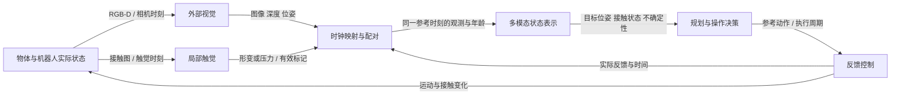
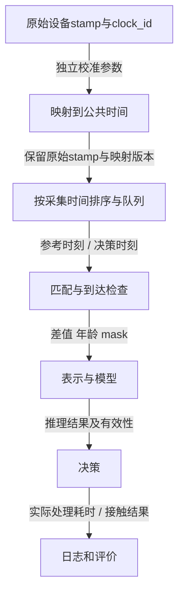
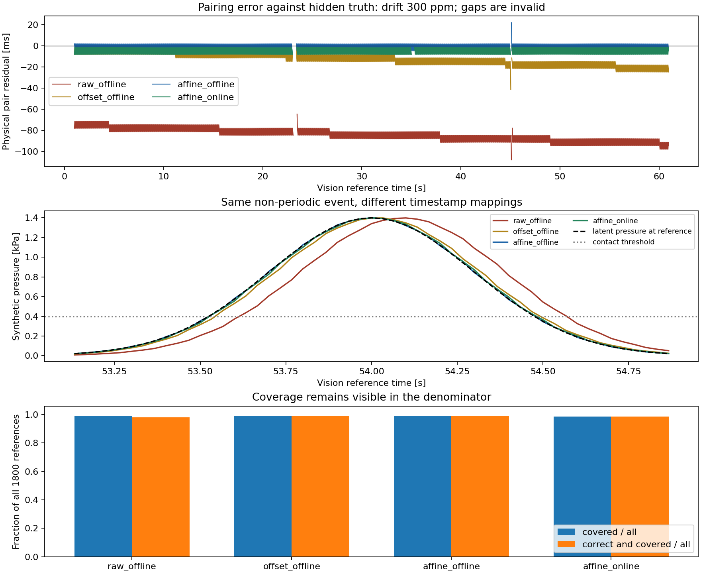
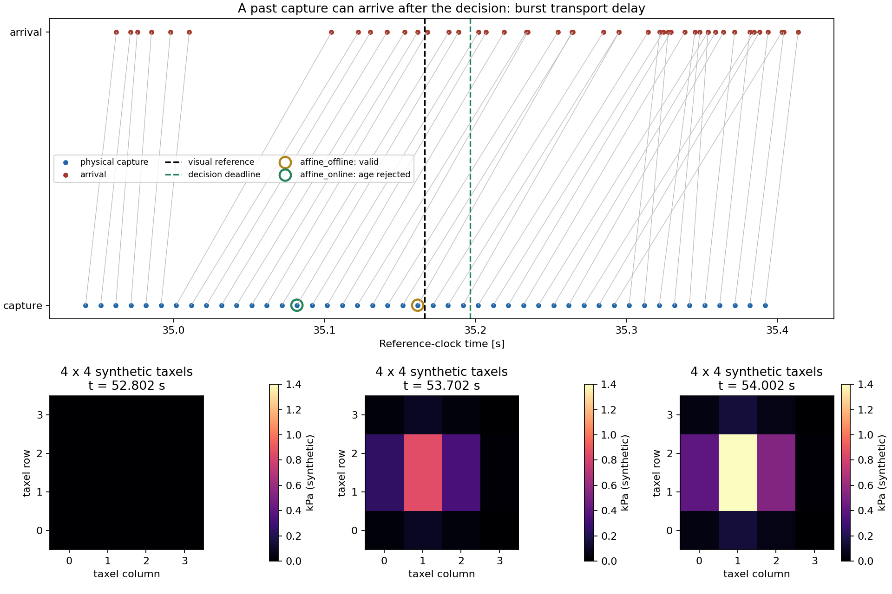

# D57 · 从同时录制到真正对齐的视觉触觉数据

[返回学习入口](../_index.md) ｜ [本周日程](../P3-项目实战-日程.md) ｜ [上一课 D56](../day56/Daily-Learning-Pack.md) ｜ [CPU 时间对齐实验](demo.py)

**多模态学习首先需要回答：这些观测来自哪个接触过程、描述哪个物理时刻、在做决定时是否已经可用。把 RGB 和触觉数组放在同一行，并不等于它们观察了同一状态。**

本课进入 Π-2 / W9-D1：视觉、触觉与语言的多模态感知。上一课建立了完整试验清单、接口和复现证据；今天把这些约定用到新的触觉数据流。机械臂接近杯子时，RGB-D 擅长提供外部几何；夹爪接触杯子之后，触觉提供局部接触、形变和相对运动信息。若两种观测错开几十毫秒，训练样本可能把“尚未接触的图像”与“已经受压的触觉”标成同时发生，模型就会学到错误关系。

今天完成传感器输出理解、数据契约和时间对齐，不提前把下一课的触觉编码器训练当作已完成。CPU 实验使用合成信号与小型触觉阵列，不需要触觉硬件，也不冒充真实 GelSight/DIGIT 读数。Π-1 尚未完成的正式项目验收仍独立保留。

<details>
<summary>个人学习记录（自动更新时保留你的作答）</summary>

<!-- learner-notes:start -->

- 我的配对结果、改变量实验与解释：
- 我的自测答案：
- 我的数据来源、时钟与标定信息：
- 仍未理解的问题：

<!-- learner-notes:end -->

</details>

<!-- daily-pack-generated:start -->

## 0. 学习目标与路线

完成本课后，应能解释三类触觉数据的物理含义，设计包含采集时间、到达时间和时钟身份的数据记录；推导并估计仿射时钟映射；区分离线最近邻、过去样本保持、插值与窗口聚合；识别未来信息泄漏、缺失掩码和接触阶段错配；用独立校准信号验证时钟而不偷看评价真值。

| 顺序 | 知识主线 | 需要回答的问题 |
| --- | --- | --- |
| 宏观 | 视觉触觉在抓取闭环中的位置 | 两种观测各自消除什么不确定性？ |
| 微观一 | 传感器与数据契约 | 一幅触觉图究竟是什么量？ |
| 微观二 | 时钟、延迟与漂移 | 相同数字是否代表相同物理时刻？ |
| 微观三 | 多速率配对与在线可用性 | 最近的样本一定能用于当前控制吗？ |
| 工程组合 | 数据划分、ROS 与学习接口 | 如何防止错配进入模型和动作数据？ |
| 实验与总结 | 漂移干预与因果配对 | 误差变小的同时，是否隐藏了无效样本？ |

## 1. 宏观：从“在哪里”走向“接触发生了什么”

### 1.1 两个观测窗口看见同一个任务的不同部分

外部 RGB-D 能估计杯子位置、形状和遮挡，但夹爪遮住接触区后，不一定能直接看见手指与杯壁是否滑动。局部触觉可以感受接触区域、压力分布或弹性表面形变，却通常不能单独恢复整个桌面布局。

因此，融合的价值来自**互补的可观测性**，不是简单增加输入通道。一个接触局部可以对应多种全局物体姿态；一个外部姿态也可以对应不同的局部受力。



图中的时钟映射位于编码、融合之前。若对齐模块输出的是错误配对，再强的编码器也只能在错误样本上优化目标函数。后续 W9 的编码器、W10 的融合、W11 的语言定位都依赖这里的数据定义。

### 1.2 接近、接触、受压与滑移不是一个标签

接近阶段，视觉距离缩短但触觉可能仍是基线；接触瞬间，局部区域开始形变；继续闭合时，压力或形变加大；抬升之后，接触点相对位移可能提示滑移。它们之间存在真实因果过程和传感器响应时间。

例如外部图像看起来“贴上杯壁”，不保证已经有可测力；触觉阈值触发也可能稍晚于首次微小接触。今天可以用“接触/未接触”作最小例子，但正式数据应保留原始信号与事件定义，不能把复杂过程压成无法复查的单个布尔值。

> [!warning] 时间差不全是时钟错
> 视觉事件、弹性体响应、滤波与触觉阈值之间可以存在真实时间差。把所有峰值强行平移到重合，会删掉真实动力学；只凭相关峰值不能证明校准出了设备时钟。

## 2. 微观：触觉输出的量纲与表示

### 2.1 压力阵列、光学触觉与六维力矩

| 类型 | 原始输出及常见 shape | 能直接说明什么 | 不能直接当成什么 |
| --- | --- | --- | --- |
| 压阻/电容等阵列 | 电压、电阻、电容或计数，`H_t×W_t` | 各 taxel（触觉单元）的电学响应 | 未标定的响应不是 Pa 或 N |
| 光学触觉 | 弹性表面图像，`H_t×W_t×3` | 接触引起的亮度、纹理和标记点变化 | 图像亮度不等于压力 |
| 腕部力/力矩传感器 | `[F_x,F_y,F_z,τ_x,τ_y,τ_z]` | 指定坐标系中的合力和力矩 | 合力不提供完整接触分布 |

光学触觉的相机观察的是传感器内部受接触作用的弹性表面；外部 RGB-D 相机观察的是场景。它们都可能输出三通道图像，但成像几何、标定和数据分布不同，不能因为 shape 相同就共用所有预处理参数。

[DIGIT 原论文](https://arxiv.org/html/2005.14679v1) 的结构与传感器设计部分展示了弹性体、内部照明和相机的关系。接触使弹性表面变形，照明与相机把局部变化转成图像；从图像推断几何或力仍需要相应模型和标定。这里不把论文中的特定装置参数当成本实验规格。

### 2.2 压力到合力：需要面积与标定

若已标定的 taxel 压力为 $p_j$（Pa），单元有效面积为 $A_j$（m²），且压力近似沿同一传感器法向，则法向合力近似为：

$$
F_n\approx\sum_j p_jA_j.
$$

这是面积积分的离散形式。倾斜或曲面的法向不一致时，应累加矢量 $p_jA_jn_j$；只有法向压力通常也不足以恢复切向摩擦力。

压力中心 center of pressure（CoP）为：

$$
r_{\rm CoP}=\frac{\sum_j p_jA_jr_j}{\sum_j p_jA_j}.
$$

$r_j$ 是传感器平面中的位置，单位 m。无接触时分母很小，CoP 应标记无效，而不是把加一个小常数后得到的原点误当测量。

手算一个 2×2 阵列：四个单元面积均为 1 mm²，坐标为 $(\pm0.5,\pm0.5)$ mm，压力如下。

| 位置 (x,y)，mm | (-0.5,-0.5) | (0.5,-0.5) | (-0.5,0.5) | (0.5,0.5) |
| --- | --- | --- | --- | --- |
| 压力 kPa | 10 | 20 | 30 | 40 |

总压力数值为 100 kPa，故 $F_n=100000\times10^{-6}=0.1$ N；$x_{\rm CoP}=0.1$ mm，$y_{\rm CoP}=0.2$ mm。若把 kPa 当 Pa，会差 1000 倍。这个算例仅适用于已知面积和压力标定的阵列；不能把四个像素灰度直接代入。

### 2.3 光学触觉：从参考图到局部变化

设无接触参考图为 $I_0$，当前图像为 $I_t$，可计算：

$$
\Delta I_t=\operatorname{float}(I_t)-\operatorname{float}(I_0).
$$

先转浮点再相减，避免 uint8 下负差值溢出。输入、参考图、曝光与白平衡等设置应一致；参考图有污渍、温漂或残余压痕时，差分会把这些变化也显示出来。

更深入的光学触觉模型可由照明推断表面法向，再积分为局部高度；若法向 $n=(n_x,n_y,n_z)$ 与高度图 $h(x,y)$ 满足约定朝向，可写梯度关系 $h_x=-n_x/n_z,\ h_y=-n_y/n_z$。法向到高度需要边界条件、尺度和噪声处理，图像到法向又需要光学标定。**高度变化仍不自动等于力：弹性材料、接触面积、边界与加载历史都会影响受力。**

明天 D58 再把差分、接触区域、纹理和标记运动组织为特征。今天先保留原始图、参考图版本和采集设置，避免训练前就丢掉可解释信息。

## 3. 微观：构建可追溯的多模态数据记录

### 3.1 “一行样本”之前先保存独立流

不要在采集时只保存“第 i 张 RGB + 第 i 张触觉”。设备频率不同、丢帧不同，第 i 项通常并不同时。首先独立保存每个流的原始索引和时间，再产生可重建的配对表。

建议每条原始记录包含：

| 字段 | 意义 | 失败反例 |
| --- | --- | --- |
| `episode_id / object_id / session_id` | 交互、物体与采集会话身份 | 同一接触片段流入训练和测试 |
| `sensor_id / sequence_id` | 传感器身份与单调序号 | 丢帧被重编号隐藏 |
| `device_stamp / clock_id` | 原始设备时间及其时钟域 | 直接比较两个独立设备的秒数 |
| `capture_start / capture_end` | 若可得，曝光或积分区间 | 把长曝光当瞬时采样 |
| `arrival_stamp` | 主机收到/可用时刻 | 离线样本在线当时还没到 |
| `frame_id / unit / encoding` | 坐标、单位、通道顺序 | RGB/BGR或左右手传感器混淆 |
| `calibration_id / reference_id` | 时钟、空间、信号标定及基线身份 | 换指尖或参考图却沿用旧标定 |
| `valid / drop_reason` | 原始数据是否可信与原因 | 黑图、过曝、断连被当作无接触 |
| `action / command_time / feedback_time` | 仅在实际记录时才存在 | 从视频动作描述虚构机器人控制量 |

配对表另外保存 `visual_index, tactile_index, mapped_capture_time, delta_t, age, available, valid`。原始流和配对索引分开，改变时钟校准或配对阈值时可重新生成，不必篡改原始记录。

### 3.2 真实数据集能支持哪些任务

[Touch and Go 项目与数据说明](https://touch-and-go.github.io/) 提供视觉与 GelSight 视频、各自时间数组以及材料和接触起始相关标注，可作为视觉触觉表示学习的研究入口。先核对实际版本中的时间单位、数组长度、帧索引和标注定义，再设计配对；本课没有下载并运行该数据集。

两份时间数组的存在**不自动证明它们共享时钟，也不证明不存在响应延迟**。需要读清采集和处理约定，再用可解释事件检验。

论文§4.3将视觉称为隐式动作条件（implicit action conditioning），这是利用视觉变化提供条件；它与本课程要求的可干预机器人控制量不同。论文§3.1也说明没有独立力传感器，因此不当作具有牛顿力真值的数据。该公开文件说明没有列出可直接当作机器人控制输入的同步 `a_t` 指令日志。因此可以研究跨模态对应或接触相关任务，但不能仅凭“视频里有人触摸物体”就称构建了动作条件转移 $(s_t,a_t,s_{t+1})$。W9-D6 将专门处理有无动作数据的边界；缺动作时可另做明确标注的合成转移例。

### 3.3 Tensor 的 shape 应包含时间语义

| 量 | 示例 shape | 说明 |
| --- | --- | --- |
| RGB 序列 | `B×L_v×3×H_v×W_v` | B批次、L_v帧数；通道先后由框架约定 |
| 触觉图序列 | `B×L_t×C_t×H_t×W_t` | 压力阵列可 C_t=1，光学图可 C_t=3 |
| 原始时间 | `B×L_v`、`B×L_t` | 不能假设 L_v=L_t |
| 过去窗口 | `B×L_v×K×C_t×H_t×W_t` | 每个视觉参考对应K个过去触觉样本 |
| 有效与年龄 | `B×L_v×K` | padding和未到达样本需mask；年龄另传 |
| 接触标签 | `B×L_v` 或事件区间 | 定义必须匹配参考时刻 |

若设备使用纳秒时间，原始值宜保留 int64；先减同一时钟域中的参考原点，再转 float64 秒用于拟合。把约 $10^9$ s 的绝对时间直接转 float32 会丢失毫秒分辨率。这个数值精度问题与传感器噪声不同，增加数据量不能修复已丢掉的小数。

## 4. 微观：从设备时钟映射到公共时间

### 4.1 四个容易混用的时间

对触觉第 j 帧定义：

- $t_j$：公共参考时间中的采集代表时刻，例如曝光中点。
- $d_j$：设备本地时钟记录的数值。
- $r_j$：数据在主机上到达或完成解码、可用于决策的时刻。
- $q$：某次决策实际读取数据的时刻。

若设备时钟在一段记录中近似线性：

$$
d_j=a\,t_j+b+\epsilon_j,\qquad r_j=t_j+\ell_j.
$$

a 为时钟速率比例、无量纲；b 为偏置，单位 s；$\epsilon_j$ 为时间戳误差；$\ell_j$ 为采集后的处理与传输延迟，单位 s。只有 r 和 t 已换算到相同参考域时，才能直接作差。

$a=1+300\times10^{-6}$ 表示快 300 ppm。经过 60 s，仅由速率差累积的时间偏移为 18 ms；3000 ppm 则为 180 ms。这里的 ppm 是教学变量，不是某款设备实测指标。

> [!question] 先算
> 触觉设备 $d=1.001t+0.080$，某帧设备时间为 10.090 s。公共采集时间是多少？若主机收到时间为 10.035 s，传输与处理延迟是多少？

$(10.090-0.080)/1.001=10.000$ s，延迟为 35 ms。直接把设备时间 10.090 s 当作采集时间，会误以为“数据在被采集之前就收到”，其实是混用了时钟域。

### 4.2 用独立同时事件估计仿射映射

希望直接将设备时间变为公共时间：

$$
\hat t=\alpha d+\beta,\qquad
\alpha=1/a,\quad\beta=-b/a.
$$

给定 K 对独立校准事件 $(d_k,t_k^{\rm ref})$，其中事件必须表示同一个真实发生时刻，解：

$$
\min_{\alpha,\beta}\sum_{k=1}^K
(\alpha d_k+\beta-t_k^{\rm ref})^2.
$$

设 $X=[d_k,\ 1]\in\mathbb R^{K\times2}$，
$y=[t_k^{\rm ref}]\in\mathbb R^K$，参数 $\theta=(\alpha,\beta)$。用 QR/SVD 最小二乘解 $X\theta\approx y$，实现可用 `np.linalg.lstsq`，不必显式求逆。也可由去中心化公式看出机制：

$$
\alpha=\frac{\sum_k(d_k-\bar d)(t_k^{\rm ref}-\bar t)}
{\sum_k(d_k-\bar d)^2},\quad
\beta=\bar t-\alpha\bar d.
$$

事件必须覆盖足够的时间跨度。只有一次同步事件，无法区分 b 与 a；所有事件都挤在极短时间中，微小时间戳噪声就可能让斜率估计不稳定。硬件同步脉冲、已知公共触发或可靠时钟同步机制可以提供校准信息；并不是所有相机或触觉设备都支持这些接口。

若固定 $\alpha=1$，只估计偏置，则
$\hat\beta=\operatorname{mean}(t_k^{\rm ref}-d_k)$。
它对校准时间中心附近可能有效，离得越远，未修正漂移残差越明显：

$$
\hat t-t\approx (a-1)(t-\bar t_{\rm calib}).
$$

这个式子解释为什么“开机时对齐过”不代表整个长序列都对齐。

### 4.3 校准必须与评价分开

本课使用记录前的独立同步脉冲拟合参数，再评价之后的数据；评价时可用合成真实时间计算误差，但真实时间不输入待估计的映射。这与直接用整段评价真值拟合后再报告误差不同。

实际项目还需记录时钟重启、计数器回绕、时间跳变或温度导致的漂移变化。单个仿射模型只适合局部近似稳定的时钟。发生重启时应切分会话或重新校准，不能用一条直线把不连续时间强行连起来。

## 5. 微观：采样率不同，怎样配对才有意义

### 5.1 离线最近邻：最接近不等于同时

视觉参考时间为 $t_i^v$，映射后的触觉时间为 $\hat t_j^\tau$。离线最近邻选择：

$$
j^*(i)=\arg\min_j|\hat t_j^\tau-t_i^v|.
$$

还需设置最大差值 $\delta_{\max}$，超出则标记没有可接受配对。若两者本就使用共同时间、触觉均匀100 Hz且没有丢帧、视觉时刻在触觉序列内部，最近邻量化误差最多约5 ms。实际时钟误差、抖动、缺失与曝光宽度会破坏这个理想界限。

**不要按索引一一配对。** 30 Hz与100 Hz的两个流，第300帧大约分别发生在10 s与3 s；两者同时开始录制也不能使帧号代表相同时刻。

离线最近邻可能选到 $t_j^\tau>t_i^v$ 的未来观测。对离线重建这不一定错误，只要任务允许；若用来训练“当时即可执行”的策略，就可能泄漏决策之后的信息。

### 5.2 在线配对：既要属于过去，也要已经到达

本课采用一个明确、较保守的契约：表示以视觉采集时刻为参考，只允许不晚于该时刻的触觉；决策可以稍后发生，但必须检查触觉当时已到达。

$$
\mathcal J_i=
\{j:\hat t_j^\tau\le t_i^v,\ r_j^\tau\le q_i,\
0\le t_i^v-\hat t_j^\tau\le A_{\max}\}.
$$

在集合中选映射采集时间最新的一帧；集合为空则输出缺失 mask，而不是补一张看起来正常的“零触觉”。

这是本课选择的表示契约，不是唯一合法设计。若系统以决策时刻 $q_i$ 为共同参考，也可以使用视觉采集之后、决策之前到达的触觉，但需把较旧视觉向该参考时刻建模，并显式传递各自年龄。不能一边宣称所有模态描述 $t_i^v$，一边偷偷用它之后的触觉。

手算例：视觉参考1.000 s，决策1.020 s，触觉帧如下。

| 采集时间 s | 到达时间 s | 以视觉时刻为参考的在线使用 |
| --- | --- | --- |
| 0.985 | 1.015 | 可用，年龄15 ms |
| 0.995 | 1.030 | 尚未到达 |
| 1.005 | 1.018 | 已到达，但属于参考时刻之后 |

离线最近邻会在0.995/1.005之间按平局规则选取；本课在线契约只能选择0.985。离线配对误差更小，不代表在线控制更好。

```text
触觉:  capture .985 ── receive 1.015 ─┐
视觉:             capture 1.000      ├── decision 1.020
触觉:       capture .995 ────────────┼── receive 1.030
触觉:                  capture 1.005 ─ receive 1.018
           参考时刻左边                决策时刻左边
```

这幅时间线分别回答“数据描述过去吗”和“数据当时可获得吗”。两道约束都需要检查。

### 5.3 过去保持、插值与窗口各有假设

| 方法 | 做法 | 假设与风险 |
| --- | --- | --- |
| 过去最近一帧 / 零阶保持 | 保持最新可用测量 | 变化不太快；过旧数据要拒绝 |
| 线性插值 | 用两侧样本按时间加权 | 两侧值有效且变化近似线性；右侧样本常需未来信息 |
| 时间窗口 | 输入一段过去序列及mask | 可保留接触变化；需清楚窗口边界与可用性 |
| 降采样聚合 | 区间均值、峰值或抗混叠滤波 | 均值可能抹平短接触；滤波会改变响应和延迟 |

线性插值为：

$$
x(t)=(1-\lambda)x(t_0)+\lambda x(t_1),\quad
\lambda=\frac{t-t_0}{t_1-t_0}.
$$

若接触在两帧之间突然开始，线性插值可能生成并未发生的“半接触”；如果是在线控制，$x(t_1)$ 还可能不可用。离线对齐后的更平滑曲线不能自动证明物理上更准确。

降低采样率时，原信号超过新 Nyquist 频率的分量可能混叠；应先依据任务带宽选择滤波和采样方式。高频振动用于滑移检测时，简单把100 Hz流取到30 Hz可能丢掉关键信息。这里频率只是示意，不保证能覆盖真实滑移的全部带宽。接触时间估计若用非因果双向滤波，还需标明它是离线处理。

### 5.4 缺失不是无接触

无接触是有效观测的一个状态；缺失是没有足够证据。不能用全零数组同时表示这两个情况而不传mask。

一个窗口可保留 `x:K×C×H×W`、`mask:K`、`age:K`。加权平均时仅累加有效项：

$$
\bar x=\frac{\sum_k m_kw_kx_k}{\sum_km_kw_k}.
$$

若分母为0，整条表示标记无效；不能用分母加极小常数后把输出0解释为“无接触”。后续编码器可以设计缺失token，但它仍应表达未知，而不是伪造传感器测量。

## 6. 微观：如何分开时钟误差、物理响应与标签偏移

### 6.1 信号相似性不是同步真值

简化为同一潜在接触过程 $s(t)$。视觉与触觉输出可能是：

$$
v(t)=g_v(s(t)),\qquad
u(t)=g_\tau(s(t-\tau_{\rm phys})).
$$

两模态的函数 $g_v,g_\tau$ 不同，触觉还可能有物理响应延迟 $\tau_{\rm phys}$。在此之上叠加时钟偏置 b、接收延迟与滤波延迟。用相关性寻找平移 $\Delta$：

$$
\hat\Delta=\arg\max_\Delta
\sum_t(v(t)-\bar v)(u(t+\Delta)-\bar u)
$$

得到的是这些因素混合后的最优相似性偏移，通常不能单独识别 b。若信号周期性强，还会存在多个相关峰；若触觉量是局部压力而视觉量是全局速度，相关关系本来就未必简单。

所以正确顺序通常是：先用独立同步信息建立公共时间，再研究真实的模态响应差；将相关性作为诊断，不把它当无条件的时钟标定。

### 6.2 对齐误差怎样变成监督噪声

若接触标签定义为 $y(t)=\mathbf1[s(t)>\eta]$，错配 $\Delta t$ 会在上升/下降边缘改变标签。平稳区域里错开20 ms也许不变，接触边缘却可能完全相反。

这意味着“所有帧标签一致率很高”可能被大量无接触帧掩盖。应同时看：

- 全部参考帧数与有效配对数，保留完整分母。
- 物理配对残差的均值/分位数/随时间变化。
- 接触边缘附近的一致率或事件时间差。
- 未来样本使用比例、尚未到达比例和数据年龄。
- 不同物体、会话与接触阶段的分组结果。

合成实验有真实采集时间，可以直接测残差；真实数据若缺独立时间真值，只能报告映射后时间差、可见事件证据与标定残差，不能把估计时间自洽称为真实物理同步精度。

## 7. 回到工程：ROS、数据划分与后续学习的入口

### 7.1 ROS 同步器解决排队配对，不负责估计时钟

ROS `header.stamp` 应代表明确的采集时间语义，`frame_id` 表示数据坐标系。设备驱动若把收到时间填写到 header，两个消息的 header 很接近也可能描述不同物理时刻。

ROS2 `message_filters` 的近似时间同步根据 header 时间、队列和 `slop` 容差寻找匹配；它不会自动估计本课的 $\alpha,\beta$，也不保证回调运行在某个严格控制截止时间之前。相关行为可核对 [官方实现源码](https://raw.githubusercontent.com/ros2/message_filters/rolling/src/message_filters/time_synchronizer.py)。这是对 rolling 源码的机制说明，接入时还需核对本机发行版与 API；本课未运行 ROS 节点。

`slop=0.03` 若适用于该版本表示约30 ms的匹配容差，不是“自动将两台传感器同步到30 ms以内”。容差过大提高配对率，却会接受更不同的状态；容差过小会丢掉大量数据。订阅者与发布者还需满足 QoS 兼容要求，否则没有消息进入队列，调整时间参数也无用。

建议的工程顺序是：



空间标定也不能省略。两只指尖的相同像素位置通常不表示相同机器人坐标；把局部接触中心送给规划器前，需要各自指尖到工具/基座的变换。时间对齐正确与空间对齐正确是两个独立条件。

### 7.2 划分交互片段，再拟合可学习的预处理

同一接触过程的邻近帧强相关。随机按帧划分训练/测试，会把几乎相同的压痕和背景分到两侧。至少按 episode 分组；想测试新物体就按物体留出，想测试新传感器/会话就按相应身份留出。

计算归一化均值和方差、选择配对阈值或拟合某些数据驱动对齐参数时，也要说明使用的集合。无接触基线可以在每次部署会话开始按固定流程采集，但不能为了让测试结果变好，反复挑选最有利的测试参考图。

对比学习中，误配的视觉—触觉对会被当作正样本拉近；监督接触分类中，时间错位会产生错误标签；世界模型中，动作与观测区间错配会改变推断的动力学。它们的损失函数不同，问题都源自样本含义不一致。

| Learning 五格 | 本周数据入口的回答 |
| --- | --- |
| 数据来源 | 同一交互中的视觉/触觉独立流及其时间，保留缺失 |
| 学习对象 | 明天的触觉特征，随后是跨模态表示与接触任务 |
| 改善信号 | 配对关系、接触标签或其他明确监督；时间戳本身不是语义标签 |
| 训练与推理 | 训练样本必须遵守部署可用信息，离线双向窗口不能无声明地移入在线策略 |
| 泛化评价 | episode/物体/会话分组，评估对齐质量和任务效果，并分别报告 |

### 7.3 VLA 与动作条件世界模型需要额外契约

对于 VLA 演示，样本中的观测应对应产生动作时可获得的信息，动作还要携带单位、参考系、控制周期及实际生效时间。把动作执行后的触觉塞回动作之前的观测，会造成“提前知道接触结果”的泄漏。

对于世界模型，$a_t$ 应表示指定区间内施加的动作，后继观测应与区间终点一致。夹爪电机命令不等于实际接触力，收到命令的时间也不等于动作生效时间。仅有视觉与触觉录影时，可学习观察关系，但不能补造没有记录的控制动作。

## 8. 动手：先预测，再改变时钟漂移

### 8.1 实验的可解释简化

[demo.py](demo.py) 使用 NumPy 与 Matplotlib，CPU 运行。视觉是一个带时间的接触代理标量，不是已经渲染或识别的 RGB 图；触觉为 `4×4` 的已标定压力阵列代理，单位为合成 kPa，不是光学触觉图。两者由同一非周期潜在接触过程生成，以单独观察时钟与可用性。

独立同步脉冲位于 `[-20,0] s`，校准读数含标准差20 µs的合成噪声；评价区间从1 s到60.966667 s。视觉参考1800帧，教学频率30 Hz；触觉原始6200帧，教学频率100 Hz，删除两个短区间内52帧后保留6148帧，阵列 shape 为 `[6148,4,4]`。时钟真实截距75 ms，默认漂移300 ppm；变体只把漂移改成3000 ppm。

触觉传输延迟为合成12–24 ms，在 `[35,35.3) s` 另加90 ms；决策设在视觉采集后30 ms。在线最大年龄25 ms。校准只使用独立脉冲对，配对器只读取估计采集时间和主机到达时间；合成真实采集时间用于生成数据、评价和绘图，不作为待估计映射的拟合标签。没有机器人尝试、网络训练或物理接触仿真。

输出 `streams.npz` 保留原始/映射/真实时间、到达时间、触觉阵列、视觉代理、校准脉冲和各方法的配对索引/mask。无效索引保存为 `-1`：读取时必须先应用mask，不能直接拿 `-1` 索引数组，否则会误读最后一帧。

从 vault 根目录运行：

```bash
python 3d_learning/day57/demo.py --out _assets/3d_learning/day57/default
python 3d_learning/day57/demo.py --drift-ppm 3000 --out _assets/3d_learning/day57/drift3000
```

本次实际环境为 Python3.11.15、NumPy1.26.4、Matplotlib3.10.9，macOS CPU。使用已有环境执行，未安装新包或连接硬件。原定课程日期是2026-10-31，最终脚本验证与本课归档日期为2026-11-11；这是补写记录，不顺延课号。

### 8.2 先预测

> [!question] 运行前写下三个判断
> ① 只修正固定偏置，误差会随记录时间增长还是保持恒定？  
> ② 离线最近邻误差更小，是否意味着在线合法配对覆盖率也更高？  
> ③ 一段触觉丢包后，应该补“无接触”，还是保留未知？完整评价分母如何处理？

### 8.3 运行与实测图解

默认与漂移变体均实际运行，四张图已查看；shape、mask、到达约束和脚本内容哈希均已检查。[默认结果](../../_assets/3d_learning/day57/default/results.json)、[漂移变体结果](../../_assets/3d_learning/day57/drift3000/results.json)、默认原始流与配对 (not exported: excluded by publication policy) 可直接核对。

| 漂移 | 方法 | 有效配对 / 全部参考 | 真实时间 MAE / P95，ms | 接触一致 / 有效 | 物理未来样本 | 决策时未到达 |
| --- | --- | --- | --- | --- | --- | --- |
| 300 ppm | 原始时间离线 | 1787/1800 | 84.238 / 94.667 | 1763/1787 | 0 | 1 |
| 300 ppm | 仅偏置离线 | 1787/1800 | 12.335 / 21.333 | 1784/1787 | 1 | 9 |
| 300 ppm | 仿射离线 | 1787/1800 | 2.684 / 4.667 | 1786/1787 | 595 | 10 |
| 300 ppm | 仿射在线 | 1776/1800 | 4.667 / 8.000 | 1775/1776 | 0 | 0 |
| 3000 ppm | 原始时间离线 | 1786/1800 | 167.509 / 248.000 | 1739/1786 | 0 | 0 |
| 3000 ppm | 仅偏置离线 | 1787/1800 | 122.660 / 204.667 | 1752/1787 | 0 | 0 |
| 3000 ppm | 仿射离线 | 1787/1800 | 2.684 / 4.667 | 1786/1787 | 595 | 10 |
| 3000 ppm | 仿射在线 | 1776/1800 | 4.667 / 8.000 | 1775/1776 | 0 | 0 |

MAE/P95与最后两列均在有效配对集合内计算，完整参考分母固定1800，不能忽略缺失。默认仿射离线覆盖1787/1800，而在线覆盖1776/1800；在线保留24条无效参考。`correct_and_covered_fraction_all` 另将正确且有配对数除以1800，避免只报告条件一致率。

默认仿射参数为 $\alpha=0.999699879512,\ \beta=-0.074994960114$ s，最大校准残差约15.785 µs。这个校准残差不是评价段物理配对误差：评价还包含采样间隔与丢帧。



第一张图上方显示真实配对残差随参考时刻变化，中间显示一个接触事件的错位，下方保留覆盖率与“正确且覆盖/全部参考”。仅偏置方法的误差随远离校准中心而积累；仿射方法校正速率差后，仍有采样离散化和丢包造成的误差。大片无接触区域会使总体接触一致率显得较高，不能只据此评价对齐好坏。

偏置估计为72.015369 ms，而非真实截距75 ms，因为校准事件均值为−10 s。估计平均差吸收了校准中心处的漂移项；3000 ppm时同样计算得到45.015369 ms。这正是“只偏置对齐在校准中心附近有效”的具体例子。



第二张图的连线从真实采集时间指向主机到达时间。突发延迟区间中，离线最近的触觉已经在过去采集，但决策时仍可能拿不到；在线方法宁可输出过旧/缺失，也不使用未来到达的数据。下方三幅4×4阵列是合成压力空间分布，不应被解释为真实传感器照片。

> [!warning] 在线规则使用的是估计时间
> 本次合成实验验证了在线有效配对中物理未来样本为0，但这不是所有估计误差下的保证。若时间映射有误差界 $\epsilon_t$，可采用 $\hat t_j+\epsilon_t\le t_i^v$ 等保守余量；真实系统需据校准证据设置并报告代价。

[3000 ppm残差图](../../_assets/3d_learning/day57/drift3000/clock_and_pairing.png) 保持相同信号、随机种子与丢包，仅改变漂移。日志中的总运行时间包含绘图和文件写入，不能当作传感器延迟或模型推理速度。

### 8.4 从结果解释工程边界

先对比相同信号、噪声与丢包条件下的默认和漂移变体。只改一个时钟速率参数，解释未校正、只偏置、仿射映射三种误差曲线为何不同。然后比较离线和在线：离线可能利用未来采集或尚未到达的数据，在线合法集合更小，覆盖率下降不能被隐藏。

将一个无效配对展开，查看该视觉时刻、候选触觉时刻、到达时间、决策时间与年龄上限。给出拒绝的具体原因，比只看总体平均误差更能定位工程问题。若要进一步改变年龄阈值，先保留本次结果，再单独改动并记录：更宽松阈值可以提高覆盖率，但会容忍更旧状态。

此实验的两模态共用同一潜在接触过程，以隔离时钟效应；没有模拟真实弹性滞后、复杂材料摩擦、独立曝光、传感器串扰或真实视觉接触识别错误。因此仿射校正改善本例，不代表真实系统的全部模态差异都应被时间平移消除。

### 8.5 完整可复制脚本

<details>
<summary>展开完整 demo.py（与同目录文件一致）</summary>

```python
"""Day57: synthetic tactile clocks, pairing, arrival-time causality; CPU only.

Run from the vault root. All frequencies, delays and pressures are teaching
choices, not specifications of a commercial sensor. No model is trained.
"""
import argparse
import hashlib
import json
import platform
from datetime import datetime, timezone
from pathlib import Path
from time import perf_counter

import matplotlib
matplotlib.use("Agg")
import matplotlib.pyplot as plt
import numpy as np


def pressure(t):
    """Non-periodic latent contact pressure, in synthetic kPa."""
    y = np.zeros_like(t, dtype=float)
    for center, width, peak in [(6, .4, 1.3), (13, .23, 1.0),
                                (25, .55, 1.7), (40, .18, .9), (54, .3, 1.4)]:
        y += peak * np.exp(-.5 * ((t - center) / width) ** 2)
    return y


def nearest(mapped, reference):
    hi = np.clip(np.searchsorted(mapped, reference), 1, len(mapped) - 1)
    lo = hi - 1
    return np.where(abs(mapped[lo] - reference) <= abs(mapped[hi] - reference), lo, hi)


def summarize(index, valid, mapped, tv, tt, arrival, decision, pv, pt):
    # Truth is used ONLY for evaluation, never to select a matched sample.
    dt = tt[index] - tv
    correct = (pt[index] >= .4) == (pv >= .4)
    n, k = len(tv), int(valid.sum())
    return {
        "reference_count": n, "valid_count": k, "missing_count": n - k,
        "coverage": k / n,
        "physical_mae_ms_valid": float(np.mean(abs(dt[valid])) * 1000) if k else None,
        "physical_p95_abs_ms_valid": float(np.quantile(abs(dt[valid]), .95) * 1000) if k else None,
        "contact_correct_count": int((correct & valid).sum()),
        "contact_agreement_valid": float(correct[valid].mean()) if k else None,
        "correct_and_covered_fraction_all": float((correct & valid).sum() / n),
        "estimated_future_count_valid": int((valid & (mapped[index] > tv + 1e-12)).sum()),
        "physical_future_count_valid": int((valid & (dt > 1e-12)).sum()),
        "unavailable_at_decision_count_valid": int((valid & (arrival[index] > decision)).sum()),
    }


def main():
    ap = argparse.ArgumentParser(description=__doc__)
    ap.add_argument("--drift-ppm", type=float, default=300.)
    ap.add_argument("--seed", type=int, default=57)
    ap.add_argument("--out", type=Path, default=Path("_assets/3d_learning/day57/default"))
    args = ap.parse_args()
    if not np.isfinite(args.drift_ppm) or abs(args.drift_ppm) > 10000:
        ap.error("this teaching experiment requires finite drift within +/-10000 ppm")
    args.out.mkdir(parents=True, exist_ok=True)
    tic = perf_counter()
    rng = np.random.default_rng(args.seed)
    a, b = 1 + args.drift_ppm * 1e-6, .075
    # Independent synchronous pulses, identified by trigger ID, BEFORE evaluation.
    cal_ref = np.array([-20., -15., -10., -5., 0.])
    cal_raw = a * cal_ref + b + rng.normal(0, 20e-6, len(cal_ref))
    alpha, beta = np.linalg.lstsq(np.c_[cal_raw, np.ones(5)], cal_ref, rcond=None)[0]
    offset = np.mean(cal_raw - cal_ref)
    tv = 1 + np.arange(1800) / 30  # physical/reference clock; vision is the anchor
    tt_all = .002 + np.arange(6200) / 100
    keep = ~(((tt_all >= 23) & (tt_all < 23.4)) |
             ((tt_all >= 45) & (tt_all < 45.12)))
    tt = tt_all[keep]
    raw = a * tt + b
    touch_arrival = tt + .012 + rng.uniform(0, .012, len(tt))
    touch_arrival += .09 * ((tt >= 35) & (tt < 35.3))
    vision_arrival = tv + .020 + rng.uniform(0, .010, len(tv))
    decision = tv + .030  # the current visual sample has arrived by this instant
    pv, pt = pressure(tv), pressure(tt)
    # Calibrated pressure-grid proxy, not an optical tactile RGB image or real force.
    gy, gx = np.mgrid[-1:1:4j, -1:1:4j]
    spatial = np.exp(-((gx[None] - .3 * np.sin(.2 * tt[:, None, None])) ** 2 +
                       gy[None] ** 2) / .4)
    spatial /= spatial.max(axis=(1, 2), keepdims=True)
    taxels = (pt[:, None, None] * spatial).astype(np.float32)
    mappings = {"raw_offline": raw, "offset_offline": raw - offset,
                "affine_offline": alpha * raw + beta}
    pairs, metrics = {}, {}
    for name, mapped in mappings.items():
        index = nearest(mapped, tv)
        valid = abs(mapped[index] - tv) <= .025
        pairs[name] = (index, valid)
        metrics[name] = summarize(index, valid, mapped, tv, tt, touch_arrival, decision, pv, pt)
    mapped = mappings["affine_offline"]
    index, valid = np.zeros(len(tv), dtype=int), np.zeros(len(tv), dtype=bool)
    for i, (ref, now) in enumerate(zip(tv, decision)):
        eligible = np.flatnonzero((mapped <= ref) & (touch_arrival <= now))
        if len(eligible):
            index[i] = eligible[-1]  # latest capture, not latest packet arrival
            valid[i] = ref - mapped[index[i]] <= .025
    pairs["affine_online"] = (index, valid)
    metrics["affine_online"] = summarize(index, valid, mapped, tv, tt, touch_arrival, decision, pv, pt)
    assert np.all(vision_arrival <= decision)
    assert metrics["affine_online"]["estimated_future_count_valid"] == 0
    assert metrics["affine_online"]["unavailable_at_decision_count_valid"] == 0
    assert max(cal_ref) < min(tv)
    report = {
        "data_kind": "synthetic_nonperiodic_contact_and_clock_fixture",
        "created_utc": datetime.now(timezone.utc).isoformat(),
        "environment": {"python": platform.python_version(), "numpy": np.__version__,
                        "matplotlib": matplotlib.__version__, "platform": platform.platform()},
        "seed": args.seed, "drift_ppm": args.drift_ppm, "truth_a": a, "truth_b_s": b,
        "script_sha256": hashlib.sha256(Path(__file__).read_bytes()).hexdigest(),
        "fit_alpha": float(alpha), "fit_beta_s": float(beta), "offset_only_s": float(offset),
        "calibration_max_abs_residual_us": float(abs(alpha * cal_raw + beta - cal_ref).max() * 1e6),
        "calibration_interval_s": [-20, 0], "evaluation_interval_s": [1, float(tv[-1])],
        "sampling_hz": {"vision": 30, "touch": 100}, "dropped_touch_count": int((~keep).sum()),
        "online_max_age_s": .025, "decision_after_vision_capture_s": .030,
        "touch_record_count": len(tt), "contact_threshold_kpa": .4,
        "metrics": metrics, "robot_attempt_count": 0, "training_interaction_count": 0,
        "limits": "No hardware, physical contact simulation, modality-response lag or neural network. "
                  "True physical times are evaluation labels only; calibrator uses separate pulse pairs.",
    }
    arrays = dict(vision_capture_s=tv, vision_arrival_s=vision_arrival, decision_s=decision,
                  touch_truth_s=tt, touch_raw_s=raw, touch_mapped_s=mapped,
                  touch_arrival_s=touch_arrival, touch_taxels_kpa=taxels,
                  vision_contact_proxy_kpa=pv, calibration_reference_s=cal_ref,
                  calibration_device_s=cal_raw)
    for name, (ix, mask) in pairs.items():
        arrays[name + "_index"] = np.where(mask, ix, -1)
        arrays[name + "_valid"] = mask
    np.savez_compressed(args.out / "streams.npz", **arrays)
    colors = ["#a33a2b", "#b18419", "#2066a8", "#23845b"]
    fig, axes = plt.subplots(3, 1, figsize=(11, 9), constrained_layout=True)
    for (name, (ix, mask)), color in zip(pairs.items(), colors):
        axes[0].plot(tv, np.where(mask, (tt[ix] - tv) * 1000, np.nan),
                     label=name, color=color, lw=1)
        zoom = (tv > 53.1) & (tv < 54.9)
        axes[1].plot(tv[zoom], np.where(mask, pt[ix], np.nan)[zoom], label=name, color=color)
    axes[0].axhline(0, color="black", lw=.6)
    axes[0].set(xlabel="Vision reference time [s]", ylabel="Physical pair residual [ms]",
                title=f"Pairing error against hidden truth: drift {args.drift_ppm:g} ppm; gaps are invalid")
    axes[0].legend(ncol=2)
    axes[1].plot(tv[zoom], pv[zoom], "k--", label="latent pressure at reference")
    axes[1].axhline(.4, color="gray", ls=":", label="contact threshold")
    axes[1].set(xlabel="Vision reference time [s]", ylabel="Synthetic pressure [kPa]",
                title="Same non-periodic event, different timestamp mappings")
    axes[1].legend(ncol=2, fontsize=8)
    names = list(pairs)
    axes[2].bar(np.arange(4) - .18, [metrics[n]["coverage"] for n in names], .36, label="covered / all")
    axes[2].bar(np.arange(4) + .18, [metrics[n]["correct_and_covered_fraction_all"] for n in names],
                .36, label="correct and covered / all")
    axes[2].set(xticks=np.arange(4), xticklabels=names, ylim=(0, 1.06),
                ylabel="Fraction of all 1800 references", title="Coverage remains visible in the denominator")
    axes[2].legend(loc="lower right")
    fig.savefig(args.out / "clock_and_pairing.png", dpi=160)
    plt.close(fig)
    fig = plt.figure(figsize=(12, 8), constrained_layout=True)
    grid = fig.add_gridspec(2, 3, height_ratios=[1.7, 1])
    ax = fig.add_subplot(grid[0, :])
    pick = int(np.argmin(abs(tv - 35.16)))
    local = (tt > 34.94) & (tt < 35.4)
    for cap, arr in zip(tt[local], touch_arrival[local]):
        ax.plot([cap, arr], [0, 1], color="#bbb", lw=.6)
    ax.scatter(tt[local], np.zeros(local.sum()), s=15, label="physical capture", color="#2066a8")
    ax.scatter(touch_arrival[local], np.ones(local.sum()), s=15, label="arrival", color="#a33a2b")
    ax.axvline(tv[pick], color="black", ls="--", label="visual reference")
    ax.axvline(decision[pick], color="#23845b", ls="--", label="decision deadline")
    for name, color in [("affine_offline", "#b18419"), ("affine_online", "#23845b")]:
        j, ok = pairs[name][0][pick], pairs[name][1][pick]
        ax.scatter([tt[j]], [0], s=120, facecolors="none", edgecolors=color,
                   linewidths=2, label=f"{name}: {'valid' if ok else 'age rejected'}")
    ax.set(xlabel="Reference-clock time [s]", yticks=[0, 1], yticklabels=["capture", "arrival"],
           title="A past capture can arrive after the decision: burst transport delay")
    ax.legend(ncol=3, fontsize=8)
    for col, sec in enumerate([52.8, 53.7, 54.]):
        ax = fig.add_subplot(grid[1, col])
        j = np.argmin(abs(tt - sec))
        im = ax.imshow(taxels[j], vmin=0, vmax=1.4, cmap="magma", origin="lower")
        ax.set(title=f"4 x 4 synthetic taxels\nt = {tt[j]:.3f} s", xlabel="taxel column", ylabel="taxel row")
        fig.colorbar(im, ax=ax, label="kPa (synthetic)")
    fig.savefig(args.out / "arrival_and_taxels.png", dpi=160)
    plt.close(fig)
    report["wall_time_s_including_figures"] = perf_counter() - tic
    (args.out / "results.json").write_text(json.dumps(report, indent=2) + "\n")
    print(json.dumps(report, indent=2))


if __name__ == "__main__":
    main()
```

</details>

## 9. 今日总结：先保证样本描述同一件事

视觉触觉融合增加了接触信息，也增加了时钟、采样、坐标和标定的接口要求。公共采集时间决定观测描述什么状态，到达时间决定当时能否使用它。可靠的数据入口应保留这些区别，连同缺失和不确定性一起交给后续模型。

今天最值得掌握的五点：

1. **触觉像素、压力和力不是同一量。** 量纲与标定决定模型输出能否进入真实控制。
2. **偏置和漂移要分开。** 单次对时解决不了长期速率差，校准事件必须覆盖时间跨度。
3. **配对要同时考虑参考时刻与到达时刻。** 这样才能防止离线好结果依赖在线拿不到的信息。
4. **缺失mask不能省略。** 未知触觉与有效无接触应产生不同的系统行为。
5. **时钟差与物理响应差不能混合解释。** 独立同步证据帮助保留真正的接触动力学。

三个易错边界：按帧号配对不是时间对齐；相关峰值不是设备时钟真值；有触觉视频不等于有动作条件数据。

本课产出应包括默认/漂移变体结果、两模态数据契约、一条具体无效配对的时间线，以及一页说明你选择的参考时刻和在线可用规则的笔记。若有真实数据，先完成字段与时钟核查，再接入模型；不需要为了完成本课连接或操作机器人。

## 10. 自测：从量纲到因果配对

每题0/1/2分：0=关键概念错误或无依据；1=能复述结论但缺计算或适用条件；2=计算、机制与边界完整。共20分，建议16分且能独立解释单变量实验后进入下一课；建议线不代表已替你评分。

1. 为什么光学触觉图不能直接作为压力图或外部RGB-D深度图？至少指出两个不同的标定环节。
2. 第2节2×2阵列的法向合力与CoP分别是多少？无接触时CoP应怎样表示？
3. 30 Hz视觉与100 Hz触觉同时开始记录，第300帧能直接配对吗？说明误差来源。
4. $d=1.001t+0.080$，设备stamp为10.090 s，主机收到时刻10.035 s。求公共采集时间与延迟。
5. 为何一次同步事件不能同时确定时钟偏置与漂移？为何要把校准与评价区间分开？
6. 视觉参考1.000 s、决策1.020 s，三条触觉记录为(采集,到达)：(0.985,1.015)、(0.995,1.030)、(1.005,1.018)。按本课契约应选择哪条，为什么？
7. 相关性最大化发现触觉比视觉晚40 ms，能否直接认定时钟偏置40 ms？还可能有哪些因素？
8. 丢包处填全零触觉但不提供mask，会给接触分类、控制或对比学习带来什么错误？
9. 为什么随机按帧划分视觉触觉数据可能造成泄漏？若目标是泛化到新物体应怎样划分？
10. 只有RGB、GelSight视频和时间数组，能否构造真实机器人动作条件世界模型训练集？VLA离线演示还需要哪些时间信息？

## 11. 未理解问题与次日衔接

若你仍把触觉灰度与力混用，先复算第2节的量纲例子，再回查D29的接触控制与传感器标定；若仍混淆消息收到与动作生效，回查D41和D54；若不能解释在线覆盖率为什么低于离线，逐项画出第5节时间线，再查看实验中的具体拒绝记录。

下一课 **D58 / W9-D2（2026-11-01）** 进入触觉特征提取器：从参考差分、接触区域与局部形变到可训练表征。第一步使用今天保留的触觉原始输入、有效mask和分组身份，明确一个特征想保留什么、对什么变化应稳定。后续W9-D3/D4研究视觉触觉对齐学习与独立评价；W9-D6再连接带动作的转移模型。

### 一手材料精读

- [Touch and Go 原论文](https://arxiv.org/html/2211.12498v1)：阅读§3.1、§4.3与§5.1，区别传感器测量、隐式视觉条件与显式控制动作，并核对按视频分组的动机。

- [DIGIT：A Novel Design for a Low-Cost Compact High-Resolution Tactile Sensor](https://arxiv.org/html/2005.14679v1)：阅读 §II、§III-A/C 与 Fig.2–4，画出接触→弹性体→照明→相机的链条，分别标记原始测量和推断量。
- [Touch and Go 项目与 Dataset 说明](https://touch-and-go.github.io/)：核对视觉、触觉、时间数组和标签文件，列“可直接使用 / 需要验证 / 未提供”的三栏；本课不假设未列出的机器人动作日志存在。
- [ROS2 message_filters 官方时间同步实现](https://raw.githubusercontent.com/ros2/message_filters/rolling/src/message_filters/time_synchronizer.py)：定位 `ApproximateTimeSynchronizer`、header时间与slop匹配逻辑，说明队列配对与时钟标定的区别。源码随分支变化，真实接入需固定本机发行版或提交版本。

> [!note]- 自测核对答案与判分标准
> 每题0/1/2分；能复述结论为1分，能补齐计算、实现条件或反例为2分。此处不记录你的实际成绩。
>
> 1. 光学触觉测的是内部弹性表面的成像变化；图像到局部几何需光学/几何标定，几何或图像到力还需材料与力标定。外部RGB-D观察外部场景，不能因shape相同混用。
> 2. $F_n=0.1$ N，CoP为(0.1,0.2) mm，均在约定传感器平面内。分母很小时标记无效，而不是把数值原点当有效接触中心。
> 3. 不能；约分别发生在10 s与3 s，另外还有时钟偏置、漂移及丢帧。应按校准后的采集时间和有效条件配对。
> 4. 公共采集时间10.000 s，延迟35 ms；必须先统一时钟域才能作差。
> 5. 一点只给一个方程，$\alpha,\beta$有两个未知；多个分散事件提供速率信息。独立评价检验外推与真实误差，避免用评价真值拟合后自证正确。
> 6. 选择0.985 s帧，年龄15 ms且已到达。0.995尚未到达，1.005相对视觉参考是未来。若改变参考时刻，必须同时改变并声明表示契约。
> 7. 不能；物理响应、阈值定义、滤波、接收延迟与周期性歧义都可能参与。先用独立同步信息估计时钟，再解释物理时差。
> 8. 缺失会被错当有效无接触，可能污染标签、导致继续闭合或构造错误正样本；传mask、年龄及缺失原因，全部参考分母不丢。
> 9. 邻近帧共享物体、压痕、背景与时间结构。至少按episode分组；新物体泛化应按物体留出，预处理参数与阈值不能利用测试结果调优。
> 10. 不能补造未记录的真实 $a_t$。需要动作单位/参考系/周期、发出与实际生效时间和反馈；VLA观测还必须满足动作决策时可获得，不能使用执行后的触觉结果。

<!-- daily-pack-generated:end -->

