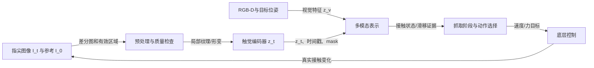
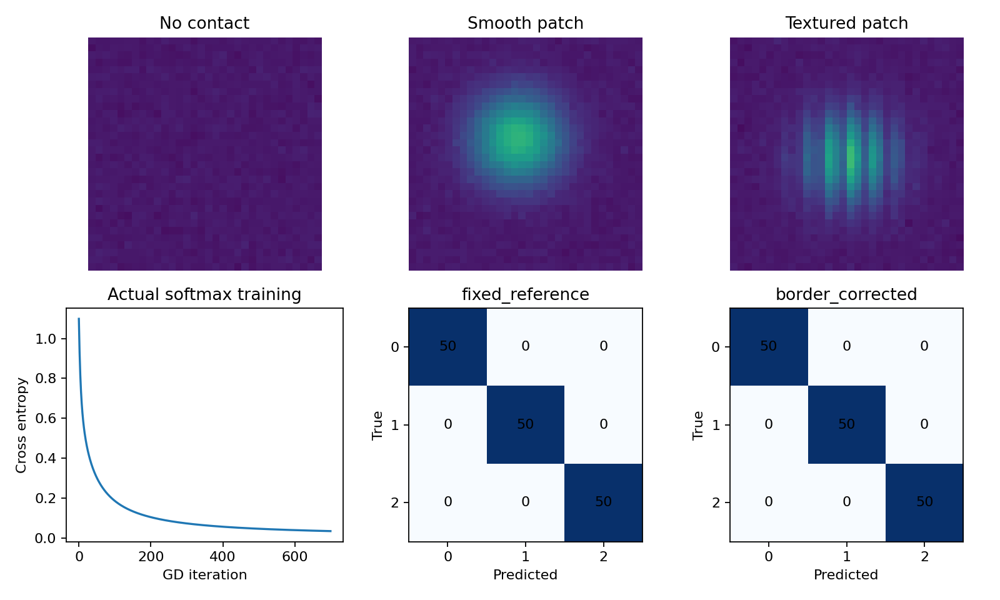
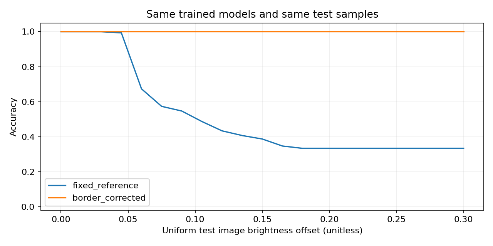

# D58 · 从触觉图像到可解释、可训练的特征

[返回学习入口](../_index.md) · [本周项目日程](../P3-项目实战-日程.md) · [上一课：数据与时间对齐](../day57/Daily-Learning-Pack.md) · [本课实验](demo.py)

**触觉特征提取器的任务，是把接触造成的变化与照明、位置、传感器个体差异分开，并保留后续任务真正需要的信息。一个漂亮的向量既不自动等于力，也不自动等于物体状态。**

D57 已把视觉和触觉对齐到同一个时间语义。本课接着问：同一时刻的触觉图像进入系统后，哪些量值得送给接触识别、视觉融合和抓取反馈？继续想象 RGB-D 机械臂抓杯子：外部相机可以看到杯子位置，指尖相机则看到一小块胶体如何形变。两者的图像都叫 image，测量对象却不同。

<details>
<summary>个人作答与观察（教材更新保留）</summary>

保留你的先猜结果、改变量记录和未理解问题；此区不由教材更新覆盖。

</details>

<!-- daily-pack-generated:start -->

## 1 学习目标与路线

完成本课后，你应能解释原始触觉图、参考差分、接触区域、纹理和运动特征之间的关系；推导四维统计特征与 softmax 梯度；手算一个接触中心；实现 CPU 特征分类器；判断亮度校正何时合理、何时会删掉接触信号。

| 顺序 | 知识主线 | 需要回答的问题 |
| --- | --- | --- |
| 1 | 传感器到任务 | 原始像素到底测到了什么？ |
| 2 | 差分与参考 | 怎么区别接触、照明漂移与胶体老化？ |
| 3 | 特征机制 | 强度、面积、纹理、形变分别保留什么？ |
| 4 | 可训练编码 | CNN、全局池化、任务头如何连接？ |
| 5 | 最小实验 | 一次亮度变化为什么能让分类器全部猜同一类？ |
| 6 | 工程闭环 | 特征通过什么契约进入融合和控制？ |

## 2 宏观：感知表示在机器人闭环中的位置



图中的 `z_t` 是一个编码后的向量。它可以帮助估计接触，但下游仍需要明确的预测头、阈值和误差验证。若模型输出“粗糙”类别，不应该把这个标签直接解释成摩擦系数；若模型输出接触面积，也不应该跳过材料与载荷标定，直接解释成法向力。

视觉型触觉传感器通过弹性介质和内部成像获得接触细节。DIGIT 原论文展示了反射、带标记等不同介质配置，并讨论相应的纹理和运动信息。今天的合成灰度图只模拟局部图案变化，**没有复现该传感器的光学成像和弹性体物理**。[DIGIT，III-A/III-C 与图3–4](https://arxiv.org/html/2005.14679v1)

先建立三个不同层次：

| 层次 | 例子 | 语义和单位 |
| --- | --- | --- |
| 测量 | RGB 像素、压力阵列原始读数 | 亮度数字、ADC；需读设备定义 |
| 表示 | 差分纹理、光流、embedding | 强度、pixel/frame、通常无量纲向量 |
| 任务量 | 接触概率、法向力、滑移速度 | 概率、N、m/s；需要对应监督和标定 |

同一个编码器可以支持多个任务头，但每个头的可信范围必须分别评价。材料分类准确，并不证明它能在快速滑动时预测滑移。

## 3 微观：参考差分为什么有效，又为什么会失败

### 3.1 一个最小观测模型

对像素位置 $u$，写一个局部近似：

$$
I_t(u)=I_0(u)+D_t(u)+b_t+\epsilon_t(u).
$$

$I_0$ 是无接触参考图，$D_t$ 是接触造成的图像变化，$b_t$ 是整幅图近似一致的亮度偏移，$\epsilon_t$ 是噪声。这里全部是亮度单位，**$D_t$ 不是米也不是牛顿**。这个加法模型适用于今天的合成实验；真实光照可有乘性增益、空间变化和饱和，因此不能无限推广。

固定参考差分为 $\Delta I_t=I_t-I_0=D_t+b_t+\epsilon_t$。它消除了静态背景，却保留了漂移。若取一圈已知未接触的边界 $\mathcal B$，可以估计：

$$
\hat b_t=\operatorname{median}_{u\in\mathcal B}\Delta I_t(u),\qquad
\Delta I_t^{\rm corr}(u)=\Delta I_t(u)-\hat b_t.
$$

中位数比均值更不容易被少量异常亮点带走，但它不保证正确：若边界大部分已被接触覆盖，$\hat b_t$ 会把真实形变当漂移扣掉；若光源只在中心变亮，边界无法估计中心偏差。

> [!question] 先算
> 参考像素是0.40，当前接触像素是0.75，背景边界从0.40升到0.60。固定差分是多少？边界校正后是多少？
>
> 先自己写出两步计算，再检查：0.35与0.15。校正删掉的是假设为全局漂移的0.20，而不是“自动找到真实力”。

### 3.2 为什么不能每帧都更新参考图

假设正在持续夹住杯子，接触图案几乎不变。若用滑动平均让参考图不断追随当前图，差分最终趋近零。系统可能把“持续稳定接触”误认成“没有接触”。更新参考应有条件，例如明确处于自由空间、没有接触证据、曝光设置已稳定，并保存 `reference_id`。不能仅凭“最近变化小”判断可以重置。

真实接入时，记录参考图、曝光、增益、照明、传感器序列号、胶体/标记版本。模型跨设备变差，可能是传感器观测模型变了；扩大网络之前先比较无接触背景和受控压入响应。

### 3.3 数值范围也是契约

`uint8` 图直接相减会发生回绕，例如 $10-250$ 不能在无符号8位上得到$-240$。先转 `float32` 再减；如果使用归一化亮度，训练和部署必须一致。今天代码以背景0.4的浮点灰度图生成数据，不做相机8位裁剪；亮度偏移是无量纲数，不能说成“增加0.2 N”。

## 4 微观：四种特征到底看见了什么

### 4.1 强度统计与局部变化

对一张 $H\times W$ 差分图 $D$，今天使用：

$$
\mu_D=\frac1{HW}\sum_{u,v}D_{uv},\qquad
\sigma_D=\sqrt{\frac1{HW}\sum_{u,v}(D_{uv}-\mu_D)^2},
$$

$$
g_y=\frac1{(H-1)W}\sum_{u=1}^{H-1}\sum_v|D_{u+1,v}-D_{u,v}|,
\qquad
g_x=\frac1{H(W-1)}\sum_u\sum_{v=1}^{W-1}|D_{u,v+1}-D_{u,v}|.
$$

它们组成 $f=[\mu_D,\sigma_D,g_y,g_x]\in\mathbb R^4$。均值反映总体变化；标准差反映空间不均匀；两个一阶差分反映行、列方向的纹理变化。本实验在接触斑上加入沿横向的条纹，所以 $g_x$ 对该合成类别较有辨别力。

若 $D$ 加上常量 $b$，均值增加$b$，标准差和两个差分理论上不变。这说明特征本身具有不同的不变性。**一个特征不受漂移影响，不代表整个分类器不受影响：分类器可能强烈依赖均值这一维。**

手算二维例：

$$
D=\begin{bmatrix}0&0.2\\0.2&0.4\end{bmatrix}
\Rightarrow \mu_D=0.2,\quad\sigma_D=\sqrt{0.02}\approx0.1414,
\quad g_x=g_y=0.2.
$$

全部加0.2后，均值变0.4，其他三维不变。如果把整图只压缩为均值，平滑接触与细纹理可能相同；若只保留梯度，又可能把没有接触但噪声很高的图误认为粗糙。

### 4.2 面积和接触中心：可解释，但需要阈值与标定

构造 $M_{uv}=\mathbb1(|D_{uv}|>\tau)$，可以得到像素接触面积 $A_{\rm px}=\sum M$。若每像素对应表面面积为 $a$，才可近似 $A=aA_{\rm px}$，单位为 $\mathrm{mm}^2$。透视成像或曲面胶体可能使$a$随位置变化，不能套统一比例。

接触中心可以用二值区域或非负权重 $w$：

$$
c_x=\frac{\sum w_{uv}v}{\sum w_{uv}},\qquad
c_y=\frac{\sum w_{uv}u}{\sum w_{uv}}.
$$

若两点在$x=0,2$ pixel，权重为1与3，$c_x=1.5$ pixel。分母为0时中心未定义，应输出无效mask，而不是返回$(0,0)$假装接触位于左上角。只有$w$确实是法向压力并有面积标定时，才可以进一步叫压力中心；亮度权重中心只是图像变化中心。

### 4.3 形变与运动：单帧无法回答全部问题

滑移是接触界面相对运动。表面粗糙是静态纹理性质。二者可以相关，却不是同一标签。若观察标记位移 $\Delta p$，光流输出常是 pixel/frame；换算速度必须有时间间隔与局部尺度：$v\approx s\Delta p/\Delta t$。若$s=0.04\ \mathrm{mm/pixel}$，位移2pixel、间隔0.01s，速度为8mm/s。

但标记移动也可能来自弹性剪切积累而非完全滑动；指尖整体运动还会引入其他变化。需要结合局部流场、接触区域、历史和相对运动判断。今天的脚本没有视频，没有实现滑移检测；它只区分三种合成图案。

## 5 微观：从人工特征到可训练编码器

### 5.1 CNN改变的是特征提取方式

人工特征由设计者指定，训练只决定如何组合它们。卷积神经网络（CNN）则让局部滤波核也从数据中学习。例如一个可接入设计为：

| 模块 | 输入shape | 输出shape | 作用 |
| --- | --- | --- | --- |
| 差分预处理 | `[B,3,64,64]` | `[B,3,64,64]` | 颜色通道、参考和范围一致 |
| 3×3卷积，stride2，padding1 | `[B,3,64,64]` | `[B,16,32,32]` | 学局部边缘/纹理 |
| 3×3卷积，stride2，padding1 | `[B,16,32,32]` | `[B,32,16,16]` | 扩大感受野 |
| 全局平均池化 | `[B,32,16,16]` | `[B,32]` | 产生紧凑表示 |
| 任务头 | `[B,32]` | `[B,C]` | 类别logits |

标准卷积在通道与局部位置加权求和：$Y_{o,i,j}=b_o+\sum_{c,a,b}K_{o,c,a,b}X_{c,i+a,j+b}$。参数共享意味着同一纹理可以在不同位置被同一滤波器检测。池化提高了平移稳定性，却也可能丢失接触位置；若后续要控制压力中心，就应保留空间feature map或单独的定位头。

以上是工程扩展方案；**本课实际运行的是四维人工特征加softmax，不声称训练了CNN**。从容易诊断的基线开始，能直接知道亮度漂移影响了哪一维；以后换CNN也必须保留这个对照。

### 5.2 softmax怎样学会组合特征

训练集统计量为$m_j,s_j$，标准化 $z_j=(f_j-m_j)/(s_j+\epsilon)$，追加常数1作为偏置。$Z\in\mathbb R^{N\times5}$、$W\in\mathbb R^{5\times3}$，logits为 $L=ZW$。类别概率：

$$
p_{ic}=\frac{\exp L_{ic}}{\sum_{k=1}^3\exp L_{ik}},\qquad
\mathcal L=-\frac1N\sum_i\log p_{i,y_i}+\frac\lambda2\|W\|_F^2.
$$

交叉熵鼓励真实类别概率升高，L2项抑制权重过大。代码对全部$W$含偏置一起正则化，这是一个简化选择。对矩阵求导：

$$
\nabla_W\mathcal L=\frac1N Z^T(P-Y)+\lambda W.
$$

$Y$ 是one-hot标签。初始权重全0时每类概率$1/3$，交叉熵为$\log3\approx1.0986$，与运行记录一致。计算指数前每行减去最大logit，不改变softmax比值，却避免指数溢出。

标准化参数只能从训练集计算。如果部署时对每一张图重新减去其整体均值，就改变了训练时语义，也可能删掉“是否接触”的有效信号。

### 5.3 Learning五格卡

| 问题 | 本课实例 |
| --- | --- |
| 数据从哪来 | 三类合成图，分别用58/158/258种子产生训练/验证/测试 |
| 学什么 | 4维特征到3类logits的线性映射；预处理规则不训练 |
| 改善信号 | 真实合成类别的交叉熵加L2正则 |
| 训练与推理 | 训练700次全批量梯度更新；推理只提特征、标准化、矩阵乘法 |
| 泛化怎样测 | 独立生成的样本和同一测试样本的亮度漂移；不能外推真实材料能力 |

## 6 动手：先预测，再改变一个变量

### 6.1 数据、运行与可观察结果

实验是CPU NumPy实现，依赖Python、NumPy、Matplotlib。已验证环境为Python3.11.15、NumPy1.26.4、Matplotlib3.10.9。若现有Python已装这些包即可运行；不需要GPU、设备或下载数据。在vault根目录执行：

```bash
python 3d_learning/day58/demo.py
python 3d_learning/day58/demo.py --drift 0.2 --out _assets/3d_learning/day58/drift02
```

训练300张、验证150张、测试150张，每类均衡。输入 `[N,32,32]`，输出四维特征。测试改变全局亮度偏移，图案位置、纹理、噪声种子与训练数据保持同一构造，训练过程不使用带漂移测试集。

> [!question] 运行前预测
> 如果梯度特征不受全局偏移影响，为什么固定参考模型仍可能失败？你的预测应说明“特征集里哪一维受影响”和“分类器如何依赖它”，不能只说模型不鲁棒。

**2026-11-11 已执行并检查**的结果：

| 测试条件 | 固定参考正确数/样本数 | 边界校正正确数/样本数 |
| --- | --- | --- |
| 无漂移 | 150/150 | 150/150 |
| 全局亮度+0.2 | 50/150 | 150/150 |

固定参考的训练交叉熵从1.09861下降至0.03527，校正分支到0.03521。带漂移测试中固定参考模型把全部样本预测成平滑接触类；这解释了为什么其准确率恰好是1/3。校正的成功来自本实验确实满足“边界无接触且偏移全局一致”的假设，不是普遍消除域差异。



图上行展示模型看到的三种输入；下行连接真实优化过程和分类输出。没有接触不等于全黑，背景与噪声也会进入特征。



横轴是同一批测试图额外增加的亮度，纵轴是正确率。扫描重复使用同一测试样本，适合定位扰动机制；不能把21个扫描点当21份独立泛化实验。完整数值见[默认记录](../../_assets/3d_learning/day58/default/results.json)和[漂移记录](../../_assets/3d_learning/day58/drift02/results.json)。

### 6.2 再做一个反例

把 `make_data` 中的接触中心范围向图像边缘扩展，或把接触斑扩大，使边界进入接触区。先预测校正会偏高还是偏低，再运行到新的输出目录。检查边界估计与中心差分，并记录是否出现漏检。**不要只记准确率，要画出被错误校正的输入。** 原已验证结果只覆盖原参数；你改参数后的结果要另记。

若改为真实输入，接口至少携带 `image, reference_id, capture_timestamp, sensor_id, valid_mask, exposure`。训练标签要说明“接触/无接触”来自人工、力传感器还是自动阈值；用同一个阈值造标签再验证模型复刻该阈值，不能证明物理触觉理解。

脚本记录的 `runtime_s` 包含合成数据、训练、扫描和绘图，**不是推理延迟**；batch1预处理+推理延迟未单独测量。真实机器人尝试数0、真实传感器采集数0，没有物理力标定。

### 6.3 完整可复制代码

> [!note]- 展开与同目录 demo.py 一致的完整代码
> ```python
> """D58 synthetic tactile feature extraction; no force/hardware validation."""
> import argparse, json, platform, time
> from pathlib import Path
> import numpy as np
> import matplotlib
> matplotlib.use('Agg')
> import matplotlib.pyplot as plt
> 
> 
> def make_data(seed, n=300, drift=0.):
>     rng = np.random.default_rng(seed)
>     y = np.arange(n) % 3
>     yy, xx = np.mgrid[-1:1:32j, -1:1:32j]
>     images = []
>     for label in y:
>         cx, cy = rng.uniform(-.25, .25, 2)
>         patch = np.exp(-((xx-cx)**2+(yy-cy)**2)/.16)
>         smooth = rng.uniform(.3,.6)*patch if label else np.zeros_like(xx)
>         texture = .15*patch*np.sin(rng.uniform(22,32)*xx) if label == 2 else 0.
>         images.append(.4 + smooth + texture + rng.normal(0,.008,xx.shape) + drift)
>     return np.array(images), y
> 
> 
> def features(images, border_correct):
>     diff = images - .4
>     if border_correct:
>         border = np.concatenate([diff[:,0,:], diff[:,-1,:], diff[:,:,0], diff[:,:,-1]],1)
>         diff = diff - np.median(border,1)[:,None,None]
>     return np.column_stack([diff.mean((1,2)), diff.std((1,2)),
>         np.abs(np.diff(diff,axis=1)).mean((1,2)),
>         np.abs(np.diff(diff,axis=2)).mean((1,2))])
> 
> 
> def train(x, y):
>     mu, sd = x.mean(0), x.std(0)+1e-8
>     z = np.column_stack([(x-mu)/sd, np.ones(len(x))])
>     w = np.zeros((z.shape[1],3)); losses=[]
>     target=np.eye(3)[y]
>     for _ in range(700):
>         logits=z@w; logits-=logits.max(1,keepdims=True)
>         p=np.exp(logits); p/=p.sum(1,keepdims=True)
>         losses.append(float(-np.log(p[np.arange(len(y)),y]+1e-12).mean()))
>         w-=.08*(z.T@(p-target)/len(y)+.001*w)
>     return w,mu,sd,losses
> 
> 
> def main():
>     ap=argparse.ArgumentParser(); ap.add_argument('--drift',type=float,default=0.)
>     ap.add_argument('--out',type=Path,default=Path(__file__).resolve().parents[2]/'_assets/3d_learning/day58/default')
>     args=ap.parse_args(); args.out.mkdir(parents=True,exist_ok=True); start=time.perf_counter()
>     tr,yt=make_data(58); va,yv=make_data(158,150); te,ye=make_data(258,150,args.drift)
>     results={}; models={}
>     for name,correct in [('fixed_reference',False),('border_corrected',True)]:
>         w,mu,sd,loss=train(features(tr,correct),yt)
>         pred=lambda im: np.column_stack([(features(im,correct)-mu)/sd,np.ones(len(im))])@w
>         pv=pred(va).argmax(1); pe=pred(te).argmax(1)
>         cm=np.zeros((3,3),int); np.add.at(cm,(ye,pe),1)
>         results[name]={'validation_correct':int((pv==yv).sum()),'validation_n':len(yv),
>           'test_correct':int((pe==ye).sum()),'test_n':len(ye),'accuracy':float((pe==ye).mean()),
>           'confusion':cm.tolist(),'loss_first':loss[0],'loss_last':loss[-1]}
>         models[name]=(w,mu,sd,loss)
>     fig,axs=plt.subplots(2,3,figsize=(10,6))
>     for j in range(3):
>         axs[0,j].imshow(te[j],cmap='viridis',vmin=.35,vmax=1.1); axs[0,j].set_title(['No contact','Smooth patch','Textured patch'][j]); axs[0,j].axis('off')
>     axs[1,0].plot(models['fixed_reference'][3]); axs[1,0].set(xlabel='GD iteration',ylabel='Cross entropy',title='Actual softmax training')
>     for j,name in enumerate(results):
>         cm=np.array(results[name]['confusion']); axs[1,j+1].imshow(cm,cmap='Blues',vmin=0,vmax=50)
>         for r in range(3):
>             for c in range(3): axs[1,j+1].text(c,r,str(cm[r,c]),ha='center',va='center')
>         axs[1,j+1].set(title=name,xlabel='Predicted',ylabel='True',xticks=range(3),yticks=range(3))
>     fig.tight_layout(); fig.savefig(args.out/'features.png',dpi=160); plt.close(fig)
>     fig,ax=plt.subplots(figsize=(8,4))
>     for name,correct in [('fixed_reference',False),('border_corrected',True)]:
>         w,mu,sd,_=models[name]; drift_values=np.linspace(0,.3,21); scores=[]
>         for d in drift_values:
>             im,y=make_data(258,150,d); z=np.column_stack([(features(im,correct)-mu)/sd,np.ones(len(y))]); scores.append(((z@w).argmax(1)==y).mean())
>         ax.plot(drift_values,scores,label=name)
>     ax.set(xlabel='Uniform test image brightness offset (unitless)',ylabel='Accuracy',ylim=(-.02,1.05),title='Same trained models and same test samples'); ax.legend(); ax.grid(alpha=.2)
>     fig.tight_layout(); fig.savefig(args.out/'drift.png',dpi=160); plt.close(fig)
>     report={'seed':[58,158,258],'python':platform.python_version(),'numpy':np.__version__,'matplotlib':matplotlib.__version__,
>       'drift':args.drift,'data':'independent synthetic patches; intensity is not force','n_train':300,'n_val':150,'n_test':150,
>       'input_shape':[150,32,32],'feature_shape':[150,4],'results':results,'runtime_s':time.perf_counter()-start,
>       'robot_trials':0,'learning_status':'not_assessed'}
>     (args.out/'results.json').write_text(json.dumps(report,indent=2),encoding='utf8'); print(json.dumps(report,indent=2))
> 
> if __name__=='__main__': main()
> ```

## 7 回到宏观：何时保留空间，何时压成向量

夹杯系统需要的并非“最大维度embedding”。如果只是判断是否接触，均值、方差与分类头可能足够；如果要向接触中心移动，必须保留位置；如果要识别滑移，需要时间维；如果要预测施力后果，还需要动作和状态历史。特征取舍由任务定义，而不是由某个网络名称决定。

本课最值得掌握的四点是：**参考图有状态**，因为错误更新会抹去稳定接触；**不变性有代价**，因为去亮度或全局池化也可能删掉有效信号；**表示和物理量分层**，因为亮度到力没有天然单位转换；**先建立可解释基线**，因为它能把模型失败定位到测量与特征维度。

三个重点边界：全局亮度校正不能修复空间光照变化；单帧纹理分类不能证明滑移检测；合成满分不能替代跨物体、跨设备或真实材料验证。

三句话总结：从原始触觉到特征，先确定测量和参考的含义。一个特征应对哪些变化稳定、保留哪些变化，需要由下游任务决定。只有独立数据和可控扰动都解释得通，特征才有资格进入融合系统。

可验收产出：四维特征定义与单位表；无漂移/漂移两组结果及一张失败输入图；一个“边界接触破坏校正”的待验证反例；自己的8题答案。代码运行通过只表示教材实验可复现，个人掌握仍待作答。

## 8 自测

1. 触觉embedding、接触概率和法向力分别属于什么层次？单位是什么？
2. 参考0.4，当前中心0.75、边界0.6，计算固定差分和边界校正差分。
3. 给差分图全部加常量，四维特征哪些改变？为什么分类器仍可能失效？
4. 两个接触像素$x=0,2$、权重1和3，中心在哪里？权重和为0怎么办？
5. 从$Z:[N,5]$、$W:[5,3]$推导logits与梯度shape。
6. 为什么一帧强纹理不等于正在滑移？还缺什么观测？
7. 大接触斑覆盖边界时，中位数校正可能造成什么错误？怎样验证？
8. 要把本实验换成真实DIGIT输入，哪些字段与验证必须补上，才能声称力控制可用？

## 9 未理解问题与次日衔接

请把尚未想通的具体问题写入个人区，例如“怎样确认边界真的自由？”“局部光照变化如何估计？”“保留接触位置的编码器如何设计？”。W9-D4将检查独立评价，W10-D2/D3将把编码器和交叉注意连接起来；光学到物理力的标定需设备和外部载荷证据，不能由这张合成图表代替。

下一课 **D59 / W9-D3（2026-11-02）** 研究视觉触觉表征与对比学习。第一步把“一个触觉图对应哪个视觉观测”写成配对关系，而不是直接拼接两条向量。

精读任务：阅读[DIGIT原文III-A、III-C及图3–4](https://arxiv.org/html/2005.14679v1)，画出“接触→胶体→照明/相机→图像”链，写出哪一个变化会破坏今天的加法漂移假设。阅读目的在于对应测量机制，不要求记传感器历史规格。

> [!note]- 自测核对答案与判分
> 每题0/1/2分：0分为核心错误；1分能正确复述或算出主结果；2分还能解释条件、单位或给出迁移反例。建议至少12/16且第1、7、8题无核心错误；这不是已取得的个人成绩。
>
> 1. embedding是表示，通常无量纲；接触概率是任务输出、范围0–1；法向力是物理量N，需要独立标定或对应监督。
> 2. 0.75−0.4=0.35；漂移0.6−0.4=0.2；校正0.15。
> 3. 仅均值平移；标准差和有限差分不变。模型可能依赖均值，整体仍失效。
> 4. $(0×1+2×3)/4=1.5$ pixel。零分母必须标无效，不能返回伪中心。
> 5. logits与概率是`[N,3]`，$Z^T(P-Y)$为`[5,3]`，与$W$一致。
> 6. 纹理描述空间图案，滑移描述相对运动；需要时序、时间间隔、运动尺度和接触状态，还要区分弹性剪切与滑动。
> 7. 真实接触被当作背景偏移扣掉，可能低估接触或漏检；改变接触位置/面积并检查原图、估计偏移和误分类。
> 8. 图像范围、参考版本、曝光、时间、传感器身份、有效mask及力/位移标定；还需真实接触、跨设备/载荷、延迟和闭环验证。合成分类满分不能跳过这些步骤。
<!-- daily-pack-generated:end -->
