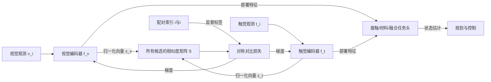
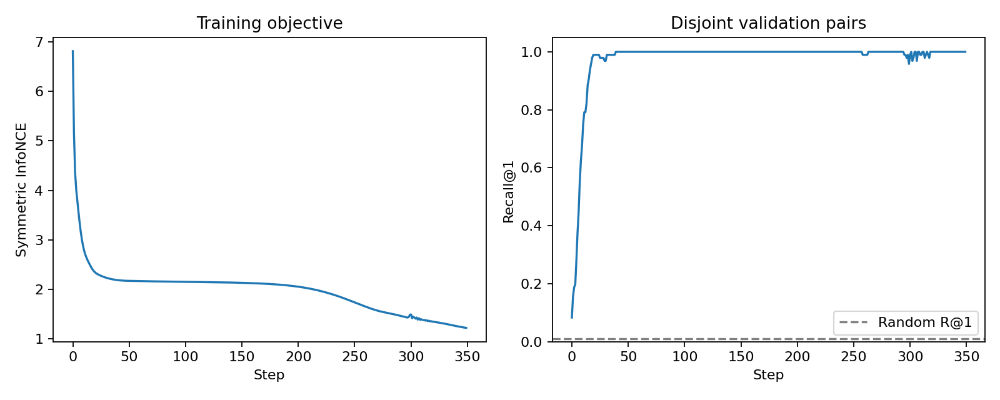
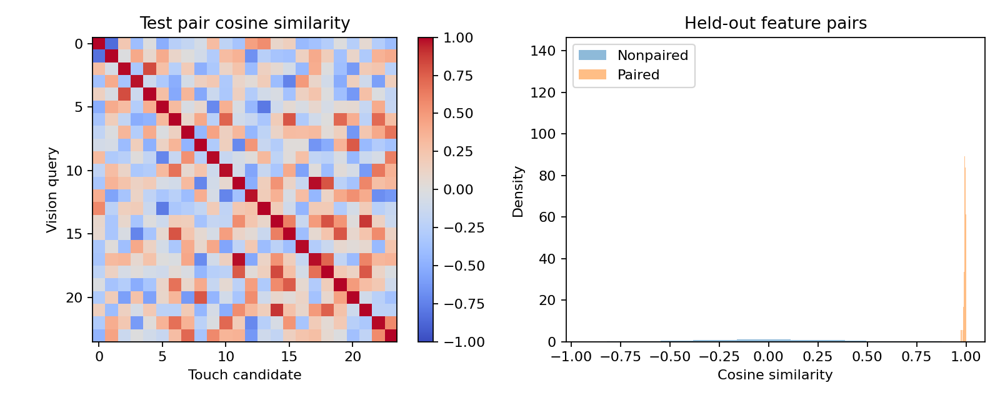

# D59 · 从视觉触觉配对到共享表征

[返回学习入口](../_index.md) · [本周项目日程](../P3-项目实战-日程.md) · [上一课：触觉特征](../day58/Daily-Learning-Pack.md) · [本课实验](demo.py)

**跨模态表征学习的关键，是规定哪些观测应该对应、对应到什么语义层次，再用目标函数把这种关系变成可训练的几何。相似向量并不自动意味着相同物体、相同接触或相同动作。**

D58把触觉图压缩成特征。本课把外部视觉与指尖触觉连接起来：杯子看起来光滑，接触图也平滑，这两条观测可能共享材料信息；但视觉图包含整个杯子，触觉只覆盖局部接触。学习要保留共同的部分，也要允许两种模态拥有各自独有的信息。

<details>
<summary>个人作答与观察（教材更新保留）</summary>

在这里记录配对假设、实验预测、作答与尚未理解的问题；教材更新保留本区。

</details>

<!-- daily-pack-generated:start -->

## 1 学习目标与路线

你应能写出正负配对的定义、推导对称InfoNCE及其梯度方向、手算温度对匹配概率的影响、实现双编码器训练和跨模态检索，并解释配对训练、融合、分类、策略学习之间的区别。

| 顺序 | 知识主线 | 要回答的问题 |
| --- | --- | --- |
| 1 | 共享与私有信息 | 看见与摸到的哪些因素能对齐？ |
| 2 | 配对与监督 | 没有人写类别标签，训练信号从哪里来？ |
| 3 | 对比目标 | 为什么相似度矩阵的对角线是训练目标？ |
| 4 | 优化与shape | 哪些参数真的更新，哪些量只在训练出现？ |
| 5 | 多任务与评价 | 检索好是否意味着接触识别或控制好？ |
| 6 | 单变量实验 | 只打乱配对，训练损失和独立检索会怎样？ |

## 2 宏观：共享表示并不要求所有信息相同

令视觉观测$v$、触觉观测$t$由共享因素$s$和各自私有因素产生：

$$
v=g_v(s,n_v),\qquad t=g_t(s,n_t).
$$

$s$可能包含局部形状、材质或接触状态；$n_v$包含背景和外部光照，$n_t$包含施压力度、胶体状态和内部成像。一个理想的共享embedding突出$s$；但实际训练只看到配对样本，并不知道哪个因素是我们想要的。



这张图区分训练与部署：损失函数在训练时塑造编码器；部署时不需要每次反向传播，也不需要知道真实配对索引。若任务是检索，就用一个模态查询另一模态候选库；若任务是接触分类，就需要单独的分类头和标签；若要输出机器人动作，还缺演示/奖励、动作契约和控制反馈。

“对齐”至少有三种含义：D57的时间对齐解决是否同一时刻；本课表征对齐解决向量能否比较；几何对齐解决同一位置/参考系。三者互相支持，不能用同一个高相似度分数替代全部。

## 3 微观：正样本是谁，决定了学到什么

### 3.1 配对定义是数据协议的一部分

同一物体的两次触摸，可以作为材料正样本，但未必是接触状态正样本。一次按在杯壁、一次按在杯把，局部形状和接触法向不同。反过来，来自两个不同杯子的触觉图可能同样平滑，把它们强行作为语义负样本会造成false negative（假负样本）。

可以把配对粒度写成：`object_id → interaction_id → contact_patch_id → timestamp`。任务越局部，正样本要求通常越严格。选择近邻帧前先约束时间误差、接触阶段和视野重叠。没有接触时的所有触觉图可能近乎相同，不能要求每一张都识别出唯一视觉对象。

> [!warning] 监督没有消失
> 自监督表示没有人工类别标签，不等于没有监督。配对索引、采样规则和数据增强就是监督。错误时间戳、错位帧和相邻帧泄漏会直接改变目标函数鼓励的关系。

### 3.2 把正样本做错会出现什么

若所有正对都来自同一采集场景，而负对来自不同场景，模型可能靠背景、传感器色偏或拍摄批次完成匹配。它学到“来自同一次录制”，不一定学到材料。部署换背景时，配对损失曾经很低也不能保证有效。

因此要做关系破坏对照：保留每个单模态的分布，把跨模态对应关系打乱。若仍能在独立样本高水平匹配，需检查身份信息、索引泄漏或数据生成代码。反过来，打乱后训练损失仍下降完全可能：网络在拟合有限训练对或利用偶然相关性，关键是独立配对上的效果。

## 4 微观：InfoNCE把配对问题变成分类问题

### 4.1 相似度矩阵

编码器输出$h_i^v,h_j^t\in\mathbb R^d$，先做L2归一化：

$$
z=\frac{h}{\max(\|h\|_2,\epsilon)},\qquad S_{ij}=(z_i^v)^Tz_j^t.
$$

两个单位向量点积就是余弦相似度，范围[-1,1]。$S\in\mathbb R^{B\times B}$，第$i$行表示第$i$个视觉查询与整个触觉批次比较；正确配对放在对角线。归一化阻止模型只靠增大向量长度提高logit，但不能消除错误配对。

设温度$\tau>0$，将候选匹配概率定义为：

$$
p_{ij}^{v\to t}=\frac{\exp(S_{ij}/\tau)}{\sum_{k=1}^{B}\exp(S_{ik}/\tau)},\quad
\mathcal L_{v\to t}=-\frac1B\sum_i\log p_{ii}^{v\to t}.
$$

这就是“在B个候选中，找出第i个”的交叉熵分类。反方向对$S^T$同样计算，再平均：

$$
\mathcal L=\frac12(\mathcal L_{v\to t}+\mathcal L_{t\to v}).
$$

温度没有单位。较小的$\tau$让相似度差异变得更尖锐：有利于区分相近候选，也会放大难负样本和错误监督的影响。温度不能简单当成“越小越好”的旋钮。

### 4.2 手算：温度如何改变概率

一条查询对三个候选的相似度为$[0.8,0.2,-0.1]$，第一个正确。$\tau=0.2$时logits为$[4,1,-0.5]$，最大值平移后$[0,-3,-4.5]$，因此：

$$
p_+=\frac1{1+e^{-3}+e^{-4.5}}\approx0.9426,\quad
-\log p_+\approx0.0591.
$$

$\tau=1$时，概率约$1/(1+e^{-0.6}+e^{-0.9})=0.5114$，损失约0.6709。排序没有改变，概率与梯度强度改变了。

> [!question] 反过来想
> 如果那个0.8其实是错配，低温度会减轻还是加重错误监督？解释为什么“模型很有信心”不能证明配对标签正确。

### 4.3 梯度为什么能拉近正对、推开负对

对一行的损失，令logit$\ell_{ij}=S_{ij}/\tau$，有：

$$
\frac{\partial\mathcal L_i}{\partial S_{ij}}=
\frac{p_{ij}-\mathbb1(j=i)}{\tau}.
$$

正样本$p_{ii}<1$时导数为负，梯度下降倾向于增加它的相似度；负样本导数为正，倾向于降低相似度。越像正样本的负对概率越大，受到的推开作用越强。这个直觉解释了为什么假负样本会伤害语义结构。

若所有向量完全相同，每行概率为$1/B$，损失$\log B$。负样本比较使“把所有东西映射成一样”不能获得低损失；但这不是对所有结构、优化器和数据的无条件防塌缩证明。还要看方差、相似度分布和保留集评价。

## 5 微观：实际双编码器的张量与训练

今天输入是共享四维潜变量生成的两种**合成传感特征**，不是RGB或GelSight图像：

$$
z_\ast\sim\mathcal N(0,I_4),\quad
v=z_\ast A+\epsilon_v\in\mathbb R^{12},\quad
t=z_\ast B+\epsilon_t\in\mathbb R^{10}.
$$

$A:[4,12]$、$B:[4,10]$在所有划分固定，潜变量样本和噪声独立。这模拟同一测量机制下的新场景状态，不模拟更换传感器。测试集满分也只能证明这个线性潜变量任务可学。

| 量/操作 | shape | 说明 |
| --- | --- | --- |
| 训练视觉/触觉 | `[256,12]` / `[256,10]` | 每一行是一对 |
| 两个第一层 | `[256,32]` | Linear后Tanh |
| 两个第二层 | `[256,8]` | 学习出的embedding |
| L2 normalize | `[256,8]` | 每行单位范数 |
| 相似度矩阵 | `[256,256]` | 一个批次的所有跨模态组合 |
| 正样本标签 | `[256]` | `0,1,...,255` |
| 测试检索矩阵 | `[96,96]` | 只用独立96对 |

两侧编码器共有1296个参数：视觉$12×32+32+32×8+8=680$，触觉$10×32+32+32×8+8=616$。Adam每步对两个编码器同时更新；固定全批次256对，350步，学习率0.006、温度0.12。本实验不包含CNN、Transformer或VLA。

训练统计量只从训练集拟合；视觉和触觉各有自己的均值/标准差，不能跨模态混用。打乱训练触觉配对使用独立随机数生成器，确保不会顺便改变两个编码器的初始化。这是受控实验中很容易忽略的实现细节。

```python
scores = normalize(enc_v(v)) @ normalize(enc_t(t)).T
labels = arange(len(v))
loss = (cross_entropy(scores / tau, labels)
        + cross_entropy(scores.T / tau, labels)) / 2
loss.backward()
optimizer.step()
```

真实框架需要先清空梯度，完整脚本已包含。这里用`normalize`表达逐行归一化，不是对整个batch做一次范数。

## 6 表征、多任务和融合：三种不同承诺

对比学习约束两种模态可以互相检索；融合模型需要把两者组合起来完成任务；多任务训练则同时优化多个目标。三者可组合，但不能互相当证据。

假设共享表征$h$有接触分类头和力回归头：

$$
\mathcal L_{\rm total}=\lambda_c\mathcal L_{\rm contrast}
+\lambda_s\operatorname{CE}(\hat y,y)
+\lambda_f\left\|\frac{\hat F-F}{s_F}\right\|^2.
$$

$F$必须来自对应的力监督，$s_F$使误差无量纲；不能拿0–1亮度直接填到牛顿目标。各损失梯度可能冲突：材料不变特征希望忽略按压力度，力预测却必须保留力度。解决思路包括共享底层加私有分支、任务专用头、明确权重和分别评价，而非要求所有embedding一模一样。

| 方法 | 监督从哪里来 | 推理输出 | 不自动保证什么 |
| --- | --- | --- | --- |
| 对比表征 | 跨模态配对 | embedding/检索 | 接触分类、力预测、动作质量 |
| 有监督任务头 | 类别或物理标签 | 类别/数值 | 新传感器上仍有效 |
| 多任务编码器 | 配对+多种任务标签 | 共享/私有表示与多个头 | 各任务同时改善 |
| VLA策略 | 视觉语言、本体、演示动作等 | 动作或动作chunk | 接触测量真实、动作已执行成功 |

Learning五格卡：本课数据是共享潜变量的成对合成特征；学习对象是两个编码器；信号来自配对交叉熵；训练需双模态与配对，检索推理需查询与候选库；泛化通过未见潜变量样本和错配对照测量。它是自监督关系学习，不是强化学习，也没有世界状态转移目标。

## 7 动手：打乱配对以后，损失还能下降吗

### 7.1 先预测、运行、解释

依赖Python、NumPy、PyTorch、Matplotlib，CPU即可。在vault根目录运行：

```bash
python 3d_learning/day59/demo.py
python 3d_learning/day59/demo.py --shuffle-pairs --out _assets/3d_learning/day59/shuffled
```

先写下三项预测：正常配对的相似度矩阵；错配训练的loss方向；错配训练后独立检索的水平。再检查图，而不是仅看终端最后一行。

**2026-11-11 实际运行并检查**：Python3.11.15、NumPy1.26.4、PyTorch2.13.0.dev20260423、CPU单线程。模型初始化seed59，错配排列独立seed159，训练/验证/测试为256/96/96对。代码固定350步，验证曲线用于观察而未选取最佳checkpoint；报告最终权重。

| 条件 | 训练loss起点→终点 | 验证R@1 | 测试R@1 | 测试R@5 |
| --- | --- | --- | --- | --- |
| 正确配对 | 6.8114→1.2226 | 96/96 | 96/96 | 96/96 |
| 仅打乱训练配对 | 6.7770→4.0262 | 3/96 | 4/96 | 8/96 |

R@k是正确候选是否进入前k，按查询数平均。随机排序的期望R@1为1/96≈1.04%、R@5为5/96≈5.21%；一次实验略高于随机不能证明学会了可靠配对。训练loss并未归零，正确配对R@1仍可达1：排序正确不要求正样本概率严格等于1，批次候选数和温度也影响loss量级。



左图是实际梯度训练，右图是未参与梯度更新的96对验证查询。纵轴不是机器人成功率。



左图只显示前24对的矩阵局部，右图使用完整96×96矩阵。明亮对角线与正负相似度分离互相印证；注意非配对候选中也可能有相似潜变量，不要求全部为负相似度。

对照图见[错配训练曲线](../../_assets/3d_learning/day59/shuffled/training.png)及[错配检索分布](../../_assets/3d_learning/day59/shuffled/retrieval.png)。它们显示loss持续下降，但保留集配对与非配对分布大量重叠。完整数值见[默认结果](../../_assets/3d_learning/day59/default/results.json)和[错配结果](../../_assets/3d_learning/day59/shuffled/results.json)。

### 7.2 改一个变量的进一步任务

本次已执行的单变量是训练配对打乱；验证、测试的正确配对保持不变。现在只改温度，例如从0.12改到0.04，使用新的输出目录并保留种子和步数，预测loss和检索哪个更敏感。这个扩展未在本课保存结果中执行，不能预先填上“改善”。

进一步调试顺序：确认训练配对索引→确认归一化轴→看正负相似度→查梯度是否到达两个分支→最后调温度、容量和学习率。若测试相似度矩阵直接用训练索引构造出来，任何漂亮对角线都是泄漏。

`runtime_s`含数据生成、训练和绘图，不是推理延迟。batch1编码延迟、候选库规模变化的检索延迟未测。真实图像样本0、机器人动作样本0、机器人尝试0；没有完成材料或接触任务的真实验证。

### 7.3 完整可复制代码

> [!note]- 展开与 demo.py 一致的完整CPU代码
> ```python
> """D59 CPU cross-modal InfoNCE training on synthetic sensor features."""
> import argparse, json, platform, time
> from pathlib import Path
> import numpy as np
> import torch
> from torch import nn
> from torch.nn import functional as F
> import matplotlib
> matplotlib.use('Agg')
> import matplotlib.pyplot as plt
> 
> 
> def main():
>     ap=argparse.ArgumentParser(); ap.add_argument('--shuffle-pairs',action='store_true')
>     ap.add_argument('--out',type=Path,default=Path(__file__).resolve().parents[2]/'_assets/3d_learning/day59/default')
>     args=ap.parse_args(); args.out.mkdir(parents=True,exist_ok=True); start=time.perf_counter()
>     torch.set_num_threads(1); torch.manual_seed(59); rng=np.random.default_rng(59)
>     a=rng.normal(size=(4,12)); b=rng.normal(size=(4,10))
>     def sample(n):
>         z=rng.normal(size=(n,4)); return [torch.tensor(v,dtype=torch.float32) for v in (z@a+.04*rng.normal(size=(n,12)),z@b+.04*rng.normal(size=(n,10)))]
>     x,y=sample(256); vx,vy=sample(96); tx,ty=sample(96)
>     mx,sx=x.mean(0),x.std(0); my,sy=y.mean(0),y.std(0)
>     x,vx,tx=[(v-mx)/sx for v in (x,vx,tx)]; y,vy,ty=[(v-my)/sy for v in (y,vy,ty)]
>     # Independent permutation RNG keeps encoder initialization identical in the ablation.
>     if args.shuffle_pairs: y=y[torch.randperm(len(y), generator=torch.Generator().manual_seed(159))]
>     enc_v=nn.Sequential(nn.Linear(12,32),nn.Tanh(),nn.Linear(32,8))
>     enc_t=nn.Sequential(nn.Linear(10,32),nn.Tanh(),nn.Linear(32,8))
>     opt=torch.optim.Adam(list(enc_v.parameters())+list(enc_t.parameters()),lr=.006)
>     def score(v,t): return F.normalize(enc_v(v),dim=1)@F.normalize(enc_t(t),dim=1).T
>     def recall(s,k=1): return (s.topk(k,dim=1).indices==torch.arange(len(s))[:,None]).any(1).float().mean().item()
>     losses=[]; vals=[]
>     for step in range(350):
>         logits=score(x,y)/.12; labels=torch.arange(len(x))
>         loss=(F.cross_entropy(logits,labels)+F.cross_entropy(logits.T,labels))/2
>         opt.zero_grad(); loss.backward(); opt.step(); losses.append(loss.item())
>         with torch.no_grad(): vals.append(recall(score(vx,vy)))
>     with torch.no_grad():
>         s=score(tx,ty); r1=recall(s); r5=recall(s,5); matrix=s.numpy()
>     fig,axs=plt.subplots(1,2,figsize=(10,4)); axs[0].plot(losses); axs[0].set(xlabel='Step',ylabel='Symmetric InfoNCE',title='Training objective')
>     axs[1].plot(vals); axs[1].axhline(1/96,color='gray',ls='--',label='Random R@1'); axs[1].set(xlabel='Step',ylabel='Recall@1',ylim=(0,1.05),title='Disjoint validation pairs'); axs[1].legend()
>     fig.tight_layout(); fig.savefig(args.out/'training.png',dpi=160); plt.close(fig)
>     fig,axs=plt.subplots(1,2,figsize=(10,4)); im=axs[0].imshow(matrix[:24,:24],cmap='coolwarm',vmin=-1,vmax=1); axs[0].set(xlabel='Touch candidate',ylabel='Vision query',title='Test pair cosine similarity'); fig.colorbar(im,ax=axs[0])
>     off=matrix[~np.eye(len(matrix),dtype=bool)]; axs[1].hist(off,bins=35,alpha=.5,density=True,label='Nonpaired'); axs[1].hist(np.diag(matrix),bins=15,alpha=.5,density=True,label='Paired'); axs[1].legend(); axs[1].set(xlabel='Cosine similarity',ylabel='Density',title='Held-out feature pairs')
>     fig.tight_layout(); fig.savefig(args.out/'retrieval.png',dpi=160); plt.close(fig)
>     report={'seed':59,'python':platform.python_version(),'numpy':np.__version__,'torch':torch.__version__,'device':'cpu','shuffle_pairs':args.shuffle_pairs,
>       'n_train':256,'n_val':96,'n_test':96,'vision_dim':12,'touch_dim':10,'embedding_dim':8,'temperature':.12,'steps':350,
>       'loss_first':losses[0],'loss_last':losses[-1],'validation_r1':vals[-1],'test_r1':r1,'test_r5':r5,
>       'paired_cosine':float(np.diag(matrix).mean()),'nonpaired_cosine':float(off.mean()),'runtime_s':time.perf_counter()-start,
>       'data':'shared latent synthetic feature vectors; no images or robot actions','robot_trials':0,'learning_status':'not_assessed'}
>     (args.out/'results.json').write_text(json.dumps(report,indent=2),encoding='utf8'); print(json.dumps(report,indent=2))
> 
> if __name__=='__main__': main()
> ```

## 8 回到宏观：表征好不好，要由后续任务回答

杯子视觉与触觉能匹配，说明编码器学到了某种跨模态共同结构；接触是否稳定，需要接触标签与历史；该不该加力，需要控制约束和动作后果。把检索、状态估计和动作选择分开评价，才能定位失效发生在哪一层。

四个重点及理由：**配对就是监督**，决定训练优化哪种对应；**归一化与温度控制相似度几何**，影响梯度而非只改变显示；**独立检索要与训练loss同时看**，能暴露关系记忆；**共享不等于全部相同**，避免抹去触觉独有的力度和接触信息。

最容易混淆的边界：时间同步不等于语义正对；低训练loss不等于独立检索好；检索好不等于VLA或世界模型已建好。

三句话总结：先定义关系，再训练编码器。InfoNCE把跨模态匹配转成有明确候选集合的分类问题。训练得到的向量必须接受独立下游评价，才知道它究竟保留了什么。

产出应包括：一张标注shape的双编码器图；温度手算；正常/错配两组对照表；真实数据正负样本协议草稿；个人自测答案。今天没有替你完成真实数据精读或项目验收。

## 9 自测

1. 同一物体不同部位的两次触摸，能否总是作为正样本？
2. 当$B=64,d=8$时，两模态embedding、相似度矩阵和分类标签shape是什么？
3. 对相似度$[0.8,0.2,-0.1]$，$\tau=0.2$，计算正样本概率与loss。
4. 为什么归一化后仍需要温度？温度变小会怎样影响错误配对？
5. 写出$\partial\mathcal L_i/\partial S_{ij}$，解释正负样本更新方向。
6. 打乱训练配对后loss下降，而独立R@1很低，是否矛盾？
7. 两个不同杯子的平滑接触被当成负样本，有什么潜在问题？
8. 要把检索模型升级为接触状态预测或VLA策略，分别缺少哪些监督和接口？

## 10 未理解问题与次日衔接

把“不知道如何定义局部正对”“如何处理没有接触的重复图”“怎样保留私有特征”写成可实验的问题。W10的融合与交叉注意会研究信息组合；动作条件预测将在D62、D68及后续展开。不要将本课的静态配对目标写成已学习动力学。

下一课 **D60 / W9-D4（2026-11-03）**：对齐训练与独立评价。第一步定义数据的独立单位——帧、一次接触、物体还是传感器——再选择数据划分和评价分母。

精读：阅读[Touch and Go §4.1](https://arxiv.org/html/2211.12498v1)的双向匹配目标，标注编码器、配对和温度，与本课12/10维合成输入区别开；阅读[SimCLR §2.1与图2](https://proceedings.mlr.press/v119/chen20j/chen20j.pdf)，辨认encoder和projection head，并写出“数据增强定义正对”与“跨模态采集定义正对”的差异。两者为代表机制，本实验不是官方网络复现。

> [!note]- 自测核对答案与判分
> 每题0/1/2分：核心错误0分；结论或计算正确1分；还能解释条件与迁移2分。建议至少12/16且第1、6、8题没有层次混淆；个人成绩待作答。
>
> 1. 取决于任务粒度。材料可共享，局部形状、接触法向和瞬时状态未必一致。
> 2. 两侧`[64,8]`，矩阵`[64,64]`，标签`[64]`且值0…63。
> 3. $1/(1+e^{-3}+e^{-4.5})≈0.9426$，loss≈0.0591。
> 4. 归一化限制长度，温度调整分布尖锐程度和梯度尺度。低温度可能强化错配的影响。
> 5. $(p_{ij}-\mathbb1[j=i])/\tau$；梯度下降提高正相似度、降低负相似度，需沿编码器链式传播。
> 6. 不矛盾，网络可以拟合有限错配或偶然关系；独立配对检索检验关系是否泛化。
> 7. 假负样本可能把语义相同的状态推开；需要按任务定义多正对、排除近重复或用合适采样，并评价收益。
> 8. 接触预测需接触标签/历史和独立评价；VLA还需视觉语言/本体输入、演示动作或其他学习信号、动作单位参考系时间及底层执行反馈。embedding本身不等于策略。
<!-- daily-pack-generated:end -->
