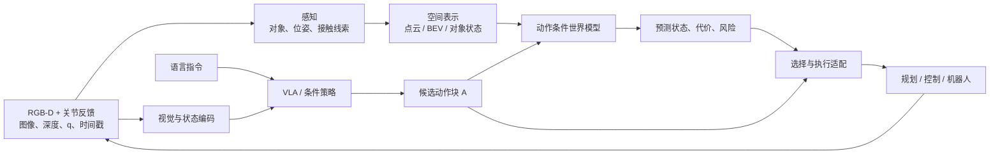
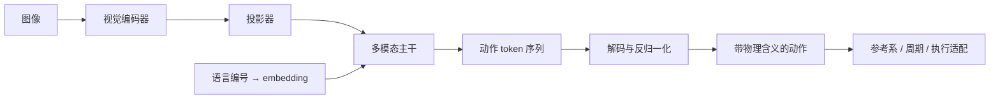
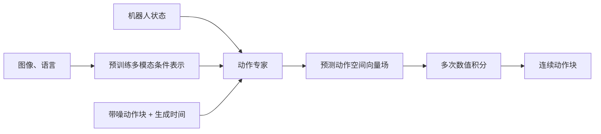
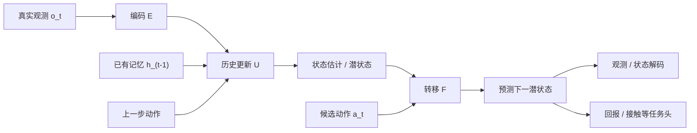
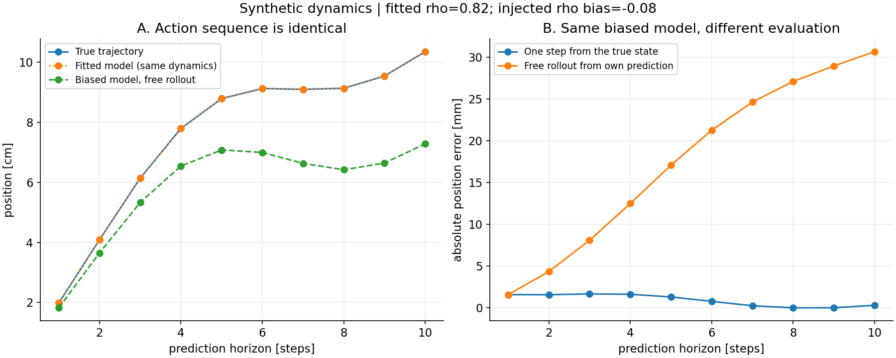
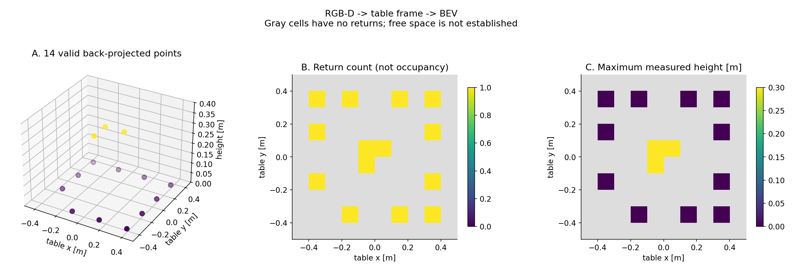

# D6 · 从多模态输入到动作生成、未来预测与空间表征

[返回学习入口](../_index.md) · [本周日程](../P1-第一周-扫盲日程.md) · [上一课：控制与动作接口](../day5/Daily-Learning-Pack.md) · [本课实验](demo.py)

**今天要建立的认识：VLA负责在观测和指令条件下产生动作，世界模型负责在动作条件下预测后果，BEV负责把空间信息组织到统一平面坐标中。三者可以组合，但一个模块的存在，不能证明另两个模块已经具备。**

上一课把“机器人动作”还原成了带单位、参考系、执行周期和反馈约束的接口。今天打开模型内部：图像为什么能和语言一起进入 Transformer？离散 token 如何变成连续位移？预测下一张图与预测一次抓取的后果差在哪里？深度点云为什么可以变成一张方便规划使用的俯视图？

继续使用 RGB-D 机械臂抓杯子的例子。桌上有红杯和蓝杯，你说“把红杯放到左边”。感知系统要确定对象，策略要产生动作，预测器要估计推碰与移动后果，执行器要完成运动。下面会反复区分：**正在计算什么、用什么数据学会、输出是否足够让下游作决定。**

<details>
<summary>个人学习记录（自动更新时保留）</summary>

<!-- learner-notes:start -->
**个人状态**：尚未提交本课作答；资料生成和代码验证不代表已经完成学习。

- 我能独立解释的机制：
- 我运行与修改的变量：
- 我仍然不理解的问题：
- 自测得分与纠错记录：
<!-- learner-notes:end -->

</details>

<!-- daily-pack-generated:start -->

## 学习目标与路线

学完后，应当能够：

- 画出 VLA 的视觉编码、语言表示、融合和动作输出链路，并标出输入输出 shape。
- 手算一次注意力加权与动作量化，解释它们引入了什么信息变换和误差。
- 区分离散动作自回归生成、连续动作块生成，以及实际控制执行。
- 用“状态是否足够、是否给动作、怎样评估 rollout”检查一个世界模型。
- 从深度像素推导桌面坐标，再写出 BEV 栅格索引和聚合操作。
- 跑通一个无需模型权重的实验，形成后续官方模型复现所需的资源与接口清单。

| 顺序 | 知识主线 | 需要回答的问题 |
| --- | --- | --- |
| 1 | 模块位置 | 策略、预测器、空间表征分别回答什么？ |
| 2 | 多模态编码 | 图像 patch、语言 token、本体状态怎样共同参与计算？ |
| 3 | 动作生成 | 连续动作怎样离散化？连续生成模型究竟迭代什么？ |
| 4 | 世界模型 | 状态、历史、动作、潜变量和未来预测怎样连接？ |
| 5 | BEV | 从透视图到度量空间，需要哪些几何假设？ |
| 6 | 工程与实验 | 如何定位失败、验证接口、准备复现环境？ |
| 7 | 总结与自测 | 能否把同一套机制迁移到自己的机器人管线？ |

## 1. 宏观：把“理解、行动、预测”放回闭环

### 1.1 三种输入输出，不是三个互斥流派

先定义本课符号：

| 符号 | 意义 | 示例或单位 |
| --- | --- | --- |
| $o_t$ | 机器人在时刻 $t$ 得到的观测 | 图像、深度、关节反馈、触觉 |
| $s_t$ | 环境与机器人用于描述动力学的状态 | 位置 m、速度 m/s、接触状态 |
| $h_t$ | 由历史观测和动作形成的记忆 | 向量，不必有物理单位 |
| $\ell$ | 任务语言 | “把红杯放到左边” |
| $a_t$ | 一个控制采样周期对应的动作 | 位移、关节目标或其他约定量 |
| $A_t$ | 一段动作序列 | $[a_t,\ldots,a_{t+H-1}]$ |
| $b_t$ | BEV 空间表征 | 每个平面栅格的高度、特征、有效性等 |

策略可以写成：

$$
A_t\sim \pi_\theta(A\mid o_{\le t},a_{<t},\ell).
$$

它回答：“在当前条件和任务下，应该做哪一段动作？”不同模型可能只用当前图像，也可能显式使用历史和本体状态；公式给的是一般条件集合，**不能据此声称每一个 VLA 都接收这些字段**。

世界模型的动作条件转移可以写成：

$$
\hat s_{t+1}=f_\phi(s_t,a_t).
$$

它回答：“如果从这个状态执行这个动作，下一步会怎样？”输出也可以是潜变量、观测分布或接触概率，不一定是显式物理状态。

BEV 构造则可以写成：

$$
b_t=\mathcal B(o_t,K,T,\text{grid specification}).
$$

$K$ 是相机内参，$T$ 是所需外参，grid specification 包括范围、分辨率和聚合规则。它回答：“怎样把不同视角的空间信息放到一个便于融合与查询的坐标网格？”

### 1.2 一张有明确数据流的系统图



图中的“VLA 候选动作 + 世界模型评分”是一个**教学系统设计**，不是所有 VLA 的内部结构，也不是你现有项目已经确认的实现。模块化策略、直接 VLA、模型预测控制可以有不同组合。

例如，纯几何抓取管线可以不使用 VLA；VLA 可以直接处理图像而没有显式 BEV；一个世界模型可以以 BEV 为状态，也可以处理图像潜变量。**是否采用 BEV，是表征设计；是否学习策略，是决策设计；是否学习后果，是动力学建模设计。**

> [!question] 先判断
> 模型输出“红杯会向左移动”的文字，是否已经足够给控制器使用？
>
> 想清楚缺少什么：移动多少、在哪个坐标系、经过多久、受什么动作影响、是否带不确定性，以及输出与真实反馈怎样对应。

## 2. 微观：图像、语言与机器人状态怎样变成模型输入

### 2.1 token 是序列位置，embedding 是数值表示

语言 tokenizer 把文本切成离散编号，例如 $[101,520,83,\ldots]$。编号只用于查找，不意味着编号 520 比 83 更接近“红色”。通过可学习表：

$$
E_{\text{text}}\in\mathbb R^{V\times d},\qquad
x_i=E_{\text{text}}[\text{id}_i]\in\mathbb R^d.
$$

$V$ 是词表大小，$d$ 是表示维度。模型随后处理的是向量 $x_i$，不是直接对字符或编号做物理运算。

视觉 token 则通常来自图像块或视觉编码器输出。为便于手算，假设一幅 $224\times224$ RGB 图像按 $16\times16$ 切块：

$$
N_p=(224/16)^2=196.
$$

每块展开后有 $16\times16\times3=768$ 个输入数。一个教学用线性投影把它映射到 $d=256$：

$$
\underbrace{X_{\text{patch}}}_{[B,196,768]}
\underbrace{W_p}_{[768,256]}
=
\underbrace{E_{\text{image}}}_{[B,196,256]}.
$$

这里的 $B$ 是 batch size。真实视觉编码器还会包含位置编码、多层注意力、归一化等计算；上式只解释形状变换。该切块思想可对照 [ViT 原论文](https://arxiv.org/abs/2010.11929)，**196 和 256 是本课示例，不是 OpenVLA 的固定配置**。

因此，“视觉 token”不必先成为一个整数；它可以直接是一段连续向量。“用了 token”与“动作被离散化”是不同判断。

### 2.2 投影到同一个维度，不等于已经理解彼此

假设视觉编码器给出 $E_v\in\mathbb R^{B\times N_v\times d_v}$，语言模型的隐藏维度为 $d$。投影器可写成：

$$
\tilde E_v=g_\psi(E_v)\in\mathbb R^{B\times N_v\times d}.
$$

投影器可能是一层线性层，也可能是 MLP。作用是使视觉信息能够进入后续模型的数值空间。**shape 能拼接是计算条件，语义是否对齐仍取决于训练。**

手工把“杯子特征”补零到语言维度，并不会自动让模型知道哪个语言词对应哪个物体。训练样本和目标函数需要推动相关信息进入可供下游使用的表示。

机器人本体状态（proprioception）提供“我自身现在是什么姿态”。示例：

$$
r_t=[q_1,\ldots,q_7,w]\in\mathbb R^8.
$$

$q_i$ 可以是关节角，$w$ 可以是夹爪宽度。它们的尺度不同，输入前通常要按照训练数据契约归一化，再投影为状态 token。只看腕部图像，有时不能唯一确定完整关节配置；状态输入可以补充视觉难以直接辨认的信息。

但状态字段不是越多越好：时间未对齐、单位错误、训练时没有而部署时强行补入，都可能让输入失去意义。

### 2.3 一个完整的教学 shape 表

以下是**假设模型**的 shape，用于练习检查维度，不对应某个官方 checkpoint：

| 对象 | shape | 解释 |
| --- | --- | --- |
| 双相机 RGB | $[B,2,3,224,224]$ | 两路视角，各有三个颜色通道 |
| 图像 patch 表示 | $[B,392,256]$ | 每视角 196 个 token |
| 文本编号 | $[B,32]$ | 32 是补齐后的序列长度 |
| 文本表示 | $[B,32,256]$ | 查 embedding 表后的结果 |
| 本体状态 | $[B,8]$ | 物理字段先按各自规范处理 |
| 状态 token | $[B,1,256]$ | 一种可能的投影方式 |
| 条件序列 | $[B,425,256]$ | $392+32+1=425$ |
| 连续动作块 | $[B,8,7]$ | 8 个控制采样点，每步 7 维 |

这里 7 维可以约定为三维位移、三维小旋转增量和夹爪命令，但它**不天然等于七关节角**。输出维度相同，不代表可直接接到同一个机器人。

另一个代价来自序列长度。常规全注意力的得分矩阵是 $N\times N$，计算和中间存储通常随 $N^2$ 增长。增加相机和历史帧会提高观测信息量，也会提高计算量；这就是多模态系统需要裁剪、压缩、稀疏注意力或缓存的原因之一。

## 3. 微观：注意力怎样实现条件相关的信息读取

### 3.1 Query、Key、Value 各自干什么

注意力可以理解为：**拿查询向量与候选信息的地址特征比较，再按比较结果读取候选内容。**

以交叉注意力为例：

$$
Q=X_qW_Q,\qquad K=X_cW_K,\qquad V=X_cW_V,
$$

$$
\operatorname{Attention}(Q,K,V)
=\operatorname{softmax}\left(\frac{QK^\top}{\sqrt{d_k}}+M\right)V.
$$

其中 $X_q$ 是查询侧输入，$X_c$ 是被读取的信息；$M$ 是可见性掩码，禁止访问的位置通常在加 softmax 前置为负无穷。softmax 对每一行的候选位置归一化。机制来源可对照 [Attention Is All You Need](https://arxiv.org/abs/1706.03762)。

单头形状为：

$$
Q:[B,N_q,d_k],\quad K:[B,N_k,d_k],\quad
V:[B,N_k,d_v].
$$

所以 $QK^\top$ 是 $[B,N_q,N_k]$，输出是 $[B,N_q,d_v]$。查询数量决定输出 token 数量，不是被读取 token 的数量。

同一序列产生 Q、K、V 是 self-attention；来自不同信息集合的查询与键值组合是 cross-attention。把图像和语言拼成一条序列后做 self-attention，也能产生跨模态交互；“多模态融合”并不强制采用一个独立命名的 cross-attention 层。

### 3.2 用红杯和蓝杯手算一遍

为隔离机制，手工指定：

$$
q=[1,0],\quad k_{\text{red}}=[1,0],\quad
k_{\text{blue}}=[0,1].
$$

它们是人为构造的“颜色特征”，没有经过训练。令值向量表示两个物体的平面位置：

$$
v_{\text{red}}=[0.2,0.1]\ \mathrm m,\quad
v_{\text{blue}}=[0.6,0.3]\ \mathrm m.
$$

取 $d_k=2$，两个分数是 $[1/\sqrt2,0]$。softmax 后：

$$
\alpha\approx[0.669762,0.330238].
$$

加权结果为：

$$
c=0.669762v_{\text{red}}+0.330238v_{\text{blue}}
\approx[0.332095,0.166048]\ \mathrm m.
$$

注意，结果落在两物体之间！它并不等于红杯位置。这说明加权读取是一个中间计算，后续还需利用上下文、训练目标和输出头得到适合任务的结果。

引入教学温度参数 $T>0$：

$$
\alpha_i=\frac{\exp(s_i/T)}{\sum_j\exp(s_j/T)}.
$$

$T$ 从 1 降到 0.2 时，红杯权重会接近 0.972，读取更尖锐。但错误特征同样会被尖锐放大。**更集中的注意力不等于更正确，更不等于通过校准的成功概率。**

### 3.3 mask 限制的是信息路径

自回归动作生成时，第 $i$ 个动作 token 不应该偷看第 $i+1$ 个真实标签，否则训练时出现部署时不可获得的信息。

```text
条件：图像、指令
第1个动作 token：读条件
第2个动作 token：读条件 + 第1个 token
第3个动作 token：读条件 + 前2个 token
...
```

训练可通过因果 mask 并行计算各位置损失；推理要在没有真实未来 token 的条件下逐步生成。多步连续动作生成则可以允许同一个带噪动作块内部相互注意，因为整个带噪块在采样时都存在。**mask 是否合理，取决于每个阶段有哪些信息实际可用。**

## 4. 微观：离散动作 token 怎样回到物理动作

### 4.1 VLM 到 VLA，改变的不只是末尾文字

VLM 的视觉语言任务可以输出描述、答案或其他语义表示。VLA 增加与动作相联系的训练和输出机制，使结果能按明确契约解释为机器人动作。

[RT-2](https://robotics-transformer2.github.io/) 的代表思路是把动作表示为可由视觉语言模型预测的 token，并结合机器人轨迹与视觉语言任务训练。[原版 OpenVLA](https://openvla.github.io/) 使用 DINOv2 与 SigLIP 的融合视觉编码、投影器和 Llama 2 主干来预测动作 token。这里只讨论原版的机制，不把后来连续动作或高效微调变体的能力混入原版。



图强调两个容易忽略的边界：主干产生的符号必须解码；解码之后仍要满足执行接口。不能看到一个 float 数组就跳过坐标、单位和动作模式检查。

### 4.2 均匀量化的手算例

下面自行定义一个教学量化器，**不是对某个 VLA tokenizer 的逐行复现**。

设一维位移范围为 $[l,u]=[-0.04,0.04]\ \mathrm m$，分为 $M=8$ 个桶。桶宽：

$$
\Delta=\frac{u-l}{M}=0.01\ \mathrm m.
$$

编码采用下取整并截断到合法编号：

$$
k=\min(M-1,\max(0,\lfloor(a-l)/\Delta\rfloor)).
$$

解码用桶中心：

$$
\hat a=l+(k+0.5)\Delta.
$$

当 $a=0.013\ \mathrm m$：

$$
k=\lfloor5.3\rfloor=5,\qquad
\hat a=0.015\ \mathrm m.
$$

误差是 2 mm。对于范围内的数，该中心解码器的最大绝对误差不超过 $\Delta/2=5$ mm；端点通过编号截断处理。

这不是说一个机器人最终最多错 5 mm。量化误差只是局部表示误差，后面还存在模型预测、标定、执行和接触误差。

### 4.3 两个能暴露隐藏假设的反例

**反例一：输入越界。** $a=0.08$ m 被截到最后一个桶，解码成 0.035 m，误差 45 mm。半个桶宽的界限只在原量化范围内成立。

**反例二：零动作。** 上述偶数桶、中心解码方案没有恰好为零的中心；$a=0$ 被解码为 0.005 m。如果系统依赖精确的“保持不动”，需要专门设计表示、死区或保持动作，不能假设所有量化器都保留零。

增加桶数会降低量化间隔，却可能增加输出选择与学习难度。动作维度间的耦合也不会因为每一维分桶就消失：单维预测都合理的组合，仍可能不满足运动学或碰撞约束。

### 4.4 损失函数与部署处理分别在哪里

离散动作序列的一个基本训练目标是：

$$
\mathcal L_{\mathrm{CE}}
=-\sum_{i=1}^{D_A}\log p_\theta(k_i^*\mid o,\ell,k_{<i}^*).
$$

$D_A$ 是动作 token 序列长度，$k_i^*$ 是演示标签。训练时用真实前缀，推理时使用模型自己生成的前缀；这种差异需要在 rollout 中检查。

如果训练前进行了按维归一化，模型输出还须使用**匹配训练数据和机器人动作定义**的统计量反归一化。示例标准化：

$$
\tilde a_j=(a_j-\mu_j)/\sigma_j,\qquad
a_j=\tilde a_j\sigma_j+\mu_j.
$$

这只是常见形式之一；有的系统采用分位数区间，有的字段不作相同处理。应读取实际实现，不能凭经验把所有 checkpoint 都按均值方差还原。

当一个末端平移量本来是 0.01 m，你用毫米数值解释成 0.01 mm，或者把相机坐标误作基座坐标，错误不会通过更强的语言能力自行消失。

## 5. 微观：连续动作块与 flow matching

### 5.1 为什么一次生成一段动作

机械臂绕过杯柄、接近、闭合夹爪，是一段有时间关联的运动。每一步孤立预测可能缺乏连续性；动作块可以把未来多个采样点联合表示：

$$
A_t=[a_t,\ldots,a_{t+H-1}]\in\mathbb R^{H\times d_a}.
$$

$H$ 是控制采样点数量，$d_a$ 是每步动作维度。例如 $H=8$、周期 0.1 s，对应计划范围 0.8 s。但可以只执行前 $K=2$ 步，再读取新观测重算。$H$ 是预测跨度，$K$ 是反馈前实际执行的步数。

“联合生成”不意味着所有生成方式都相同：[ACT](https://tonyzhaozh.github.io/aloha/) 使用动作块的模仿学习结构；[Diffusion Policy](https://diffusion-policy.cs.columbia.edu/) 使用条件生成动作轨迹；$\pi_0$ 在预训练 VLM 基础上增加动作专家，通过 flow matching 产生连续动作块。后两者都是生成式策略，**生成对象是动作，不因此成为预测环境后果的世界模型**。本课重点是读懂这一结构关系；具体比较将在后续操作学习课程继续展开。

### 5.2 从噪声到动作：先固定一种时间约定

以下推导使用 $0\rightarrow1$ 的生成时间 $\tau$，与机器人时刻 $t$ 区分。

取真实演示动作块 $A^*$ 和同 shape 噪声 $\epsilon$，定义直线插值：

$$
A_\tau=(1-\tau)\epsilon+\tau A^*,\qquad \tau\in[0,1].
$$

在这条路径上：

$$
\frac{dA_\tau}{d\tau}=A^*-\epsilon.
$$

训练一个向量场 $v_\theta(A_\tau,\tau,c)$，$c$ 表示图像、语言和机器人状态条件：

$$
\mathcal L_{\mathrm{FM}}
=\mathbb E\left[
\left\|v_\theta(A_\tau,\tau,c)-(A^*-\epsilon)\right\|^2
\right].
$$

各变量的 shape 都要对齐：$A_\tau,\epsilon,A^*,v_\theta$ 为 $[B,H,d_a]$，$\tau$ 为 $[B]$，广播时常整理为 $[B,1,1]$。输入动作应按约定规范化，避免米、弧度和夹爪字段的数值尺度不当地支配损失。

训练标签中有 $A^*$，所以目标速度可以直接构造；推理时没有 $A^*$，必须依赖学到的向量场。

### 5.3 一个数字例子与真正的推理区别

取一维 $\epsilon=-0.02$，$A^*=0.04$：

$$
A_{0.25}=0.75(-0.02)+0.25(0.04)=-0.005,
\quad
u=A^*-\epsilon=0.06.
$$

这个算例说明训练样本和目标怎样产生。**已知目标后画一条直线，不等于训练好了生成模型。** 在真实训练中，不同条件、不同动作样本给出大量这样的局部监督，模型要学到条件相关的向量场。

最简单的 Euler 采样为：

$$
A_{\tau+\Delta\tau}
=A_\tau+\Delta\tau\,v_\theta(A_\tau,\tau,c).
$$

```python
# 结构伪代码：不是已经训练好的策略
A = normal_noise(shape=(B, H, action_dim))
for n in range(num_integration_steps):
    tau = n / num_integration_steps
    velocity = action_expert(A, tau, image_language_state)
    A = A + velocity / num_integration_steps
# 解码物理动作，适配接口，执行前 K 步，再读取真实反馈
```

这里的“velocity”是**动作空间中相对于生成时间的变化率**，不是必然等于机器人末端速度。模型内部迭代 10 次，也不是让机器人实际移动 10 次。

### 5.4 读原理和读源码，必须核对时间方向

[$\pi_0$ 原论文](https://arxiv.org/abs/2410.24164) 的结构重点是 VLM 条件与动作专家的结合。其 [openpi 动作模型实现](https://github.com/Physical-Intelligence/openpi/blob/main/src/openpi/models/pi0.py) 在本次核对时采用另一种时间约定：

$$
A_\tau=\tau\epsilon+(1-\tau)A^*,\quad
u=\epsilon-A^*,\quad \Delta\tau<0.
$$

这套约定从噪声端 $\tau=1$ 积分到动作端 $\tau=0$，与上面的正向约定数学上可对应。**插值、监督方向和积分步长必须成套使用**；拿一篇材料的正向步长配另一份代码的反向速度，会朝错误方向更新。



图里的表示交互和 mask 需要按具体实现检查。不能把“有 VLM”简化成“先让语言模型输出一句规划文本，再由另一个完全独立模型执行”；这只是可能的系统设计之一。

## 6. 微观：世界模型为什么需要状态、历史与动作

### 6.1 一张照片相同，未来仍然可以不同

假设桌面滑块的位置是 $x=0.2$ m。两种情形里相机都看到同一个位置，但：

- 情形 A：滑块速度 $v=+0.1$ m/s，正在向右。
- 情形 B：滑块速度 $v=-0.1$ m/s，正在向左。

不给速度或历史，下一步位置通常无法唯一确定。观测 $o_t$ 是传感器能看到的量；状态 $s_t$ 则试图包含预测转移所需的信息。两者不必相同。

若一组变量满足：

$$
p(s_{t+1}\mid s_{\le t},a_{\le t})
=p(s_{t+1}\mid s_t,a_t),
$$

我们称其满足相应的马尔可夫条件。实际机器人往往只能部分观测，需要通过历史估计状态或维护信念。上一帧不是装饰性输入，而可能补充速度、遮挡和接触演化信息。

本课透明模型采用：

$$
v_{t+1}=\rho v_t+g a_t\Delta t,\qquad
x_{t+1}=x_t+v_{t+1}\Delta t.
$$

这里 $a_t$ 是加速度命令，单位 m/s²；$g$ 为无量纲增益，$\rho$ 为每步速度保留系数。我们明确采用**先更新速度、再用新速度更新位置**的离散规则，不与另一种积分规则混用。

取 $\rho=0.82$、$g=1.2$、$\Delta t=0.1$ s、$a_t=0$，上面两种状态的下一位置分别为：

$$
0.2+0.82(0.1)(0.1)=0.2082\ \mathrm m,
\qquad
0.1918\ \mathrm m.
$$

单看当前 $x$ 的确定性预测器，只能对不同未来作折中，除非它还获得区分两种情形的信息。

### 6.2 编码器、记忆、转移与解码器

一个一般化潜空间模型可写为：

$$
e_t=E_\phi(o_t),\quad
h_t=U_\phi(h_{t-1},e_t,a_{t-1}),\quad
\hat z_{t+1}=F_\phi(h_t,z_t,a_t).
$$

随后可以接不同输出头：

$$
\hat o_{t+1}=D_\phi(\hat z_{t+1}),\quad
\hat r_t=R_\phi(h_t,z_t,a_t),\quad
\hat p_{\text{contact}}=C_\phi(\hat z_{t+1}).
$$

这些公式是架构模板，不是所有方法都必须包含全部模块。潜状态 $z_t$ 不一定是人可解释的坐标；记忆 $h_t$ 也不保证已经包含所有重要物理因素。



编码器减小输入规模或提取任务信息；记忆处理观测不完整；转移描述动作后的演化；解码或任务头使预测可评价、可供决策使用。**低维表示不是自动可靠的状态压缩**：若把杯子是否已被夹紧丢掉，未来抓起还是滑落就难以预测。

### 6.3 为什么“给动作”改变了问题

仍取上面的动力学，固定 $x=0.2$ m、$v=0$，分别施加 $a=\pm0.5$ m/s²：

$$
x_{t+1}=0.2\pm1.2\times0.5\times0.1^2
=0.2\pm0.006.
$$

下一位置是 0.194 m 或 0.206 m。如果数据中两种动作等概率发生，而预测器看不到动作，那么在平方误差下，最优的确定性输出是均值 0.2 m，RMSE 为 6 mm。

它可能对“这类视频通常怎样变化”学得很好，却不能区分“我现在向左推”和“向右推”的后果。这是动作条件建模与被动视频预测之间的关键差别。

同样，数据中写了 action 字段也不够：若采样错位，$a_t$ 实际对应另一个时间段；若总是向右推，模型没有足够证据学向左的响应；若只在简单场景采集，复杂接触状态仍可能超出支持范围。

### 6.4 Dreamer 与 V-JEPA 的名字背后，要看学习和使用阶段

[DreamerV3](https://danijar.com/project/dreamerv3/) 的重要连接是：利用学到的世界模型进行想象，在这些预测轨迹中改善策略与价值估计。它不是“部署时每一步都必须穷举动作并跑 MPC”的同义词。**模型可以用于训练策略，也可以用于在线规划，使用位置要分开。**

[V-JEPA 2 官方实现](https://github.com/facebookresearch/vjepa2) 区分视频表征学习与 V-JEPA 2-AC 的动作条件阶段。无动作视频能够提供丰富的时空表征监督，但控制用途仍需要与机器人动作相关的建模和评价。不要把基础表征预训练、动作条件后训练、规划应用视为同一个训练目标。

本课脚本是一个**显式状态的两参数转移预测器**。它真正从合成转移数据拟合参数，但没有训练视觉编码器、潜变量模型或策略，不应写成“复现了 Dreamer / V-JEPA / VLA”。

## 7. 微观：学会一步预测，为什么还不能保证规划可靠

### 7.1 用两列最小二乘实际学动力学

对每个训练样本构造：

$$
X_i=[v_i,\ a_i\Delta t],\qquad y_i=v_{i+1}.
$$

于是：

$$
\hat\beta=
\begin{bmatrix}\hat\rho\\\hat g\end{bmatrix}
=\arg\min_\beta\|X\beta-y\|_2^2.
$$

在 $X$ 的列满秩时，正规方程给出：

$$
(X^\top X)\hat\beta=X^\top y.
$$

脚本用两列的显式 $2\times2$ 解便于阅读。实际较大的数值问题通常应采用 QR、SVD 或合适求解器，避免为求解显式计算矩阵逆。D7 会回查这层线性代数。

为什么要检查激励？如果所有动作都是零，第二列全部为零，无论 $g$ 取什么值，对已有训练数据的预测都相同。**不是优化器不够强，而是数据没有提供辨认该参数的证据。**

我们的训练集是 200 个随机速度与动作构成的无噪声转移，测试使用另一段正弦动作序列。拟合几乎精确，是因为模型族包含真实规则，数据也很干净；不能把这一结果外推到真实接触动力学。

### 7.2 teacher forcing 与自由 rollout 的输入不一样

一步评价：

$$
\hat s_{t+1}=f_\phi(s_t^{\mathrm{true}},a_t).
$$

自由 rollout：

$$
\hat s_{t+1}=f_\phi(\hat s_t,a_t),\qquad
\hat s_t=f_\phi(\hat s_{t-1},a_{t-1}).
$$

前者每一步都由真实状态重新起步，后者把自己的预测送回模型。后者会让误差改变下一次输入，是规划更需要关心的场景。

对状态小扰动作局部线性化：

$$
e_{t+1}\approx J_t e_t+\delta_t,
\qquad
J_t=\frac{\partial f}{\partial s}.
$$

$\delta_t$ 是局部模型偏差，$J_t$ 描述已有误差怎样经转移传播。误差可能放大、衰减或抵消；不能简单宣称任何模型的误差都必然单调增长，但不能只测一步就忽略长期行为。

### 7.3 实测：相同模型偏差，两种评估给出不同印象

实验先拟合出 $\hat\rho=0.82,\hat g=1.2$，再**人为将预测器的 $\rho$ 减少 0.08**，其余条件不变。这是受控模型偏差实验，不是训练自然产生了该偏差。



左图：准确拟合模型与真实轨迹重合；有偏模型使用同一动作序列却逐渐偏离。右图：每一步用真实状态启动时，当前一步误差很小；自由 rollout 已经积累了位置偏差。

| 预测跨度 | 当前一步误差：从真实状态起步 | 自由 rollout 的终点位置误差 |
| --- | --- | --- |
| 1 步 | 1.600 mm | 1.600 mm |
| 5 步 | 1.324 mm | 17.099 mm |
| 10 步 | 0.327 mm | 30.679 mm |

这是固定初态 $(x,v)=(0,0.2)$、周期 0.1 s 和指定动作序列的**绝对位置误差**，不是整套数据的 RMSE，也不是机器人实测成功率。

规划会根据预测结果挑选动作。有时一个模型平均误差很低，却在“最有希望成功”的候选动作附近系统性乐观；优化器恰好偏爱这些错误。评价时需要加入候选排序、约束违例、任务成功率和真实反馈，而不只是预测曲线美观。

### 7.4 今天的 Learning 五格卡

| 问题 | 离散动作策略 | 显式转移预测器 | BEV 构造 |
| --- | --- | --- | --- |
| 数据从哪里来 | 观测、指令、演示动作 | $(s,a,s')$ 转移 | 深度、相机几何、有效点 |
| 学什么 | 条件动作分布 | 状态和动作到下一状态的映射 | 本课是确定性几何处理，无学习参数 |
| 改善信号 | 演示 token 的交叉熵 | 下一状态或速度误差 | 若纯几何构造，无训练 loss |
| 训练与推理 | 真实动作标签只在训练可见 | 拟合后可以一步预测或 rollout | 按规则投影和聚合 |
| 怎样测泛化 | 新目标、初态、背景和动作接口下的任务表现 | 新状态动作、扰动、不同预测跨度 | 标定误差、分辨率、遮挡、不同几何 |

网络结构、监督来源和部署用途是不同分类轴。一个 Transformer 可以训练成策略或预测器；同样，BEV 可以用纯几何规则构造，也可以由神经网络预测。

## 8. 微观：RGB-D 怎样变成具有物理尺度的 BEV

### 8.1 先把深度的含义说清楚

本课深度 $Z$ 指相机光轴方向的深度，单位 m；它不是到相机中心的欧氏距离。假设像素已符合针孔模型，或已经完成所需去畸变。

$$
K=
\begin{bmatrix}
f_x&0&c_x\\
0&f_y&c_y\\
0&0&1
\end{bmatrix},
\qquad
p_c=ZK^{-1}[u,v,1]^\top.
$$

展开得到：

$$
X_c=\frac{(u-c_x)Z}{f_x},\quad
Y_c=\frac{(v-c_y)Z}{f_y},\quad Z_c=Z.
$$

$u,v,f_x,f_y,c_x,c_y$ 以像素为单位，乘以 $Z$ 后得到米。若接口返回沿射线距离 $r$，则需先取单位射线方向，不能直接把 $r$ 当作上式的 $Z$。

为建立统一空间，应用外参：

$$
p_b=R_{bc}p_c+t_{bc}.
$$

下标 $bc$ 表示把相机系点转换到目标坐标系 $b$。矩阵方向错时，即使点云看起来仍像桌面，也可能在机器人坐标里翻转或偏移。

### 8.2 一个向下看的相机算例

设相机位于桌面上方 1 m，朝下看；本课定义桌面坐标 $x$ 向右、$y$ 沿桌面向远处、$z$ 向上。光学相机坐标 $x$ 向右、$y$ 向图像下方、$z$ 向前。

两坐标通过：

$$
R_{bc}=\operatorname{diag}(1,-1,-1),\qquad
t_{bc}=[0,0,1]^\top\ \mathrm m.
$$

该旋转的行列式为 $+1$，是合法旋转，不是只翻一个轴造成的镜像。这里的桌面坐标是我们显式定义的，不自动等于 ROS 的机器人基座坐标。

在 $4\times4$ 合成深度图中，取 $f_x=f_y=4$ px，$c_x=c_y=1.5$ px，像素 $(u,v)=(1,1)$ 的深度 $Z=0.7$ m：

$$
p_c=[-0.0875,-0.0875,0.7]^\top\ \mathrm m,
$$

$$
p_b=[-0.0875,0.0875,0.3]^\top\ \mathrm m.
$$

它是一个高于桌面 0.3 m 的表面点。这些内参和深度值是为了手算的合成输入，不能照搬到 RealSense。

### 8.3 BEV 索引：从米到行列号

BEV（Bird's-Eye View，鸟瞰表征）通常在选定参考系的 $x-y$ 平面上划网格。设：

$$
x,y\in[-0.5,0.5),\qquad r=0.1\ \mathrm{m/cell}.
$$

共 $10\times10$ 个格子。约定列 $j$ 对应 $x$，行 $i$ 对应 $y$：

$$
j=\left\lfloor\frac{x-x_{\min}}r\right\rfloor,\qquad
i=\left\lfloor\frac{y-y_{\min}}r\right\rfloor.
$$

上述点得到：

$$
j=\lfloor4.125\rfloor=4,\qquad
i=\lfloor5.875\rfloor=5.
$$

也就是数组 `grid[5][4]`。画图时让较小 $y$ 在下方，需要显式设置 `origin="lower"`，否则画面行方向可能让你误读坐标。

下边界包含、上边界不包含：$x=-0.5$ 合法，$x=0.5$ 越界。先做范围检查，再计算索引。不要为了避免异常，把范围外的所有点粗暴 clamp 到边缘格子，制造不存在的边缘障碍物。

### 8.4 一个格子里存什么，决定能回答什么

设落在格子 $(i,j)$ 内的点集为 $\mathcal P_{ij}$：

$$
n_{ij}=|\mathcal P_{ij}|,\qquad
h_{ij}^{\max}=\max_{p\in\mathcal P_{ij}}z_p.
$$

还可存平均特征、类别概率、高度分布、时间戳、观测有效性等。例如：

$$
b_t\in\mathbb R^{B\times C\times H_b\times W_b}.
$$

本课用点计数、最大高度和有效性三个通道，shape 可组织为 $[B,3,10,10]$。最大高度只对有点的格子定义；代码用 `None` 表示无观测，另保留布尔 mask，而不是把无观测默认填成“高度为零的桌面”。



左图显示 14 个有效反投影点；中图显示收到点的位置；右图保留最大测量高度。灰色表示没有返回点。我们只采样了极少数射线，灰色不能解释成空间一定为空。

这张 BEV 也没有重建物体内部的占用体积：点来自可见表面。要生成碰撞模型，还需明确表面到占用的建模假设、射线信息、膨胀和不确定区域处理。

### 8.5 BEV 能简化规划，也会丢信息

两个物体在同一 $x-y$ 格子中，一个高 0.02 m，另一个高 0.4 m。如果只存“有没有点”，两者完全相同；但夹爪从 0.1 m 高处横向通过，几何后果不同。

加入最大高度能够区分这两例，却仍无法完整表达“下面有空隙、上面有横梁”的多层结构。高度分层、体素、距离场或完整点云可能更合适。**没有一种平面压缩，能在没有额外信息的情况下保留所有三维关系。**

网格变粗还会让不同目标落入同一单元。如果把点用格子中心近似，在边长 $r$ 的平面格子内，最坏中心距离是：

$$
e_{\max}=\frac{\sqrt2}{2}r.
$$

$r=0.1$ m 时约为 7.07 cm。这一界限针对“用中心代替任意格内点”的操作，不代表所有 BEV 网络都只能定位到这个精度；子格偏移回归可以恢复更细位置。但它提醒你：规划接口拿到的是格子中心还是连续位置，需要确认。

## 9. 从几何 BEV 到学习 BEV：变的是映射，不是坐标意义

### 9.1 有测量深度，可以按几何落点

前面每个有效像素有一个确定的深度值，反投影得到一个三维点，再聚合到网格。优点是过程透明，容易追踪标定和量测误差；局限是缺失深度、遮挡和噪声会直接传入表征。

对于 RGB-only 图像，一条像素射线上的深度不唯一。若没有额外几何或学习信息，不能只凭一个像素坐标决定它对应哪个 BEV 单元。

### 9.2 Lift-Splat-Shoot：把深度不确定性展开后聚合

[Lift-Splat-Shoot](https://research.nvidia.com/labs/toronto-ai/lift-splat-shoot/) 的核心是把图像特征提升到一组深度假设上，再聚合到 BEV。一个示意表达是：

$$
F(u,v,d)=p(d\mid u,v)\,c(u,v).
$$

$c$ 是图像特征，$p(d\mid u,v)$ 是离散深度权重。同一个像素在多个深度位置贡献不同权重的特征，经内外参转换后 splat 到共同网格。

这不是把透视图做一次普通缩放或俯视截图。深度、相机位姿和多视角重叠决定哪些内容应落到同一物理位置。论文中的 shoot 部分将候选轨迹与 BEV 代价联系起来；不意味着任何 BEV 特征都天然就是可用的运动代价。

### 9.3 BEVFormer：从 BEV 查询相关图像和历史

[BEVFormer](https://arxiv.org/abs/2203.17270) 使用网格状 BEV queries，通过空间交叉注意力从多相机相关区域取特征，并通过时间注意力融合历史 BEV 信息。可以把方向理解为：“这个 BEV 位置需要看哪些图像区域与历史信息？”

| 路径 | 关键已知或学习量 | 需要特别检查 |
| --- | --- | --- |
| RGB-D 几何投影 | 测量深度、内外参 | 无效深度、时间与坐标 |
| Lift-Splat 类路径 | 图像特征、深度权重、几何投影 | 深度假设、聚合、标定 |
| BEV query 注意力路径 | 空间查询、图像特征、历史特征 | 查询位置、可见性、时序对齐 |

以上是机制定位，不是精度排名。换表征方案时，要按照任务、输入传感器、范围、延迟、训练数据和评价协议做实际对照。

### 9.4 同时有 BEV 和时间信息，仍不自动成为动作条件世界模型

历史 BEV 融合可以帮助估计目标运动，但如果系统只是输出当前检测框，它主要是时序感知。若希望预测“执行这个推行动作后杯子和障碍物怎样变化”，还需要动作条件、未来监督和对应的评价。

类似地，静态地图、NeRF 和三维重建可以提供几何环境，但不单凭“表示了世界”就满足动作条件动力学建模。**问输出变量和训练目标，比看模型名字有效。**

## 10. 回到宏观：真实机器人系统怎样组合与定位失败

### 10.1 抓红杯的三条可比较路径

| 路径 | 决策链 | 适合做的对照 |
| --- | --- | --- |
| 模块化几何路径 | 语言定位 → RGB-D 目标点云 → 物体/抓取位姿 → IK、碰撞和轨迹 → 控制 | 定位、位姿、规划的误差分别如何影响成功 |
| 条件动作策略路径 | 图像/指令/规定状态 → VLA → 动作解码与适配 → 控制 | 对新背景、目标和动作定义的泛化 |
| 策略加预测路径 | 候选动作 → 世界模型 rollout → 评分/筛选 → 执行与反馈 | 加入预测后成功率、时延和失败模式是否改善 |

真实系统中，BEV 可作为目标和障碍物的空间组织，点云可用于精细碰撞，VLA 可提供动作候选，控制器跟踪目标。也可以选择更简单的一条链。组合的价值需要用同初态、同任务、同输入和明确预算验证。

一个候选评分目标可以写成：

$$
J(A)=\sum_{k=1}^{H}
\left(
w_g\|\hat p_k-p_{\mathrm{goal}}\|^2
w_c\,\hat c_k
w_u\|a_k\|^2
\right).
$$

三项分别代表目标距离、预测碰撞代价和动作幅度。它们的量纲不同，权重和归一化必须明确；$\hat c_k$ 若来自不可靠预测，低代价不代表真实安全。该式是教学设计，不是已经在真机验证的控制器。

### 10.2 一份最低限度的观测动作契约

下面是接口示意，字段值需由实际数据管线提供：

```text
observation:
  rgb: 各相机图像、颜色顺序、裁剪/缩放规则
  depth: 数组、有效掩码、单位、Z深度或射线距离
  camera: K、畸变处理、T_target_camera、标定版本
  robot_state: 关节角/速度/夹爪状态与各自单位
  timing: 图像与状态时间戳、同步误差、观测年龄
  instruction: 任务文本与坐标语义，例如“左边”的参考

action:
  mode: 关节目标 / 末端绝对位姿 / 增量 / 速度
  values: 与mode匹配的维度、单位、顺序
  frame: 基座 / 工具 / 相机等明确坐标
  period: 每个动作对应的执行周期
  chunk: H个采样点，实际执行前K步
  gripper: 连续宽度还是开关，正负号与边界
  preprocessing: 归一化与反归一化配置

feedback:
  commanded: 计划发送的动作
  executed: 实际接受/执行状态与时间
  measured: 实测状态、接触与任务成功判据
```

尤其不要把“已经发给驱动”记录成“已经成功执行”。使用 ROS 消息也不会自动修复字段语义错误；消息类型和 frame_id 只是契约的一部分。

### 10.3 如何避免把所有失败都归咎于“大模型不够聪明”

| 现象 | 先查看什么 | 可以做的隔离实验 |
| --- | --- | --- |
| 总是伸向两个杯子中间 | 目标选择、视觉表示、输出头行为 | 固定图像只改指令；替换为已知目标坐标 |
| 方向对但位移差几个数量级 | 单位、反归一化、增量/速度模式 | 输入已知小动作，离线核对解码 |
| BEV 障碍位置随相机旋转而错位 | 外参方向、坐标定义 | 用已知桌面点验证变换 |
| 一步预测很好，接近目标后偏离 | 历史状态、自由 rollout、接触分布 | 固定动作序列评估 1/5/10 步 |
| 离线动作误差低，闭环失败多 | 反馈频率、动作块执行跨度、数据分布 | 减少执行前缀 K，记录观测年龄和恢复行为 |
| 预测器偏好实际会碰撞的路径 | 代价定义、未知空间、模型误差利用 | 对候选排序做真实或高质量仿真核验 |

这些检查以离线、回放或合成实验为先；本课没有连接、发送或执行任何真实机器人指令。

## 11. 环境准备：把“能开始学习”与“能运行官方大模型”分清

### 11.1 今天已经具备的最小入口

[demo.py](demo.py) 只使用 Python 标准库，自带合成输入，不依赖 NumPy、PyTorch、Open3D、GPU、模型权重或相机。

在笔记库根目录运行：

```bash
python3 -B 3d_learning/day6/demo.py
```

`-B` 让这次执行不产生 Python 字节码缓存。程序输出 JSON，包含 Python/系统/种子、注意力结果、量化误差、拟合参数、逐步预测和 BEV；最后 `"checks": "passed"` 表示内置数值断言通过。

这是今天学习机制的已验证入口。环境准备的目标不是马上安装所有模型，而是让后续问题有可检查的前提。

### 11.2 为什么“7B 模型”不能直接换算为“电脑有 14GB 就能运行”

仅考虑 $7\times10^9$ 个参数、每参数 2 bytes 的示例：

$$
M_{\mathrm{weights}}=7\times10^9\times2
=14\times10^9\ \mathrm{bytes}
\approx13.0\ \mathrm{GiB}.
$$

这是**仅权重下界示例**，不是某个 checkpoint 的完整显存要求。还要考虑视觉输入、激活、缓存、临时张量、框架和设备算子；训练还涉及梯度、优化器状态和其他内存。

量化可以减少一部分权重存储，但具体算子是否支持 CPU、MPS 或 CUDA，模型加载路径和依赖是否兼容，仍需分别确认。统一内存容量也不能直接证明所有 CUDA 代码都能在 Mac 上执行。

### 11.3 官方复现前，形成一张资源卡

| 项目 | 必须记录的内容 | 今天的状态 |
| --- | --- | --- |
| 模型身份 | 原论文版本、仓库、commit、checkpoint、许可证 | 已定位代表来源；尚未固定后续正式复现快照 |
| 环境 | OS、Python、框架、设备后端、关键算子 | CPU 标准库实验已验证 |
| 输入适配 | 相机数、分辨率、语言、状态字段 | 本课给出契约；真实数据待按项目落实 |
| 输出适配 | 模式、维度、反归一化、参考系、周期 | 需匹配选定模型与机器人 |
| 资源 | 权重、峰值内存、磁盘、吞吐、时延 | 不用参数量代替实测 |
| 验证层级 | 单样本前向、离线回放、仿真、真机 | 本课只完成合成机制实验 |

截至本课核对，[OpenVLA README](https://github.com/openvla/openvla) 的基本示例涉及 CUDA 加载路径，[openpi README](https://github.com/Physical-Intelligence/openpi) 给出其设备与运行要求；它们不能直接当成本机 CPU 已验证命令。[V-JEPA 2 README](https://github.com/facebookresearch/vjepa2) 还明确记录了视频读取依赖的 macOS 限制。后续选定官方复现路径时，应再次读取对应版本的环境说明。

今天没有修改已有深度学习环境、安装大型依赖或下载 checkpoint。后续建议按“当前 CPU 算例 → 小型张量实现 → 官方单样本推理 → 离线适配 → 仿真闭环”逐层验收，避免同时引入多个无法区分的故障源。

## 12. 动手：先预测，再改变一个变量

### 12.1 四个实验各自验证什么

| 实验 | 输入 | 应观察的结果 | 不能据此宣称什么 |
| --- | --- | --- | --- |
| 注意力 | 手工 query/key/value | 加权位置与温度变化 | 没有训练真实多模态语义 |
| 动作量化 | 三个一维动作 | 桶内误差、零点偏移、越界饱和 | 没有运行官方动作 tokenizer |
| 转移模型 | 200 个合成转移 | 两参数拟合、自由 rollout 偏差 | 没有复现潜变量世界模型或真机动力学 |
| RGB-D → BEV | $4\times4$ 深度图 | 14 个有效点、计数、高度和有效性 | 没有得到完整占用或碰撞地图 |

先写下四个预测：

1. 注意力结果会等于红杯坐标，还是落在两个杯子之间？
2. 0.08 m 的动作会不会仍满足 5 mm 的量化误差界限？
3. 模型每一步只偏一点，10 步自由 rollout 会和一步评价一样好吗？
4. 空格子的最大高度应该是 0，还是“没有足够观测”？

### 12.2 运行与改变量

默认实验并保存完整结果：

```bash
python3 -B 3d_learning/day6/demo.py --output _assets/3d_learning/day6/results.json
```

只改变注意力温度：

```bash
python3 -B 3d_learning/day6/demo.py --temperature 0.2
```

把人为模型偏差改为零：

```bash
python3 -B 3d_learning/day6/demo.py --rho-bias 0
```

换一个训练数据种子：

```bash
python3 -B 3d_learning/day6/demo.py --seed 23
```

后三条只输出到终端，不覆盖默认结果文件。由于训练是无噪声、模型形式匹配的简单问题，换种子不应让正确参数显著变化。若你给训练标签加噪声，结果就应改为误差与稳定性分析，不能继续要求严格等于 0.82 和 1.2。

BEV 进一步改动：把 `bev(points)` 的分辨率改为 0.2 m，观察哪些点落到同一格。先写出预测，再检查 counts。注意脚本中只比较点总数的断言仍应成立，而格子大小和单元计数会变。

### 12.3 已执行验证记录

**已确认，2026-09-10：**在 macOS、Python 3.14.3 上运行标准库实验，默认种子为 7。拟合参数为 $\rho\approx0.82$、$g\approx1.2$；输入动作 0.013 m 的解码误差为 2 mm；有效深度点数为 14；10 步有偏自由 rollout 的终点位置误差约为 30.679 mm。

数值检查涵盖注意力权重和、量化范围内误差界限、不可辨识训练数据拒绝、BEV 半开区间边界、总有效点数，以及“相同平面计数但不同高度”的反例。源码与图表都使用合成数据；验证结果不等于用户已经完成课程。

改变量验证也已执行：温度降至 0.2 时红杯权重约为 0.971682；取消人为模型偏差后，10 步预测仅剩浮点舍入量级误差；训练种子改为 23 时仍能恢复参数；BEV 分辨率改为 0.2 m 后得到 $5\times5$ 网格，总点数仍为 14，单格最大计数变为 3。

完整输出见 [results.json](../../_assets/3d_learning/day6/results.json)。[plot_demo.py](plot_demo.py) 从该结果生成两张图，不重新拟合模型。绘图需要 NumPy 与 Matplotlib，已使用现有 Python 3.11.15 / Matplotlib 3.10.9 环境生成；基础实验不需要它们。若当前环境已有这些包，可运行：

```bash
python3 -B 3d_learning/day6/plot_demo.py
```

### 12.4 完整最小脚本

下面与同目录 [demo.py](demo.py) 内容一致。先看 `transition`、`fit_dynamics`、`bev` 三个函数，再阅读数据生成和验证部分。

> [!note]- 完整可复制代码：demo.py
>
> ```python
> #!/usr/bin/env python3
> """Day 6: attention, action quantization, fitted dynamics, RGB-D -> BEV.
>
> Python standard library only. Synthetic data; no trained VLA or real robot.
> Coordinates in metres, velocity in m/s, acceleration command in m/s^2.
> """
> import argparse
> import json
> import math
> import platform
> import random
> from pathlib import Path
>
>
> def attention(temperature=1.0):
>     if not math.isfinite(temperature) or temperature <= 0:
>         raise ValueError("temperature must be finite and positive")
>     query, keys = [1.0, 0.0], [[1.0, 0.0], [0.0, 1.0]]
>     values = [[0.2, 0.1], [0.6, 0.3]]
>     scores = [sum(q * k for q, k in zip(query, key)) / math.sqrt(2)
>               / temperature for key in keys]
>     exps = [math.exp(s - max(scores)) for s in scores]
>     weights = [e / sum(exps) for e in exps]
>     context = [sum(w * value[d] for w, value in zip(weights, values))
>                for d in range(2)]
>     return {"weights": weights, "context_m": context}
>
>
> def quantize(action, low=-0.04, high=0.04, bins=8):
>     if not math.isfinite(action) or bins <= 0 or high <= low:
>         raise ValueError("invalid quantizer inputs")
>     width = (high - low) / bins
>     token = min(bins - 1, max(0, math.floor((action - low) / width)))
>     decoded = low + (token + 0.5) * width
>     return {"input_m": action, "token": token, "decoded_m": decoded,
>             "abs_error_m": abs(action - decoded)}
>
>
> def transition(state, action, rho=0.82, gain=1.2, dt=0.1):
>     x, v = state
>     next_v = rho * v + gain * action * dt
>     return x + next_v * dt, next_v
>
>
> def fit_dynamics(rows, dt=0.1):
>     # Learn v_next = rho * v + gain * (a * dt), using two-column OLS.
>     xx = xy = yy = xb = yb = 0.0
>     for velocity, action, next_velocity in rows:
>         x, y = velocity, action * dt
>         xx += x * x
>         xy += x * y
>         yy += y * y
>         xb += x * next_velocity
>         yb += y * next_velocity
>     determinant = xx * yy - xy * xy
>     if xx * yy <= 0 or determinant <= 1e-12 * xx * yy:
>         raise ValueError("training inputs lack independent excitation")
>     return ((xb * yy - yb * xy) / determinant,
>             (yb * xx - xb * xy) / determinant)
>
>
> def dynamics_report(seed, rho_bias):
>     if not math.isfinite(rho_bias):
>         raise ValueError("rho_bias must be finite")
>     rng = random.Random(seed)
>     rows = []
>     for _ in range(200):
>         velocity, action = rng.uniform(-0.2, 0.2), rng.uniform(-0.5, 0.5)
>         _, next_velocity = transition((0.0, velocity), action)
>         rows.append((velocity, action, next_velocity))
>     rho, gain = fit_dynamics(rows)
>     true = fitted = biased = (0.0, 0.2)
>     records = []
>     for step in range(1, 11):
>         action = 0.4 * math.sin(0.8 * step)
>         one_step = transition(true, action, rho + rho_bias, gain)
>         true = transition(true, action)
>         fitted = transition(fitted, action, rho, gain)
>         biased = transition(biased, action, rho + rho_bias, gain)
>         records.append({"step": step, "action_m_s2": action,
>                         "true_x_m": true[0], "fit_x_m": fitted[0],
>                         "biased_x_m": biased[0],
>                         "teacher_forced_error_m": abs(one_step[0] - true[0]),
>                         "rollout_error_m": abs(biased[0] - true[0])})
>     minus = transition((0.2, 0.0), -0.5)[0]
>     plus = transition((0.2, 0.0), 0.5)[0]
>     actionless_rmse = math.sqrt(((minus - 0.2) ** 2 + (plus - 0.2) ** 2) / 2)
>     assert abs(rho - 0.82) < 1e-10 and abs(gain - 1.2) < 1e-10
>     assert max(abs(r["true_x_m"] - r["fit_x_m"]) for r in records) < 1e-10
>     try:
>         fit_dynamics([(0.1, 0.0, 0.082)] * 10)
>     except ValueError:
>         pass
>     else:
>         raise AssertionError("unidentifiable gain must be rejected")
>     return {"rho_fit": rho, "gain_fit": gain, "rho_bias": rho_bias,
>             "paired_next_x_m": [minus, plus],
>             "actionless_rmse_m": actionless_rmse, "rollout": records}
>
>
> def synthetic_points():
>     # Optical Z-depth, fx=fy=4 px, cx=cy=1.5 px; table camera height=1 m.
>     # R_table_camera = diag(1, -1, -1), translation=(0, 0, 1) m.
>     depth = [[1, 1, 1, 1], [1, 0.7, 0.7, 1],
>              [1, 0.7, 0, 1], [float("nan"), 1, 1, 1]]
>     points = []
>     for v, row in enumerate(depth):
>         for u, z in enumerate(row):
>             if not math.isfinite(z) or z <= 0:
>                 continue
>             points.append(((u - 1.5) * z / 4, -(v - 1.5) * z / 4, 1 - z))
>     return points
>
>
> def bev(points, resolution=0.1, low=-0.5, high=0.5):
>     # Square XY extent; floor mapping, lower inclusive and upper exclusive.
>     if resolution <= 0 or high <= low:
>         raise ValueError("invalid grid extent")
>     size_float = (high - low) / resolution
>     size = round(size_float)
>     if not math.isclose(size_float, size):
>         raise ValueError("extent must contain an integer number of cells")
>     counts = [[0 for _ in range(size)] for _ in range(size)]
>     heights = [[None for _ in range(size)] for _ in range(size)]
>     for x, y, z in points:
>         if not all(math.isfinite(q) for q in (x, y, z)):
>             continue
>         if not (low <= x < high and low <= y < high):
>             continue
>         j = min(size - 1, math.floor((x - low) / resolution))
>         i = min(size - 1, math.floor((y - low) / resolution))
>         counts[i][j] += 1
>         heights[i][j] = z if heights[i][j] is None else max(heights[i][j], z)
>     return {"counts": counts, "max_height_m": heights,
>             "observed": [[c > 0 for c in row] for row in counts],
>             "extent_m": [low, high, low, high], "resolution_m": resolution}
>
>
> def run(seed=7, temperature=1.0, rho_bias=-0.08):
>     points = synthetic_points()
>     grid = bev(points)
>     assert len(points) == 14 and sum(map(sum, grid["counts"])) == 14
>     boundary = bev([(-0.5, -0.5, 0.0), (0.5, 0.0, 0.0)])
>     assert sum(map(sum, boundary["counts"])) == 1
>     assert boundary["counts"][0][0] == 1
>     low_object, tall_object = bev([(0, 0, 0.02)]), bev([(0, 0, 0.4)])
>     assert low_object["counts"] == tall_object["counts"]
>     assert low_object["max_height_m"] != tall_object["max_height_m"]
>     quantization = [quantize(a) for a in (0.013, 0.0, 0.08)]
>     assert all(quantize(-0.04 + i * 0.0001)["abs_error_m"] <= 0.005 + 1e-12
>                for i in range(801))
>     attn = attention(temperature)
>     assert abs(sum(attn["weights"]) - 1) < 1e-12
>     return {"environment": {"python": platform.python_version(),
>                             "system": platform.system(), "seed": seed},
>             "attention": attn, "quantization": quantization,
>             "dynamics": dynamics_report(seed, rho_bias), "bev": grid,
>             "points_table_m": points, "checks": "passed"}
>
>
> if __name__ == "__main__":
>     parser = argparse.ArgumentParser(description=__doc__)
>     parser.add_argument("--seed", type=int, default=7)
>     parser.add_argument("--temperature", type=float, default=1.0)
>     parser.add_argument("--rho-bias", type=float, default=-0.08)
>     parser.add_argument("--output", type=Path)
>     args = parser.parse_args()
>     result = run(args.seed, args.temperature, args.rho_bias)
>     payload = json.dumps(result, ensure_ascii=False, indent=2, allow_nan=False)
>     if args.output:
>         args.output.parent.mkdir(parents=True, exist_ok=True)
>         args.output.write_text(payload + "\n", encoding="utf-8")
>     print(payload)
> ```

## 13. 五篇摘要卡：用结构问题读代表方法

今天准备五篇摘要阅读入口，接续上一课的五篇卡。**“已准备卡片”不等于“你已读完论文”。** 本周 15 篇摘要目标应按个人实际记录核对，不通过自动生成计数补齐。

每篇先读摘要、方法总图及以下指定部分，写一句“输入 → 核心变换 → 输出”，再写一句证据边界。以下卡片是阅读引导，不替代论文原文。

| 论文与来源 | 今天定位的阅读部分 | 核心问题与方法 | 证据边界 / 个人要写的判断 |
| --- | --- | --- | --- |
| [RT-2：Vision-Language-Action Models Transfer Web Knowledge to Robotic Control](https://robotics-transformer2.github.io/) | Abstract 与 Approach | 怎样把视觉语言知识接到动作输出？关注动作 token 和联合训练任务 | 语义迁移和物理执行分别怎样评价？不要把会解释动作当作已经执行 |
| [OpenVLA：An Open-Source Vision-Language-Action Model](https://openvla.github.io/) | The OpenVLA Model 与模型结构图 | 找到视觉编码器、投影器、语言主干、动作解码边界 | 原版输入输出是什么？后续变体的能力不能直接归给原版 |
| [$\pi_0$：A Vision-Language-Action Flow Model for General Robot Control](https://arxiv.org/abs/2410.24164) | Overview、The Model 与 Appendix 架构/推理部分 | 动作专家怎样在条件下产生连续动作块？ | 分开 H、执行前缀 K 和积分次数；核对生成时间方向 |
| [DreamerV3：Mastering Diverse Control Tasks through World Models](https://danijar.com/project/dreamerv3/) | 摘要与方法总图 | 世界模型怎样为策略学习提供想象轨迹？ | 想象中学策略与部署时逐步 MPC 有何不同？ |
| [Lift-Splat-Shoot：Encoding Images from Arbitrary Camera Rigs by Implicitly Unprojecting to 3D](https://research.nvidia.com/labs/toronto-ai/lift-splat-shoot/) | Abstract、Main Idea 与 Lift-Splat 图 | 多视角图像怎样通过深度假设聚合到共同网格？ | learned BEV 与实测 RGB-D 投影的输入条件有什么区别？ |

**建议每篇留下四行，而不是复制摘要：**要解决的问题；输入输出和关键中间量；支撑结论的实验类型；与 RGB-D 抓杯子的关系或尚未验证的迁移条件。

本课其他一手材料已放在对应正文附近：Attention、ViT、BEVFormer、V-JEPA 2、openpi 源码。涉及仓库实现的描述核对于 2026-09-10；未来复现必须固定具体版本，不能把 main 分支链接当作永久不变的运行快照。

## 14. 今日总结：重点在于把模型拆成可检查的计算

**第一句：**VLA 把观测和指令映射到动作分布，动作落地仍依赖正确的物理接口。

**第二句：**世界模型把状态或历史与动作映射到未来，必须用不同预测跨度和任务后果检查它。

**第三句：**BEV 把信息组织到共同平面空间，便利来自结构化，代价来自分辨率、遮挡和三维信息压缩。

今天最值得掌握的五点：

1. **沿 shape 找计算，沿契约找含义。** 两个模块张量维度一致只能说明能够连接；单位、参考系和训练语义一致才可能正确连接。
2. **动作表示决定误差和生成方式。** 量化带来分桶、零点与饱和问题；连续动作块带来生成迭代与反馈跨度问题。它们都会进入真实控制链。
3. **状态、观测和历史不能混为一谈。** 相同位置、不同速度的反例直接说明：预测未来需要的信息可能不在单帧里。
4. **世界模型必须测自己的预测作为输入时怎样表现。** 一步低误差可能掩盖多步偏差，规划又可能利用模型薄弱处。
5. **BEV 的每个通道要有明确物理和统计含义。** 有点、占用、已观测自由空间、未知空间是不同概念，直接影响规划判断。

最容易混淆的三个边界：

- **注意力尖锐 ≠ 判断可靠。** 手工例里更低温度会更集中；如果查询和键特征本身错误，它只会更坚定地读错信息。
- **动作生成时间 ≠ 机器人执行时间。** flow 迭代是在模型内部更新动作样本，动作块长度则涉及未来控制采样点。
- **有时序表征 ≠ 有动作条件动力学。** 融合历史 BEV、预测自然视频和评估“我执行这个动作”的后果，需要分别检查输入与目标。

今天应留下这些产出：

| 产出 | 验收标准 |
| --- | --- |
| 一张带字段的系统图 | 至少标出传感器、表征、策略、预测器、执行与反馈；三条边写单位/shape/时间 |
| 一份运行与改变量记录 | 保存默认结果，解释温度变化、去掉模型偏差、改变 BEV 分辨率的结果 |
| 一张环境和接口资源卡 | 写清目前能运行哪一层，后续官方复现还缺哪三个条件 |
| 五篇个人摘要记录 | 每篇有自己的机制解释与适用边界，不把本页卡片当成已阅读证明 |
| 自测与纠错 | 记录答案、评分理由和至少一个修正前后不同的理解 |

## 15. 自测：先回答，再展开末尾答案

每题 0/1/2 分，共 16 分。建议达到 12 分，并且第 6、7 题不为 0；若未达到，按错误对应的小节重做算例，不以阅读完成代替掌握。

1. **概念关系。** 一个系统有 RGB-D → BEV → 检测框，另一个系统有图像/语言 → 动作。它们分别能称作什么？为什么不能直接把任意一个称为动作条件世界模型？
2. **shape。** 假设双相机每幅产生 196 个视觉 token，文本 32 个，本体状态 1 个，隐藏维度 256，batch size 为 2。拼接后 shape 是多少？若用 8 个动作查询 cross-attend 这些条件，单头注意力得分矩阵与输出的 token 数各是什么？
3. **注意力。** 本课红杯权重约 0.669762，红/蓝杯的 x 坐标为 0.2/0.6 m，加权 x 是多少？为什么不应直接把这个结果当成最终抓取目标，也不应把权重当成成功概率？
4. **动作表示。** 对本课 8 桶量化器计算 0.013 m、0 m 和 0.08 m 的解码。半桶误差上界何时成立？如果机器人必须保持不动，这个例子暴露了什么设计问题？
5. **flow matching。** 采用噪声在 $\tau=0$、动作在 $\tau=1$ 的约定，$\epsilon=-0.02,A^*=0.04$。求 $A_{0.25}$ 和目标向量场。源码若改成噪声在 1、动作在 0，积分方向该怎样一起改变？
6. **世界模型。** 使用本课动力学，$x=0.2$ m、$v=0$、$a=\pm0.5$ m/s²。求两种下一位置。为何看不到动作的确定性预测器可能给出 0.2 m？为什么每一步真实状态输入的低误差不足以证明 10 步规划可靠？
7. **几何与工程判断。** 本课像素 $(1,1)$、深度 0.7 m，桌面点和 BEV 行列号分别是什么？没有返回点的格子能不能标为空闲？一个格子的点计数能否区分 2 cm 与 40 cm 高的物体？
8. **迁移设计。** 你准备比较“模块化几何抓取”与“VLA 加世界模型评分”。写出至少三项必须保持一致的评价条件、三项需要记录的接口字段，以及一种能判断新增预测器是否真有价值的实验。

## 16. 未理解问题与下一课衔接

仍值得继续追问的问题，按后续课程逐步解决：

| 问题 | 接下来在哪里深化 |
| --- | --- |
| 为什么正规方程可能数值不稳，QR 和 SVD 如何帮助？ | D7 数学回查，W2/W4 几何与优化 |
| 旋转怎样进入动作表示，三维小旋转增量与完整姿态有什么区别？ | W2 运动学，W3 6D 位姿与动作 |
| 连续动作分布为什么需要多峰，ACT 与 Diffusion Policy 怎样比较？ | W3 动作块，W5 VLA 与操作学习 |
| 历史如何形成可预测的潜状态，如何训练多步模型？ | W4 世界模型，W9–W10 多模态动态预测 |
| 一个 BEV 单元怎样保留高度和不确定性，如何影响真实碰撞？ | W3 融合与规划，W7–W8 抓取系统 |

**下一课是 P1-D7：数学与工具回查、概念图与闭卷验收。** 第一件事是不用翻讲义，画出至少 30 个概念及它们的关系，再用本周算例检查坐标、表征、学习目标、控制接口和未来预测是否真正接起来。摘要记录、仿真/实验状态和个人掌握情况将分别核对，不把已生成文件自动计为完成。

> [!note]- 自测答案与判分标准（作答后展开）
>
> **1.** 前者是带 BEV 表征的感知管线；后者是条件动作策略，可具有 VLA 形式。要称动作条件世界模型，还需检查是否以动作作条件预测未来及相应训练/评价。正确区分两类得 1 分，能指出缺少的条件与输出得 2 分。
>
> **2.** 条件序列为 `[2,425,256]`。8 个查询对应得分 `[2,8,425]`；输出有 8 个 token，单头值维为 $d_v$ 时输出 `[2,8,d_v]`。拼接正确得 1 分，注意力两种 shape 也正确得 2 分。
>
> **3.** $x\approx0.332095$ m，是两位置的加权混合。它只是中间读取结果，未保证目标身份、几何有效性或控制可执行性；权重也未通过成功概率校准。算对得 1 分，能解释两个边界得 2 分。
>
> **4.** 分别为 0.015、0.005、0.035 m；误差为 2、5、45 mm。半桶界限针对范围内输入；本例没有精确零中心，需要设计保持动作或适当表示。数值正确得 1 分，能解释范围和零点问题得 2 分。
>
> **5.** $A_{0.25}=-0.005$，正向目标为 $0.06$；反向约定的目标是 $-0.06$，应配负的积分步长从 1 到 0。算对得 1 分，说明符号与时间方向必须一致且不同于物理执行时间得 2 分。
>
> **6.** 两位置为 0.194、0.206 m；等概率且用平方误差时，不看动作的最优确定性输出为均值 0.2 m。真实状态反复输入会重置状态误差，自由 rollout 会传播自身预测误差。算对动作后果得 1 分，解释信息缺失与多步评价差别得 2 分。
>
> **7.** 桌面点为 $(-0.0875,0.0875,0.3)$ m，对应 `grid[5][4]`。无点不能直接认定空闲；计数相同可对应不同高度，需要额外高度或三维表示。点和索引正确得 1 分，两个工程判断也正确得 2 分。
>
> **8.** 条件可包括同初态/物体摆放、传感器与任务定义、训练/交互预算和成功标准；字段可包括动作模式、单位、参考系、时间戳、执行周期、反归一化。实验可固定候选动作，只切换是否使用预测评分，比较成功数/尝试数、碰撞或约束违例、时延和恢复次数，并检查评分排序与真实结果是否一致。列出基本公平条件得 1 分，给出能归因新增模块贡献的受控实验得 2 分。
<!-- daily-pack-generated:end -->
