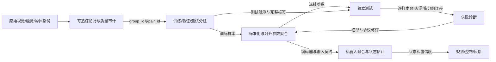
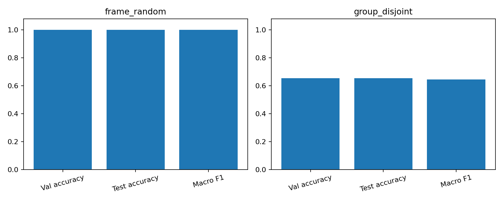
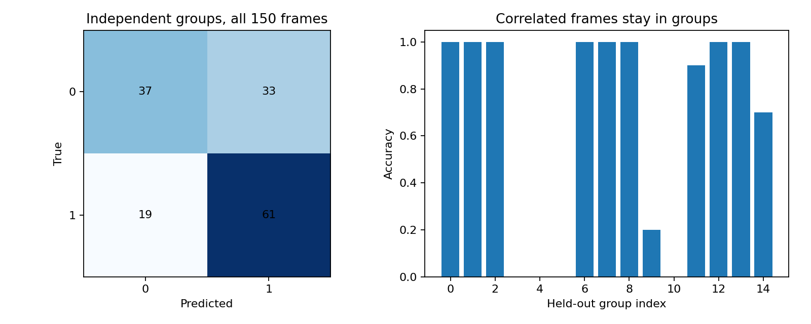

# D60 · 从对齐训练到独立评价：模型学会了什么

[返回学习入口](../_index.md) · [本周项目日程](../P3-项目实战-日程.md) · [上一课：共享表征](../day59/Daily-Learning-Pack.md) · [本课实验](demo.py)

**评价必须回答一个明确的泛化问题：新的一帧、新的一次接触、新物体与新传感器不是同一个问题。对齐误差小，只证明某种坐标映射成立；任务效果和独立性需要另外的证据。**

D59用正确配对训练双编码器，获得了独立合成样本上的检索结果。今天进一步检查：如果一个杯子的相邻帧同时出现在训练和测试里，模型是理解了材质，还是记住了杯子的外观身份？若触觉与视觉已经进入同一向量空间，但来自不同接触，简单融合还能相信吗？

<details>
<summary>个人作答与观察（教材更新保留）</summary>

在本区记录数据协议、预测、反例与答案；教材更新保留本区。

</details>

<!-- daily-pack-generated:start -->

## 1 学习目标与路线

本课结束后，你应能定义分组划分、推导带正则的线性对齐、实现独立评价与混淆矩阵，计算balanced accuracy和macro F1，说明帧内相关性对不确定性估计的影响，并诊断“划分更严格后指标下降”的不同成因。

| 顺序 | 知识主线 | 要回答的问题 |
| --- | --- | --- |
| 1 | 评价对象 | 想泛化到什么没见过的东西？ |
| 2 | 对齐训练 | 如何把触觉映射到可比较的视觉特征空间？ |
| 3 | 独立协议 | 哪些统计量和样本必须隔离？ |
| 4 | 任务指标 | 错在哪里、分母是什么、相关帧怎么算？ |
| 5 | 受控反例 | 帧随机划分与分组划分为何不同？ |
| 6 | 工程诊断 | 是评估更真实，还是训练覆盖被伤害？ |

## 2 宏观：评价管线与部署管线共用契约



图中的测试集不能沿着“失败诊断→修订”无限循环后还被称作一次独立测试。开发时可以根据验证集修订；如果反复查看测试错误并选模型，它已经承担验证角色，最终需要新的保留测试或独立采集。

机器人系统里的评价对象应是可复用模块，而不是只比较一张最终成功率表。触觉预处理、表征对齐、接触任务与控制分别可能失败；给每层保留中间量，才能判断后端失败是因为错配、偏置、漏检还是动作执行问题。

## 3 微观：线性对齐是一个清晰的训练基线

### 3.1 为什么不直接平均两个特征

假设视觉特征$v=[1,0]$，同一状态的触觉特征$t=[0,1]$，只是坐标轴旋转了90°。直接平均得到$[0.5,0.5]$没有清晰含义。先学映射$Wt\approx v$，再融合才有机会比较对应维度。

今天用行向量约定。触觉标准化后追加偏置，形成$A\in\mathbb R^{N\times(d_t+1)}$；视觉目标$V\in\mathbb R^{N\times d_v}$。目标：

$$
\min_W\ \|AW-V\|_F^2+\lambda\|W\|_F^2.
$$

$W:[d_t+1,d_v]$。对$W$求导并令零：

$$
2A^T(AW-V)+2\lambda W=0
\Rightarrow (A^TA+\lambda I)W=A^TV.
$$

实现用 `solve` 解线性系统，而不显式求逆；正则使小特征方向更稳定。本实验把偏置也正则化，是简化实现；工程中可按需求不正则化偏置。$\lambda$相对于特征尺度和样本数定义，改目标为平均误差后若不调整$\lambda$，正则相对强度会改变。

### 3.2 手算一个映射

忽略偏置与标准化，两个训练触觉标量$t=[1,2]^T$，视觉目标$v=[2,4]^T$，$\lambda=1$。$t^Tt=5$、$t^Tv=10$，所以$w=10/(5+1)=5/3$。新触觉$t=3$映射为5，而无正则解$w=2$映射为6。正则牺牲一点拟合，控制放大；这不是保证测试一定更好的定理。

### 3.3 对齐、融合、任务预测分别干什么

今天训练映射$\hat t=AW$，融合$f=(v+\hat t)/2$。任务分类使用训练集融合特征的1-nearest neighbor（1近邻）：

$$
\hat y(f)=y_{j^\ast},\qquad j^\ast=\arg\min_{j\in\text{train}}\|f-f_j\|_2^2.
$$

对齐最小化跨模态残差；融合平均两个估计；近邻分类把表示距离转换为任务标签。即使$\hat t$很接近$v$，也可能两者共同携带与任务无关的身份信息。低对齐RMSE不能替代标签评价。

| 量 | shape | 语义 |
| --- | --- | --- |
| 训练视觉/触觉 | `[600,6]` | 同一状态的不同线性观测 |
| 标准化触觉+偏置 | `[600,7]` | 训练均值、标准差固定 |
| 对齐权重 | `[7,6]` | 学习出的映射 |
| 测试融合特征 | `[150,6]` | 当前两模态平均 |
| 测试到训练距离 | `[150,600]` | 仅与训练库比较 |
| 预测标签 | `[150]` | 二分类 |

这是NumPy教学基线，没有训练深度编码器，也不是完整Touch and Go复现。D59的神经网络负责学习非线性共享几何；本课用更透明的线性映射，集中看数据协议如何影响结论。

## 4 微观：独立单位决定划分方式

### 4.1 合成数据为什么有泄漏风险

代码产生90个物体组，每组10帧。每组有一个二分类标签和5维随机身份向量，第一维只有较弱的类别线索：

$$
s_g=[0.35(2y_g-1),\ \mathrm{id}_g]\in\mathbb R^6,
$$

$$
v_{g,k}=s_g+\epsilon_{g,k}^v,\qquad
t_{g,k}=s_gQ+\epsilon_{g,k}^t.
$$

$Q$为固定正交变换，噪声标准差0.07。相邻“帧”是同一组潜状态的独立测量噪声，不是真实连续视频。身份向量在组内重复，1近邻很容易找到同一物体的训练帧并复制标签。

帧随机协议分600/150/150帧；分组协议分60/15/15个物体组，仍是600/150/150帧。后者训练和测试组交集为0。前者本次测试74个组都在训练出现；因此它回答的是“已见物体的新测量”，不能宣称“未见物体泛化”。

> [!warning] 两个协议改变了不止一个统计条件
> 分组划分不仅更独立，还把训练物体覆盖从接近全体90组变为60组，并改变了测试对象。不能把两张准确率表之差严格解释为某一个单独因素的因果效应。它是协议敏感性对照；若要隔离训练覆盖影响，应固定独立测试组，再用不同数量训练组做学习曲线。

### 4.2 需要隔离的不只是图片

训练均值/方差、PCA、词表、缺失值填补统计量、类别权重、阈值和checkpoint选择都可能把测试信息带回训练。今天触觉标准化只使用训练帧，对齐矩阵只用训练配对，1近邻库只含训练样本。验证集报告结果，但本实验固定$\lambda=0.01$，不搜索超参数。

真实多模态数据应至少保存`sample_id, pair_id, group_id, split, sensor_id, timestamp, valid`。可以按目标增加`session_id/object_id/environment_id`。测试“新传感器”时只做物体隔离还不够；测试“同一设备连续运行”时强行把所有相似接触删掉也可能破坏训练覆盖。

[scikit-learn官方分组交叉验证说明](https://scikit-learn.org/stable/modules/cross_validation.html#cross-validation-iterators-for-grouped-data)将组内依赖和组间泛化明确分开。本课用手写划分，不依赖scikit-learn库；工具名并不能替代正确的`group_id`定义。

## 5 微观：指标必须保留完整分母

### 5.1 混淆矩阵与不平衡类别

约定$C_{ij}$为真实类别$i$预测为$j$的计数。类别$i$的召回、精确率和F1为：

$$
R_i=\frac{C_{ii}}{\sum_jC_{ij}},\quad
P_i=\frac{C_{ii}}{\sum_jC_{ji}},\quad
F1_i=\frac{2P_iR_i}{P_i+R_i}.
$$

准确率为$\sum_iC_{ii}/N$；balanced accuracy为各类召回的算术平均；macro F1为各类F1的平均。不能把“先平均P/R再算F1”当成macro F1。

本次独立组默认矩阵：

$$
C=\begin{bmatrix}37&33\\19&61\end{bmatrix}.
$$

$N=150$、正确98；召回$37/70=0.5286$与$61/80=0.7625$；balanced accuracy$0.6455$；accuracy$0.6533$。macro F1约0.6442。这个例子说明整体65%掩盖了第一类更弱的问题。

如果真实工程中某一类测试样本为0，对应召回是“不可估”，不能用0填充后当成完整宏平均。脚本的分母保护用于避免除零，本次两类都存在；迁移到其他协议时应同时报告support和未定义状态。

### 5.2 分组统计与不确定性

十帧同一物体不等于十次独立泛化。先算每组准确率$a_g$，再对组重采样：随机抽取$G$个组（允许重复），求组均值，重复1000次取2.5/97.5百分位。它给出条件于当前模型和样本组的经验区间，不包含训练种子、全部数据选择或部署分布的不确定性。

默认独立组15组、每组10帧，所以帧准确率与等权组均值恰好相同。若组大小不等，两者回答的问题不同：帧加权偏向长视频，组等权偏向每次物体/交互同等重要。

本次默认组bootstrap区间约[0.4133,0.8667]，很宽。不要因为有150帧就把置信度写得很窄。帧随机协议即使算出[1,1]，仍有训练/测试组重叠，不能证明新物体可靠性。

## 6 错配检测：映射正确不代表配对正确

对照仅在测试时打乱已对齐触觉向量。$W$、训练库和视觉测试都保持不变。原始映射RMSE仍低，因为它在原正确对上计算；真正送入融合的触觉已属于另一个样本，融合配对RMSE会升高。

$$
E_{\rm map}=\sqrt{\operatorname{mean}(\hat t_i-v_i)^2},\qquad
E_{\rm pair}=\sqrt{\operatorname{mean}(\hat t_{\pi(i)}-v_i)^2}.
$$

两个RMSE单位均为本例的合成特征单位。真实embedding没有物理单位时，也不要把该数写成毫米。错误配对可以来自队列索引错乱、时间对齐错误或左右手通道交换；这种错误不会被训练时的低loss自动发现。

## 7 动手：先比较协议，再破坏配对

依赖Python、NumPy、Matplotlib，CPU执行。在vault根目录运行：

```bash
python 3d_learning/day60/demo.py
python 3d_learning/day60/demo.py --shuffle-test-touch --out _assets/3d_learning/day60/shuffled
```

运行前预测：哪种划分最容易被1近邻利用身份？只在测试错配触觉，训练对齐RMSE是否一定改变？你的解释应指向数据路径。

**2026-11-11 已执行并检查**：Python3.11.15、NumPy1.26.4，数据seed60、错配排列seed660、组bootstrap seed960。600训练/150验证/150测试，不删除失败、不挑选测试类别。

| 条件 | 测试正确/总数 | balanced accuracy | macro F1 | 训练测试组重叠 |
| --- | --- | --- | --- | --- |
| 帧随机，正常配对 | 150/150 | 1.0000 | 1.0000 | 74组 |
| 独立组，正常配对 | 98/150 | 0.6455 | 0.6442 | 0 |
| 帧随机，测试错配 | 104/150 | 0.6903 | 0.6906 | 74组 |
| 独立组，测试错配 | 85/150 | 0.5705 | 0.5665 | 0 |

独立组原映射RMSE两次都为0.09640，实际融合配对RMSE从0.09640升至1.16604。这个差异直接定位“配对关系损坏”，而不是声称对齐权重突然学坏。



两侧数据量相同，但泛化对象不同；横向看模型容易受到物体身份记忆影响。



有些组全部正确，有些全部错误，说明帧错误强相关。每组10帧不足以把15个物体变成150个独立物体。对照见[错配后的独立评价](../../_assets/3d_learning/day60/shuffled/independent.png)，完整记录见[默认JSON](../../_assets/3d_learning/day60/default/results.json)及[错配JSON](../../_assets/3d_learning/day60/shuffled/results.json)。

错配对照的组bootstrap输出只是描述性数值：全测试集的随机置换把不同组的触觉互相连接，削弱了简单“组彼此独立”的假设；不应把该区间当严格覆盖保证。若需要严谨的扰动区间，应在每个bootstrap重采样内重新定义扰动或以独立采集批次组织对照。

### 7.1 为什么更严格后指标下降，不等于处理失败

先查训练覆盖：是否把小众材质、困难接触或某些传感器全部排掉？再查评价难度：是否从“已见物体新帧”变成“未见物体”？最后查标签口径：是否把本应保留的模糊边界强行统一，令任务不再匹配部署？三个因素不能混成一个“清洗程度”。

本实验没有删除任何原始样本，只换划分与错配条件。真实流程应保留原始数据，只新增可追踪的派生版本。确定损坏的文件与标签可隔离；不确定的近重复和边界样本先标记review，不为了指标好看直接丢弃。分组约束用于防止评价串组，不要求把训练集中所有相似帧都删掉。

如果指标低且训练覆盖不足，应补足独立训练对象或减轻过度删样，再在固定保留组上比较；不能把测试同物体帧放回训练来“修复”分数。这里采用数据处理诊断原则，具体分组仍由预期部署场景决定。

### 7.2 可执行的下一步

只把每个训练组的帧数从10变成5，保持测试组集合与测试帧不变，比较效果；再增加训练组数，区分“更多同物体帧”与“更多新物体”的价值。这是扩展实验设计，当前保存结果没有执行它。先写预测和固定项，再修改脚本输出到新目录。

真实接入至少输出逐样本预测、真值、group_id、pair_id、可用模态和错误状态；不可只保存最终均值。`runtime_s`含生成、求解、评价和绘图，batch1对齐/近邻推理延迟未单独测量。真实机器人尝试数0，没有真实标准数据基准或个人验收结果。

### 7.3 完整可复制代码

> [!note]- 展开与 demo.py 一致的完整代码
> ```python
> """D60 ridge alignment plus 1NN evaluation: groups and cross-modal mismatch."""
> import argparse, json, platform, time
> from pathlib import Path
> import numpy as np
> import matplotlib
> matplotlib.use('Agg')
> import matplotlib.pyplot as plt
> 
> 
> def run_protocol(x,t,y,groups,split,shuffle):
>     train,val,test=split
>     mu,sd=t[train].mean(0),t[train].std(0)+1e-8
>     a=np.column_stack([(t-mu)/sd,np.ones(len(t))]); lam=.01
>     w=np.linalg.solve(a[train].T@a[train]+lam*np.eye(a.shape[1]),a[train].T@x[train])
>     aligned=a@w; base=(x+aligned)/2
>     def predict(ids,corrupt=False):
>         pair=aligned[ids].copy()
>         if corrupt: pair=pair[np.random.default_rng(660).permutation(len(ids))]
>         f=(x[ids]+pair)/2
>         dist=((f[:,None,:]-base[train][None,:,:])**2).sum(2)
>         return y[train[dist.argmin(1)]],f
>     pv,_=predict(val); pred,f=predict(test,shuffle)
>     cm=np.zeros((2,2),int); np.add.at(cm,(y[test],pred),1)
>     recall=np.diag(cm)/np.maximum(cm.sum(1),1)
>     precision=np.diag(cm)/np.maximum(cm.sum(0),1)
>     f1=2*precision*recall/np.maximum(precision+recall,1e-12)
>     per_group=np.array([(pred[groups[test]==g]==y[test][groups[test]==g]).mean() for g in np.unique(groups[test])])
>     rng=np.random.default_rng(960); boot=rng.choice(per_group,(1000,len(per_group)),replace=True).mean(1)
>     return {'train_n':len(train),'val_n':len(val),'test_n':len(test),'test_group_n':len(per_group),
>       'train_test_group_overlap':len(set(groups[train])&set(groups[test])),
>       'validation_accuracy':float((pv==y[val]).mean()),'correct':int((pred==y[test]).sum()),
>       'accuracy':float((pred==y[test]).mean()),'balanced_accuracy':float(recall.mean()),'macro_f1':float(f1.mean()),
>       'group_mean_accuracy':float(per_group.mean()),'group_bootstrap95':np.quantile(boot,[.025,.975]).tolist(),
>       'alignment_rmse':float(np.sqrt(((aligned[test]-x[test])**2).mean())),
>       'fusion_pair_rmse':float(np.sqrt(((2*f-x[test]-x[test])**2).mean())),
>       'confusion':cm.tolist(),'per_group_accuracy':per_group.tolist()}
> 
> 
> def main():
>     ap=argparse.ArgumentParser(); ap.add_argument('--shuffle-test-touch',action='store_true')
>     ap.add_argument('--out',type=Path,default=Path(__file__).resolve().parents[2]/'_assets/3d_learning/day60/default')
>     args=ap.parse_args(); args.out.mkdir(parents=True,exist_ok=True); start=time.perf_counter(); rng=np.random.default_rng(60)
>     groups=np.repeat(np.arange(90),10); labels=rng.integers(0,2,90); y=labels[groups]
>     identity=rng.normal(size=(90,5)); latent=np.column_stack([.35*(2*labels-1),identity])
>     x=latent[groups]+rng.normal(0,.07,(900,6)); q,_=np.linalg.qr(rng.normal(size=(6,6))); t=latent[groups]@q+rng.normal(0,.07,(900,6))
>     ids=rng.permutation(900); g=rng.permutation(90)
>     splits={'frame_random':(ids[:600],ids[600:750],ids[750:]),
>       'group_disjoint':tuple(np.flatnonzero(np.isin(groups,a)) for a in (g[:60],g[60:75],g[75:]))}
>     results={k:run_protocol(x,t,y,groups,v,args.shuffle_test_touch) for k,v in splits.items()}
>     fig,axs=plt.subplots(1,2,figsize=(10,4))
>     for ax,(name,r) in zip(axs,results.items()):
>         ax.bar(['Val accuracy','Test accuracy','Macro F1'],[r['validation_accuracy'],r['accuracy'],r['macro_f1']]); ax.set(ylim=(0,1.08),title=name); ax.tick_params(axis='x',rotation=15)
>     fig.tight_layout(); fig.savefig(args.out/'protocol.png',dpi=160); plt.close(fig)
>     r=results['group_disjoint']; fig,axs=plt.subplots(1,2,figsize=(10,4)); cm=np.array(r['confusion']); axs[0].imshow(cm,cmap='Blues')
>     for i in range(2):
>         for j in range(2): axs[0].text(j,i,str(cm[i,j]),ha='center',va='center')
>     axs[0].set(xticks=[0,1],yticks=[0,1],xlabel='Predicted',ylabel='True',title='Independent groups, all 150 frames')
>     axs[1].bar(range(len(r['per_group_accuracy'])),r['per_group_accuracy']); axs[1].set(xlabel='Held-out group index',ylabel='Accuracy',ylim=(0,1.05),title='Correlated frames stay in groups')
>     fig.tight_layout(); fig.savefig(args.out/'independent.png',dpi=160); plt.close(fig)
>     report={'seed':60,'python':platform.python_version(),'numpy':np.__version__,'shuffle_test_touch':args.shuffle_test_touch,
>       'results':results,'runtime_s':time.perf_counter()-start,'data':'90 synthetic object groups; 10 correlated frames/group; no real benchmark',
>       'robot_trials':0,'learning_status':'not_assessed'}
>     (args.out/'results.json').write_text(json.dumps(report,indent=2),encoding='utf8'); print(json.dumps(report,indent=2))
> 
> if __name__=='__main__': main()
> ```

## 8 回到宏观：把评价变成失败定位工具

四个重点及理由：**先规定新东西是什么**，否则“泛化”无明确对象；**标准化和对齐只在训练拟合**，防止隐性泄漏；**映射误差与配对误差分开**，能区分模型问题和数据管线问题；**逐组结果比单个均值更有解释力**，能发现模型靠少数身份取巧。

三条边界：更独立的数据划分常常更难，但不能自动排除训练覆盖不足；group bootstrap不会修复泄漏；低特征RMSE不是好的接触控制证据。

三句话总结：评价协议本身是系统的一部分。对齐后的表示仍要经过独立任务评价和故障注入。只有把样本身份、配对、分母和统计单位保留下来，指标变化才有可解释的含义。

可验收产出：一张按部署目标制定的group/split表；线性对齐推导；四组结果与完整分母；一份“覆盖不足还是评价更真实”的诊断笔记；个人自测。当前项目正式真实数据验收仍待完成。

## 9 自测

1. “新帧泛化”和“新物体泛化”有什么区别？
2. 为什么视觉和触觉特征不能不经检查就逐维平均？
3. 推导岭回归对齐的正规方程，并给出$A:[600,7]$时$W$的shape。
4. $t=[1,2]$、$v=[2,4]$、$\lambda=1$，求标量权重和$t=3$的输出。
5. 对$C=[[37,33],[19,61]]$计算accuracy及balanced accuracy。
6. 150帧来自15个物体，为什么不应假定有150个独立物体证据？
7. 错配后映射RMSE不变、融合配对RMSE变大，说明什么？
8. 分组测试分数下降后，如何区分训练覆盖损失与评估更真实，怎样设计后续对照？

## 10 未理解问题与次日衔接

请记录仍不明确的单位，例如“真实杯子应该按物体还是按采集会话分组？”“新传感器测试能否使用目标设备无标签数据校正？”“重采样单位如何包含场景层级？”。这些问题会在W10任务评价和W14域偏移继续出现；先明确是否允许测试时适配，再设计协议。

下一课 **D61 / W9-D5（2026-11-04）** 进入接触状态与控制。第一步把“接触分类输出”改写成有时间戳、置信度和失效处理的状态输入，观察它如何改变控制阶段。

精读：[Touch and Go §5.1的抓取与材料评价协议](https://arxiv.org/html/2211.12498v1)，只抽取训练/验证/测试独立单位和冻结编码器/任务头的关系；再看[官方分组交叉验证说明](https://scikit-learn.org/stable/modules/cross_validation.html#cross-validation-iterators-for-grouped-data)，写出你的`group_id`定义。不要抄论文分数当本项目结果。

> [!note]- 自测核对答案与判分
> 每题0/1/2分：核心错误0分；正确结论/计算1分；能解释条件或提出有效对照2分。建议至少12/16且第1、6、8题无关键错误，个人成绩尚未评定。
>
> 1. 新帧可以来自训练见过物体；新物体要求测试对象身份未在训练出现，难度与目标不同。
> 2. 特征坐标、尺度和语义可能不同；先统一/学习映射，且融合后仍需任务评价。
> 3. 对平方误差和正则求导得到$(A^TA+\lambda I)W=A^TV$；$W:[7,6]$。
> 4. $w=10/6=5/3$，输出5。无正则则为6。
> 5. $98/150=0.6533$；$(37/70+61/80)/2=0.6455$。
> 6. 同物体帧共享身份与误差，组内相关；应保留组级评价，置信区间以相应独立单位估计。
> 7. 映射在原对上正常，但送给融合的对应关系损坏；优先排查时间/索引/左右手通道。
> 8. 先检查覆盖和删样，再定义测试目标。固定独立测试组，分别改变训练组数量与每组帧数，保持其他项；不把测试帧回灌训练来提高分数。
<!-- daily-pack-generated:end -->
