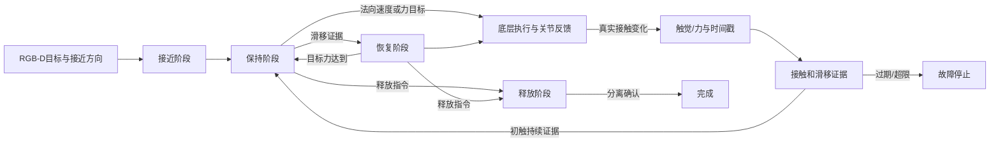
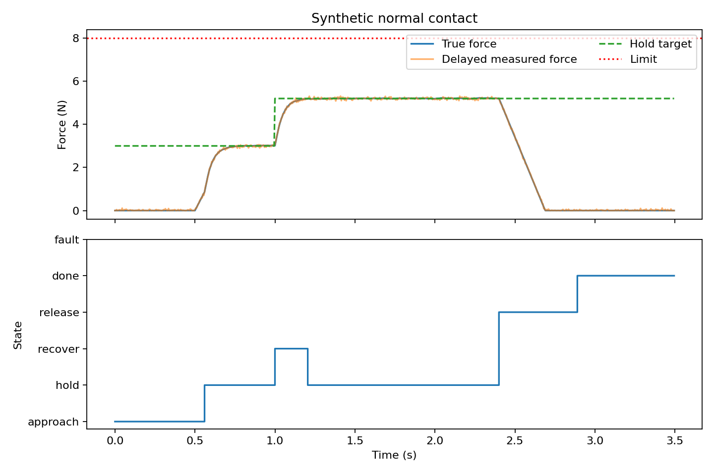
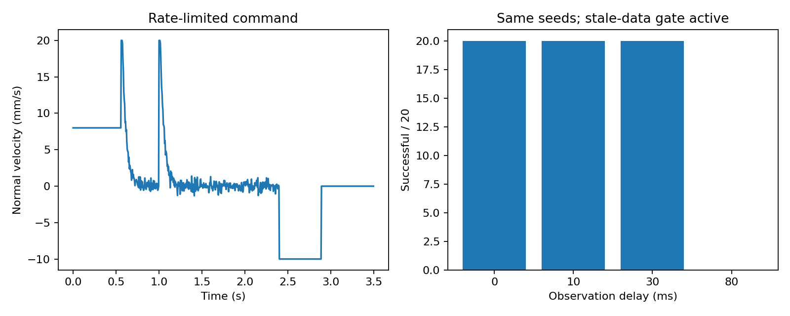

# D61 · 从接触状态到有边界的反馈控制

[返回学习入口](../_index.md) · [本周项目日程](../P3-项目实战-日程.md) · [上一课：独立评价](../day60/Daily-Learning-Pack.md) · [本课实验](demo.py)

**接触感知的价值，是改变系统下一步如何行动；要把“看起来接触了”变成控制输入，必须同时确定接触阶段、测量时刻、物理量含义和动作限幅。**

D58和D59讨论特征与共享表征，D60检查它们是否在独立数据上有效。今天把这条线接到控制：机械臂靠近杯子、指尖刚接触、稳住载荷、检测滑动并纠偏、最后释放，每个阶段应该使用不同的动作规律。即使接触分类器输出一直正确，延迟、坐标方向和单位错误仍能让执行失败。

<details>
<summary>个人作答与观察（教材更新保留）</summary>

在此记录状态图、手算、运行预测、自测和未理解问题；教材更新保留本区。

</details>

<!-- daily-pack-generated:start -->

## 1 学习目标与路线

你应能构造接近—保持—恢复—释放的状态机；解释接触证据与任务阶段的差别；推导一维力误差到速度的反馈及无延迟离散稳定条件；手算限速后的位移和力变化；运行延迟对照；指出教学滑移代理与真实触觉估计之间的缺口。

| 顺序 | 知识主线 | 需要回答的问题 |
| --- | --- | --- |
| 1 | 接触状态 | 一次分类输出能否直接切换控制阶段？ |
| 2 | 接触几何与力 | 坐标符号、刚度、力目标怎样相连？ |
| 3 | 反馈机制 | 力误差如何变成有单位的速度？ |
| 4 | 滑移恢复 | 为什么加力既可能有效，也可能伤害任务？ |
| 5 | 时延与执行 | 过期测量为什么不能按当前真值使用？ |
| 6 | 可运行实验 | 默认完成与过期停止分别证明了什么？ |

## 2 宏观：感知状态与任务状态不是同一个变量

接触状态可以是自由、初触、黏着、部分滑动、完全滑动；任务状态可以是接近、保持、恢复、释放、完成、故障。物理状态描述环境，任务状态描述控制器正在做什么。同样的“有接触”在保持阶段意味着继续调节，在释放阶段却意味着还未释放完。



流程中的每条边要有触发条件，不能只画一个“智能决策”框。本课实际脚本把释放时刻固定为2.4s，用解析位置确认分离；真实系统需任务命令、运动反馈和可观测接触证据，不应硬编码一个通用释放时间。

VLA可以给出“继续夹紧”或动作chunk，世界模型可以预测候选动作后果；接触阶段管理和底层执行仍承担实时反馈。策略输出不是传感器真值，也不是执行成功证明。

## 3 微观：从瞬时测量到接触事件

### 3.1 阈值、持续证据与迟滞

假设已得到有物理单位的法向力测量$\tilde F_n$。单阈值$\tilde F_n>F_{\rm on}$容易受噪声影响反复跳变。两个常用机制是：

- 持续判定：连续$K$帧超过阈值才确认初触。
- 迟滞：接触进入阈值$F_{\rm on}$高于离开阈值$F_{\rm off}$，在两阈值之间保持原状态。

今天代码实现的是**连续3次超过0.6N后进入保持**，并不是完整双阈值迟滞。释放结束由位置$x\le-0.002$m判断。不能把教材里介绍的所有机制都算成脚本已实现。

采样周期$\Delta t=0.005$s，三次连续检测需要跨三个采样判定，带来约10–15ms的事件确认延后，具体取决于越阈时刻相对于采样的位置。持续判定降低噪声误触，但也推迟反应；它不是免费的滤波。

> [!question] 先判断
> 若触觉输入缺失，模型返回接触概率0，控制器能否把它解释成没有接触并继续前进？
>
> 缺失与无接触应是不同状态。需要有效mask、时间戳和异常原因；默认0会把数据错误伪装成自由空间。

### 3.2 从图像到力必须有独立证据

D58的图像变化特征单位是亮度；本课$\tilde F_n$单位是N。两者之间缺少的不是一个随意比例常数，而是传感器、胶体、接触形状、载荷和温度条件下的标定/学习映射及独立验证。

真实系统可用独立力传感器监督光学触觉力预测，也可直接用触觉图像策略做任务控制；后者不一定必须输出牛顿，但不能把内部embedding伪称标定力。本课为隔离控制机制，直接合成带噪牛顿测量，没有训练图像到力网络。

## 4 微观：一维接触模型与力—速度反馈

### 4.1 先固定方向和单位

令$x$为沿接触法向的压入量，单位m，$x>0$表示压入，$x<0$表示分离。单边线性弹簧：

$$
F_n(x)=k\max(x,0),\qquad k=1800\ \mathrm{N/m}.
$$

它只允许压缩，不允许弹簧把分离的指尖拉回表面。真实软接触可能有迟滞、粘弹性、面积变化与摩擦，本式只是准静态局部教学模型。代码直接积分位置，没有质量和惯性，不能叫完整动力学或接触物理仿真。

目标力3N对应压入$3/1800=0.001667$m≈1.667mm；5.2N对应2.889mm。若把这个$x$当作机器人世界坐标绝对位置，会把模型的局部法向位移混入错误参考系。

### 4.2 力误差变成速度

设$e_F=F_d-\tilde F_n$，给法向速度命令：

$$
v_n=\operatorname{clip}(G e_F,-v_{\max},v_{\max}),
\quad x_{t+1}=x_t+\Delta t\,v_n.
$$

$G=0.012\ \mathrm{m/(N\cdot s)}$，$v_{\max}=0.02\ \mathrm{m/s}$。量纲检查：N乘m/(N·s)=m/s。误差为正，沿正法向压入增加力；误差为负，沿反向减少压入。

手算：目标3N、测量1N，未限幅速度$0.012×2=0.024$m/s，限幅后0.02m/s。一个5ms周期移动$0.0001$m=0.1mm，弹簧力变化约$1800×0.0001=0.18$N。若毫秒误当秒，位移会放大1000倍；若法向符号相反，反馈会把误差越推越大。

### 4.3 无延迟离散稳定性的由来

在持续接触、无饱和、无噪声且$F=kx$的局部条件下：

$$
e_{t+1}=F_d-k[x_t+\Delta t G(F_d-kx_t)]
=(1-kG\Delta t)e_t.
$$

误差收敛需要$|1-kG\Delta t|<1$，即$0<kG\Delta t<2$；若希望单调不交替，还需$0<kG\Delta t\le1$。本例$kG\Delta t=1800×0.012×0.005=0.108$，局部误差因子0.892。

> [!warning] 这个推导有明确边界
> 加入测量时延后，控制依赖$e_{t-d}$，不再由一个标量因子决定；加入机器人惯性、内环、摩擦或饱和后，也需要新的分析。不能用0.108小于2就宣称真机稳定。

### 4.4 与位置、阻抗、导纳、力矩控制的关系

| 控制方式 | 主要输入→输出 | 工程含义 |
| --- | --- | --- |
| 位置控制 | 位置误差→位置/速度/力矩命令 | 接触刚度不确定时可能产生大力 |
| 本课比例力到速度外环 | 力误差→法向速度 | 依赖下游速度执行，简化的顺应调节 |
| 完整导纳 | 外力→虚拟质量阻尼弹簧运动 | 通常含动态状态和积分 |
| 阻抗 | 运动误差→期望力/力矩关系 | 塑造接触机械响应 |
| 雅可比转置力控制 | 末端wrench→关节力矩 | 需要动力学/重力、坐标与执行接口 |

本课外环可以理解为力误差驱动运动的最小机制，不是已经实现完整二阶导纳。Modern Robotics §11.5讲的是力矩级的末端wrench控制与反馈，和这里的速度外环接口不同；学习时应比较输出量，而不是只看都叫force control。[Modern Robotics：Force Control](https://modernrobotics.northwestern.edu/nu-gm-book-resource/11-5-force-control/)

## 5 微观：滑移证据如何触发恢复

### 5.1 摩擦直觉与代理公式

最简单的库仑摩擦容量为$|F_t|\le\mu F_n$。当切向载荷超过这个容量，可能产生滑动。真实接触的局部滑移、粘着区域和动态摩擦更复杂；今天使用一个人为代数代理：

$$
v_{\rm slip}=c\max(F_{\rm load}-\mu F_n,0),\quad
c=0.003\ \mathrm{m/(N\cdot s)},\quad\mu=0.4.
$$

载荷在1.0–2.4s为1.8N，其他时刻为0。若法向力3N，摩擦容量1.2N，代理滑移速度$0.003×0.6=0.0018$m/s=1.8mm/s；高于触发阈值0.15mm/s。恢复阶段将目标从3N提升至5.2N，此时容量2.08N，大于1.8N，代理滑移趋于0。

这解释了“加力可能减少滑移”，但不保证加力总正确：杯子可能脆弱、夹爪可能偏心、接触法向可能错误。真实操作还要检查上限、接触位置和是否需要重新抓取。

### 5.2 脚本的观测边界必须看清

**本课滑移速度直接由真实解析力和已知载荷计算，并直接提供给状态机。它是理想观测代理，不是由触觉图像推断出来的滑移。** 默认成功不能证明一个真实触觉滑移检测器可用。若接入真实系统，需要用标记光流、局部相对运动、力变化或独立测量建立滑移估计，并对漏检、误检、延迟分别评价。

这个显式缺口使实验仍有用：先检查控制阶段在“给定滑移证据”时是否正确；再单独替换滑移估计模块。不要用强控制器掩盖错误传感器，也不要在一个黑箱成功率中混淆两个责任。

### 5.3 实际状态机

| 状态 | 动作 | 进入/离开条件 |
| --- | --- | --- |
| approach | +0.008m/s | 连续3次测力>0.6N进入hold |
| hold | 目标3N，或恢复后保留5.2N | 滑移代理>0.00015m/s进入recover |
| recover | 目标5.2N，反馈限速 | 时间>1.2s且力误差<0.15N回hold |
| release | −0.01m/s | 2.4s触发；$x\le-0.002$m进入done |
| done | 速度0 | 本实验终态 |
| fault | 速度0 | 观测年龄>50ms或测力>8N，保持故障 |

恢复回hold后目标仍为5.2N；代码并没有自动回到3N。否则在载荷仍存在时会再次滑移。初始$x=-4$mm，开始处于approach。状态编号只是实现枚举，不应该当作有连续距离意义的实数特征。

## 6 微观：时间戳进入控制律以后

### 6.1 测量正确，但时刻错误

本课延迟为$d$个采样周期，控制使用$\tilde F_{t-d}$。若接近速度0.008m/s、延迟30ms，等待期间位置变化约0.24mm，在本弹簧上对应0.432N。即使传感器本身零噪声，时间差也能形成可观的反馈误差。

观测年龄定义为控制时刻减采集时刻，不能用消息接收时刻替代采集时刻。相机/触觉的时钟变换、队列和实际到达条件承接D57；只有可用且未过期的观测才进入决策。

### 6.2 过期门控与实验含义

年龄>50ms直接进入fault，速度归零。80ms对照在仿真启动时用最早样本填充延迟历史，年龄从0逐步增加，于0.055s越界并停止；此时还在自由空间，尚未接触。因此0/20不是“接触控制振荡失败”，而是“所有尝试在过期输入下被门控拒绝”。拒绝执行与执行失败都计入预定20次总数，但需要分别报告原因。

零速度在这个没有惯性的解析模型中立即停止；真实机器人有制动、内环、位置保持和力释放策略，不能把它当完整硬件停止行为。代码未连接机器人，也不应直接改成真机发布器。

### 6.3 与ROS/动作接口的连接

可以把工程接口写成如下字段，而不是让感知节点只发一个布尔值：

| 输入/输出 | 必需信息 |
| --- | --- |
| 接触观测 | `capture_time, frame_id, force_N, contact_prob, slip_estimate, valid, source` |
| 控制状态 | `phase, target_force_N, last_transition_reason` |
| 法向命令 | `velocity_m_s, normal_frame, issue_time, valid_until, limits` |
| 执行反馈 | 实际位置/速度、执行时间、停止/拒绝原因 |

真实机器人法向速度应通过正确坐标转换与雅可比映射为可执行关节命令，考虑关节限制与碰撞。本课没有实现IK、碰撞或多指力分配；这部分要与此前D53/D54接口以及正式工程对接。

## 7 动手：默认闭环与延迟停止

依赖Python、NumPy、Matplotlib，CPU即可。在vault根目录执行：

```bash
python 3d_learning/day61/demo.py
python 3d_learning/day61/demo.py --delay-ms 80 --out _assets/3d_learning/day61/delay80
```

> [!question] 先预测
> 默认情况下力为何分两段接近3N和5.2N？80ms情况下是否会先撞到物体再停止？利用初始距离4mm、接近速度8mm/s和50ms过期门限计算你的判断。

**2026-11-11 已执行并检查**，Python3.11.15、NumPy1.26.4，seed61–80共20组噪声，每组700步、5ms周期，确定的同一初态$x=-0.004$m。20组只有传感噪声不同，不是20种独立物体或场景。

| 条件 | 满足教学成功条件/尝试 | 终态 | 解释 |
| --- | --- | --- | --- |
| 无延迟 | 20/20 | done | 完成保持、恢复、释放；峰力<8N、累计代理滑移<1mm |
| 10ms延迟扫描 | 20/20 | done | 仍在当前简化模型与参数内完成 |
| 30ms延迟扫描 | 20/20 | done | 不能外推更高刚度或真实惯性 |
| 80ms延迟 | 0/20 | fault | 接触前因年龄越界拒绝继续 |

seed61默认轨迹：0.560s进入hold，1.000s进入recover，1.205s回hold，2.400s开始release，2.890s进入done。峰力5.22654N、累计代理滑移0.04508mm、最大速度0.02m/s。80ms运行于0.055s进入fault，位置−3.56mm、峰力0N。



上图显示真实解析力、带噪测量和目标；下图显示离散阶段。3N到5.2N的目标变化来自滑移恢复逻辑，不是网络自动学出来的力。



左图是下发速度，右图是同20个种子的不同延迟结果。横轴是观测时延，不是算法运行耗时。默认/对照的完整记录见[默认JSON](../../_assets/3d_learning/day61/default/results.json)、[80ms JSON](../../_assets/3d_learning/day61/delay80/results.json)与[80ms接触图](../../_assets/3d_learning/day61/delay80/contact.png)。

### 7.1 读取真实执行的中间量

保存的trace.npz (not exported: excluded by publication policy)含seed61的700×9数组，列依次为：`time_s, x_m, true_force_N, measured_force_N, target_force_N, velocity_m_s, state_id, cumulative_slip_m, observation_age_s`。这是合成回放轨迹，不是实际机器人日志。

下一步只改弹簧刚度$k$，保持增益、采样周期、初态和噪声种子，先算$kG\Delta t$，再观察是否碰到限速、力超限或震荡。这个扩展尚未保存验证结果；有时先触发保护而不是出现理论振荡，需要按状态日志归因。

`runtime_s`是脚本总体耗时，包含多组模拟、延迟扫描和绘图，不是控制计算延迟。单次控制计算与真实传感传输延迟未测。默认20次+80ms20次以及各调用内四档扫描是合成计算，不能累计成真机尝试；机器人尝试数始终0。

### 7.2 完整可复制代码

> [!note]- 展开与 demo.py 一致的完整CPU代码
> ```python
> """D61 one-dimensional quasistatic contact hybrid controller; not robot physics."""
> import argparse, json, platform, time
> from pathlib import Path
> import numpy as np
> import matplotlib
> matplotlib.use('Agg')
> import matplotlib.pyplot as plt
> 
> 
> def simulate(seed, delay_ms):
>     rng=np.random.default_rng(seed); dt=.005; k=1800.; gain=.012; vmax=.02; fmax=8.
>     n_delay=int(round(delay_ms/1000/dt)); x=-.004; state=0; onset=0; target=3.; slip_total=0.; rows=[]; history=[]
>     # states: approach, hold, recover, release, done, fault
>     for i in range(700):
>         now=i*dt; force=max(0.,k*x); history.append(max(0.,force+rng.normal(0,.04)))
>         idx=max(0,i-n_delay); measured=history[idx]; age=(i-idx)*dt
>         load=0. if now<1. else (1.8 if now<2.4 else 0.)
>         slip=max(0.,load-.4*force)*.003 if state in (1,2) else 0.
>         slip_total+=slip*dt
>         if age>.05 or measured>fmax: state=5
>         if state==0:
>             onset=onset+1 if measured>.6 else 0
>             if onset>=3: state=1
>         if state==1 and slip>.00015: state=2; target=5.2
>         if state==2 and now>1.2 and abs(measured-target)<.15: state=1
>         if now>=2.4 and state in (0,1,2): state=3
>         if state==3 and x<=-.002: state=4
>         if state==0: v=.008
>         elif state in (1,2): v=float(np.clip(gain*(target-measured),-vmax,vmax))
>         elif state==3: v=-.01
>         else: v=0.
>         rows.append([now,x,force,measured,target,v,state,slip_total,age]); x+=v*dt
>     arr=np.array(rows); success=state==4 and arr[:,2].max()<fmax and slip_total<.001
>     return arr,{'seed':seed,'terminal_state':['approach','hold','recover','release','done','fault'][state],
>       'success':bool(success),'peak_force_N':float(arr[:,2].max()),'slip_mm':1000*slip_total,
>       'max_speed_m_s':float(np.abs(arr[:,5]).max()),'max_age_ms':float(arr[:,8].max()*1000)}
> 
> 
> def main():
>     ap=argparse.ArgumentParser(); ap.add_argument('--delay-ms',type=float,default=0.)
>     ap.add_argument('--out',type=Path,default=Path(__file__).resolve().parents[2]/'_assets/3d_learning/day61/default')
>     args=ap.parse_args(); args.out.mkdir(parents=True,exist_ok=True); start=time.perf_counter()
>     cases=[simulate(s,args.delay_ms) for s in range(61,81)]; arr=cases[0][0]; reports=[c[1] for c in cases]
>     fig,axs=plt.subplots(2,1,figsize=(9,6),sharex=True)
>     axs[0].plot(arr[:,0],arr[:,2],label='True force'); axs[0].plot(arr[:,0],arr[:,3],alpha=.6,label='Delayed measured force'); axs[0].plot(arr[:,0],arr[:,4],ls='--',label='Hold target'); axs[0].axhline(8,color='r',ls=':',label='Limit'); axs[0].set(ylabel='Force (N)',title='Synthetic normal contact'); axs[0].legend(ncol=2)
>     axs[1].step(arr[:,0],arr[:,6],where='post'); axs[1].set(xlabel='Time (s)',ylabel='State',yticks=range(6),yticklabels=['approach','hold','recover','release','done','fault']); fig.tight_layout(); fig.savefig(args.out/'contact.png',dpi=160); plt.close(fig)
>     fig,axs=plt.subplots(1,2,figsize=(10,4)); axs[0].plot(arr[:,0],1000*arr[:,5]); axs[0].set(xlabel='Time (s)',ylabel='Normal velocity (mm/s)',title='Rate-limited command')
>     delays=[0,10,30,80]; sweeps=[]
>     for d in delays:
>         rr=[simulate(s,d)[1] for s in range(61,81)]; sweeps.append(sum(r['success'] for r in rr))
>     axs[1].bar([str(d) for d in delays],sweeps); axs[1].set(xlabel='Observation delay (ms)',ylabel='Successful / 20',ylim=(0,21),title='Same seeds; stale-data gate active'); fig.tight_layout(); fig.savefig(args.out/'feedback.png',dpi=160); plt.close(fig)
>     report={'python':platform.python_version(),'numpy':np.__version__,'delay_ms':args.delay_ms,'dt_s':.005,'stiffness_N_m':1800.,'gain_m_per_N_s':.012,
>       'force_limit_N':8.,'speed_limit_m_s':.02,'stale_limit_ms':50.,'successes':sum(r['success'] for r in reports),'attempts':20,
>       'trials':reports,'sweep_delays_ms':delays,'sweep_successes':sweeps,'runtime_s':time.perf_counter()-start,
>       'data':'analytic spring contact and algebraic slip proxy; no inertial/contact simulation or hardware',
>       'robot_trials':0,'learning_status':'not_assessed'}
>     np.savez(args.out/'trace.npz',trace=arr); (args.out/'results.json').write_text(json.dumps(report,indent=2),encoding='utf8'); print(json.dumps(report,indent=2))
> 
> if __name__=='__main__': main()
> ```

## 8 Learning视角：哪些环节在学习，哪些没有

| 五格 | 本课实际实验 | 可扩展的学习模块 |
| --- | --- | --- |
| 数据从哪里来 | 解析弹簧、噪声与载荷函数 | 有真实接触标签/动作的触觉轨迹 |
| 学什么 | 当前脚本没有训练参数 | 接触概率、滑移估计或转移模型 |
| 改善信号 | 预设控制规则与成功条件 | 分类标签、物理误差、回报等 |
| 训练与推理 | 全部是规则控制与模拟执行 | 训练估计器，部署冻结权重+控制环 |
| 泛化怎样测 | 同初态不同噪声和延迟 | 新物体/刚度/载荷/传感器的独立评价 |

没有梯度更新的控制律不是强化学习。世界模型学习未来，策略选择动作，控制器追踪命令；三者可以共同使用触觉，但各自的输入、目标和失败证据不同。下一课先从同步动作转移数据补齐预测学习的入口。

## 9 回到宏观：以接触为分界组织机器人行为

四个重点及理由：**物理状态与任务阶段分开**，同样接触在不同阶段含义不同；**力—速度量纲与法向符号要检查**，它们直接决定反馈方向；**限幅与过期门控必须进入记录**，失败原因才不会混在一个成功率里；**感知缺口必须显式保留**，理想滑移信号不能冒充真实触觉算法。

三个最容易混淆的边界：比例力到速度外环不是完整机器人动力学控制；合成摩擦容量代理不是接触物理仿真；80ms拒绝执行不是证明系统在80ms时延下可以稳定抓取。

三句话总结：感知输出要带上有效性与时刻才能进入控制。接触阶段决定该追踪位置、力还是释放动作。通过可解释的反馈与故障记录，才能把“有触觉”变成能定位失败的闭环。

可验收产出：状态转移图及每条触发条件；力反馈量纲与稳定性推导；默认/延迟日志和一次预测对照；把理想滑移输入替换为真实估计所需的数据清单；个人自测。正式机器人与接触物理验收仍独立待完成。

## 10 自测

1. 接触状态与任务状态有什么区别？举一个同接触不同动作的例子。
2. 连续3帧超过阈值与双阈值迟滞分别解决什么问题？本脚本实现了哪一种？
3. 目标3N、测力1N，$G=0.012$、限速0.02m/s，求速度、单步位移与力变化。
4. 推导无延迟线性接触下误差递推，并计算本例因子。
5. 为什么该稳定条件不能直接证明真实机器人稳定？
6. 载荷1.8N、$\mu=0.4$时，3N与5.2N法向力的摩擦容量分别多少？这能否代替滑移测量？
7. 80ms对照为什么在接触前停止？0/20应该如何解释？
8. 从触觉图像到本课力反馈和滑移恢复，还缺哪些模块与验证？

## 11 未理解问题与次日衔接

把“实际机器人哪个坐标轴是压入正方向？”“胶体形变如何区分剪切和滑动？”“过期输入时应该保持、退让还是重新观测？”写成具体工程问题。控制器接口和停止行为需要结合设备规范验证；本课不连接硬件。W10会把接触估计融入联合模型，W12–14再在操作环境里评价策略与迁移。

下一课 **D62 / W9-D6（2026-11-05）** 讨论带动作转移的小模型、VLA数据字段与无动作数据边界。第一步把本课每条日志写成$(o_t,a_t,o_{t+1})$，标明动作生效区间和采样周期，避免把“同时录到的触觉”直接当作动作后果监督。

精读：[Modern Robotics §11.5 Force Control](https://modernrobotics.northwestern.edu/nu-gm-book-resource/11-5-force-control/)，把末端wrench、雅可比转置和关节力矩的shape写出来，并与本课“力误差→法向速度”比较接口。阅读目标是辨认控制层次，不是照搬力矩公式运行设备。

> [!note]- 自测核对答案与判分
> 每题0/1/2分：核心错误0分；结论/计算正确1分；说明假设、单位或迁移边界2分。建议至少12/16且第3、5、7、8题没有关键错误；不据教材生成认定个人已掌握。
>
> 1. 接触状态描述物理界面，任务状态描述执行阶段。相同接触在hold调力，在release需要退出接触。
> 2. 持续判定抑制短脉冲并增加确认延迟；迟滞抑制阈值附近来回切换。本脚本使用连续3次初触判定，不是完整双阈值迟滞。
> 3. 未限幅0.024m/s，限幅0.02m/s；5ms移动0.1mm；线性接触力约增0.18N。
> 4. $e_{t+1}=(1-kG\Delta t)e_t$；$kG\Delta t=0.108$，因子0.892。稳定需绝对值<1。
> 5. 推导忽略时延、惯性、机器人内环、饱和及非线性接触；这些都会改变闭环。
> 6. 1.2N与2.08N；前者小于载荷，后者大于。只是模型容量，不能代替真实滑移估计；代码直接用了理想代理。
> 7. 观测年龄0.055s已超过50ms门限，指尖仍距表面3.56mm。0/20是预定尝试被过期门控拒绝，不是完成接触实验后的振荡失败。
> 8. 时间/质量契约、图像到力的标定或直接任务估计、真实滑移识别、法向和机器人执行映射、限幅/停止行为、独立物体及延迟/载荷闭环验证。教学代理不构成这些证据。
<!-- daily-pack-generated:end -->
