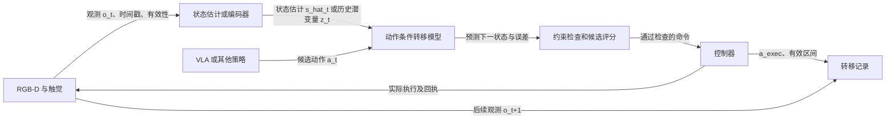
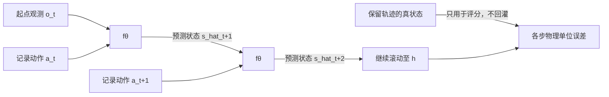
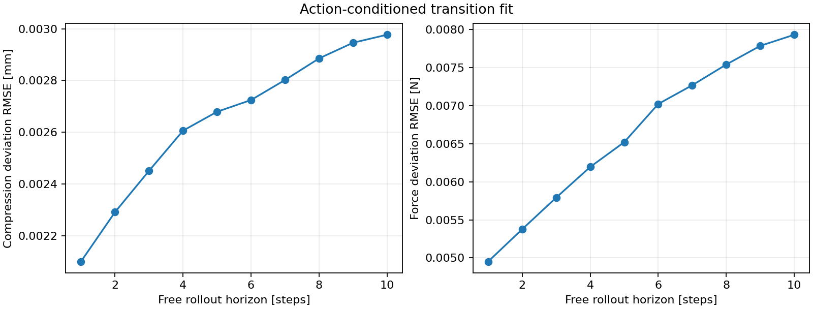
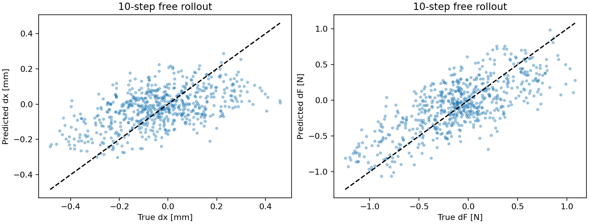

# D62 · 从触觉状态到可检验的动作后果

[返回学习入口](../_index.md) ｜ [本周日程](../P3-项目实战-日程.md) ｜ [上一课 D61](../day61/Daily-Learning-Pack.md) ｜ [CPU 实验](demo.py)

**动作条件预测的关键，不是把“下一帧”预测得像，而是对于同一当前状态、不同候选动作，给出不同且可核验的后果。没有同步动作记录的数据，不能自动成为可用于机器人候选动作评分的训练集。**

上一课用接触状态驱动控制切换；本课把“看见接触后如何反应”再向前推进：如果稍微增加压入速度，下一刻压缩量和力会怎样变化？机械臂抓杯子时，视觉提供外部几何，触觉提供接触局部量，动作说明机器人在这段时间里施加了什么干预。三者的时间、坐标和单位必须在同一个样本中闭合。

本课属于 P3 / Π-2 / W9-D6。我们实现一个八参数的局部转移拟合器，直接观察有无动作输入的区别。它是世界模型所需的一块可检验机制，不是完整机器人世界模拟器，也不是大型 VLA 的复现。

<details>
<summary>个人学习记录（自动更新时保留）</summary>

<!-- learner-notes:start -->
- 我的动作字段、单位与采样区间：
- 我的先验预测、运行记录与未理解问题：
<!-- learner-notes:end -->
</details>

<!-- daily-pack-generated:start -->

## 学习目标与路线

学完后应能够：构造严格的 $(o_t,a_t,o_{t+1})$ 样本；用手算说明动作缺失为何导致不可辨识；推导带正则化的线性残差模型；区分 teacher forcing（逐步喂真实观测）和自由滚动；审查一份触觉数据能支持哪些学习任务；把一个策略动作转换成具有单位、参考系、有效时间和执行回执的接口。

| 顺序 | 知识主线 | 需要回答的问题 |
| --- | --- | --- |
| 1 | 状态、策略、转移 | “现在是什么”和“做了之后怎样”为什么不同？ |
| 2 | 动作与时间契约 | 当前观测属于动作执行之前还是之后？ |
| 3 | 局部转移与辨识 | 能否从记录中恢复动作的影响？ |
| 4 | 一步与多步评价 | 低一步误差能否支撑连续预测？ |
| 5 | VLA 与无动作数据 | 哪些字段可复用，哪些结论不能声称？ |
| 6 | 受控实验 | 只移除动作，模型还剩什么能力？ |

## 1 宏观：在感知与控制之间插入“如果这样做”



图中转移模型回答“某个动作会带来什么后果”；策略回答“当前应选什么动作”；控制器负责“怎样把命令落实到执行器”。三个模块可能共享神经网络部件，但输入输出职责不能混淆。

用概率记号把它们分开：

$$
\text{感知：}\quad p(s_t\mid o_{\le t}),\qquad
\text{策略：}\quad \pi(a_t\mid o_{\le t},\ell),\qquad
\text{转移：}\quad p(s_{t+1}\mid s_t,a_t).
$$

$s_t$ 是物理状态，$o_t$ 是传感器观测，$\ell$ 是语言任务。实际机器人通常无法直接观测完整状态：相同杯子外观可能对应不同摩擦、接触预载和滑移速度。因此工程上常用历史编码 $z_t=E(o_{t-k:t},a_{t-k:t-1})$，再预测下一潜状态。本课先把状态压到两个明确有单位的量，才能直接核验每条公式。

**这条顺序有实际价值：先证明动作字段和后果对应得上，再考虑增加编码器容量。** 如果动作日志整体错一拍，一个更大的模型也可能只是在拟合系统性的错配。

## 2 微观：一个转移样本必须包含哪段时间

### 2.1 观测时间、命令时间与生效时间

设 $o_t$ 对应物理时间 $t$，$a_t$ 表示在 $[t,t+\Delta t)$ 区间内生效的控制输入。下一观测应代表 $t+\Delta t$ 附近的状态，而不是仅按文件行号选“下一行”。真实系统至少区分：曝光或采样时间、驱动接收时间、命令发送时间、控制器开始生效时间、执行反馈时间。

例如相机观测为 1.000 s，动作于 1.015 s 开始，下一图像采样为 1.033 s。若把该图像标签当成动作持续 0.033 s 的后果，会把 0.018 s 的有效动作错误解释为 0.033 s。若机器人以 20 mm/s 匀速运动，实际动作贡献为 0.36 mm，错误模型会认为应该达到 0.66 mm。

> [!question] 先判断
> 触觉数组和动作数组长度一样，是否意味着它们是一一对齐的转移数据？请先写出你需要检查的三个时间字段。

至少要检查采样时间、动作生效区间和后续观测时间；还要确认所有时钟已经映射到同一时间轴。Day57 的对齐和可用性门禁在这里成为前置条件。

### 2.2 物理字段与学习字段分开

| 字段 | 本课最小例 | 实机适配时的含义 |
| --- | --- | --- |
| `observation` | $[\delta x,\delta F]$ | RGB-D、触觉、关节和各自 mask，可变维 |
| `action_command` | 压缩法向速度偏差，mm/s | 指令类型、参考系、单位、限幅前后值 |
| `action_executed` | 合成例等于指令 | 控制器实际执行值及回执；不能默认等于指令 |
| `interval` | $\Delta t=0.05$ s | 动作开始、结束、采样间隔 |
| `next_observation` | 下一时刻两个偏差量 | 采样时间和有效性；不能跨 episode 拼接 |
| `episode_id` | 独立轨迹 ID | 同一次接触/物体/场景分组关系 |
| `calibration_id` | 教学固定比例 | 传感器标定版本和动作反归一化统计量版本 |

归一化值是模型内部表示；物理值是系统接口。比如网络输出 0.5，若缩放规则为速度范围 $[-2,2]$ mm/s，则一种线性映射可能给出 1 mm/s；若它本来表示位移增量，则还必须除以执行周期才能转为速度。**没有动作类型和单位，数字相同也无法相互替代。**

## 3 微观：用两个量建立可手算的局部接触模型

### 3.1 为什么使用偏差状态

杯子已经被轻微夹住，设工作点压缩量为 $x_0$、力为 $F_0$。定义

$$
s_t=\begin{bmatrix}\delta x_t\\\delta F_t\end{bmatrix}
=\begin{bmatrix}x_t-x_0\\F_t-F_0\end{bmatrix}.
$$

$\delta x$ 用 mm，$\delta F$ 用 N。负的 $\delta F$ 表示力低于预载，不代表接触可以承受任意拉力。本实验没有指定真实 $F_0$，也没有接触脱离事件，所以数值不能直接转换成机器人绝对力命令。

本课合成系统为：

$$
\begin{aligned}
\delta x_{t+1}&=0.95\delta x_t+0.05a_t+\epsilon^x_t,\\
\delta F_{t+1}&=0.8\delta F_t+0.6(0.95\delta x_t+0.05a_t)+\epsilon^F_t.
\end{aligned}
$$

$a_t$ 为局部压缩法向速度偏差，mm/s；0.05 的单位为 s；0.6 的单位为 N/mm；0.95 和 0.8 是无量纲遗忘因子。实现中力方程使用加噪之前的压缩预测，随后分别加入过程噪声。这是人为构造的稳定局部模型，没有摩擦锥、惯量、接触切换或真实材料识别。

合并成状态空间形式：

$$
s_{t+1}=As_t+Ba_t+\epsilon_t,\quad
A=\begin{bmatrix}0.95&0\\0.57&0.8\end{bmatrix},\quad
B=\begin{bmatrix}0.05\\0.03\end{bmatrix}.
$$

矩阵中混合单位是合理的：$A_{21}$ 单位 N/mm，$B_2$ 单位 N·s/mm；不能把这种物理矩阵中所有元素都当成无量纲权重来解读。$A$ 的两个特征值 0.95、0.8 都位于单位圆内，说明零输入偏差会衰减；这解释了本例长步误差没有爆炸，不能据此认定任意接触预测都稳定。

### 3.2 同状态、相反动作的手算

取 $s_t=[0.2\text{ mm},0.6\text{ N}]^T$，忽略噪声。

| 动作 | 下一压缩偏差 | 下一力偏差 |
| --- | --- | --- |
| $a=-2$ mm/s | $0.95\times0.2-0.05\times2=0.09$ mm | $0.8\times0.6+0.6\times0.09=0.534$ N |
| $a=+2$ mm/s | $0.95\times0.2+0.05\times2=0.29$ mm | $0.8\times0.6+0.6\times0.29=0.654$ N |

观测完全相同，动作让下一压缩相差 0.20 mm、力相差 0.12 N。不输入动作的确定性预测器只能返回同一个结果；在均方误差目标下，它通常接近这些不同未来的条件均值。

更一般地，若动作没有记录，模型拟合的是

$$
p(s_{t+1}\mid s_t)=\int p(s_{t+1}\mid s_t,a_t)\,p(a_t\mid s_t)\,\mathrm da_t.
$$

这里已经把数据采集策略下的动作混合进去。换一个操作者或策略，$p(a_t\mid s_t)$ 变了，无动作预测的统计规律也可能改变。**观看序列能学习自然延续，却不自动识别可自由指定动作的干预效果。** 即使加入动作，也仍需足够动作覆盖、有效时序和可观测状态，不能由条件相关性自动宣称因果模型完备。

## 4 微观：手写一个八参数的残差学习器

### 4.1 为什么预测变化量

本课从有噪观测 $o_t=s_t+\nu_t$ 学习变化量，而非直接拟合绝对值。令 $D=\operatorname{diag}(\sigma_x,\sigma_F)$，两个标准差只在训练轨迹上计算。

$$
\phi_t=\left[o_t^TD^{-1},\ a_t,\ 1\right]\in\mathbb R^4,
\qquad y_t=(o_{t+1}-o_t)^TD^{-1}\in\mathbb R^2.
$$

动作数值保持 mm/s，状态残差标准化。偏置常数 1 允许学习小的系统偏移。设 $X\in\mathbb R^{N\times4}$，$Y\in\mathbb R^{N\times2}$，学习 $W\in\mathbb R^{4\times2}$：

$$
\mathcal L(W)=\|XW-Y\|_F^2+\lambda\|W\|_F^2.
$$

对 $W$ 求导令零：

$$
2X^T(XW-Y)+2\lambda W=0
\quad\Rightarrow\quad
(X^TX+\lambda I)W=X^TY.
$$

脚本用 `np.linalg.solve` 解线性方程，$\lambda=10^{-4}$，共八个标量参数。这里偏置也受正则化；若要不正则偏置，应把惩罚矩阵最后一项置零并说明协议。预测为 $\hat s_{t+1}=s_t+(\phi_tW)D$，自由滚动时 $s_t$ 换成上一步预测。

| 数据/算子 | shape | 物理或统计含义 |
| --- | --- | --- |
| 单轨迹观测 | `[41,2]` | 41个状态时刻，40个动作区间 |
| 全部动作 | `[100,40,1]` | 100轨迹，每步一个法向速度 |
| 训练设计矩阵 | `[2400,4]` | 60轨迹×40步，2状态+1动作+1偏置 |
| 训练目标 | `[2400,2]` | 标准化状态增量 |
| 参数 | `[4,2]` | 两输出共享同一输入字段 |
| 测试滚动状态 | `[620,2]` | 20轨迹×31个起点 |

### 4.2 先检验数据可辨识，再检验拟合器

如果所有动作都是零，$X$ 的动作列全零，数据不包含动作响应信息。正则化能使方程可解，却不能创造动作辨识能力。如果动作永远等于某个状态的线性函数，状态作用和动作作用也可能难以区分。工程中应查看动作分布、覆盖范围及 $X^TX$ 的条件数，而不是只看训练误差。

本例的动作在 $[-2,2]$ mm/s 独立采样，便于隔离动作因素。它不是推荐在真机上随机施加速度的方案。真实采集必须满足控制约束，并记录控制器限幅与实际执行，否则学习器会把限制器行为误当成被接触物体的动力学。

> [!warning] 归一化与噪声的两个边界
> 使用全体数据计算标准差会引入测试信息；本例只用训练集。另一方面，输入和增量目标共享同一观测噪声，会产生 errors-in-variables（带误差自变量）偏差；拟合参数不等于真实物理参数。这里的检验目标是预测对照，不是高精度材料辨识。

## 5 微观：一步预测与自由滚动是两种考试

### 5.1 预测下一步时是否重新得到真实观测

逐步喂真实观测时，每个时刻都从 $o_t$ 开始预测 $\hat o_{t+1}$；自由滚动时只在起点读取真实观测，以后执行

$$
\hat s_{t+h+1}=f_\theta(\hat s_{t+h},a_{t+h}).
$$

两种评价的区别不是“是否打开训练模式”，而是**模型下一步输入来自现实还是来自自身输出**。本课验证集的一步 RMSE 对比下一观测；测试自由滚动对比合成真状态，因此两表不是完全同一噪声口径，不能直接用数值差推导泛化变化。



本例使用保留轨迹中记录的未来动作序列，所以是“给定动作序列后的状态预测”。它没有运行新策略，没有生成接触力反馈，也没有证明未来策略能在模型中安全闭环。

### 5.2 误差为何沿着转移累积

对局部线性模型，预测误差大致满足 $e_{h+1}\approx A e_h+\eta_h$，其中 $\eta_h$ 汇集模型偏差与过程噪声。展开：

$$
e_H\approx A^He_0+\sum_{j=0}^{H-1}A^{H-1-j}\eta_j.
$$

稳定的 $A$ 可以衰减某些初值误差，但每步仍会引入新误差。若输入动作遗漏，$Ba_t$ 本身就成为无法解释的扰动；哪怕动作均值为零，其方差也不会消失。使用平均预测不能代替动作条件预测。

测试每个 horizon 都用 620 个窗口，保持分母一致。窗口来自20条轨迹且相互重叠，不能视作620次独立机器人试验，也不据此计算“620个独立样本”的置信区间。若要做统计复跑，应以轨迹为单位重采样，并增加数据生成/训练种子。

## 6 微观：同一份数据如何接到 VLA，又有什么不能补造

VLA 需要“给定观测与语言，专家怎样动作”的训练关系；世界模型需要“给定观测/状态与动作，后续怎样变化”的训练关系。它们可以共享原始轨迹，但目标方向不同：

| 学习对象 | 输入 | 监督目标 | 推理阶段 |
| --- | --- | --- | --- |
| 行为克隆/VLA策略 | 图像、语言、允许的本体观测 | 专家动作或动作chunk | 产生候选动作 |
| 本课转移模型 | 状态估计、动作、周期 | 下一状态或变化量 | 预测指定动作的后果 |
| 无动作视觉触觉表征 | 同时刻配对观测 | 配对关系/接触标签 | 编码、检索或分类 |
| 无动作时间预测 | 观测历史 | 下一观测 | 预测采集策略下的延续 |

[OpenVLA 原版官方入口](https://github.com/openvla/openvla#getting-started)示例通过 `unnorm_key` 选择数据统计量进行动作反归一化。课程中只沿用这一工程原则：统计量和机器人动作语义必须匹配；不能把某模型的七维输出当成通用机器人接口。当前脚本没有加载 OpenVLA 权重，也没有执行 VLA 推理。

若现有触觉数据只有视频和接触标签，可以做表征、接触分类或自然序列预测。后验估计“操作者大概在向下压”不等于已经获得有单位、参考系、有效区间的机器人执行动作。若尝试从视频推断动作，应明确它是带误差的额外估计，并独立标定和评价。不能把未记录的 `action` 填零后称为零动作真实转移，更不能填上未来状态差分后声称模型学会了控制输入。

### Learning 五格卡：本课学的究竟是什么

| 格子 | 本课具体答案 |
| --- | --- |
| 数据从哪来 | 已知局部线性方程生成100条独立轨迹，带过程及观测噪声 |
| 学什么 | 状态与动作到下一状态残差的映射，不学语言理解或抓取策略 |
| 改善信号 | 训练轨迹下一观测残差的平方误差与参数正则 |
| 训练与推理 | 闭式解拟合；推理时矩阵乘加；自由滚动不再取真实中间状态 |
| 泛化怎么测 | 按轨迹60/20/20划分，有无动作受控对照；尚未做真实域迁移 |

## 7 回到宏观：用误差模式定位接口问题

如果一步误差大，先查单位、时钟和输入缺失，再查模型。若一步小、多步大，检查滚动分布偏移、未建模隐状态和不稳定性。若训练动作范围内小、范围外大，记录支持集，不把模型用于任意候选动作搜索。

机械臂抓杯子的建议接入点是：先在离线日志构造局部接触窗口，核验命令、执行和触觉时间；用保留轨迹验证物理量预测；再做候选评分的离线回放。只有这些证据满足要求，才讨论控制集成。本课没有连接任何设备。

## 8 动手：先预测，再移除一个字段

### 8.1 运行入口与产出

依赖 Python、NumPy、Matplotlib；CPU 内置合成数据，不需要下载数据或硬件。在 vault 根目录执行，`python3` 应指向已具备依赖的环境：

```bash
python3 3d_learning/day62/demo.py --out _assets/3d_learning/day62/default
python3 3d_learning/day62/demo.py --remove-action --out _assets/3d_learning/day62/no_action
```

先预测：移除动作以后，前述相反动作的两个预测是否还能不同？1步和10步的误差会怎样？运行后从 JSON 检查答案，不只看图是否“画出了直线”。

**2026-11-11 已在 CPU 实际运行并查看图。** 环境 Python 3.11.15、NumPy 1.26.4、Matplotlib 3.10.9；种子62。每次生成4000个合成转移，训练2400个；测试20条轨迹，每horizon620个相关窗口；机器人尝试数0。脚本 `wall_time_s` 包括数据、拟合和绘图，默认约0.285 s、去动作约0.329 s，不是模型单次推理延迟；单次及端到端机器人延迟未测。

| 输入配置 | 1步压缩 RMSE/mm | 5步/mm | 10步/mm | 10步力 RMSE/N |
| --- | ---: | ---: | ---: | ---: |
| 状态+动作 | 0.002100 | 0.002679 | 0.002977 | 0.007932 |
| 只保留状态 | 0.059286 | 0.117031 | 0.151578 | 0.313969 |
| 保持起点压缩不变 | 0.059935 | 0.123425 | 0.168475 | 本表未报告 |

默认相反动作预测为 `[0.090094 mm,0.534011 N]`、`[0.290009 mm,0.653713 N]`，接近手算。去动作后两次均为 `[0.190515 mm,0.594139 N]`。它保留了局部衰减规律，却失去了区分干预的能力。



图1横轴为未来步数，左纵轴为压缩偏差 RMSE/mm，右纵轴为力偏差 RMSE/N。它回答“不给中间真状态后，误差随horizon如何变化”；不能将两个纵轴的数字直接相加。



图2横轴是真值、纵轴是预测。去动作后预测向平均延续收缩，尤其难以跟随受随机动作推动的幅度。对角线只表示理想预测，不能替代完整数值评分。

[默认结果](../../_assets/3d_learning/day62/default/results.json) · [无动作结果](../../_assets/3d_learning/day62/no_action/results.json) · 数据与拟合参数 (not exported: excluded by publication policy) · [默认10步散点](../../_assets/3d_learning/day62/default/prediction.png) · [无动作滚动曲线](../../_assets/3d_learning/day62/no_action/rollout.png)

### 8.2 完整可复制代码

> [!note]- 展开完整 `demo.py`（与同目录脚本一致）
> ```python
> """D62: locally linear contact deviations, with/without recorded action. CPU."""
> import argparse, hashlib, json, platform, time
> from datetime import datetime, timezone
> from pathlib import Path
> import numpy as np
> import matplotlib
> matplotlib.use('Agg')
> import matplotlib.pyplot as plt
>
>
> def generate(rng, episodes=100, length=41):
>     # States are deviations from a preload: dx [mm], dF [N], not absolute force.
>     s = np.zeros((episodes, length, 2)); s[:, 0] = rng.normal(0, [.15, .2], (episodes, 2))
>     u = rng.uniform(-2, 2, (episodes, length-1, 1))  # delta compression velocity [mm/s]
>     for t in range(length-1):
>         x = .95*s[:, t, 0] + .05*u[:, t, 0]
>         f = .8*s[:, t, 1] + .6*x
>         s[:, t+1] = np.c_[x, f] + rng.normal(0, [.001, .003], (episodes, 2))
>     obs = s + rng.normal(0, [.002, .005], s.shape)
>     return s, obs, u
>
>
> def main():
>     p=argparse.ArgumentParser(description=__doc__)
>     p.add_argument('--remove-action', action='store_true')
>     p.add_argument('--out', type=Path, default=Path('_assets/3d_learning/day62/default'))
>     a=p.parse_args(); a.out.mkdir(parents=True, exist_ok=True); start=time.perf_counter()
>     rng=np.random.default_rng(62); truth, obs, action=generate(rng)
>     train, val, test=np.arange(60), np.arange(60,80), np.arange(80,100)
>     scale=obs[train,:-1].reshape(-1,2).std(0)
>     def features(s,u):
>         return np.c_[s/scale, np.zeros(len(u)) if a.remove_action else u[:,0], np.ones(len(u))]
>     x=features(obs[train,:-1].reshape(-1,2),action[train].reshape(-1,1))
>     y=(obs[train,1:]-obs[train,:-1]).reshape(-1,2)/scale
>     w=np.linalg.solve(x.T@x+1e-4*np.eye(4),x.T@y)
>     def step(s,u): return s+(features(s,u)@w)*scale
>     vy=step(obs[val,:-1].reshape(-1,2),action[val].reshape(-1,1))
>     val_rmse=np.sqrt(np.mean((vy-obs[val,1:].reshape(-1,2))**2,0))
>     starts=np.arange(0,31); pred=obs[test][:,starts].reshape(-1,2).copy()
>     persist=pred.copy(); curves=[]; per_h={}; roll=[]
>     for h in range(1,11):
>         u=action[test][:,starts+h-1].reshape(-1,1)
>         pred=step(pred,u); target=truth[test][:,starts+h].reshape(-1,2)
>         rmse=np.sqrt(np.mean((pred-target)**2,0)); curves.append(rmse); roll.append(pred.copy())
>         if h in (1,5,10):
>             per_h[str(h)]={'windows':len(pred),'rmse_dx_mm':float(rmse[0]),'rmse_dF_N':float(rmse[1]),
>                           'persistence_rmse_dx_mm':float(np.sqrt(np.mean((persist[:,0]-target[:,0])**2)))}
>     # Same observation, opposing actions: no-action predictor must return same result.
>     pair=step(np.array([[.2,.6],[.2,.6]]),np.array([[-2.],[2.]]))
>     report={'created_utc':datetime.now(timezone.utc).isoformat(),'seed':62,'data':'synthetic local deviations',
>             'python':platform.python_version(),'numpy':np.__version__,'matplotlib':matplotlib.__version__,
>             'remove_action':a.remove_action,'dt_s':.05,'action_unit':'mm/s','frame':'local normal compression axis',
>             'train_episodes':60,'val_episodes':20,'test_episodes':20,'train_transitions':2400,
>             'test_windows_per_horizon':620,'val_rmse_dx_mm_dF_N':val_rmse.tolist(),'free_rollout':per_h,
>             'counterfactual_predictions_dx_mm_dF_N':pair.tolist(),'parameters':8,'robot_attempts':0,
>             'environment_interactions':'4000 synthetic transitions, including held-out episodes',
>             'script_sha256':hashlib.sha256(Path(__file__).read_bytes()).hexdigest(),
>             'limits':'Not calibrated contact dynamics; overlapping test windows are correlated; no confidence interval.'}
>     np.savez_compressed(a.out/'results.npz',weights=w,state_scale=scale,truth=truth,observation=obs,action=action,
>                         train_episodes=train,val_episodes=val,test_episodes=test,rollout=np.stack(roll))
>     curves=np.array(curves); fig,ax=plt.subplots(1,2,figsize=(10,3.8),constrained_layout=True)
>     for j,label in enumerate(['Compression deviation RMSE [mm]','Force deviation RMSE [N]']):
>         ax[j].plot(range(1,11),curves[:,j],'o-'); ax[j].set(xlabel='Free rollout horizon [steps]',ylabel=label)
>         ax[j].grid(alpha=.25)
>     fig.suptitle('Action omitted' if a.remove_action else 'Action-conditioned transition fit')
>     fig.savefig(a.out/'rollout.png',dpi=160); plt.close(fig)
>     fig,ax=plt.subplots(1,2,figsize=(10,3.8),constrained_layout=True)
>     target=truth[test][:,starts+10].reshape(-1,2)
>     for j,unit in enumerate(['dx [mm]','dF [N]']):
>         ax[j].scatter(target[:,j],pred[:,j],s=8,alpha=.35); lim=np.array([target[:,j].min(),target[:,j].max()])
>         ax[j].plot(lim,lim,'k--'); ax[j].set(xlabel='True '+unit,ylabel='Predicted '+unit,title='10-step free rollout')
>     fig.savefig(a.out/'prediction.png',dpi=160); plt.close(fig)
>     report['wall_time_s']=time.perf_counter()-start
>     (a.out/'results.json').write_text(json.dumps(report,indent=2)+'\n'); print(json.dumps(report,indent=2))
>
>
> if __name__=='__main__': main()
> ```

### 8.3 改变量与解释

先只改变 `--remove-action`，保留数据种子、轨迹划分、拟合形式和评价窗口。去动作配置保留零动作列，所以名义数组仍有八参数，但该列不携带信息；不能说两者有效输入容量相同。然后从 `results.npz` 对照两个配置的 `truth`、`observation`、`action` 完全一致，确认改变的是输入可见性。

进一步可以把动作幅度缩小、改变采样周期或增加噪声，但一次只改一个；这些扩展不属于已报告结果。更改周期时必须同时更改生成方程与动作语义，否则“0.05”不再对应动作持续时间。

## 9 今日总结：给未来加上动作，也给结论加上边界

转移模型以已发生或候选动作作为条件，把当前表征变成可检验的未来预测。数据契约决定模型能辨认什么，闭式求解只能在已有信息中估计规律。自由滚动揭示一步误差背后的累积效应，但合成局部模型的成功不能替代真实接触验证。

最值得掌握的四点：**动作条件性**决定能否比较干预；**时间与单位**决定训练目标是否有物理意义；**完整滚动口径**防止中间真值回灌造成虚高结果；**无动作数据边界**防止把表征学习误报为可控世界模型。

最易混淆的三个边界：力的偏差可以为负不代表负绝对接触力；记录未来动作不代表未来状态可见；模型参数可解不代表数据足以辨识动作作用。

今日留下：一张转移字段契约、一份有无动作对照表、一张误差曲线及对相反动作算例的解释。材料和代码已验证；个人是否掌握、正式项目是否通过，仍需你的产出与作答。

## 10 自测：从字段审查到系统迁移

1. 感知、策略、动作条件转移分别回答什么问题？各给一个输入输出例。
2. 当前 $[\delta x,\delta F]=[0.2,0.6]$、动作 $+2$ mm/s 时，手算下一状态。为什么负力偏差不等于负绝对力？
3. 动作在相机采样后15 ms才生效，下一图像在33 ms后采样。速度20 mm/s实际贡献多少位移？
4. 从正则化目标推导 $W$ 的线性方程。为什么标准差只用训练轨迹？
5. 所有动作均为0时，加入正则项能否让模型学出未知动作增益？
6. 一个10步预测实验每步读入真实触觉，另一个只读初始触觉。哪一个是自由滚动，能否直接比较为同一任务？
7. 触觉视频没有动作记录。列出两个可以合理训练的任务和一个不能直接声称完成的任务。
8. 测试有20条轨迹、620个重叠窗口。如何报告分母与统计独立性？模型接入候选评分前还需哪些证据？

## 11 未理解问题、精读与下一课

尚需继续解决：真实接触切换如何建模（W10 多模态预测、W12 仿真）；历史长度如何选且避免未来泄漏（W10）；预测误差如何转成候选评分和恢复策略（W13）；缺失触觉时如何降级（下一周融合）。这些是扩展问题，当前最小闭环仍应能独立运行。

精读任务：阅读 [World Models 的 Agent Model / MDN-RNN / Controller 段落](https://worldmodels.github.io/)，只提取“编码、动作条件记忆、控制”三个接口，画出与本课八参数模型的对应和缺失部分。再阅读 [OpenVLA README 的 Getting Started 动作预测与反归一化示例](https://github.com/openvla/openvla#getting-started)，列出模型输出到本地控制器之间仍需确定的单位、参考系、周期和统计量；本课不执行其 GPU/机器人示例。

下一课 Day63 / W9-D7 按原计划汇总触觉编码与视觉触觉对齐：第一步冻结编码器，用独立测试配对与下游探针分别检查“跨模态对应”和“任务信息”，不把一个分数替代全部验收。

> [!note]- 自测核对答案与建议判分（每题0/1/2分）
> 通用规则：0分=核心判断错误或未答；1分=结论正确但缺机制/单位/例子；2分=结论、推理和边界齐全。建议达到12/16且第3、6、7题不为0，再记录自己的验收；这里没有预填个人成绩。
>
> 1. 感知从观测估计当前状态；策略从观测/语言输出动作；转移从状态与指定动作输出未来状态。能在抓杯例中写出接口得2分。
> 2. $[0.29\text{ mm},0.654\text{ N}]$。$\delta F=F-F_0$，负偏差只是低于预载；完整说明局部模型边界得2分。
> 3. 有效区间0.018 s，位移0.36 mm；把它标成0.033 s会错估输入影响。
> 4. 梯度置零得到 $(X^TX+\lambda I)W=X^TY$；训练统计量冻结可避免测试信息进入模型。说明混合单位和标准化目标得2分。
> 5. 不能。正则化解决数值/选择问题，不能产生不存在的动作激励信息。
> 6. 只读初始触觉、后续由模型递推的才是自由滚动。逐步真值输入是不同信息条件，应分别报告。
> 7. 可以做接触分类、视觉触觉配对/表征、采集策略下的序列预测；不能直接称为有已知机器人动作的候选动作后果模型。
> 8. 报20条保留轨迹和每步620个相关窗口，不把窗口当独立试验。接入前需时间/单位、动作支持集、真实执行反馈、保留场景误差及约束处理证据。
<!-- daily-pack-generated:end -->
