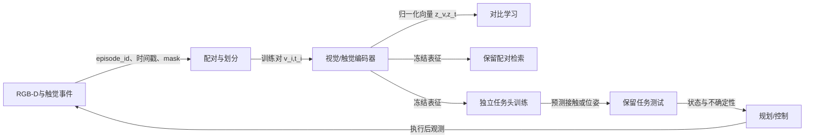
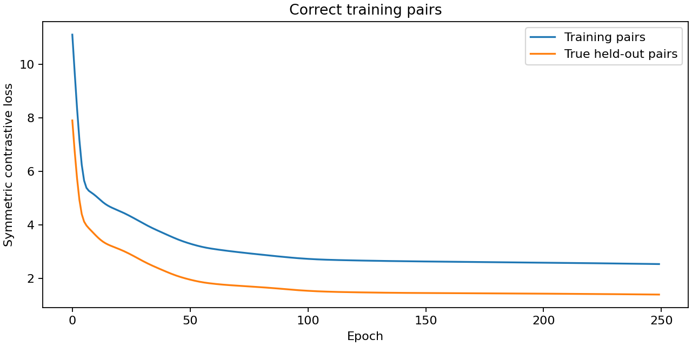
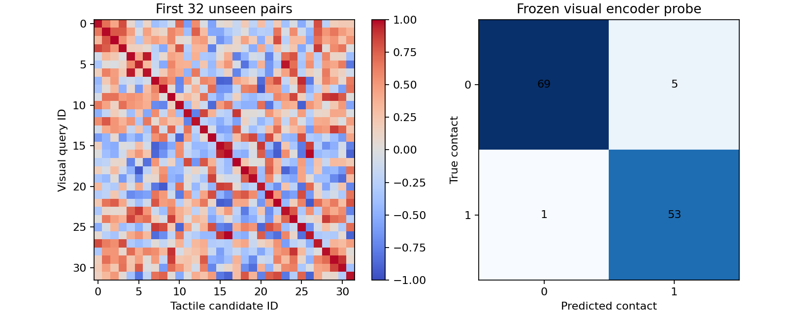

# D63 · 从“训练跑完”到可检验的视觉触觉表征

[返回学习入口](../_index.md) ｜ [本周日程](../P3-项目实战-日程.md) ｜ [上一课 D62](../day62/Daily-Learning-Pack.md) ｜ [CPU 对齐与探针实验](demo.py)

**视觉触觉编码器至少要通过两类不同检查：它是否把正确的跨模态观测对应起来，以及它是否保留了下游任务需要的信息。训练损失下降、检索成功和接触分类成功分别提供不同证据，任何一个都不能单独证明整个多模态系统有效。**

本课是 P3 / Π-2 / W9-D7，收束本周的触觉数据、特征、表征训练、独立评价、接触控制和动作转移。抓杯子的系统中，“这幅触觉图属于哪一个视觉接触事件”与“现在是否接触”是不同问题；仅凭外观甚至也可能较好地预测接触标签，却没有学会把视觉和触觉放进共同空间。

今天完成一个可运行的对齐模块和验收报告骨架：两个小编码器真实训练，随后冻结视觉编码器再训练一个简单探针，用未见过的配对检索和下游分类分别评价。本课数据是合成传感器向量，不是实际触觉图像、官方触觉数据集或已验证机器人系统。

<details>
<summary>个人学习记录（自动更新时保留）</summary>

<!-- learner-notes:start -->
- 我的 W9 产物与仍缺的证据：
- 我的检索/探针对照、作答与未理解问题：
<!-- learner-notes:end -->
</details>

<!-- daily-pack-generated:start -->

## 学习目标与路线

本课结束后应能：从配对批次推导双向对比损失；追踪两个编码器和探针的梯度；手算检索与混淆矩阵指标；通过打乱配对判断模型究竟学到了什么；区分训练集、验证集、测试集和实验选择；把 W9 交付写成证据矩阵而不是“所有代码已运行”的清单。

| 顺序 | 知识主线 | 需要回答的问题 |
| --- | --- | --- |
| 1 | 两类表征能力 | 对齐和可分类为什么不能互相代替？ |
| 2 | 双向对比学习 | 对角线为什么是正确答案？ |
| 3 | 冻结探针 | 下游头如何检查编码器中剩下的信息？ |
| 4 | 独立评价 | 未见配对、类别和物体是同一个泛化问题吗？ |
| 5 | 故障注入 | 打乱配对能揭示哪种伪成功？ |
| 6 | W9验收 | 哪些材料已交付，哪些项目证据仍待获得？ |

## 1 宏观：表征处于数据与任务之间



这张图中有两条评价支路。检索测试共同空间是否保留配对关系；任务头测试表征是否包含与目标相关的可解码信息。二者均在感知表征层，尚未证明下游抓取会成功。若接触控制失败，还需查阈值、延迟、执行器限制与动力学，不能简单归咎于编码器。

**对齐不是融合。** 对齐强调两种表征的相互对应；融合强调组合可用信息去完成任务。两个编码器可能对齐得好，但没有联合预测头；一个联合分类器也可能靠视觉单模态完成任务而忽略触觉。下一周从这里进入早期、后期、门控和交叉注意融合。

## 2 微观：把配对关系写成一个分类问题

### 2.1 编码、投影与归一化

设一个批次有 $B$ 对同时刻的视觉和触觉观测 $(v_i,t_i)$。两个编码器得到 $h_i^v=f_v(v_i)$、$h_i^t=f_t(t_i)$，再做 $L_2$ 归一化：

$$
z_i^v=\frac{h_i^v}{\|h_i^v\|_2},\qquad
z_i^t=\frac{h_i^t}{\|h_i^t\|_2}.
$$

实际实现需要很小的数值下限避免除零，`F.normalize` 完成这一处理。本课每种输入6维，输出8维；向量没有 mm 或 N 的直接物理单位。归一化使点积成为余弦相似度，避免只增大向量范数来抬高分数。

$$
S_{ij}=(z_i^v)^Tz_j^t,\qquad L_{ij}=S_{ij}/\tau.
$$

$S\in[-1,1]^{B\times B}$，$\tau>0$ 为温度。本课 $\tau=0.1$。温度越小，相同相似度差越会放大为 logit 差，softmax 越尖锐；它是损失的尺度参数，不是物理温度，也不能仅凭训练损失较低判断更好。

### 2.2 一行是视觉找触觉，一列是触觉找视觉

若配对正确，$S_{ii}$ 对应同一事件的两模态。对每个视觉查询，批内所有触觉向量是候选：

$$
\ell_i^{v\to t}=-\log\frac{\exp(S_{ii}/\tau)}{\sum_{j=1}^B\exp(S_{ij}/\tau)}.
$$

交换模态得到 $\ell_i^{t\to v}$，总损失为

$$
\mathcal L_{\rm pair}=\frac{1}{2B}\sum_{i=1}^{B}
\left(\ell_i^{v\to t}+\ell_i^{t\to v}\right).
$$

这是两次多分类交叉熵；标签就是 $[0,1,\ldots,B-1]$。输出不是预定义“杯/瓶/盒”类别，而是当前批次里哪一个候选与查询配对。双向项让两个方向都承受检索约束，但不意味着部署必须同时输入两种模态。

对单行 logit 的梯度为 $\partial\ell_i/\partial L_{ij}=p_{ij}-\mathbf 1[j=i]$：正确项概率不足时被拉高，错误项概率偏高时被压低。经过点积与编码器反向传播，两个分支都被更新。这说明“对比学习不需要人工类别标签”不等于“不需要监督关系”；配对关系就是训练信号。

这个双编码器/双向配对目标的代表性一手例子可阅读 [CLIP 原论文 §2.3 与 Figure 3](https://proceedings.mlr.press/v139/radford21a/radford21a.pdf)。CLIP 本身使用图像与文本；本课借用配对目标构建视觉触觉教学实验，不声称复现其数据规模、模型或零样本能力。

### 2.3 手算一个二选一批次

设归一化后的相似度矩阵为

$$
S=\begin{bmatrix}0.8&0.2\\0.1&0.7\end{bmatrix},\qquad\tau=0.2.
$$

第一行正确概率 $e^4/(e^4+e^1)=0.9526$，损失约0.0486；第二行的差值也为3，损失相同。两列差值分别为3.5和2.5，损失约0.0298与0.0789，双向总损失约0.0515。若所有分数相等，每个候选概率为1/2，损失为 $\log 2\approx0.6931$。

由此可知，批大小改变时“随机水平”的损失也改变。本实验训练批512对，验证批128对，均匀损失分别为 $\log512\approx6.2383$ 和 $\log128\approx4.8520$。**训练曲线高于验证曲线，不足以说明验证集更容易或发生了异常泛化；候选分母已经不同。**

> [!warning] 假负样本与错误配对不是同一问题
> 错误配对是把不同事件标成正对；假负样本是把语义等价的其他事件当作负对。例如两次观察同一种杯壁纹理，实例检索可将它们区分，但材料语义任务可能希望它们接近。应先说明目标是事件对应、物体身份还是材料类别，再设计正负样本；不能一概把同批其他样本都称为语义错误。

## 3 微观：冻结探针检查“可读出”，不证明“全懂了”

### 3.1 为什么需要另一个任务头

对齐损失只约束相对相似度；它不保证保留每种任务所需的全部信息。我们冻结视觉编码器，将 $z^v$ 交给一个线性分类头：

$$
g(z)=W_pz+b_p,\qquad
\mathcal L_{\rm probe}=-\sum_i\log\operatorname{softmax}(g(z_i))_{y_i}.
$$

$W_p\in\mathbb R^{2\times8}$、$b_p\in\mathbb R^2$，只有18个参数。训练时编码器不更新，因此探针不能重新改造视觉特征；较高的测试分类准确率说明该标签信息在这种固定特征和线性读出限制下较容易读取。

本例潜因子 $z^{\rm true}\in\mathbb R^4$ 随机生成，标签 $y=\mathbf1[z_0^{\rm true}>0]$。脚本把标签称为 `contact`，但它只是二分类接触代理，不是从真实压力/接触物理获得的真值。两种6维观测由同一个潜因子经过不同线性混合与噪声生成；这刻意制造了可共享但不直接相同的输入。

### 3.2 如何真正冻结

先在 `torch.no_grad()` 中求出整个数据集的嵌入，再训练探针。缓存的 `zv` 不带编码器梯度；优化器只持有探针参数。若把编码器参数仍放在优化器里、或在每批重新以可求导方式计算特征，可能不再是冻结评估。

| 张量/模块 | shape或参数量 | 需要防止的混淆 |
| --- | --- | --- |
| 视觉/触觉原始向量 | `[768,6]` / `[768,6]` | 合成特征，不是RGB像素/真实taxel图 |
| 每个编码器 | `6→24→8`，中间Tanh | 每支368参数，两支736 |
| 训练相似度 | `[512,512]` | 批内实例候选，不是512类固定标签 |
| 保留检索相似度 | `[128,128]` | 128个未见事件的候选集合 |
| 冻结视觉表征 | `[768,8]` | 后续只训练探针，不改编码器 |
| 探针输出 | `[N,2]` | 两类logits，未做概率校准 |

### 3.3 探针与迁移能力之间还有距离

探针成功不能推出：触觉分支有效、两模态对齐、位姿信息保留、真实域可迁移或控制可靠。尤其当视觉本来就包含标签信息时，即使视觉和触觉被训练成彼此不对应的空间，视觉自身仍可能保留分类线索。

本课没有“随机冻结编码器”“直接输入原始视觉向量”的探针基线，所以不能仅凭95.31%证明对比预训练提升了接触分类。我们能报告的是：在此训练配置下，冻结表征可被探针读出；错配会破坏配对检索。若要声称表征学习带来增益，需追加同样标签预算、同样划分和适当容量的原始输入/随机编码器对照。

## 4 微观：评价协议先写清“未见过什么”

### 4.1 训练、验证与测试的职责

本例768行，每行是独立合成事件：512用于训练、128用于验证监测、128用于最终测试。两模态均用训练数据均值与标准差做标准化。编码器和探针各训练固定250个全批梯度步；本例没有根据测试成绩选epoch，也没有选择最佳验证checkpoint，报告最终固定轮次模型。

真实系统不能机械地把每张图像视为独立事件。若同一杯子同一次接触的相邻帧同时进入训练与测试，模型可能靠背景、纹理和缓慢变化完成匹配。应根据目的分组：跨接触episode、跨物体实例、跨材质、跨设备或跨场景。四者是不同泛化条件，不能统一标成“测试集”。

本例只有独立潜因子样本，没有真实物体层级，因此“保留事件”成立，“未知物体泛化”没有被验证。数据分组独立也不能代替域变化测试。

### 4.2 检索指标与任务指标分别算

视觉到触觉 Recall@1：

$$
R@1=\frac1N\sum_{i=1}^N\mathbf1[\arg\max_j S_{ij}=i].
$$

报告候选池大小和完整分母非常重要：从10个候选里找对和从1000个里找对不是同一个难度。当前脚本的最终检索只报告视觉→触觉方向；虽然训练损失双向，不能自动声称已经测了双向检索。

二分类混淆矩阵约定行是真值、列是预测：

$$
C=\begin{bmatrix}TN&FP\\FN&TP\end{bmatrix},\quad
\text{Accuracy}=\frac{TN+TP}{N},\quad
\text{Recall}_{+}=\frac{TP}{TP+FN}.
$$

本例默认矩阵为 $[[69,5],[1,53]]$，准确率122/128=95.3125%，正类召回53/54≈98.15%，正类精确率53/58≈91.38%。把行列含义写反会交换某些指标；只写95%会隐藏错误类型。

### 4.3 方差检查能排除什么

如果每个样本的嵌入都相同，特征各维标准差接近0，检索无法区分候选，这称为表示坍塌的一种极端形式。本例报告8个维度的测试标准差，两种训练都明显非零。但**非零方差只排除了常量式坍塌，不证明两模态共享了正确坐标**；它们可以各自变化，却朝完全不同的方向变化。

## 5 微观：用错配对照拆穿“看起来学到了”

只将训练触觉行打乱，保持视觉输入、物理潜因子、训练/验证/测试集合、编码器初始化、优化器配置和探针初始化一致。验证与测试始终使用正确配对，因此不会用同一个错误标签系统给模型自我证明。

为了做到这一点，脚本给 `torch.randperm` 使用独立随机生成器种子630，不让打乱操作消耗全局随机流而改变后续探针初始化。主模型种子63。这个小细节决定了“只改变配对”是否成立。

打乱后，模型仍可以使错误训练损失下降：损失下降只说明它在优化给定标签，不说明标签代表真实对应。此处随机配对目标难以由小网络泛化，测试检索接近随机；它保留的视觉标签信息却未完全消失。

> [!question] 先预测
> 如果错配模型的视觉探针仍有80%以上准确率，你会认定对齐有效，还是认为这个探针并不检验对齐？在运行前写下理由。

这是本课最重要的反例：任务相关信息与跨模态对应关系是两条证据轴。对单一指标建立过强解释，往往比模型训练失败更难发现。

## 6 回到宏观：W9 模块应怎样交付给 W10

### 6.1 数据接口、模型接口、评价接口

最小编码器服务接收已对齐的视觉、触觉、时间、mask与校准版本，输出特征及其有效性。缺失触觉不能伪造为“真实零压力”，而应保留缺失mask；下一周融合器才有机会正确降级。

建议将完整项目放在 vault 外的 `multimodal_robot_perception` 中，分成数据适配、编码器、训练、评价、推理和配置六部分。每日教学脚本留在课程目录。模型参数之外，还要保存归一化统计量、输入顺序、传感器版本、数据分组清单与评价协议；否则同样的权重也无法重现同样的特征。

### 6.2 验收是一张证据矩阵

| W9环节 | 本周应留下的证据 | 当前教材/教学实验状态 | 正式项目仍需什么 |
| --- | --- | --- | --- |
| 时间对齐 | 时钟映射、因果可用性、丢帧mask | D57有合成对照 | 真实采样/执行时钟记录 |
| 触觉特征 | 输入契约、零点/漂移处理、特征解释 | D58课程与实验 | 实际传感器标定与保留数据 |
| 表征训练 | 正对构造、目标、参数和训练曲线 | D59/D60及本课 | 真实配对数据与分组评价 |
| 对齐检索 | 保留事件候选池、完整分母 | 本课128候选检索 | 跨物体/设备等目标域测试 |
| 任务读出 | 独立标签、冻结协议、混淆矩阵 | 本课合成二分类探针 | 真实接触/位姿任务评价 |
| 接触控制 | 状态切换、限幅、延迟和失败原因 | D61教学例 | 真机或有效接触物理证据 |
| 动作转移 | 同步动作、单位周期、多步误差 | D62局部模型 | 真实执行动作支持集 |

这张表是验收要求与已有教材的映射，不是替学习者勾选“已掌握”。本周新增教学实验也没有补完 Π-1 的正式基准或真实闭环缺口。Π-2 更不能因为出现高检索分数就自动算整个多模态项目通过。

### Learning 五格卡：本课的两个学习阶段

| 格子 | 配对编码器 | 冻结探针 |
| --- | --- | --- |
| 数据从哪来 | 同潜因子的视觉/触觉合成事件 | 训练事件的固定视觉嵌入与二分类代理标签 |
| 学什么 | 两模态归一化共同空间 | 从固定表征读出标签 |
| 信号 | 双向配对交叉熵 | 有监督分类交叉熵 |
| 训练/推理 | 更新两个编码器；推理输出特征 | 只更新18参数头；推理做分类 |
| 泛化测什么 | 未见事件中的配对检索 | 未见事件上的任务读出 |

## 7 动手：保存一份能解释的对齐验收包

### 7.1 先预测与运行

依赖 Python、NumPy、PyTorch、Matplotlib。内置CPU合成数据，运行时从 vault 根目录使用具备这些依赖的Python环境：

```bash
python3 3d_learning/day63/demo.py --out _assets/3d_learning/day63/default
python3 3d_learning/day63/demo.py --shuffle-pairs --out _assets/3d_learning/day63/shuffled
```

先写预测：错配后的训练损失是否一定完全不下降？检索与探针会不会同步降到随机水平？再运行，查看正确训练和错配训练的测试结果。

**2026-11-11已实际运行与核对。** Python 3.11.15、NumPy 1.26.4、PyTorch 2.13.0.dev20260423、CPU；主种子63、错配专用种子630。编码器736参数，探针18参数；512/128/128独立合成事件；编码器和探针各250步。机器人尝试数0。脚本总耗时约1.261 s和0.950 s，包括训练、评价与绘图，受进程/cache影响，不能解释成推理延迟或算法加速；单次推理及机器人端到端延迟未测。

| 配对方式 | 最终训练loss（512候选） | 验证loss（128候选） | 测试检索R@1 | 冻结视觉探针准确率 |
| --- | ---: | ---: | ---: | ---: |
| 正确训练配对 | 2.5299 | 1.3907 | 121/128 = 94.531% | 122/128 = 95.312% |
| 打乱训练配对 | 6.1121 | 4.9890 | 1/128 = 0.781% | 105/128 = 82.031% |

随机选择一个触觉候选的期望正确率为1/128≈0.781%，但有限试验的实际正确数不是必须为1。这个结果支持“错配破坏此设置中的跨模态检索”，不建立真实世界置信度，也不证明95%可以迁移到触觉硬件。



图1显示512候选训练loss和128候选验证loss随epoch变化。应比较同一协议下的训练趋势与正确/错配对照，不能把两条曲线的绝对高低直接当成训练泛化差距。



图2左侧为前32个保留事件的余弦相似度，完整检索实际使用128候选；右侧是128个样本的探针混淆矩阵。左图明显对角结构回答配对问题，右图回答分类问题。两者的分母和任务不能混为一谈。

[错配训练曲线](../../_assets/3d_learning/day63/shuffled/learning.png) · [错配检索/探针图](../../_assets/3d_learning/day63/shuffled/retrieval_probe.png) · [默认JSON](../../_assets/3d_learning/day63/default/results.json) · [错配JSON](../../_assets/3d_learning/day63/shuffled/results.json) · 保存参数与数据 (not exported: excluded by publication policy)

### 7.2 完整可复制代码

> [!note]- 展开完整 `demo.py`（与同目录脚本一致）
> ```python
> """D63: train paired encoders; frozen probe and unseen-pair retrieval. CPU."""
> import argparse, hashlib, json, platform, time
> from datetime import datetime, timezone
> from pathlib import Path
> import numpy as np
> import torch
> from torch import nn
> from torch.nn import functional as F
> import matplotlib
> matplotlib.use('Agg')
> import matplotlib.pyplot as plt
>
>
> def main():
>     ap=argparse.ArgumentParser(description=__doc__)
>     ap.add_argument('--shuffle-pairs',action='store_true')
>     ap.add_argument('--out',type=Path,default=Path('_assets/3d_learning/day63/default'))
>     args=ap.parse_args(); args.out.mkdir(parents=True,exist_ok=True); start=time.perf_counter()
>     torch.set_num_threads(2); torch.manual_seed(63); rng=np.random.default_rng(63)
>     # Each row is an independent synthetic episode, not adjacent frames from one run.
>     z=rng.normal(size=(768,4)).astype('float32')
>     av=rng.normal(size=(4,6)); at=rng.normal(size=(4,6))
>     v=z@av+.04*rng.normal(size=(768,6)); t=z@at+.04*rng.normal(size=(768,6))
>     v=(v-v[:512].mean(0))/v[:512].std(0); t=(t-t[:512].mean(0))/t[:512].std(0)
>     v=torch.tensor(v,dtype=torch.float32); t=torch.tensor(t,dtype=torch.float32)
>     labels=torch.tensor((z[:,0]>.0).astype('int64'))
>     ev=nn.Sequential(nn.Linear(6,24),nn.Tanh(),nn.Linear(24,8))
>     et=nn.Sequential(nn.Linear(6,24),nn.Tanh(),nn.Linear(24,8))
>     opt=torch.optim.Adam(list(ev.parameters())+list(et.parameters()),lr=.003)
>     # A dedicated generator keeps probe initialization identical in both runs.
>     pairing=(torch.randperm(512, generator=torch.Generator().manual_seed(630))
>              if args.shuffle_pairs else torch.arange(512))
>     train_curve=[]; val_curve=[]
>     def embed(x,encoder): return F.normalize(encoder(x),dim=1)
>     def contrast(a,b):
>         score=a@b.T/.1; ids=torch.arange(len(a))
>         return (F.cross_entropy(score,ids)+F.cross_entropy(score.T,ids))/2
>     for epoch in range(250):
>         opt.zero_grad(); loss=contrast(embed(v[:512],ev),embed(t[pairing],et))
>         loss.backward(); opt.step(); train_curve.append(float(loss.detach()))
>         with torch.no_grad():
>             val_curve.append(float(contrast(embed(v[512:640],ev),embed(t[512:640],et))))
>     with torch.no_grad(): zv=embed(v,ev); zt=embed(t,et)
>     # Frozen visual encoder; contact labels are a separate downstream probe signal.
>     probe=nn.Linear(8,2); po=torch.optim.Adam(probe.parameters(),lr=.03)
>     for _ in range(250):
>         po.zero_grad(); loss=F.cross_entropy(probe(zv[:512]),labels[:512]); loss.backward(); po.step()
>     with torch.no_grad():
>         sim=zv[640:]@zt[640:].T; hit=(sim.argmax(1)==torch.arange(128))
>         pred=probe(zv[640:]).argmax(1); truth=labels[640:]
>         confusion=torch.bincount(2*truth+pred,minlength=4).reshape(2,2)
>         std=zv[640:].std(0); acc=float((pred==truth).float().mean())
>     report={'created_utc':datetime.now(timezone.utc).isoformat(),'seed':63,'python':platform.python_version(),
>             'torch':torch.__version__,'numpy':np.__version__,'device':'cpu','shuffle_pairs':args.shuffle_pairs,
>             'train_val_test_episodes':[512,128,128],'encoder_epochs':250,'probe_epochs':250,'temperature':.1,
>             'encoder_parameters':sum(p.numel() for m in (ev,et) for p in m.parameters()),
>             'final_training_loss':train_curve[-1],'final_validation_true_pair_loss':val_curve[-1],
>             'test_retrieval_correct':int(hit.sum()),'test_retrieval_denominator':128,
>             'test_retrieval_R1':float(hit.float().mean()),'test_probe_correct':int((pred==truth).sum()),
>             'test_probe_denominator':128,'test_probe_accuracy':acc,'test_confusion':confusion.tolist(),
>             'test_embedding_std_each_dim':std.tolist(),'robot_attempts':0,
>             'script_sha256':hashlib.sha256(Path(__file__).read_bytes()).hexdigest(),
>             'limits':'Synthetic six-dimensional sensor vectors; not tactile image learning or official data validation.'}
>     arrays={'visual':v.numpy(),'tactile':t.numpy(),'labels':labels.numpy(),'test_similarity':sim.numpy(),
>             'train_loss':np.array(train_curve),'val_loss':np.array(val_curve),'train_pairing':pairing.numpy()}
>     for name,module in [('visual_encoder',ev),('tactile_encoder',et),('probe',probe)]:
>         arrays.update({name+'_'+key:val.detach().numpy() for key,val in module.state_dict().items()})
>     np.savez_compressed(args.out/'results.npz',**arrays)
>     fig,ax=plt.subplots(figsize=(8,4),constrained_layout=True)
>     ax.plot(train_curve,label='Training pairs'); ax.plot(val_curve,label='True held-out pairs')
>     ax.set(xlabel='Epoch',ylabel='Symmetric contrastive loss',title='Shuffled training pairs' if args.shuffle_pairs else 'Correct training pairs')
>     ax.legend(); fig.savefig(args.out/'learning.png',dpi=160); plt.close(fig)
>     fig,ax=plt.subplots(1,2,figsize=(10,4),constrained_layout=True)
>     im=ax[0].imshow(sim.numpy()[:32,:32],vmin=-1,vmax=1,cmap='coolwarm'); fig.colorbar(im,ax=ax[0])
>     ax[0].set(xlabel='Tactile candidate ID',ylabel='Visual query ID',title='First 32 unseen pairs')
>     ax[1].imshow(confusion.numpy(),cmap='Blues')
>     for i in range(2):
>         for j in range(2): ax[1].text(j,i,str(int(confusion[i,j])),ha='center',va='center')
>     ax[1].set(xticks=[0,1],yticks=[0,1],xlabel='Predicted contact',ylabel='True contact',title='Frozen visual encoder probe')
>     fig.savefig(args.out/'retrieval_probe.png',dpi=160); plt.close(fig)
>     report['wall_time_s']=time.perf_counter()-start
>     (args.out/'results.json').write_text(json.dumps(report,indent=2)+'\n'); print(json.dumps(report,indent=2))
>
>
> if __name__=='__main__': main()
> ```

### 7.3 改变量后的解释与复现检查

改变的唯一语义变量是训练配对关系；验证/测试关系保持真实。检查两个NPZ里的视觉数组、触觉数组和标签完全一致；编码器参数最终应不同，因为优化目标不同；模型文件里保存的是可重建的 NumPy 参数数组，不是官方模型权重。报告完整候选池与测试分母，不只展示最漂亮的前32个样本。

再把默认混淆矩阵手算为精确率和召回率，解释为什么“接触漏检1例”与“误报5例”对控制系统的影响不同。若想建立更强预训练收益结论，下一步应增补随机编码器/原始特征探针对照；不要通过本次测试不断选取新设置后还把它称为未使用测试集。

## 8 今日总结：让验收回答明确的问题

对比编码器用配对关系学习共同空间，冻结探针用独立标签检验任务信息是否可读。错误配对可以让检索接近随机而视觉探针仍显著高于随机，因此不同指标不能互相替代。W9交付应包含数据契约、权重与统计量、完整评价协议、失败对照和未完成项，才能稳妥进入W10的融合实验。

四个关键结论及原因：**配对就是监督**，错误数据会被认真优化；**候选池决定检索难度**，loss和R@1必须带分母；**冻结协议界定探针证据**，否则测成重新训练整个网络；**故障注入揭示指标边界**，可以发现“分类不错但跨模态不对应”。

易混淆边界：不坍塌不等于对齐；准确率高不等于概率校准；合成独立事件不等于真实未知物体。今日产出是一份W9证据矩阵、正确/错配对照表、两种评价图和一段对指标分歧的解释。个人学习状态仍待自己的作答与产出。

## 9 自测：给每个分数找准它证明的命题

1. 对齐与融合有什么区别？一个分类器能否忽略触觉仍得到高准确率？
2. 为什么配对训练可以使用标签 `arange(B)`？它是否属于“完全没有监督”？
3. 相似度 `[0.8,0.2]`、温度0.2时，正确候选概率和loss约是多少？若两项相等呢？
4. 本实验训练loss高于验证loss，为什么不能只据此判断过拟合或异常？
5. 写出冻结探针应冻结哪些参数、训练哪些参数。探针95%还能有哪些其他解释？
6. 对矩阵 `[[69,5],[1,53]]`，求准确率、正类精确率与召回率，并说明行列含义。
7. 错配模型检索1/128而探针105/128。它支持什么结论，不支持什么结论？
8. W9正式项目交付中，除了模型文件至少应保留哪些证据？如何区别生成材料、代码验证、个人掌握和项目验收？

## 10 未理解问题、精读与下一课

待深入的问题包括：同材质多个实例的正负样本如何处理（W10联合表征与任务评价）；触觉缺失时怎样继续输出（Day64）；如何让融合注意正确选择局部接触信息（Day66）；低配对误差是否改善动作后果预测（Day68及69）。

精读：[CLIP 原论文 §2.3、Figure 3 与线性探针相关实验](https://proceedings.mlr.press/v139/radford21a/radford21a.pdf)。只围绕三个问题写笔记：双向损失的输入是什么；归一化与温度各改变什么；冻结读出和零样本分类的监督信息为何不同。不要把图文结果直接移植成视觉触觉性能保证。论文阅读记录仍需由你实际完成。

下一课 Day64 / W10-D1：从对齐表征进入融合架构和基线。第一步在同一标注预算和相同保留样本上比较视觉单模态、早期拼接、后期加权和质量门控，并主动让触觉缺失或噪声增加。

> [!note]- 自测核对答案与建议判分（每题0/1/2分）
> 0分=核心结论错误或未答；1分=能复述结论但缺推理/算例；2分=机制、口径和边界齐全。建议12/16以上，且第4、5、7题不为0，再记录自己的验收；此处不代填成绩。
>
> 1. 对齐建立两模态对应，融合联合使用信息完成任务。可以只依赖视觉取得高分类成绩，需单模态消融检查。
> 2. 批内第i个视觉和第i个触觉是正对，因此对角标签成立；配对是监督关系，虽无需固定人工类别标签。
> 3. $p=e^4/(e^4+e^1)=0.9526$，loss≈0.0486；两项相等时p=0.5、loss≈0.6931。
> 4. 训练512候选、验证128候选，均匀基线为log512与log128；候选分母不同，loss绝对值不能直接当泛化差距。
> 5. 冻结两个编码器中的待评视觉分支，当前探针只更新8→2线性头。高分还可能来自原始视觉信息容易分类，需随机/原始特征对照才能归因预训练增益。
> 6. 行真值列预测；accuracy=122/128=95.3125%，precision=53/58≈91.38%，recall=53/54≈98.15%。
> 7. 说明冻结视觉表征仍有代理标签信息，但没有正确跨模态实例对应；不证明真实接触性能、概率校准或对比训练收益。
> 8. 数据分组与版本、时间/单位契约、统计量、权重、配置、完整分母、失败对照和真实未完成项。文件存在是资料状态；实际运行是代码证据；作答产出决定个人掌握；真实目标协议决定项目验收。
<!-- daily-pack-generated:end -->
