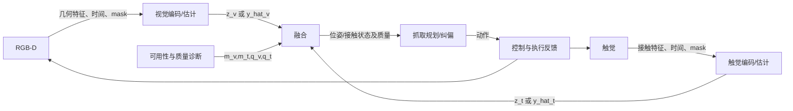
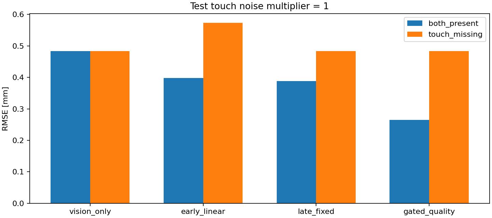
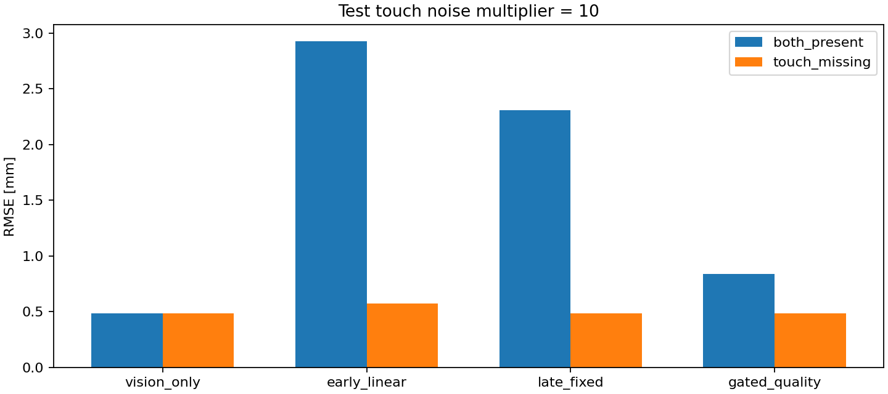

# D64 · 从两路观测到有基线、有退路的融合系统

[返回学习入口](../_index.md) ｜ [本周日程](../P3-项目实战-日程.md) ｜ [上一课 D63](../day63/Daily-Learning-Pack.md) ｜ [CPU 融合对照实验](demo.py)

**融合的价值要通过同一任务、同一数据划分和同一测试样本上的对照来证明；增加一种模态既可能补充信息，也可能把噪声、偏置和过时信息带进预测。一个工程上可用的融合器，还必须明确模态缺失时怎样退回有效分支。**

本课进入 P3 / Π-2 / W10-D1：多模态融合。W9已经建立视觉触觉数据、编码、对齐和独立评价的基础。现在回到机械臂抓杯子：视觉能估计杯壁位置，触觉在接触后能提供局部位置/变形信息；遮挡会让视觉变差，接触不足或传感器污染会让触觉变差。是否“都拼起来交给网络”就一定更好，是本课要用机制和实验回答的问题。

今天建立四个清楚的基线：视觉单模态、早期拼接、后期固定加权、质量门控。例子使用有单位的标量局部位置，避免庞大模型掩盖融合本身的差别；后续Day65、66再进入联合编码器与交叉注意。本课不把标量定位教学任务冒充真实6D位姿或图像模型验证。

<details>
<summary>个人学习记录（自动更新时保留）</summary>

<!-- learner-notes:start -->
- 我的融合接口、可用性规则与质量信号：
- 我的单模态/融合对照结果、作答与疑问：
<!-- learner-notes:end -->
</details>

<!-- daily-pack-generated:start -->

## 学习目标与路线

学完后应能：画出特征级与决策级融合的输入输出；从最小方差目标推导两传感器权重；说明其无偏、独立误差等假设；实现显式mask和缺失时权重重归一化；判断“质量”是否来自部署时可得信号；设计等数据预算但不误称等模型容量的基线比较。

| 顺序 | 知识主线 | 需要回答的问题 |
| --- | --- | --- |
| 1 | 融合位置 | 是拼观测、拼特征，还是合并预测？ |
| 2 | 早期与后期机制 | 为什么同样两个数，模型表达能力不同？ |
| 3 | 质量门控 | “更信谁”由什么可见证据决定？ |
| 4 | 缺失与退路 | 0、无接触、无效和缺失是否相同？ |
| 5 | 受控对照 | 怎样判断融合增加的是信息还是风险？ |
| 6 | 系统接入 | 融合后的量怎样进入位姿、接触和动作模块？ |

## 1 宏观：融合不是增加输入数量，而是组合信息



图中真正跨模块传递的不应只有一个预测值，还应包括时间、参考系、单位、有效性和质量说明。融合之后若丢掉来源时间，控制器可能把一份高置信度但过时的位姿当作最新状态。

不同模态可能有三种关系。**冗余**：都估计同一个局部位置，可通过合理平均降噪。**互补**：视觉提供全局目标，触觉提供接触状态，联合后解决单路无法解决的问题。**冲突**：坐标不同、时间错配、标定偏差或传感器故障使它们给出矛盾证据。冲突不能靠平均自动解决，必须回查来源。

[Multimodal Machine Learning: A Survey and Taxonomy §6.1](https://arxiv.org/pdf/1705.09406)用特征级、决策级与混合方式区分常见融合位置。本课采用这套机制语言；下面的推导和合成比较专门围绕局部机器人状态估计，不把文献中的其他应用结果当作本任务性能保证。

## 2 微观：先写一个可以检验的观测模型

设真实局部位置 $y$，单位mm，两路观测：

$$
v=y+\sigma_v(q_v)\epsilon_v,\qquad
 t=y+\sigma_t(q_t)\epsilon_t,\qquad
\epsilon_v,\epsilon_t\sim\mathcal N(0,1).
$$

$q_v,q_t\in\{0,1\}$ 是声明的质量类别；1代表训练条件下噪声较小。本实验令好质量标准差0.1 mm，差质量0.8 mm，且 $q_t=1-q_v$，刻意构造两模态可靠性互补的情形。真实传感器质量不一定互补：两者可能同时好、同时坏或同时失效，本例不覆盖这些组合。

质量类别是生成时随样本提供的诊断字段，测试时可读，不是用测试真值误差反算出来的权重。然而它仍是理想化质量提示：真实RGB-D可用点数、曝光、遮挡率，触觉饱和、接触面积、漂移监测等只能与误差部分相关，需要单独验证。把真实误差最小的分支叫“当前可靠模态”再用于推理，会泄漏答案。

> [!question] 先算
> 视觉标准差0.1 mm，触觉0.8 mm。等权平均是否比只用视觉更准确？先计算等权结果的方差，再看下一节推导。

在独立无偏误差假设下，等权方差为 $(0.1^2+0.8^2)/4=0.1625$ mm²，标准差约0.4031 mm，明显差于视觉的0.1 mm。**“多一个传感器”与“正确利用额外传感器”是两回事。**

## 3 微观：早期融合把什么交给了预测器

### 3.1 特征拼接与缺失标记

早期融合先组合特征，再输出任务预测。当前线性基线使用

$$
\phi_{\rm early}=[m_vv,\ m_tt,\ m_v,\ m_t,\ q_v,\ q_t,\ 1],\qquad
\hat y=\phi_{\rm early}w.
$$

$m_v,m_t\in\{0,1\}$ 表示是否有效。两个观测保留mm单位，mask和质量类别无量纲；线性模型的系数自然吸收单位关系。设计矩阵为 `[N,7]`，参数为 `[7,1]`，输出为 `[N,1]`。拟合仍用岭回归，目标为训练样本位置误差平方和加 $10^{-4}\|w\|^2$。

为什么必须单独给mask？当 $m_t=0$ 时，触觉填0只是数值占位。真实位置0 mm是一个可能合法测量，与“根本没有测到”不同。没有mask的模型只能猜这个0来自哪种情形。

### 3.2 一个容易被“加了质量字段”掩盖的表达限制

当前模型展开为

$$
\hat y=w_v m_vv+w_t m_tt+b_vm_v+b_tm_t+c_vq_v+c_tq_t+b.
$$

$w_v,w_t$ 是固定权重。加入 $q_v,q_t$ 只能改变加性偏置，不能让 $v$ 的系数随质量改变。要真正表达“当视觉质量好时更信视觉”，线性特征中还需要 $q_vv$ 之类交互项，或使用非线性网络/显式门控。

这并不说明“所有早期融合都差”。本课刻意使用弱、可解释的线性早期基线；更大的MLP可以学习交互，交叉注意也可建立输入相关的信息路由。但增加容量后必须重新报告数据预算、参数量和训练条件，不能把新模型的胜出全部归因于融合位置。

### 3.3 模态丢弃训练能做什么

训练时约20%样本将视觉置为缺失，约20%将触觉置为缺失，其余两模态都在；不额外增加标签。这叫 modality dropout（模态丢弃）：让模型在训练中见到缺失情况。它提供稳健性机会，但不保证任何缺失组合都能正确处理。当前例子从未同时丢弃两路，而且线性模型仍缺少质量和观测的乘积项。

## 4 微观：后期融合先形成同语义的预测

### 4.1 单模态头与固定融合

先分别用同一组2400个训练标签拟合两个仿射头：

$$
\hat y_v=a_vv+b_v,\qquad \hat y_t=a_tt+b_t.
$$

它们输出同一个局部位置，单位均为mm，才适合相互加权。如果一支输出“接触概率”、另一支输出“位置”，直接相加没有任务含义。对于旋转也不能任意平均欧拉角或四元数后不归一化；应使用与表示空间一致的融合方法，后续位姿课再讨论。

固定后期融合为 $\hat y=\alpha\hat y_v+(1-\alpha)\hat y_t$，$0\le\alpha\le1$。在验证集上令 $d_i=\hat y_{v,i}-\hat y_{t,i}$，最小化

$$
\sum_i[\hat y_{t,i}+\alpha d_i-y_i]^2,
\quad\Rightarrow\quad
\alpha^*=\operatorname{clip}_{[0,1]}
\frac{\sum_i d_i(y_i-\hat y_{t,i})}{\sum_i d_i^2}.
$$

脚本进行一次闭式验证拟合，得到视觉权重0.486253。若分母为零，两预测恒同，权重不可辨识；完整工程需处理该退化情形，当前合成数据不退化。固定权重学习的是平均可靠性，在当前样本质量交替变化时，它无法知道“这一帧谁更可信”。

### 4.2 缺失时应重新归一化

若模态缺失，使用

$$
\hat y=\frac{\alpha m_v\hat y_v+(1-\alpha)m_t\hat y_t}
{\alpha m_v+(1-\alpha)m_t}.
$$

当只有视觉有效时，结果应精确退回 $\hat y_v$；不能保留 $\alpha\hat y_v$ 导致人为缩小。若两路都缺失，分母为0，需要明确返回无效状态、保持上一有效估计并增加不确定性，或暂停依赖该状态的动作；不能偷偷返回零位姿。本脚本测试中视觉始终存在，尚未实现或验证“两路全缺”处理，真实适配应把它作为单独接口测试。

## 5 微观：质量门控为什么有效，又为什么会失效

### 5.1 从最小方差推导权重

先考虑两个独立、无偏、同一量纲的估计，其误差方差分别 $\sigma_v^2,\sigma_t^2$。对 $\hat y=w\hat y_v+(1-w)\hat y_t$，有

$$
\operatorname{Var}(\hat y-y)=w^2\sigma_v^2+(1-w)^2\sigma_t^2.
$$

对 $w$ 求导：$2w\sigma_v^2-2(1-w)\sigma_t^2=0$，得到

$$
w_v=\frac{\sigma_t^2}{\sigma_v^2+\sigma_t^2}
=\frac{1/\sigma_v^2}{1/\sigma_v^2+1/\sigma_t^2}.
$$

所以更小方差对应更大精度 $1/\sigma^2$，权重按精度归一化。对于0.1 mm与0.8 mm，视觉权重 $0.64/0.65\approx0.984615$，融合标准差约0.099228 mm；相对好的视觉只略有改善，而非“两个传感器精度翻倍”。

### 5.2 从理想方差到可实现的质量门控

真实误差方差未知。本课在训练集内按质量类别分组计算残差均方：

$$
r_v(q)=\frac{1}{N_q}\sum_{i:q_{v,i}=q}(\hat y_{v,i}-y_i)^2,
\qquad r_t(q)\ \text{同理}.
$$

推理时取 $g_v=m_v/r_v(q_v)$、$g_t=m_t/r_t(q_t)$，再输出

$$
\hat y_{\rm gate}=\frac{g_v\hat y_v+g_t\hat y_t}{g_v+g_t}.
$$

这里脚本中的 `varv/vart` 和 JSON 的 `residual_variance` 字段实际存的是**未去均值的残差MSE**，单位mm²，不能严格等同于方差。单模态岭回归可能有收缩偏差，误差也可能相关，所以这个门控是基于训练残差的启发式，不具备上节全部理想假设下的最优性保证。较小样本/更多参数时应使用保留校准集或交叉拟合估计残差，而不是依赖过拟合训练误差。

本次训练统计量为：视觉质量0/1对应 `[0.435915,0.070560]` mm²，触觉为 `[0.425399,0.061117]` mm²。它们不是传感器生成噪声的 `[0.64,0.01]`，因为中间还有任务头的收缩和拟合。

### 5.3 相关误差和共同偏置

若两估计误差协方差为 $c$，总方差多出 $2w(1-w)c$，最优权重变成

$$
w_v=\frac{\sigma_t^2-c}{\sigma_v^2+\sigma_t^2-2c},
$$

在分母正且约束允许时成立。高度相关的两个观测并不等价于两份独立证据。若两模态都共享同一错误外参、同一目标ID或同一触发延迟，平均通常无法消除共同偏差。

更直接的工程失败是**质量字段过时**。训练时“触觉质量1”意味着小噪声，部署中接触胶体磨损或零点漂移后，质量字段仍显示1，门控就会自信地给坏输入大权重。本实验只增加测试触觉噪声，不更新质量类别和训练残差表，用来精确检验这种失效。

> [!warning] 门控权重不是经过校准的成功概率
> 权重只表达当前融合规则分配的信息比例。0.9不能解释为“抓取有90%成功率”，也不能因为权重和为1就忽略两模态同时失真。真实任务成功还受位姿、可达性、碰撞、控制与接触过程影响。

## 6 微观：用公平但不过度承诺的基线协议

所有方法使用同一组4000个独立合成事件：训练2400、验证800、测试800。单模态头和早期模型只拟合训练标签；固定后期权重只在验证集拟合；测试集只用于报告。噪声倍率仅作用于测试触觉，训练与验证保持不变。

| 方法 | 如何用两模态 | 参数/统计量 | 本课具体边界 |
| --- | --- | --- | --- |
| 视觉单模态 | 仅视觉仿射头 | 2参数 | 判断第二模态是否确有净收益 |
| 早期线性 | 7字段拼接后回归 | 7参数 | 无质量×观测交互；见过单路缺失 |
| 固定后期 | 两个单模态头加全局权重 | 4头参数+1验证权重 | 能缺失重归一化，不能逐样本改权重 |
| 质量门控 | 两头预测按训练残差表加权 | 共享4头参数+4分组统计量 | 依赖可得且稳定的质量提示 |

这是**同标注数据预算**的结构对照，不是完全等参数、等容量或等计算量对照。早期模型接受额外缺失增强，门控具有预先设计的异方差先验；表格必须把这些优势写出来。若今后比较复杂神经网络，应另外固定训练步数、种子、输入模态和评价协议，报告延迟、内存以及模型容量。

### Learning 五格卡

| 格子 | 本课答案 |
| --- | --- |
| 数据从哪来 | 同一个标量位置生成两路异方差观测，质量类别作为可见字段 |
| 学什么 | 观测到当前局部位置的映射和可靠性权重，尚不预测未来 |
| 信号 | 位置标签平方误差；后期权重验证拟合；残差分组统计 |
| 训练/推理 | 训练拟合回归与统计量，推理用当前mask/quality组合输出 |
| 泛化怎么测 | 保留事件、触觉缺失、触觉噪声1/3/10倍；尚未真实设备测试 |

## 7 回到宏观：融合结果如何连接机器人任务

对于杯子的6D位姿，视觉可能提供全局位姿先验，触觉在已知接触几何下约束局部表面；这需要明确坐标链、接触点对应和对称性，不能把本课两个标量平均直接推广成任意位姿融合。对于接触状态，可在统一标签定义下组合单模态概率，但还需概率校准和阈值协议。对于动作后果预测，融合器估计的是当前状态，后面还要接有动作与周期的转移模块。

因此本周顺序是：Day64先比较融合位置与失败条件；Day65学习联合编码器；Day66实现交叉注意；Day67分别评价6D位姿与接触任务；Day68加入动作条件未来预测；Day69检查1/5/10步和模态消融。当前课程无需假装这些后续模块已经训练完毕。

## 8 动手：让第二模态先变坏，再消失

### 8.1 先预测与运行

依赖 Python、NumPy、Matplotlib，CPU合成输入。在 vault 根目录、已有依赖的Python环境执行：

```bash
python3 3d_learning/day64/demo.py --out _assets/3d_learning/day64/default
python3 3d_learning/day64/demo.py --touch-noise-mult 3 --out _assets/3d_learning/day64/noise3
python3 3d_learning/day64/demo.py --touch-noise-mult 10 --out _assets/3d_learning/day64/noise10
```

先预测三点：哪种方法能退回视觉单模态的精确结果；固定后期权重能否适应每个样本的质量；旧质量表在触觉噪声增大后是否一直可靠。每次运行内部同时测试“双方都在”和“触觉缺失”，所有测试使用同一800个目标。

**2026-11-11已实际运行三种噪声条件并查看图。** 环境 Python3.11.15、NumPy1.26.4、Matplotlib3.10.9，种子64；2400/800/800独立合成事件，机器人尝试数0。默认/3倍/10倍脚本墙钟约0.191/0.192/0.204 s，包含拟合、评价和绘图，不是单次推理延迟；端到端机器人延迟未测。

| 两模态存在时 RMSE/mm | 视觉单模态 | 早期线性 | 固定后期 | 质量门控 |
| --- | ---: | ---: | ---: | ---: |
| 原测试噪声 | 0.483246 | 0.397881 | 0.388262 | 0.264698 |
| 仅触觉噪声×3 | 0.483246 | 0.916160 | 0.755806 | 0.349877 |
| 仅触觉噪声×10 | 0.483246 | 2.930390 | 2.308676 | 0.837385 |
| 触觉缺失（各倍率相同） | 0.483246 | 0.573995 | 0.483246 | 0.483246 |

默认门控更好，与数据里“可靠性互补且质量提示有效”的构造一致。3倍噪声时它仍优于视觉；10倍时也落后于视觉。这个反例说明门控本身不能保证可靠性，错误质量估计会使额外模态产生负收益。触觉缺失时后期与门控精确退回视觉，早期模型虽经过缺失训练仍有退化，反映当前表达形式和训练混合目标的限制。



图1纵轴为800个测试事件的局部位置 RMSE/mm，蓝柱两模态存在，橙柱触觉缺失。它回答平均误差与缺失退路问题；不是机器人抓取成功率。



图2仅更改测试触觉噪声。门控仍使用旧质量表，所以不能自动识别自己过度信任的分支。对比视觉柱不变，可以确认变化不来自目标或视觉输入被重采样。

[默认逐样本误差](../../_assets/3d_learning/day64/default/errors.png) · [3倍对照图](../../_assets/3d_learning/day64/noise3/comparison.png) · [10倍逐样本误差](../../_assets/3d_learning/day64/noise10/errors.png) · [默认结果](../../_assets/3d_learning/day64/default/results.json) · [3倍结果](../../_assets/3d_learning/day64/noise3/results.json) · [10倍结果](../../_assets/3d_learning/day64/noise10/results.json) · 默认数据 (not exported: excluded by publication policy)

### 8.2 完整可复制代码

> [!note]- 展开完整 `demo.py`（与同目录脚本一致）
> ```python
> """D64: early, late and reliability-gated fusion; identical split. CPU."""
> import argparse, hashlib, json, platform, time
> from datetime import datetime, timezone
> from pathlib import Path
> import numpy as np
> import matplotlib
> matplotlib.use('Agg')
> import matplotlib.pyplot as plt
>
>
> def ridge(x,y): return np.linalg.solve(x.T@x+1e-4*np.eye(x.shape[1]),x.T@y)
>
>
> def main():
>     ap=argparse.ArgumentParser(description=__doc__)
>     ap.add_argument('--touch-noise-mult',type=float,default=1.)
>     ap.add_argument('--out',type=Path,default=Path('_assets/3d_learning/day64/default'))
>     args=ap.parse_args()
>     if not 1<=args.touch_noise_mult<=10: ap.error('noise multiplier must be in [1,10]')
>     args.out.mkdir(parents=True,exist_ok=True); start=time.perf_counter(); rng=np.random.default_rng(64)
>     n=4000; y=rng.normal(size=n); qv=rng.integers(0,2,n); qt=1-qv
>     sv=np.where(qv==1,.1,.8); st=np.where(qt==1,.1,.8)
>     nv=rng.normal(size=n); nt=rng.normal(size=n); v=y+sv*nv; t=y+st*nt
>     train=np.arange(2400); val=np.arange(2400,3200); test=np.arange(3200,4000)
>     # Same labelled training budget. Masks augment EARLY training without new labels.
>     mv=np.ones(n); mt=np.ones(n); drop=rng.uniform(size=2400)
>     mv[:2400]=(drop>=.2); mt[:2400]=~((drop>=.2)&(drop<.4))
>     def early(vv,tt,vm,tm,q1,q2): return np.c_[vm*vv,tm*tt,vm,tm,q1,q2,np.ones(len(vv))]
>     ew=ridge(early(v[train],t[train],mv[train],mt[train],qv[train],qt[train]),y[train])
>     # Single-modality calibrated heads, shared by late and gated variants.
>     wv=ridge(np.c_[v[train],np.ones(len(train))],y[train])
>     wt=ridge(np.c_[t[train],np.ones(len(train))],y[train])
>     pv=wv[0]*v+wv[1]; pt=wt[0]*t+wt[1]
>     # One closed-form validation fit for the fixed late-fusion weight.
>     d=pv[val]-pt[val]; alpha=float(np.clip(d@(y[val]-pt[val])/(d@d),0,1))
>     varv=np.array([np.mean((pv[train][qv[train]==q]-y[train][qv[train]==q])**2) for q in [0,1]])
>     vart=np.array([np.mean((pt[train][qt[train]==q]-y[train][qt[train]==q])**2) for q in [0,1]])
>     outputs={}; metrics={}
>     for name,missing in [('both_present',False),('touch_missing',True)]:
>         vv=v[test]; tt=y[test]+st[test]*nt[test]*args.touch_noise_mult
>         vm=np.ones(800); tm=np.zeros(800) if missing else np.ones(800)
>         p1=wv[0]*vv+wv[1]; p2=wt[0]*tt+wt[1]
>         l1=alpha*vm; l2=(1-alpha)*tm
>         g1=vm/varv[qv[test]]; g2=tm/vart[qt[test]]
>         predictions={'vision_only':p1,'early_linear':early(vv,tt,vm,tm,qv[test],qt[test])@ew,
>                      'late_fixed':(l1*p1+l2*p2)/(l1+l2),'gated_quality':(g1*p1+g2*p2)/(g1+g2)}
>         outputs[name]=predictions
>         metrics[name]={k:{'rmse_mm':float(np.sqrt(np.mean((pred-y[test])**2))),
>                           'mae_mm':float(np.mean(abs(pred-y[test]))),'denominator':800}
>                        for k,pred in predictions.items()}
>     report={'created_utc':datetime.now(timezone.utc).isoformat(),'seed':64,'python':platform.python_version(),
>             'numpy':np.__version__,'matplotlib':matplotlib.__version__,'data':'synthetic scalar local position in mm',
>             'train_val_test_independent_episodes':[2400,800,800],'test_touch_noise_multiplier':args.touch_noise_mult,
>             'late_visual_weight':alpha,'estimated_visual_residual_variance_mm2':varv.tolist(),
>             'estimated_touch_residual_variance_mm2':vart.tolist(),'metrics':metrics,'robot_attempts':0,
>             'parameters':{'early':7,'shared_unimodal_heads':4,'late_weight':1,'gate_variances':4},
>             'limits':'Gate uses declared quality categories, not oracle test errors; test noise change leaves those categories stale. '
>                      'Different inductive biases and parameter counts; equal data budget is not equal capacity.',
>             'script_sha256':hashlib.sha256(Path(__file__).read_bytes()).hexdigest()}
>     np.savez_compressed(args.out/'results.npz',truth_test=y[test],quality_visual=qv[test],quality_touch=qt[test],
>                         **{scenario+'_'+name:pred for scenario,ps in outputs.items() for name,pred in ps.items()})
>     methods=list(outputs['both_present']); fig,ax=plt.subplots(figsize=(9,4),constrained_layout=True)
>     for i,scenario in enumerate(outputs):
>         ax.bar(np.arange(4)+(i-.5)*.35,[metrics[scenario][m]['rmse_mm'] for m in methods],.35,label=scenario)
>     ax.set(xticks=np.arange(4),xticklabels=methods,ylabel='RMSE [mm]',title=f'Test touch noise multiplier = {args.touch_noise_mult:g}')
>     ax.legend(); fig.savefig(args.out/'comparison.png',dpi=160); plt.close(fig)
>     fig,ax=plt.subplots(1,2,figsize=(10,4),constrained_layout=True)
>     for j,(scenario,ps) in enumerate(outputs.items()):
>         for method in ['early_linear','gated_quality']:
>             ax[j].plot(y[test][:50]-ps[method][:50],label=method)
>         ax[j].axhline(0,color='black',lw=.5); ax[j].set(xlabel='Held-out episode ID (first 50)',ylabel='Signed error [mm]',title=scenario)
>         ax[j].legend()
>     fig.savefig(args.out/'errors.png',dpi=160); plt.close(fig)
>     report['wall_time_s']=time.perf_counter()-start
>     (args.out/'results.json').write_text(json.dumps(report,indent=2)+'\n'); print(json.dumps(report,indent=2))
>
>
> if __name__=='__main__': main()
> ```

### 8.3 改变量与解释结果

比较三份 JSON 的单模态头校准、固定权重和质量残差表应保持一致；比较 NPZ 的真值、视觉质量和触觉质量数组也应一致。只在测试触觉里乘噪声倍率，所以观察到的是分布偏移下的融合稳健性，而不是重新训练后适应新噪声的能力。

进一步实现一个带 $q_vv,q_tt$ 交互项的早期基线，可以检验表达能力是否解释差距；实现两路全缺返回 `valid=False`，可以补齐接口边界。这些是你的扩展产出，不在已执行结果中。不能通过查看测试误差后逐样本选择最佳分支来改进门控，那会引入测试真值泄漏。

## 9 今日总结：融合必须带着它的假设一起交付

融合位置决定哪些模态交互能够被表示，权重机制决定系统如何利用各路可靠性。质量提示和显式mask使推理可以适应部分缺失，但错误或过时的质量估计会让融合比单模态更差。一个可信的融合结论必须同时报告普通条件、缺失条件和失真条件，而不是只展示额外模态有帮助的场景。

最值得记住的四点：**单模态基线**为净收益提供参照；**质量×观测交互**解释“拼入质量字段”为何未必有效；**缺失权重重归一化**保证退路的物理意义；**独立误差假设与质量有效期**决定精度加权的适用范围。

易混淆边界：mask=0不是测量值0；残差MSE不总是无偏方差；质量权重不等于抓取成功概率。今日产出：四方法结构对照图、两模态/缺失/噪声变化表、一份输入有效性契约和对10倍噪声失败的解释。正式真实数据、位姿任务和个人验收仍独立记录。

## 10 自测：让每个“更好”都有对照条件

1. 特征级早期融合与决策级后期融合分别输入什么？为什么位姿、接触概率不能随意相加？
2. 两个独立无偏观测标准差0.1 mm和0.8 mm，等权融合的标准差是多少？为何更差？
3. 推导方差最小的视觉权重，计算上述例子最优权重与融合标准差。
4. 早期线性模型已输入质量 $q_v$，为什么仍不能让视觉权重随质量变化？怎样补充表达能力？
5. 固定后期权重为0.486，触觉缺失时为什么不能输出0.486倍视觉预测？两路都缺应怎样表达？
6. 训练残差均方什么时候等于误差方差？为什么本课门控不能宣称全局最优？
7. 默认门控0.265 mm、10倍触觉噪声时0.837 mm，而视觉始终0.483 mm。这组结果支持什么工程判断？
8. 当前实验控制了哪些条件，又没有实现哪些公平性或真实性？若移植到RGB-D+触觉系统，最先检查什么？

## 11 未理解问题、精读与下一课

继续追问：视觉触觉的局部对应如何建立（Day65/66）；如何在SO(3)上合理比较和融合位姿（Day67）；当前融合误差怎样影响未来预测（Day68/69）；多个传感器都坏时如何让控制系统降级（W12/W14）。

精读 [Multimodal Machine Learning: A Survey and Taxonomy §6、尤其§6.1及Table 5](https://arxiv.org/pdf/1705.09406)。只抽取三种融合位置、可见信息和典型缺失处理，画在同一个视觉触觉系统上；不要用综述里的分类轴替代你自己的任务评价。记录一个你项目中可以真实测量的质量信号，并说明如何验证它与误差相关，而不是把测试真值拿来当质量。

下一课 Day65 / W10-D2 进入联合编码器：第一步让两个分支通过共同任务损失一起更新，再与冻结表征和错配输入比较，观察“共同训练”到底增加了什么、掩盖了什么。

> [!note]- 自测核对答案与建议判分（每题0/1/2分）
> 0分=核心判断错误或未答；1分=结论对但缺推导、单位或边界；2分=能解释机制并迁移到机器人接口。建议12/16以上，且第4、5、7题不为0，再记录自己的验收；不预填个人成绩。
>
> 1. 早期组合特征后预测，后期组合同任务的单模态预测。两输出语义/单位不一致时没有直接加权含义，旋转还受表示空间约束。
> 2. 标准差为sqrt((0.01+0.64)/4)=0.4031 mm，较差分支被赋予过大权重。
> 3. 令 $w^2\sigma_v^2+(1-w)^2\sigma_t^2$ 导数为0，得 $w=\sigma_t^2/(\sigma_v^2+\sigma_t^2)$；视觉权重0.984615，融合标准差0.099228 mm。
> 4. 线性质量项只能改变加性偏置，不能乘性调整观测系数；需交互项、非线性网络或显式门控。
> 5. 缺失后剩余权重必须重新归一化，才能恢复完整视觉量；全缺应返回无效或明确的降级状态，不能造零位姿。
> 6. MSE=方差+偏差平方；误差均值为0时相等。头有收缩偏差、误差可能相关，质量表也会过时，因此只能报告当前启发式实际表现。
> 7. 质量有效时融合有益，但明显域偏移可使旧门控落后于单模态；需检测质量失效与缺失退路，不能只增加模态而不做压力测试。
> 8. 固定了样本、划分、标签预算、噪声抽样与测试分母；未等参数/容量，也无真实RGB-D、触觉硬件或6D任务证据。先查时间、坐标、单位、mask与质量字段在推理时是否真实可得。
<!-- daily-pack-generated:end -->
