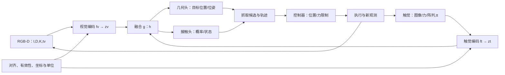
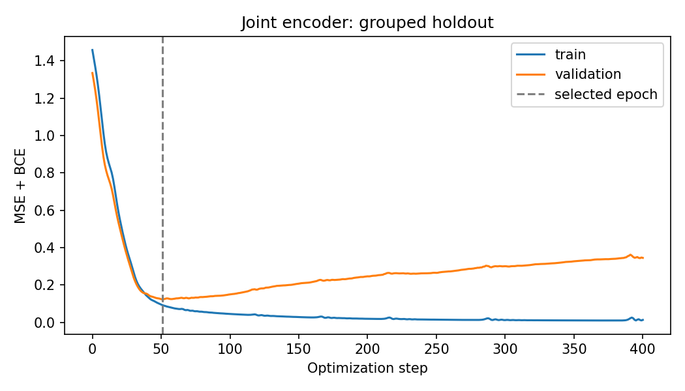
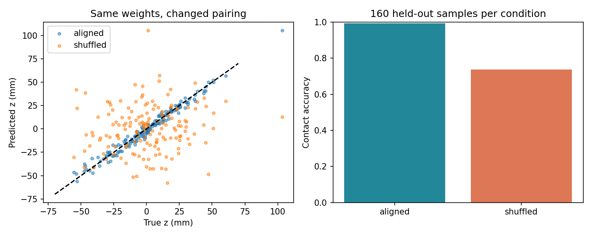

# D65 · 从两个传感器的特征到任务可用的联合编码器

[返回学习入口](../_index.md) · [本周所属项目日程](../P3-项目实战-日程.md) · [上一课：融合架构与基线](../day64/Daily-Learning-Pack.md) · [本课实验](demo.py)

**联合编码器的价值，在于让视觉中的整体几何与触觉中的局部接触共同解释任务；把两个向量拼在一起只是建立通路，训练目标、配对关系和验证协议决定这条通路学到了什么。**

上一课比较融合位置及其基线。这一课把“中间融合”落成一个真正可训练的 PyTorch 模型：两个分支、一个共享表示、两个任务头。仍以机械臂抓杯子为例：相机看到杯身位置，指端接触提供另一侧几何和接触证据；两者需要描述同一次操作中的同一时刻。

今天的脚本有真实的前向、反向传播、参数更新和验证选择，但输入是人为构造的互补特征，不是 RGB-D 图像或真实触觉。三维连续目标也只是带单位缩放的合成位置代理，不是完整 6D 位姿。分清这条边界，才能把小实验结论接到后面的正式系统。

<details>
<summary>个人作答与实验记录（保留区）</summary>

在此追加你的作答、实验变化和未理解问题；自动教材更新不覆盖本区。

</details>

<!-- daily-pack-generated:start -->

## 1 学习目标与路线

完成本课后，应能画出联合编码器的梯度路径；从模块定义计算每层 shape；解释回归与分类损失为何要区分尺度；判断“配对打乱后变差”究竟证明了什么；保存包含预处理统计量的可复现模型。

| 顺序 | 知识主线 | 需要回答的问题 |
| --- | --- | --- |
| 1 | 宏观闭环与信息互补 | 相机和触觉分别缺什么？ |
| 2 | 联合表示与分支结构 | 拼接后为什么还要学习？ |
| 3 | 双任务损失与梯度 | 两个任务如何共同改变编码器？ |
| 4 | 数据与训练协议 | 哪些信息只能在训练集上估计？ |
| 5 | 可运行模型及配对反例 | 模型真的在利用触觉吗？ |
| 6 | 工程接口与边界 | 如何接入真实系统而不夸大实验？ |

## 2 宏观：联合表示位于感知和决策之间



箭头上出现的是实际需要交换的量。图回答“今天训练的模块放在哪里”：它把观测压成可供任务头使用的表示，通常不直接执行力矩，也不自动完成规划。若要做动作条件世界模型，还需要把动作和时间步送入转移模块；这是 Day68 的主题。

视觉擅长提供较大范围的几何，但遮挡可能让杯子背面的接触点不可见。触觉直接感受接触，却只覆盖指端附近。联合表示的希望，是在两者**共同可用且配对正确**时减少歧义。它并不保证遇到传感器漂移时仍优于单模态模型。

### 2.1 三种“共同学习”不能混为一谈

| 名称 | 训练得到什么 | 推理时需要什么 | 典型检验 |
| --- | --- | --- | --- |
| 联合融合表示 | $h=g(f_v(v),f_t(t))$ | 通常两个模态 | 下游任务与缺失模态对照 |
| 对齐表示 | $f_v(v)$ 与 $f_t(t)$ 在可比较空间 | 可做跨模态检索 | 正确配对检索及独立任务 |
| 跨模态迁移 | 一个模态帮助另一个模态学习 | 可能只需单模态 | 固定单模态部署条件下的增益 |

联合训练不要求两个分支的第 3 个通道语义相同。拼接允许视觉保留自己独有的信息，触觉也一样。相反，用距离直接比较两个表示时，必须解释它们为何在同一空间。Ngiam 等人的原论文把融合、跨模态学习和共享表示作为不同设置讨论；本课借用这个区分，使用的是监督的融合小模型，并未复现其音视频网络。[Multimodal Deep Learning，第1节与 Figure 1](https://ai.stanford.edu/~jngiam/papers/NgiamKhoslaKimNamLeeNg2011.pdf)

## 3 微观：从原始量、特征到共享表示

### 3.1 原始模态不同，入口也可以不同

实际 RGB 输入可为 $[B,3,H,W]$，深度为 $[B,1,H,W]$，触觉图像为 $[B,C_t,H_t,W_t]$；腕部力矩则可能只是 $[B,6]$。它们的采样率、噪声和物理单位都不同，因此不必强行共用第一个编码器。

一种合理的实现是：

$$
z_v=f_v(\tilde v;\theta_v),\quad
z_t=f_t(\tilde t;\theta_t),\quad
h=g([z_v;z_t];\theta_g).
$$

$\tilde v,\tilde t$ 表示经过训练统计量归一化的特征；方括号分号表示沿最后一维拼接；$h$ 是无物理单位的特征向量。**无单位不等于不需要单位契约**：送入模型前，深度必须先统一为米、力必须遵循标定约定，随后才归一化。

本课将图像编码器之前的复杂部分抽象掉，使用两个 6 维向量。合成隐藏变量为 $z=(z_x,z_y,z_z)$，视觉强烈暴露 $z_x,z_y$，触觉强烈暴露 $z_z$，再加入独立噪声和非线性项。因此输入构造有意制造“互补”，不能据此推断任意真实触觉都能补足任意视觉缺口。

### 3.2 一个完整 shape 表

本课网络对应：

| 模块 | 输入 | 运算 | 输出 |
| --- | --- | --- | --- |
| 视觉分支 | $[B,6]$ | Linear 6→16，ReLU，Linear 16→8 | $[B,8]$ |
| 触觉分支 | $[B,6]$ | 同样结构、独立参数 | $[B,8]$ |
| 拼接 | 两个 $[B,8]$ | `cat(dim=-1)` | $[B,16]$ |
| 共享融合层 | $[B,16]$ | Linear 16→16，ReLU | $[B,16]$ |
| 位置代理头 | $[B,16]$ | Linear 16→3 | $[B,3]$ |
| 接触头 | $[B,16]$ | Linear 16→1，去掉末维 | $[B]$ logits |

不要沿 `dim=0` 拼接。那会把一个样本的两种模态变成两个样本，破坏配对含义，即使代码没有立即报错。

参数量也能手算。一个分支有 $(6×16+16)+(16×8+8)=248$ 个参数；两个共 496；融合层 $16×16+16=272$；位置头 51；接触头 17；总计 **836 个可训练参数**。这是小型多层感知机，不是大型多模态 Transformer。

### 3.3 手算：拼接本身不会自动解决问题

假设视觉输出 $z_v=[0.2,-0.1]$，触觉输出 $z_t=[0.6,0.4]$，共享层一个神经元的权重为 $[1,0,2,-1]$、偏置为 $-0.3$：

$$
h_1=\max(0,\ 0.2+2×0.6-0.4-0.3)=0.7.
$$

这个值编码了视觉和触觉的组合。若只把向量拼接后输出，表示仍是原来的四个数；“哪些组合对接触有意义”需要由后续可训练参数与数据确定。

> [!question] 先猜
> 将触觉换成另一个样本的 $[0.1,0.9]$，其他量不动，$h_1$ 变成多少？为什么这不是“模型参数变差”？
>
> 结果为 0。参数相同，是输入的跨模态关系被破坏了。

## 4 微观：双任务监督如何训练同一个编码器

### 4.1 连续量与二分类的目标

位置代理头给出 $\hat z_i\in\mathbb R^3$；接触头给出实数 logit $\ell_i$，概率为 $p_i=\sigma(\ell_i)$。合成接触标签定义为 $c_i=\mathbf1[z_{x,i}+z_{z,i}>0.2]$，并非真实物理接触判据。

训练损失是：

$$
L_{\text{pos}}=\frac1{3B}\sum_{i=1}^{B}\|\hat z_i-z_i\|_2^2,
$$

$$
L_{\text{contact}}=-\frac1B\sum_i[c_i\log p_i+(1-c_i)\log(1-p_i)],
\qquad L=L_{\text{pos}}+L_{\text{contact}}.
$$

这里位置目标是在无单位潜变量尺度上训练，显示结果才乘以 30 mm；权重都设为 1 是教学选择。真实系统若位置用米、旋转用弧度、接触用 BCE，直接相加的数值大小可能让某一项主导学习。应先说明每个目标的尺度，再用验证集选择任务权重，而不是凭“两个损失都下降了”断言平衡。

例如同一个 10 mm 位置误差，用米计算平方为 $10^{-4}$，用毫米则为 $100$。物理误差没有改变，未归一化损失却改变 $10^6$ 倍。这是单位影响优化的直接例子。

### 4.2 从任务头向分支传播的梯度

对共享表示 $h$：

$$
\nabla_h L=
J_{\text{pos}}^\top\nabla_{\hat z}L_{\text{pos}}
+
J_{\text{contact}}^\top\nabla_{\ell}L_{\text{contact}}.
$$

$J$ 是任务头输出对共享表示的雅可比矩阵。再通过融合层和各自分支，用链式法则更新 $\theta_v,\theta_t$。接触分类并不是只训练接触头；只要没有冻结或 `detach`，它会改变编码器如何提取特征。

BCE 对 logit 的导数为 $p-c$（批平均再除以 $B$）。当真实接触 $c=1$、预测 $p=0.2$ 时，该导数为 $-0.8$，梯度下降将推动 logit 上升。位置 MSE 对单坐标预测的导数为 $2(\hat z-z)/(3B)$。两个导数经过不同任务头后可能方向一致，也可能相互冲突。

若几何任务希望保留精确位置，分类任务只需要判断阈值两侧，它们对特征压缩的要求并不完全相同。可以观察两个头在保留数据上的指标、训练曲线、每任务梯度范数；必要时调整共享层容量或任务权重。不能只看总损失，因为一个任务改善可能掩盖另一个任务恶化。

### 4.3 多任务、监督来源与模型结构是不同轴

本课同时是“多模态输入”“多任务输出”“有标签监督训练”“MLP 架构”。这些标签不互斥。将来若标签来自机器人自身时间序列，可成为自监督目标；若奖励来自完成抓取，才涉及相应 RL 学习过程。把多任务网络叫作 RL，并不会产生试错或回报优化。

| Learning 五格 | 本课实际设置 |
| --- | --- |
| 数据从哪来 | 120 个合成组，每组 8 个样本；非设备录制 |
| 学什么 | 两个分支与融合层的表示、连续目标和二分类头 |
| 改善信号 | 潜变量真值 MSE + 人工接触规则 BCE |
| 训练与推理 | 训练反传更新参数；推理冻结参数预测两个输出 |
| 泛化如何测 | 按组保留验证/测试；同权重打乱测试触觉配对 |

接触丰富任务中的多模态表示可以与后续策略学习分阶段结合。Lee 等人的工作使用自监督目标学习视觉、力和机器人状态的紧凑表示，再用于操作策略；这提供了架构层面的参考，不意味着本课的合成 MLP 已复现其机器人结果。[Making Sense of Vision and Touch，第III–IV节](https://ai.stanford.edu/~yukez/papers/icra2019.pdf)

## 5 微观：训练协议决定“泛化”是否可信

### 5.1 按组划分，再估计预处理统计量

每个组共享一个随机偏移，组内样本还带独立变化。训练用组 0–79，共 640 样本；验证用 80–99，共 160；测试用 100–119，共 160。这样同一组合成背景不会同时进入训练和测试。

每个模态按训练数据计算：

$$
\mu_j=\frac1{N_{\mathrm{train}}}\sum_{i\in train}x_{ij},\quad
\sigma_j=\sqrt{\frac1{N_{\mathrm{train}}}\sum_{i\in train}(x_{ij}-\mu_j)^2},
\quad \tilde x_j=\frac{x_j-\mu_j}{\max(\sigma_j,10^{-6})}.
$$

验证和测试只使用固定 $\mu,\sigma$。如果部署时重新对每个批次估计均值，输入语义会随批次变化；单个接触样本也不能再与训练保持同一种变换。权重、归一化统计量和字段顺序应一起保存。

组划分只能防止这里指定的共享组泄漏，不能替代真实项目的物体、操作者、设备、日期等分组设计。数据组没有覆盖的新几何和新材料仍可能导致失败。

### 5.2 训练结束并不意味着使用最后一步

脚本完成 401 次完整训练集更新，Adam 学习率 0.01；每步记录验证损失，保存验证损失最小的状态。计数 `best_epoch=51` 是从 0 开始，表示第 52 次更新之后的参数。



图中训练损失继续下降，验证损失在较早阶段达到最低后上升。它回答“为什么要保留验证集”：晚期模型把训练细节拟合得更好，却不再改善独立组。本课保存的是验证选择的状态，而非最后一次更新。

两条曲线的细微差异还包含计算时点：训练损失在一次更新前记录，验证损失在更新后记录。不能把逐点差值全部解释为泛化间隙。

### 5.3 配对打乱是依赖性检查，不是所有问题的证明

脚本对相同 160 个测试样本做两次推理：

- `aligned`：视觉与触觉来自同一样本；
- `shuffled`：只把触觉样本顺序随机置换，视觉、标签、模型参数和归一化不变。

若指标明显变差，说明模型输出依赖于**正确的触觉内容及其配对关系**。这比“网络有触觉分支，所以一定利用了触觉”更有证据。但它不证明视觉与触觉贡献相等，也不证明训练时单独视觉模型一定更差。比较单模态收益仍需分别训练公平的 V-only、T-only 与 V+T 基线，沿用 Day64 的协议。

## 6 动手：先预测，再改变配对关系

### 6.1 运行入口与实验契约

依赖 Python、NumPy、PyTorch、Matplotlib；仅 CPU，内置合成数据。已于 **2026-11-11** 在 Python 3.11.15、NumPy 1.26.4、PyTorch 2.13.0.dev20260423、Matplotlib 3.10.9 验证。无需 CUDA、机器人、数据下载或外部权重。

从 vault 根目录运行：

```bash
python 3d_learning/day65/demo.py
python 3d_learning/day65/demo.py --shuffle-test --out _assets/3d_learning/day65/shuffled_run
```

两条命令都会输出“对齐与打乱”两组比较；第二条只改变报告中的 `selected` 标记并另存一份，**不会训练第二个特殊模型**。真正的受控改变位于脚本中 `ti[perm]` 这一行，同一次运行已完成两种条件。若不需要额外副本，运行第一条即可。

在运行前写下预测：哪一坐标对触觉错配最敏感？接触目标同时依赖 $z_x,z_z$，打乱触觉后还能否保持原准确率？再核对结果，解释哪一个假设与数据生成机制相关。

### 6.2 本次实测与图解

| 条件 | 三坐标元素 RMSE | 每样本位置 L2 的均值 | 接触正确数/总数 |
| --- | --- | --- | --- |
| 正确配对 | 4.756 mm | 7.230 mm | 159/160 |
| 触觉随机错配 | 19.613 mm | 27.565 mm | 118/160 |

这里 `xyz_rmse_mm` 是 $\sqrt{\frac1{3N}\sum_{i,j}e_{ij}^2}$；位置 L2 均值是 $\frac1N\sum_i\sqrt{\sum_je_{ij}^2}$，两者不是同一指标，也不能互换。



左图以真值 $z$ 为横轴、预测 $z$ 为纵轴，单位来自人为定义的 30 mm 比例尺。蓝色对齐点靠近对角线，橙色错配点分散；右图显示接触判断同时受损。它支持的是“模型利用了这个合成触觉通道”，不是“真实抓取成功率达到 99%”。

[机器可读结果](../../_assets/3d_learning/day65/results.json) · 保存的参数与归一化 (not exported: excluded by publication policy)

训练交互预算为 640 个训练样本、401 次全批参数更新；机器人交互为 0。JSON 中的 batch latency 是一次 160 样本前向计时，含冷启动与调度影响，没有充分预热和重复采样；不要用它声称实时部署延迟。

### 6.3 完整可复制代码

关键训练行是 `loss = position_mse + contact_bce`。请先沿输出头追踪梯度回到两个分支，再阅读完整脚本。

> [!note]- 完整 CPU 脚本，与同目录 demo.py 一致
> ```python
> """CPU synthetic joint encoder; normalized xyz proxy is not a 6D pose model."""
> import argparse
> import json
> import platform
> import time
> from pathlib import Path
> import numpy as np
> import torch
> from torch import nn
> import matplotlib
> matplotlib.use('Agg')
> import matplotlib.pyplot as plt
> 
> 
> def main():
>     ap = argparse.ArgumentParser()
>     ap.add_argument('--seed', type=int, default=65)
>     ap.add_argument('--shuffle-test', action='store_true')
>     ap.add_argument('--out', type=Path, default=Path(__file__).resolve().parents[2] / '_assets/3d_learning/day65')
>     args = ap.parse_args()
>     args.out.mkdir(parents=True, exist_ok=True)
>     torch.set_num_threads(1)
>     torch.manual_seed(args.seed)
>     rng = np.random.default_rng(args.seed)
>     groups = np.repeat(np.arange(120), 8)
>     z = rng.normal(size=(120, 3))[groups] * .5 + rng.normal(size=(960, 3)) * .7
>     v = np.column_stack([z[:, 0], z[:, 1], z[:, 0] * z[:, 1], np.sin(z[:, 0]), np.cos(z[:, 1]), z[:, 2] * .05])
>     t = np.column_stack([z[:, 2], np.tanh(z[:, 2]), z[:, 1] * .2, z[:, 0] * .1, z[:, 2] ** 2, np.ones(960)])
>     v += rng.normal(scale=.12, size=v.shape)
>     t += rng.normal(scale=.12, size=t.shape)
>     y = (z[:, 0] + z[:, 2] > .2).astype(np.float32)
>     split = {'train': groups < 80, 'val': (groups >= 80) & (groups < 100), 'test': groups >= 100}
>     norm = []
>     for a in (v, t):
>         mu, sd = a[split['train']].mean(0), a[split['train']].std(0)
>         sd = np.maximum(sd, 1e-6)
>         norm.append({'mean': mu.tolist(), 'std': sd.tolist()})
>         a -= mu
>         a /= sd
>     v, t, z, y = [torch.tensor(a, dtype=torch.float32) for a in (v, t, z, y)]
> 
>     class Joint(nn.Module):
>         def __init__(self):
>             super().__init__()
>             self.visual = nn.Sequential(nn.Linear(6, 16), nn.ReLU(), nn.Linear(16, 8))
>             self.tactile = nn.Sequential(nn.Linear(6, 16), nn.ReLU(), nn.Linear(16, 8))
>             self.fuse = nn.Sequential(nn.Linear(16, 16), nn.ReLU())
>             self.xyz = nn.Linear(16, 3)
>             self.contact = nn.Linear(16, 1)
>         def forward(self, a, b):
>             h = self.fuse(torch.cat([self.visual(a), self.tactile(b)], dim=-1))
>             return self.xyz(h), self.contact(h).squeeze(-1)
> 
>     net = Joint()
>     opt = torch.optim.Adam(net.parameters(), lr=.01)
>     best, best_state, curve = float('inf'), None, []
>     start = time.perf_counter()
>     for epoch in range(401):
>         net.train()
>         xyz, logit = net(v[split['train']], t[split['train']])
>         loss = ((xyz - z[split['train']]) ** 2).mean() + nn.functional.binary_cross_entropy_with_logits(logit, y[split['train']])
>         opt.zero_grad()
>         loss.backward()
>         opt.step()
>         net.eval()
>         with torch.no_grad():
>             xyz, logit = net(v[split['val']], t[split['val']])
>             val = ((xyz - z[split['val']]) ** 2).mean() + nn.functional.binary_cross_entropy_with_logits(logit, y[split['val']])
>         curve.append([epoch, loss.item(), val.item()])
>         if val.item() < best:
>             best, best_epoch = val.item(), epoch
>             best_state = {k: a.detach().clone() for k, a in net.state_dict().items()}
>     train_seconds = time.perf_counter() - start
>     net.load_state_dict(best_state)
>     net.eval()
>     vi, ti, zi, yi = [a[split['test']] for a in (v, t, z, y)]
>     perm = torch.tensor(np.random.default_rng(args.seed + 1).permutation(len(ti)))
>     outputs, rows = {}, {}
>     for name, tactile in [('aligned', ti), ('shuffled', ti[perm])]:
>         start = time.perf_counter()
>         with torch.no_grad():
>             pred, logit = net(vi, tactile)
>         latency = (time.perf_counter() - start) * 1000
>         err = torch.linalg.vector_norm((pred - zi) * 30, dim=-1).numpy()
>         outputs[name] = pred.numpy()
>         rows[name] = {'xyz_rmse_mm': float(torch.sqrt(((pred - zi) * 30).square().mean())),
>                       'contact_correct': int(((logit >= 0) == yi.bool()).sum()), 'contact_total': len(yi),
>                       'contact_accuracy': float(((logit >= 0) == yi.bool()).float().mean()),
>                       'batch_latency_ms': latency, 'mean_position_l2_mm': float(err.mean())}
>     result = {'seed': args.seed, 'data': 'synthetic complementary feature vectors, no image encoder or real contact',
>               'units': 'latent xyz scaled by 30 mm; binary contact is synthetic rule',
>               'split_groups': {'train': [0, 79], 'val': [80, 99], 'test': [100, 119]},
>               'split_samples': {k: int(a.sum()) for k, a in split.items()},
>               'best_epoch': best_epoch, 'train_seconds': train_seconds, 'train_steps': 401,
>               'selected': 'shuffled' if args.shuffle_test else 'aligned', 'evaluation': rows,
>               'normalization_fit': 'training only', 'normalization': norm,
>               'environment': {'python': platform.python_version(), 'numpy': np.__version__, 'torch': torch.__version__, 'matplotlib': matplotlib.__version__, 'device': 'cpu'},
>               'robot_trials': 0, 'project_acceptance': 'pending'}
>     (args.out / 'results.json').write_text(json.dumps(result, indent=2), encoding='utf-8')
>     torch.save({'weights': best_state, 'normalization': norm}, args.out / 'joint_encoder.pt')
>     c = np.asarray(curve)
>     fig, ax = plt.subplots(figsize=(7, 4))
>     ax.plot(c[:, 0], c[:, 1], label='train')
>     ax.plot(c[:, 0], c[:, 2], label='validation')
>     ax.axvline(best_epoch, color='gray', ls='--', label='selected epoch')
>     ax.set(xlabel='Optimization step', ylabel='MSE + BCE', title='Joint encoder: grouped holdout')
>     ax.legend(); fig.tight_layout(); fig.savefig(args.out / 'training.png', dpi=150); plt.close(fig)
>     fig, axes = plt.subplots(1, 2, figsize=(10, 4))
>     for name in outputs:
>         axes[0].scatter(zi.numpy()[:, 2] * 30, outputs[name][:, 2] * 30, s=12, alpha=.5, label=name)
>     axes[0].plot([-70, 70], [-70, 70], 'k--'); axes[0].set(xlabel='True z (mm)', ylabel='Predicted z (mm)', title='Same weights, changed pairing'); axes[0].legend()
>     axes[1].bar(list(rows), [rows[n]['contact_accuracy'] for n in rows], color=['#228899', '#dd7755'])
>     axes[1].set(ylim=(0, 1), ylabel='Contact accuracy', title='160 held-out samples per condition')
>     fig.tight_layout(); fig.savefig(args.out / 'pairing.png', dpi=150); plt.close(fig)
>     print(json.dumps({k: result[k] for k in ['best_epoch', 'selected', 'evaluation']}, indent=2))
> 
> 
> if __name__ == '__main__':
>     main()
> ```

### 6.4 再做一个有解释力的修改

保持组划分、种子、训练步骤不变，将数据生成中视觉的 `z[:,2] * .05` 改为 `z[:,2] * .8`，另存输出。先预测：视觉直接暴露更多第三坐标后，错配触觉造成的恶化是否可能减小？训练完再比较。这改变了模态互补性，不能与“只在推理阶段打乱配对”混成同一个消融。

若扩展到真实触觉图像，首先将 6 维输入改为图像编码器输出，保持样本 ID、曝光时间、接触阶段与有效 mask；不要先把不同时间的图片堆进同一个 batch 再寄希望于网络自行同步。

## 7 回到宏观：工程接入与失败定位

模型导出至少保留输入字段顺序、各分支归一化、权重、训练/验证组定义、坐标系和目标尺度。真实位置头可能输出相机系 $t_{CO}$；接触头输出的是“指端是否接触”的概率，这两者仍需要经过坐标变换与控制逻辑组合。接触概率不是牛顿值，几何位置也不是夹爪目标。

一个排错顺序是：

1. 同一帧检查视觉与触觉 ID、时间和对象一致性。
2. 把部署前处理后的特征与离线管线逐项比较。
3. 分别读取两个任务头的误差，不只看总损失。
4. 用错配、模态缺失和设备偏置检查依赖关系。
5. 在控制器接收目标之前检查单位、过期时间与执行反馈。

未来 VLA 可以消费这个表示或替代其中部分编码器，但动作头的输出仍须解释参考系和动作周期。世界模型可以在共享表示上加动作条件转移，但当前接触分类头并没有预测动作后果，不能仅换名字就宣称是世界模型。

## 8 今日总结与产出

三句话带走主线：**联合编码器让多个模态共同服务任务，任务损失通过共享层反传到各分支。正确配对和训练统计量属于模型定义的一部分。受控错配揭示依赖关系，正式收益仍需独立数据、单模态基线与实际任务评价。**

最值得掌握的四点及原因：

- **shape 与样本轴**：拼接轴错了，表面上仍有数字，实际样本语义已经丢失。
- **损失尺度与梯度路径**：它们决定共享层为哪种任务保留信息。
- **验证选择**：本次曲线明确出现过拟合，最后一步不等于最好状态。
- **受控配对检查**：它能检验模型是否依赖模态，却不能替代完整基线。

最易混淆的边界是：接触分类概率与力值不同；三维位置代理与 6D 位姿不同；共享特征与可直接比较的对齐特征不同。

今天留下：一张带 shape 的双分支结构图；一份正确/错配对照表；可复跑的脚本与权重；解释一次过拟合和一次输入错配的短笔记。个人掌握程度仍待你的作答与产出。

## 9 自测

1. 为什么两个编码器输出同为 8 维，不代表可以逐元素相加？
2. 两个 $[B,8]$ 沿最后一维拼接得到什么？沿样本维呢？
3. 计算本课总参数量，并说明两个分支是否共享权重。
4. 接触真值为 1，模型概率 0.2，BCE 对 logit 的单样本导数是多少？
5. 为什么把位置从米换成毫米会改变未归一化平方损失？
6. 本次验证最优发生在第 51 个零起始索引，继续训练是否一定改善部署？
7. 触觉错配后指标变差能证明什么？还有什么不能证明？
8. 将模型接入真实 RGB-D 抓杯系统前，至少需要补齐哪些数据契约和评价证据？

每题 0/1/2 分：0 分为关键机制错误；1 分为结论正确但缺少理由；2 分为能解释并给出本课之外的工程例子。建议达到 12/16，且第 2、5、8 题没有单位或接口错误；不据此自动记录个人通过。

## 10 未理解问题与次日衔接

若仍不清楚“共享表示为什么会遗忘某模态”，先记录是哪一个梯度、哪个任务或哪个数据条件未理解，后续在 W10 的模态消融中回答。若疑问是“如何让一个视觉区域寻找相关触觉位置”，下一课 Day66 将把固定拼接替换为有 query、key、value 和有效性 mask 的交叉注意。第一步先写出 $[B,N_v,D]$ 与 $[B,N_t,D]$ 的注意力矩阵形状。

本课具体精读：Ngiam 等第1节、Figure 1，列出三个学习设置各自的训练/测试模态；Lee 等第III–IV节，区分表征目标和策略目标。不要把读过摘要记为完成全文精读。


> [!note]- 自测核对答案与判分要点
> 1. 维度相同只保证算术可行；两个分支坐标基底未必对齐。能举出一个通道编码位置、另一通道编码纹理的例子可得 2 分。
> 2. 最后一维得 $[B,16]$，样本维得 $[2B,8]$；后者破坏同一样本的融合关系。
> 3. 每分支 248，共 496；融合 272、位置头 51、接触头 17，总计 836。分支形状相同但参数独立。
> 4. $p-c=-0.8$；批平均再除以批大小。梯度下降推动 logit 增大。
> 5. 数值误差扩大 1000 倍，平方扩大 $10^6$ 倍；不代表物理误差变大，应统一尺度及权重。
> 6. 不一定。本次验证曲线后期上升，应使用仅由验证集选择的参数，测试集不能参与选择。
> 7. 支持输出依赖正确触觉内容与配对；不能证明真实硬件收益、两个模态贡献相等或优于重新训练的全部单模态基线。
> 8. 样本 ID/时间、模态有效性、坐标与单位、训练归一化和目标定义；还需真实独立测试、单模态对照、延迟分布及控制闭环证据。不能把合成分类准确率当抓取成功率。

<!-- daily-pack-generated:end -->

