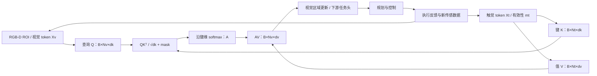
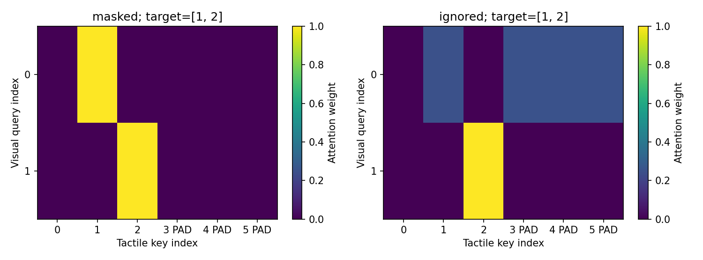
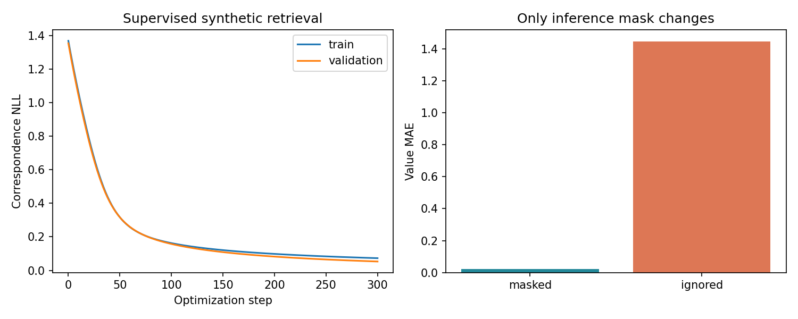

# D66 · 从固定拼接到按需读取：手写视觉触觉交叉注意

[返回学习入口](../_index.md) · [本周所属项目日程](../P3-项目实战-日程.md) · [上一课：联合编码器](../day65/Daily-Learning-Pack.md) · [本课实验](demo.py)

**交叉注意是一种“根据查询读取另一组信息”的可训练运算；query 决定询问什么，key 决定如何匹配，value 决定读出什么，mask 决定哪些数据根本没有资格参与。**

Day65 把两个模态的全局向量拼起来，已经能学习互补关系。当视觉包含许多区域、触觉包含多个指端或历史片段时，“给所有视觉区域同一个触觉向量”可能过于粗糙。抓杯子时，左指附近的视觉区域更需要左指接触证据；远处背景不应把无效触觉 padding 当作接触。

本课从单头注意力的矩阵乘法写起，再训练两个小投影矩阵学习合成几何对应。重点是读懂并实现机制，而不是把一个函数名当作已经实现多模态理解。

<details>
<summary>个人作答与实验记录（保留区）</summary>

在此追加你的作答、实验变化和未理解问题；自动教材更新不覆盖本区。

</details>

<!-- daily-pack-generated:start -->

## 1 学习目标与路线

你应能推导注意力每个张量的 shape，手算两键查询的输出；解释缩放和 softmax；正确处理无效 token 与全空样本；通过置换检查验证实现；区分注意力热图、几何对应与可靠的任务预测。

| 顺序 | 知识主线 | 需要回答的问题 |
| --- | --- | --- |
| 1 | 系统中的读取方向 | 谁查询谁，输出跟谁对齐？ |
| 2 | Q/K/V 与缩放点积 | 权重如何形成、输出怎样计算？ |
| 3 | mask、全空与时序可用性 | 没有数据时为什么不能随便填零？ |
| 4 | 训练目标和排列性质 | 该运算学了什么，又必须保持什么？ |
| 5 | CPU 实验与故障注入 | 忽略 padding 会造成多大污染？ |
| 6 | 工程扩展 | 如何接入 RGB-D、触觉、VLA 或世界模型？ |

## 2 宏观：交叉注意输出仍然跟着查询走



图中 $N_v$ 是视觉 token 数量，$N_t$ 是触觉 token 数量。**输出的序列长度是 $N_v$，因为每个视觉查询读出一个结果。**反向做“触觉查询视觉”，输出长度则为 $N_t$。二者使用的条件不同，不能把注意力矩阵转置后就当作同一种运算。

自注意力中 Q、K、V 来自同一序列；交叉注意中查询来自一组，键和值来自另一组。一个系统可以同时包含二者。视觉 token 之间的几何关系可先用自注意力建立，再通过交叉注意读取触觉。是否需要这种复杂度，必须与 Day64 的简单融合基线比较。

## 3 微观：四步写出注意力

### 3.1 先投影到可比较空间

令视觉特征 $X_v\in\mathbb R^{B\times N_v\times d_v^{in}}$，触觉特征 $X_t\in\mathbb R^{B\times N_t\times d_t^{in}}$：

$$
Q=X_vW_Q,\qquad K=X_tW_K,\qquad V=X_tW_V.
$$

$Q,K$ 的最后一维都为 $d_k$，这样点积才有意义；$V$ 的最后一维 $d_{\mathrm{val}}$ 可以不同。权重矩阵是学习得到的，不同模态无需有相同输入维度。

本课教学代码对 Q、K 分别使用无偏置 Linear 3→16，而 V 是直接给定的 1 维数值，省略学习的 $W_V$。这有意把“查到哪里”和“取回什么”分开：任务是依据方向找到一个触觉位置，取出该位置上的随机值。它不是完整 Transformer 层，也没有图像编码器。

### 3.2 点积、缩放与 softmax

对样本 $b$ 中查询 $i$ 与键 $j$：

$$
s_{bij}=\frac{q_{bi}^{\top}k_{bj}}{\sqrt{d_k}},
\qquad
a_{bij}=\frac{\exp(s_{bij})}{\sum_{r\in\mathcal V_b}\exp(s_{bir})},
\qquad
o_{bi}=\sum_{j\in\mathcal V_b}a_{bij}v_{bj}.
$$

$\mathcal V_b$ 是有效键集合。$a$ 为无单位权重，对每个查询沿键维归一化。输出是 value 的加权组合，不是直接输出被选中的 key。

为什么除以 $\sqrt{d_k}$？若每个 $q_r,k_r$ 独立、零均值、方差为 1，则 $q^\top k=\sum_r q_rk_r$ 的方差为 $d_k$。维度增大时分数幅度随之增大，softmax 更易饱和。除以 $\sqrt{d_k}$ 使这个理想化方差保持约 1；真实训练中独立性不严格成立，缩放仍是合理的数值设计。[Attention Is All You Need，第3.2.1–3.2.3节](https://arxiv.org/html/1706.03762v7)

将每行减去其最大值再求指数不会改变 softmax，因为分子分母同乘了常数，却能减少指数溢出。框架函数通常已处理数值稳定性；手写时应知道这一点。

### 3.3 完整 shape 流

| 量 | 一般形状 | 本课测试形状 |
| --- | --- | --- |
| 原始 query | $B×N_q×3$ | 128×2×3 |
| 原始 key | $B×N_k×3$ | 128×6×3 |
| 投影 Q/K | $B×N_q×16$ / $B×N_k×16$ | 128×2×16 / 128×6×16 |
| 分数及权重 | $B×N_q×N_k$ | 128×2×6 |
| value | $B×N_k×1$ | 128×6×1 |
| 键有效 mask | $B×N_k$ | 128×6 |
| 输出 | $B×N_q×1$ | 128×2×1 |

代码中的 `k.transpose(-1,-2)` 只交换最后两个轴，保留 batch。用整体 `.T` 处理三维张量会引入错误的轴顺序。softmax 必须沿最后的键维：它回答“这个 query 在候选 keys 中如何分配权重”。

### 3.4 可手算的例子

设一个 query $q=[1,0]$，两个 key 分别 $[1,0]$、$[0,1]$，value 分别为 2 和 8，且 $d_k=2$。分数为 $[1/\sqrt2,0]$，权重约 $[0.6698,0.3302]$：

$$
o=0.6698×2+0.3302×8\approx3.9814.
$$

虽然第一个 key 更相似，输出不等于 2，因为 softmax 不是硬选一个值。提高投影后的分数差会让分布更尖锐，但也可能放大噪声和过度自信。

> [!question] 先算污染
> 加一个无效 padding：key 为 $[4,0]$，value 为 50；忘记 mask 后会怎样？
>
> 权重约为 $[0.1017,0.0501,0.8482]$，输出约 43.014。一个本不应存在的数据位置，支配了整个输出。

这说明“padding 值写 0 就安全”并不成立：即使 value 为零，它也可能分走归一化权重，使正确信息被稀释；若通过有偏置网络处理，零输入也可能产生非零 key/value。

## 4 微观：mask 是数据契约的一部分

### 4.1 有效性不能等同于接触状态

“该触觉帧有效但没有接触”和“触觉数据缺失”是不同状态。有效的零接触可以告诉模型夹爪尚未碰到物体；缺失帧则不提供这条证据。建议分别保存：

- `valid`：数据是否可用、未过期且满足基础质量条件；
- `contact`：该观测支持的接触状态或概率；
- `timestamp`：时间语义；
- `frame_id`：指端或参考系身份。

如果把 missing 与 no-contact 都编码为全零，模型可能学会把断流当作安全无接触。

### 4.2 本课的全空策略

本课使用 `valid=True` 表示有效。核心实现：

```python
scores = q @ k.transpose(-1, -2) / np.sqrt(q.shape[-1])
mask = valid[:, None, :]
scores = scores.masked_fill(~mask, -1e9)
weights = torch.softmax(scores, dim=-1) * mask
weights = weights / weights.sum(-1, keepdim=True).clamp_min(1e-12)
output = weights @ v
```

先排除无效分数，再把权重与布尔 mask 相乘，并重新归一化。若全部 key 都无效，最后得到全零权重与全零输出。脚本有显式断言检验这一分支。

为什么不只填 $-\infty$？当整行都是 $-\infty$ 时，某些直接 softmax 实现会出现无定义的归一化并产生 NaN。这里为 CPU float32 教学使用有限大负数。**把 `-1e9` 原样移植到 float16 并不可靠**，它超出该类型有限范围；实际实现应使用相应 dtype 的可表示值或显式分支，并检查所用框架/内核的全空行为。

全零输出是算子约定，不代表物理上的零力。下游必须同时接收“全空”标志，选择保留视觉特征、历史状态或触发观测缺失处理。否则避免了 NaN，却仍可能做出错误解释。

### 4.3 框架接口中的 True 含义可能相反

截至本次核验，PyTorch `MultiheadAttention.key_padding_mask` 的 True 表示忽略；`scaled_dot_product_attention.attn_mask` 的布尔 True 表示允许参加。本课自写函数采用后者的有效性含义。迁移接口时先写一个“只有一个键有效”的小例子确认行为，不按变量名字猜测。[MultiheadAttention 参数说明](https://docs.pytorch.org/docs/2.15/generated/torch.nn.MultiheadAttention.html)；[SDPA mask 说明](https://docs.pytorch.org/docs/2.15/generated/torch.nn.functional.scaled_dot_product_attention.html)

文档核验版本为 2.15，实际实验环境是 2.13 开发版；基础实验使用自己的函数，不依赖某个优化内核，也未验证各种精度与 GPU 后端。

### 4.4 padding mask 与因果 mask

padding mask 排除不存在或不可用的 token；因果 mask 排除当时尚不可见的信息。二者可以同时存在：

$$
m_{ij}^{allowed}=m_j^{valid}\land (t_j^{available}\le t_i^{decision}).
$$

注意 `available` 不一定等于曝光时间：一帧在物理上已曝光，却尚未送到控制进程，也不能用于那次真实决策。Day57 的时间契约在这里仍然有效。仅在训练阶段把未来触觉加入注意力，会让离线效果很好、线上无法复现。

## 5 微观：训练、置换与空间意义

### 5.1 本课究竟学了什么

每个样本有最多 6 个单位方向 key，其中 3–5 个有效；两个 query 来自其中两个不同有效 key，再加小噪声并重新归一化。value 是对应位置的独立均匀随机数。已知对应索引 $j^\star$ 用作监督：

$$
L_{\text{match}}=-\frac1{BN_q}\sum_{b,i}\log a_{bi,j^\star_{bi}}.
$$

因为 value 与方向独立，单看 query 无法直接推算 value；模型需要学会找到对应 key，再读出 value。训练仅更新 $W_Q,W_K$，共 $3×16×2=96$ 个参数。它没有学习语言意义、接触物理或视觉语义，只学习合成方向之间的对应打分。

对一行 softmax 加交叉熵，分数梯度为 $a_j-\mathbf1[j=j^\star]$。正确键权重过低时，它的分数会被推高，其他键被压低。经过 $QK^\top$ 的链式求导，两个投影同时改变。不要把 key 的最大索引当作已定义的训练标签；标签来自数据构造或真实监督，而不是模型自身的当前猜测。

### 5.2 联合置换为何不能改变读出的值

令 $P$ 为对 key 顺序的置换矩阵，同时移动 key、value 与 mask：

$$
K'=PK,\quad V'=PV,\quad
\operatorname{softmax}(QK'^\top)=\operatorname{softmax}(QK^\top)P^\top.
$$

于是 $O'=AP^\top PV=AV=O$。这说明重排“成对的键和值”只改变存储顺序，不改变语义。脚本在 float32 下测得最大差约 $1.19×10^{-7}$。

若只置换 key 不置换 value，索引关系已被破坏，结果应改变。若置换 query，则输出按同样顺序置换。这里又出现 Day15 的不变性/等变性：输出对键值联合重排不变，对查询重排等变。

### 5.3 交叉注意不会凭空知道机器人几何

本课 directions 已人为处于同一个可比较空间。真实视觉 patch 与指端像素未天然共享坐标：需要相机内外参、末端状态、指端身份与必要的相对位置编码，或足够监督让模型学习对应。将任意位置的触觉 token 与图像 token 点乘，不能保证结果代表同一个物理接触。

多头注意把投影分成多个子空间，各头独立计算读出，再拼接投影；不同头可以学习不同关系，但没有保证某个头专门表示法向或滑移。注意力热图是内部权重，不是因果解释，也不是经过校准的接触概率。

## 6 动手：从可用键检索到 padding 污染

### 6.1 先预测与运行

依赖 Python、NumPy、PyTorch、Matplotlib；全部合成，CPU 路径。2026-11-11 实测环境为 Python 3.11.15、NumPy 1.26.4、PyTorch 2.13.0.dev20260423、Matplotlib 3.10.9。训练 512 样本，验证 128，测试 128；每个样本有两个查询，因此测试分母是 256 个 query，而不是 256 次机器人操作。

```bash
python 3d_learning/day66/demo.py
python 3d_learning/day66/demo.py --ignore-mask --out _assets/3d_learning/day66/ignored_run
```

每次运行都会计算正确 mask 和忽略 mask 两种条件；CLI 标志只选报告的主条件，并可另存输出。真正的单变量对照使用同一训练权重，推理时将 mask 替换成全 True。训练采用 Adam 0.02，共 301 次全批更新，验证最优为零起始 step 300。

先预测：padding key 被故意设置得像第一个 query，value 为无效大数 5；忽略 mask 后，哪个 query 更容易被污染？再看热图，而不是只看最终准确率。

### 6.2 实测结果

| 条件 | 对应检索正确数 | value MAE | 平均落在无效键上的权重 |
| --- | --- | --- | --- |
| 正确 mask | 255/256 | 0.021303 | 0 |
| 忽略 mask | 184/256 | 1.448303 | 0.318817 |

value 为无单位合成数，MAE 也无物理单位；不能把它解释为力误差。JSON 中的 batch_latency_ms 是单次前向及评价统计耗时，计时包含 argmax、MAE 和 padding 权重统计，未预热，不用于算法推理速度结论。



图例的 PAD 是无效位置。第一个测试样本目标为 [1,2]；左图查询 0 主要读取键 1，右图却把权重分配给多个 PAD，造成数值污染。查询 1 相对少受影响，因为本例 padding 是围绕 query 0 构造的。这正是单变量反例的用途：把故障机制做得可观察，而非模拟所有真实缺失模式。



左图显示两个投影矩阵确实经过优化；右图说明相同参数下改变 mask 即能让读出大幅恶化。脚本同时检查全空输出/权重为零、键值 mask 联合置换不变。没有真实机器人试验；这不构成 Π-2 官方多模态模型验收。

[完整结果与内置检查](../../_assets/3d_learning/day66/results.json)

### 6.3 完整可复制脚本

> [!note]- 完整 CPU 脚本，与同目录 demo.py 一致
> ```python
> """Train synthetic geometric retrieval with a hand-written cross-attention."""
> import argparse
> import json
> import platform
> import time
> from pathlib import Path
> import numpy as np
> import torch
> from torch import nn
> import matplotlib
> matplotlib.use('Agg')
> import matplotlib.pyplot as plt
> 
> 
> def attention(q, k, v, valid):
>     scores = q @ k.transpose(-1, -2) / np.sqrt(q.shape[-1])
>     mask = valid[:, None, :]
>     scores = scores.masked_fill(~mask, -1e9)
>     weights = torch.softmax(scores, dim=-1) * mask
>     weights = weights / weights.sum(-1, keepdim=True).clamp_min(1e-12)
>     return weights @ v, weights
> 
> 
> def make_data(rng, n):
>     k = rng.normal(size=(n, 6, 3))
>     k /= np.linalg.norm(k, axis=-1, keepdims=True)
>     counts = rng.integers(3, 6, n)
>     valid = np.arange(6)[None, :] < counts[:, None]
>     target = np.array([rng.choice(c, 2, replace=False) for c in counts])
>     q = k[np.arange(n)[:, None], target] + rng.normal(scale=.01, size=(n, 2, 3))
>     q /= np.linalg.norm(q, axis=-1, keepdims=True)
>     values = rng.uniform(0, 1, size=(n, 6, 1))
>     goal = values[np.arange(n)[:, None], target]
>     # Padding intentionally resembles query 0 and has an invalid large value.
>     k[~valid] = np.broadcast_to(q[:, :1, :], k.shape)[~valid]
>     values[~valid] = 5
>     return [torch.tensor(a, dtype=torch.bool if a.dtype == bool else torch.long if a.dtype.kind in 'iu' else torch.float32) for a in (q, k, values, valid, target, goal)]
> 
> 
> def main():
>     ap = argparse.ArgumentParser()
>     ap.add_argument('--seed', type=int, default=66)
>     ap.add_argument('--ignore-mask', action='store_true')
>     ap.add_argument('--out', type=Path, default=Path(__file__).resolve().parents[2] / '_assets/3d_learning/day66')
>     args = ap.parse_args(); args.out.mkdir(parents=True, exist_ok=True)
>     torch.set_num_threads(1); torch.manual_seed(args.seed)
>     rng = np.random.default_rng(args.seed)
>     train, val, test = [make_data(rng, n) for n in (512, 128, 128)]
>     wq, wk = nn.Linear(3, 16, bias=False), nn.Linear(3, 16, bias=False)
>     opt = torch.optim.Adam(list(wq.parameters()) + list(wk.parameters()), lr=.02)
>     curve, best, state = [], float('inf'), None
>     start = time.perf_counter()
>     for step in range(301):
>         q, k, v, mask, target, goal = train
>         out, a = attention(wq(q), wk(k), v, mask)
>         loss = -a.gather(-1, target[..., None]).clamp_min(1e-10).log().mean()
>         opt.zero_grad(); loss.backward(); opt.step()
>         with torch.no_grad():
>             q, k, v, mask, target, goal = val
>             out, a = attention(wq(q), wk(k), v, mask)
>             vl = -a.gather(-1, target[..., None]).clamp_min(1e-10).log().mean()
>         curve.append([step, loss.item(), vl.item()])
>         if vl.item() < best:
>             best, best_step = vl.item(), step
>             state = (wq.weight.detach().clone(), wk.weight.detach().clone())
>     train_seconds = time.perf_counter() - start
>     with torch.no_grad():
>         wq.weight.copy_(state[0]); wk.weight.copy_(state[1])
>     q, k, v, mask, target, goal = test
>     records, weights = {}, {}
>     with torch.no_grad():
>         for name, m in [('masked', mask), ('ignored', torch.ones_like(mask))]:
>             start = time.perf_counter(); out, a = attention(wq(q), wk(k), v, m)
>             records[name] = {'retrieval_correct': int((a.argmax(-1) == target).sum()), 'query_count': int(target.numel()),
>                              'value_mae': float((out - goal).abs().mean()), 'padded_mass': float((a * ~mask[:, None, :]).sum(-1).mean()),
>                              'batch_latency_ms': (time.perf_counter() - start) * 1000}
>             weights[name] = a.numpy()
>         zero_out, zero_a = attention(wq(q[:1]), wk(k[:1]), v[:1], torch.zeros_like(mask[:1]))
>         perm = torch.tensor([5, 2, 0, 4, 1, 3])
>         ref, a = attention(wq(q), wk(k), v, mask)
>         equiv, _ = attention(wq(q), wk(k[:, perm]), v[:, perm], mask[:, perm])
>     checks = {'all_empty_output_max_abs': float(zero_out.abs().max()), 'all_empty_weights_sum': float(zero_a.sum()),
>               'key_value_joint_permutation_max_abs': float((ref - equiv).abs().max())}
>     assert checks['all_empty_output_max_abs'] == 0 and checks['key_value_joint_permutation_max_abs'] < 1e-5
>     result = {'seed': args.seed, 'selected': 'ignored' if args.ignore_mask else 'masked', 'results': records, 'checks': checks,
>               'best_step': best_step, 'train_steps': 301, 'train_seconds': train_seconds,
>               'samples': {'train': 512, 'validation': 128, 'test': 128}, 'shapes': {'query': [128, 2, 3], 'key': [128, 6, 3], 'value': [128, 6, 1], 'attention': [128, 2, 6]},
>               'supervision': 'known synthetic geometric correspondence index; no language or semantic training',
>               'units': 'unit-sphere directions and dimensionless contact proxy, padding value 5 invalid', 'robot_trials': 0,
>               'environment': {'python': platform.python_version(), 'numpy': np.__version__, 'torch': torch.__version__, 'matplotlib': matplotlib.__version__, 'device': 'cpu'}, 'project_acceptance': 'pending'}
>     (args.out / 'results.json').write_text(json.dumps(result, indent=2), encoding='utf-8')
>     fig, axes = plt.subplots(1, 2, figsize=(10, 3.7))
>     for ax, name in zip(axes, weights):
>         im = ax.imshow(weights[name][0], vmin=0, vmax=1, cmap='viridis', aspect='auto')
>         ax.set_xticks(range(6), [f'{i}' + (' PAD' if not mask[0, i] else '') for i in range(6)])
>         ax.set(xlabel='Tactile key index', ylabel='Visual query index', yticks=[0, 1], title=f'{name}; target={target[0].tolist()}')
>         fig.colorbar(im, ax=ax, label='Attention weight')
>     fig.tight_layout(); fig.savefig(args.out / 'attention.png', dpi=150); plt.close(fig)
>     c = np.array(curve); fig, axes = plt.subplots(1, 2, figsize=(10, 4))
>     axes[0].plot(c[:, 0], c[:, 1], label='train'); axes[0].plot(c[:, 0], c[:, 2], label='validation')
>     axes[0].set(xlabel='Optimization step', ylabel='Correspondence NLL', title='Supervised synthetic retrieval'); axes[0].legend()
>     axes[1].bar(list(records), [r['value_mae'] for r in records.values()], color=['#228899', '#dd7755'])
>     axes[1].set(ylabel='Value MAE', title='Only inference mask changes')
>     fig.tight_layout(); fig.savefig(args.out / 'retrieval.png', dpi=150); plt.close(fig)
>     print(json.dumps({'results': records, 'checks': checks, 'best_step': best_step}, indent=2))
> 
> 
> if __name__ == '__main__':
>     main()
> ```

### 6.4 改变量与解释

首先只把 `values[~valid] = 5` 改为 0，另存结果。预测忽略 mask 后误差会降低，但未必恢复正确读取，因为 padding 仍分走权重。然后恢复该值，只在推理时把 query 0 的噪声加大，观察匹配错误与 value MAE 是否同步上升。两次改变分开执行，才能分别归因于数值污染和对应不确定性。

更接近工程的扩展是对不同数量的有效 key 分组报告，并加入所有 key 缺失的样本。全空输出为零的单元检查只证明算子未崩溃；系统级测试还必须检查下游不会将它判作“无接触”。

## 7 回到宏观：从算子走向多模态系统

真实触觉 token 可以对应左右指、接触点局部 patch 或历史时刻；视觉 token 可以对应 RGB-D ROI、点云局部邻域或对象候选。先确定 token 的实体和时间含义，再选择注意力方向。若 token 没有明确语义，注意力图再漂亮也难以定位故障。

计算量大致包含 $O(BN_qN_kd_k)$ 的分数计算和 $O(BN_qN_kd_{\mathrm{val}})$ 的聚合，注意力矩阵存储为 $O(BN_qN_k)$。盲目把所有高分辨率像素作 query 和 key 会膨胀成本。可先提取对象区域、降采样、分层聚合，或让少量任务 query 查询较大集合，但要评估丢失局部接触细节的代价。

若接到 VLA，语言/动作 token 可查询视觉触觉表示，但本课没有训练语言到动作映射。若接到世界模型，历史状态可查询可用观测再结合动作预测未来；因果 mask 与时间契约仍必须成立。交叉注意只是信息交换机制，不等同于策略，也不等同于动态预测。

## 8 今日总结与产出

**交叉注意通过 Q/K 打分、softmax 分配权重、V 加权读出。mask 定义允许使用的信息范围，全空情况要显式处理并向下游传递缺失语义。可训练对应、排列检查和故障注入一起，才能证明实现符合预期。**

最重要的四点：

- **输出跟 query 对齐**，因为它决定融合结果如何回到视觉区域或机器人实体。
- **K 与 V 分工不同**，因为“找到哪条信息”与“读出什么”是两个问题。
- **mask 与全空约定**，因为无效 token 会静默污染结果而不一定报错。
- **联合置换检验**，因为它直接检查实现是否依赖错误的存储顺序。

三条边界：注意力权重不是接触概率；合成方向检索不是已学会视觉触觉语义；输出零不是传感器证明了零力。

今日留下：手算注意力过程、带 shape 的结构图、正确/忽略 mask 对照、全空与置换检查记录。正式感知融合性能与个人验收仍待独立证据。

## 9 自测

1. 视觉有 20 个 query，触觉有 8 个 key，输出 token 数量是多少？注意力矩阵多大？
2. 给定手算例的两个键，为什么输出不是直接等于 value 2？
3. $\sqrt{d_k}$ 缩放基于什么简化统计假设？它解决什么问题？
4. “无触觉接触”和“无触觉数据”为什么必须区分？
5. 全部 key 无效时，应怎样处理算子输出与下游语义？
6. 同时重排 K、V、mask 为什么不应改变输出？只重排 K 呢？
7. 本次正确 mask 的 255/256 证明了哪些能力，不能证明哪些能力？
8. 将历史触觉送入动作预测模型时，除了 padding 还应限制什么信息？

每题 0/1/2 分，分别对应机制错误、结论正确但理由不足、能推导或迁移。建议 12/16，且第 4、5、8 题无“缺失当零值”或未来泄漏错误；个人成绩不预先填写。

## 10 未理解问题与次日衔接

若仍不能把 `QKᵀ` 的最后两个维度对应到查询与键，请手写 $2×3$ 分数矩阵再做 softmax。若疑问是“热图正确为何抓取仍失败”，下一课 Day67 将分开评价 6D 位姿、对称性、接触概率及联合条件，不把内部对应率当最终任务指标。第一步列出一个位姿误差和一个接触误判分别可能造成的后果。

精读任务：阅读 Attention Is All You Need 第3.2.1–3.2.3节，复画单头和多头结构；核对 PyTorch 两种 mask 的 True 含义。只需要解释这里用到的机制，不把机器翻译结果当机器人性能证据。

> [!note]- 自测核对答案与判分要点
> 1. 输出 20 个 token；单样本注意力为 $20×8$，有 batch 时为 $B×20×8$。输出特征维由 V 决定。
> 2. softmax 是软加权，权重约 0.6698/0.3302，输出 3.9814；只有极端尖锐权重时才近似硬选择。
> 3. 各分量独立、零均值、单位方差时，点积方差为 $d_k$；缩放控制分数幅度和饱和。实际分量不严格满足假设。
> 4. 有效的零接触是观测证据，数据缺失是不知道；必须有独立 valid/missing 信息。
> 5. 本课返回零权重和零输出，同时标记全空；下游保留其他模态/历史或进入缺失处理，不能把零输出解释为零力。
> 6. 分数列随键置换，V 同步置换后抵消；只动 K 会把匹配索引指向错误的 value。
> 7. 证明该小模型在独立合成方向样本上的对应读取和 mask 实现；不证明真实跨模态语义、接触物理、VLA 或机器人成功率。
> 8. 限制决策时尚未到达的信息，保证观测时间与可用时间满足因果条件；不能用未来触觉“预测”未来。

<!-- daily-pack-generated:end -->

