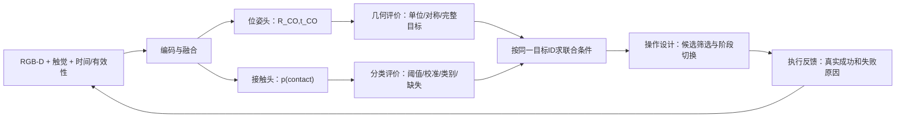
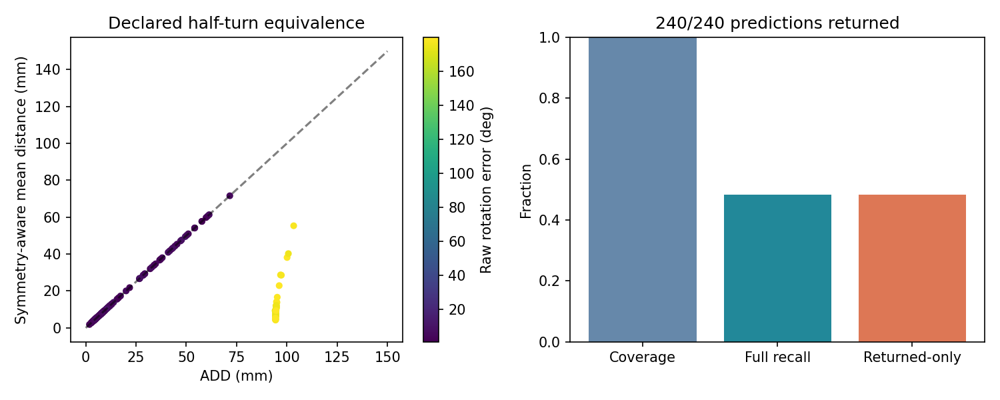
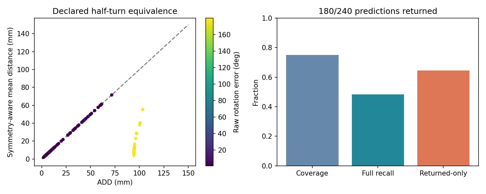
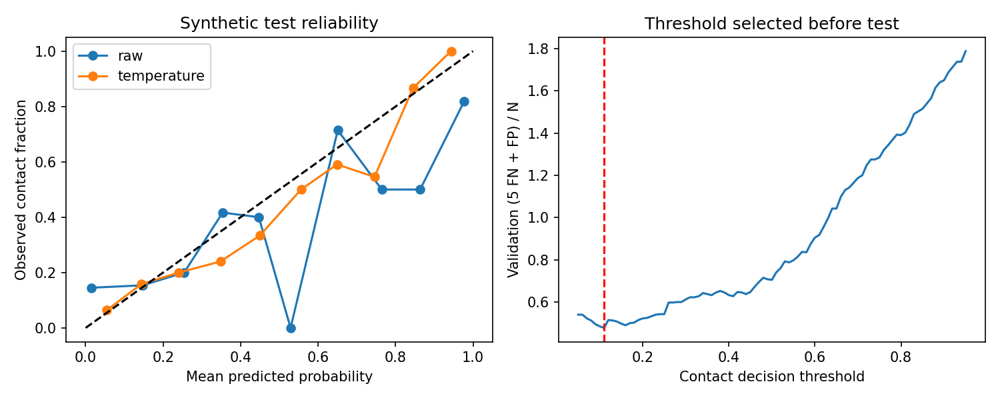

# D67 · 从融合输出到可信评价：6D位姿、对称性与接触任务

[返回学习入口](../_index.md) · [本周所属项目日程](../P3-项目实战-日程.md) · [上一课：交叉注意实现](../day66/Daily-Learning-Pack.md) · [本课实验](demo.py)

**融合网络输出了一个位姿和一个接触概率，仍不足以说明它能支持操作；必须先明确位姿的等价关系、接触判断的代价，以及所有应被处理的目标是否进入评价分母。**

上一课验证了交叉注意能读取正确的合成信息。今天从内部表示走到任务输出：一个杯子的朝向错误会影响抓取接近方向，一个接触漏报可能让控制器继续推进。它们应分别量化，再分析同一次操作中是否同时满足条件。

本课实现真正的三维旋转矩阵与平移评价，不把二维点或三维坐标回归称为 6D 位姿。为了把协议机制观察清楚，脚本直接构造带可控误差的 SE(3) 预测及接触分数，**没有训练位姿网络、没有运行官方 BOP 基准，也没有新增机器人试验**。这是评估器的实验，正式网络的表现需要换入独立预测后重测。

<details>
<summary>个人作答与实验记录（保留区）</summary>

在此追加你的作答、实验变化和未理解问题；自动教材更新不覆盖本区。

</details>

<!-- daily-pack-generated:start -->

## 1 学习目标与路线

完成本课后，应能解释物体到相机的位姿方向；计算平移、旋转和表面距离误差；区分已声明对称与最近邻匹配；在验证集选择温度与阈值；把缺失预测、条件指标和完整分母分开；设计位姿与接触的联合评价。

| 顺序 | 知识主线 | 需要回答的问题 |
| --- | --- | --- |
| 1 | 宏观任务契约 | 输出正确究竟对应什么操作需要？ |
| 2 | SE(3) 与三种误差视角 | 米、弧度与表面距离如何关联？ |
| 3 | 对称性与物体等价姿态 | 旋转差 180° 是否必然错？ |
| 4 | 接触概率、校准与阈值 | 概率准确和决策合适有何不同？ |
| 5 | 分母、缺失与联合条件 | 只评价已返回预测会隐藏什么？ |
| 6 | CPU 协议实验 | 哪些数值变化是真改善，哪些只是换了口径？ |

## 2 宏观：任务输出需要各自的评价坐标



图回答三个层次的问题：几何估计是否正确；接触判断是否可靠；两者组合是否适合下游。位姿准确不能推出接触可靠，内部注意力正确也不能直接推出二者正确。

### 2.1 最小评价记录

每个目标至少包含 `sample_id/object_id/episode_id`、输入时间和模态有效性、GT 位姿、预测位姿或缺失原因、GT 接触标签、接触分数、推理耗时。几何记录必须声明模型坐标系、相机坐标系、米或毫米、对称集合版本和目标可见性约定。

对于真实多目标场景，还需要匹配预测与 GT 实例。不能让多个重复预测同时领取同一个 GT 的正确数。本课每个样本只给一个已知目标及一个预测，不实现检测排序、跨实例匹配或 AP，所以只能称固定目标集上的教学召回，不能报告为官方检测 AP。

批处理实现可以按下表检查维度。本课为便于阅读逐样本计算，但保存的数组仍遵循这个契约。

| 量 | Shape | 单位/含义 |
| --- | --- | --- |
| GT/预测旋转 | $[N,3,3]$ | 合法 SO(3)，无单位 |
| GT/预测平移 | $[N,3]$ | 米，相机系 |
| 模型点 | $[M,3]$ | 米，物体系；本例 $M=8$ |
| 变换后点集 | $[N,M,3]$ | 米，相机系 |
| 每例两点集两两距离 | $[N,M,M]$ | ADD-S 近邻搜索；别在样本轴找近邻 |
| 接触分数/标签/返回标志 | $[N]$ | 实数/二值/布尔，以同一目标 ID 对齐 |

真实密集模型的两两距离矩阵可能很大，ADD-S 可采用最近邻索引或分块计算；不能为了省内存把不同物体的点混在一起匹配。

## 3 微观：6D位姿不等于“输出六个数”

### 3.1 刚体变换与合法旋转

物体坐标点 $x_O$ 映射到相机系：

$$
x_C=R_{CO}x_O+t_{CO},\quad
T_{CO}=
\begin{bmatrix}
R_{CO}&t_{CO}\\
0&1
\end{bmatrix}.
$$

$R\in SO(3)$ 满足 $R^\top R=I,\det R=1$；$t\in\mathbb R^3$，本课单位为米。6D 指三维平移与三维旋转的自由度，矩阵可以用 12 个存储数字表示，齐次矩阵则有 16 个。神经网络的“旋转 6D 连续表示”是另一种旋转参数化，不是物体 6D 位姿本身。

逆变换是 $R_{OC}=R_{CO}^{\top}$、$t_{OC}=-R_{CO}^{\top}t_{CO}$。不能只给平移取负而保留旋转。评价前方向错了，再好的指标函数也只能精确地评价错误输入。

脚本用旋转向量 $w=\theta u$ 构造 Rodrigues 旋转：

$$
R=\exp([w]_\times)=I+\sin\theta[u]_\times+(1-\cos\theta)[u]_\times^2.
$$

$u$ 为单位轴，$\theta$ 为弧度；$\theta\to0$ 时用单位阵分支避免除零。三个旋转方向都参与随机生成，并验证每个预测矩阵的正交性和行列式。因此实验使用的是 SO(3)，不是只绕图像平面转动。

### 3.2 分别看平移与旋转

平移误差：

$$
e_t=\|\hat t-t\|_2,
$$

单位为米。旋转测地角：

$$
e_R=\arccos\left(\operatorname{clip}
\frac{\operatorname{tr}(\hat R^\top R)-1}{2},-1,1\right).
$$

输出是弧度，需要乘 $180/\pi$ 才是度。clip 是处理浮点误差，不是修复非法旋转矩阵；若输入远离 SO(3)，应先判为接口/模型错误。

这两个量有清楚的解释，却没有直接告诉我们“夹爪附近的物体表面移动了多少”。相同的 5° 误差，对半径 10 mm 与 100 mm 的物体影响不同。

### 3.3 用表面点把旋转和平移连接起来

对模型点集合 $\mathcal M=\{x_i\}_{i=1}^M$，平均对应点距离为：

$$
e_{\mathrm{ADD}}=\frac1M\sum_i
\|\hat R x_i+\hat t-(R x_i+t)\|_2.
$$

假设两组位姿作用于同一个有对应关系的模型点，结果单位与模型相同。若只有 4 mm 纯平移而旋转完全一致，每个点都移动 4 mm，所以 ADD、最大对应距离都为 4 mm；脚本显式检验了这个算例。

对一圈半径 $r$ 的点，只绕中心旋转 $\theta$ 时，点位移长度为：

$$
d=2r\sin(|\theta|/2)\approx r|\theta| \quad (\theta\text{ 较小}).
$$

令 $r=0.05$ m、$\theta=10^\circ$，距离约 $0.008716$ m，即 8.72 mm。这个关系解释了为何“角度误差只差一点”仍可能让窄接触间隙失败。平均误差也可能掩盖局部突出部位，因此接近碰撞的问题常需要看最大偏差或任务关键点，而非只看均值。

> [!warning] 一个容易混淆的尺度
> 把 CAD 顶点保持毫米、平移使用米，会令旋转项与平移项处于不同尺度。先统一单位，再计算距离；不要在最终平均值上乘一个补偿系数试图修复混合单位。

## 4 微观：对称等价与最近邻不是同一件事

### 4.1 看起来相同的姿态可以有很大原始旋转误差

对于轴对称杯身，绕对称轴的某些旋转可能不改变可观察外形；但杯把、纹理、任务接触点可能打破等价。必须声明“在什么感知与任务条件下视为等价”，而不是看到低误差就临时加一个对称变换。

本课模型是边长 80×50×40 mm 的长方体八个角点，并人为声明：

$$
\mathcal S=\{I,R_z(\pi)\}.
$$

我们只演示绕物体原点的 z 轴半转等价。**无纹理长方体的完整几何对称群还可能包含其他半转；这里不是自动穷举完整对称群。**若真实物体某些表面标记保留 z 半转却打破其他对称，需要把那个语义约定写入数据协议。实验角点本身不提供这种纹理证据。

对称集合中的 $S$ 作用于物体系，因此真值等价姿态为 $RS$，不是随便写成 $SR$。若对称轴不经过物体原点，还应使用带平移的完整对称刚体变换；本课省略了那一类情况。

### 4.2 同一套对称变换必须作用于整个物体

定义对称平均距离：

$$
e_{\mathrm{sym\text{-}mean}}=
\min_{S\in\mathcal S}
\frac1M\sum_i\|\hat R x_i+\hat t-(RSx_i+t)\|_2,
$$

以及对称最大表面距离的教学形式：

$$
e_{\mathrm{max\text{-}sym}}=
\min_{S\in\mathcal S}
\max_i\|\hat R x_i+\hat t-(RSx_i+t)\|_2.
$$

后一种形式对应 MSSD 的核心几何思想：先选择一个整体等价姿态，再检查最坏表面偏离。真实 BOP 还规定模型采样、对称处理、阈值与聚合协议；本课八角点、固定 10 mm 阈值和声明的两元素集合不构成完整 BOP 复现。[BOP 任务与评价说明](https://bop.felk.cvut.cz/tasks/)；[BOP Challenge 2020，第2.2节](https://arxiv.org/abs/2009.07378)

本课纯半转、零平移的单元例中，普通旋转角为 180°，ADD 为：

$$
2\sqrt{40^2+25^2}\ \mathrm{mm}\approx94.34\ \mathrm{mm}.
$$

但取 $S=R_z(\pi)$ 后，对称平均距离为 0。这个例子说明“原始姿态参数差很大”和“在声明的对称等价下表面一致”可以同时成立。

### 4.3 ADD-S 会对每个点重新找最近邻

$$
e_{\mathrm{ADD\text{-}S}}=
\frac1M\sum_i\min_j
\|\hat R x_i+\hat t-(R x_j+t)\|_2.
$$

它允许不同预测点各自寻找不同的 GT 点，不要求所有匹配来自同一个合法整体对称 $S$，也不保证一一对应。因此不能把 ADD-S 与“按已知对称集合取最小 ADD”当作完全相同的指标。近邻可能掩盖不合理对应，特别是重复结构、遮挡或不完整模型。

| 指标 | 对应关系 | 聚合 | 适合说明什么 |
| --- | --- | --- | --- |
| 平移/原始旋转角 | 位姿参数 | 范数/测地角 | 坐标误差方向与量级 |
| ADD | 固定模型点对应 | 均值 | 非对称情况下整体表面偏差 |
| ADD-S | 每点独立最近邻 | 均值 | 几何最近邻距离，需注明对称约定 |
| 对称平均距离 | 已声明整体对称 | 对称最小+均值 | 允许的整体等价下平均偏差 |
| MSSD 核心形式 | 已声明整体对称 | 对称最小+最大值 | 最坏表面偏离 |
| 投影/可见表面指标 | 依相机与可见性协议 | 协议规定 | 图像偏离或可见外形差异 |

真实任务可能同时需要毫米级几何容差、像素级视觉一致性以及碰撞余量。评价应服务任务，但不能在报告时悄悄改变既定标准。BOP 的 VSD、MSSD、MSPD 分别处理不同可观察差异，本课不计算 VSD/MSPD，也不把固定阈值召回写成多阈值平均召回 AR。

## 5 微观：接触概率如何变成有代价的决策

### 5.1 分类正确率、概率校准和阈值是三件事

令 $y\in\{0,1\}$ 为接触真值，$\ell$ 为模型 logit，$p=\sigma(\ell)$ 为概率。阈值 $\tau$ 给出决策 $\hat y=\mathbf1[p\ge\tau]$。

混淆矩阵包含 TP、FP、FN、TN；precision 衡量报接触的结果中有多少是真的，recall 衡量真接触中识别出多少。若多数帧无接触，全部预测无接触仍可能得到高 accuracy，但无法支持接触阶段切换。

校准关注的是另一问题：所有给出 0.8 左右概率的样本中，实际接触比例是否约为 80%。排序好不意味着概率数值可信；反过来，一个总是输出基准接触频率的模型可能校准尚可，但区分能力很弱。

负对数似然和 Brier 分数分别为：

$$
\mathrm{NLL}=-\frac1N\sum_i[y_i\log p_i+(1-y_i)\log(1-p_i)],
\quad
\mathrm{Brier}=\frac1N\sum_i(p_i-y_i)^2.
$$

两者越小通常越好，但均依赖评估分布和标签质量；一个数字不能概括所有子群、接触阶段及设备偏移。

### 5.2 温度缩放：改置信程度，不改正负排序

温度缩放：

$$
p_T=\sigma(\ell/T),\qquad T>0.
$$

在独立验证集上最小化 NLL 得到 $T$，再固定用于测试。若 $T>1$，logit 向零缩小，极端概率变温和。对二分类，正温度不会改变 logit 的符号，因此用 0.5 阈值时预测类别不变；改进概率校准不等于提高 0.5 阈值准确率。[On Calibration of Modern Neural Networks，第4节与温度缩放讨论](https://proceedings.mlr.press/v70/guo17a.html)

手算：$\ell=3$ 时，原概率 $\sigma(3)\approx0.9526$；$T=3$ 后变为 $\sigma(1)\approx0.7311$。两者仍会在 0.5 阈值下判作接触，但对“有多确信”的解释不同。

本课人为生成真实接触概率 $\sigma(\eta)$，再把观测 logit 构造成 $3\eta$，模拟过度自信。校准器在 400 个独立验证样本上搜索温度，没有使用测试标签拟合。它不是在训练一个接触感知网络，而是在检验概率后处理。

### 5.3 阈值应由任务代价决定

假设假阳性代价为 $C_{\mathrm{FP}}$、假阴性代价为 $C_{\mathrm{FN}}$，正确决策代价为零；如果 $p$ 已校准，报接触的期望代价是 $C_{\mathrm{FP}}(1-p)$，报无接触是 $C_{\mathrm{FN}}p$。因此选择接触当且仅当：

$$
p\ge\frac{C_{\mathrm{FP}}}{C_{\mathrm{FP}}+C_{\mathrm{FN}}}.
$$

教学设定 $C_{\mathrm{FP}}=1,C_{\mathrm{FN}}=5$，理论阈值为 $1/6$。脚本在验证集网格搜索得到 $\tau=0.11$，与理论值不同，原因包括有限样本、校准误差及网格离散。它只是该验证样本上的选择，不能把 0.11 当作所有机器人的通用阈值。

真实抓取中，漏接触与误报接触的代价取决于阶段：靠近易碎物时与稳定搬运时未必一样。应先写清决策含义，再选择阈值，而不是盲目追求最大 accuracy。

## 6 微观：完整分母与联合评价

### 6.1 已返回子集可以变容易，而模型毫无进步

假设计划评价 240 个目标，其中 116 个预测通过 10 mm 容差：

$$
R_{\mathrm{full}}=\frac{116}{240}=48.33\%.
$$

删除最难的 60 个预测后，仍只有 116 个正确。若只除以剩余的 180，得到 64.44%；实际系统处理全部目标的能力没有改善，覆盖率反而只有 75%。

本课目标集及 GT 都已知，“未返回预测”按定位任务计作 missed target，因此完整召回分母仍为 240。它不同于 Day56 中“真实试验发生但结果台账丢失”的未知 outcome；后者不能凭空断定成功或失败。这两种缺失应分别处理。

对接触分类，缺失输出也不能自动当 TN。报告覆盖率和可用子集混淆矩阵，同时说明缺失机制；若定义全目标“提供且正确”的服务指标，需明确把未提供输出按服务失败计数。脚本的 `contact_available` 仅在已返回子集上计算，不是全目标接触成功率。

### 6.2 两项单独好，不代表同一个样本两项都好

定义几何通过事件 $A$、接触判断正确事件 $B$，联合条件是 $A\cap B$。除非有独立性证据，否则不能用 $P(A)P(B)$ 估计联合通过率。

例如 100 个目标中几何通过 80，接触通过 90，联合通过可能在 70–80 之间；仅从边际数字不能确定为 72。需要用同一个 `sample_id` 对齐逐样本结果后计数。

本课使用：

$$
R_{\mathrm{joint}}=
\frac1{N_{\mathrm{target}}}
\sum_i\mathbf1[\mathrm{returned}_i]
\mathbf1[e_{\mathrm{max\text{-}sym},i}<10\mathrm{mm}]
\mathbf1[\hat y_i=y_i].
$$

它仍然只是感知条件的联合满足率，不能称抓取成功率：没有 IK、碰撞、动作执行、摩擦与物体保持过程。接触头的“正确无接触”也可能满足这个公式，是否适合真正抓取阶段必须另定义。

## 7 动手：看见“指标变好而系统未改善”

### 7.1 数据与运行入口

依赖 Python、NumPy、Matplotlib，CPU，无下载。已于 **2026-11-11** 使用 Python 3.11.15、NumPy 1.26.4、Matplotlib 3.10.9 运行默认与删除难例对照，检查旋转合法性、半转等价、4 mm 纯平移算例和结果图。

```bash
python 3d_learning/day67/demo.py
python 3d_learning/day67/demo.py --drop-hard .25 --out _assets/3d_learning/day67/drop25
```

两次使用种子 67，同一组 240 个 GT 位姿、预测与接触样本；唯一实验变量是第二次让最难的 25% 位姿不返回。该选择故意利用已知误差制造反例，不能作为部署时可实现的拒识策略。

位姿真值含任意三维旋转和 0.4–0.8 m 的相机前方平移；预测加入三轴旋转噪声、毫米级平移噪声、部分较大误差及半转等价。接触使用另一组独立生成的潜分数和 Bernoulli 标签，**并未建立真实接触物理与位姿的关联**。

### 7.2 实测结果

> [!question] 先判断再看表
> 同一个模型少返回 60 个难例，平均距离下降了，究竟是预测变好还是评价对象变容易？请同时写出目标总数、返回数和正确数再作结论。

| 统计 | 全部预测 | 删除最难 60 个预测 |
| --- | --- | --- |
| 已返回/目标总数 | 240/240 | 180/240 |
| 通过 10 mm 的数量 | 116 | 116 |
| 完整目标召回 | 48.33% | 48.33% |
| 只看已返回子集的通过率 | 48.33% | 64.44% |
| 已返回子集平均 MSSD 教学值 | 15.891 mm | 9.187 mm |
| 联合条件通过/全部目标 | 64/240 | 64/240 |



左图横轴是普通 ADD，纵轴是声明对称下的平均距离，颜色为原始旋转角。部分原始旋转差接近 180° 的黄色点，在正确对称处理后几何距离显著减小。右图在全覆盖时，完整召回与已返回子集通过率相同。



第二幅右图显示：丢弃难例使橙色条件比例上升，却没有提高完整召回。更低的子集平均距离也不能单独证明模型改进。报告中要同时保留 coverage、完整分母及拒识规则。

接触校准结果使用全部 240 个合成测试样本：

| 概率指标 | 原始 logit | 验证集选择 $T=3.1$ 后 |
| --- | --- | --- |
| 测试 NLL | 0.720302 | 0.478554 |
| 测试 Brier | 0.175956 | 0.155927 |

固定校准后，比两个阈值：

| 阈值 | TP / FP / FN / TN | Accuracy | Recall | 教学代价 $5FN+FP$ |
| --- | --- | --- | --- | --- |
| 0.5 | 52 / 24 / 29 / 135 | 77.92% | 64.20% | 169 |
| 验证选择 0.11 | 76 / 114 / 5 / 45 | 50.42% | 93.83% | 139 |

较低阈值牺牲 precision 和 accuracy，换取更少漏接触，并在这组测试上降低指定代价。这不是“低准确率更好”的普遍规律，而是不同任务代价下应报告的取舍。



左图按概率区间比较预测均值与实际接触比例，有限样本会让折线起伏；右图只使用验证集选择阈值。温度与阈值固定后才读取测试结果。删除难例对照中的校准图仍画原始完整合成测试集，故保持不变；`contact_available` 的混淆矩阵则按已返回子集另算，二者分母明确不同。

[默认机器结果](../../_assets/3d_learning/day67/default/results.json) · [删除难例结果](../../_assets/3d_learning/day67/drop25/results.json) · 逐样本数组 (not exported: excluded by publication policy)

数据预算：240 个合成位姿目标、400 个接触验证样本和 240 个接触测试样本；模型训练步数为 0，机器人交互为 0。JSON 的 `elapsed_seconds` 包含合成构造与评价，不是网络推理延迟。随机例用于测试协议，不构成真实成功率或可靠性统计。

### 7.3 完整可复制脚本

> [!note]- 完整 CPU 脚本，与同目录 demo.py 一致
> ```python
> """CPU protocol experiment: synthetic SE(3) predictions, not a trained pose model."""
> import argparse
> import json
> import platform
> import time
> from datetime import datetime, timezone
> from pathlib import Path
> import numpy as np
> import matplotlib
> matplotlib.use('Agg')
> import matplotlib.pyplot as plt
> 
> 
> def rotvec(w):
>     a = np.linalg.norm(w)
>     if a < 1e-12:
>         return np.eye(3)
>     x, y, z = w / a
>     k = np.array([[0, -z, y], [z, 0, -x], [-y, x, 0]])
>     return np.eye(3) + np.sin(a) * k + (1 - np.cos(a)) * (k @ k)
> 
> 
> def sigmoid(z):
>     return 1 / (1 + np.exp(-np.clip(z, -40, 40)))
> 
> 
> def bce(logit, y):
>     return float(np.mean(np.logaddexp(0, logit) - y * logit))
> 
> 
> def classification(p, y, threshold):
>     q = p >= threshold
>     tp, fp = int(np.sum(q & (y == 1))), int(np.sum(q & (y == 0)))
>     fn, tn = int(np.sum(~q & (y == 1))), int(np.sum(~q & (y == 0)))
>     return dict(tp=tp, fp=fp, fn=fn, tn=tn, count=len(y),
>                 precision=tp / max(tp + fp, 1), recall=tp / max(tp + fn, 1),
>                 accuracy=(tp + tn) / len(y), cost_5fn_fp=5 * fn + fp)
> 
> 
> def main():
>     ap = argparse.ArgumentParser()
>     ap.add_argument('--seed', type=int, default=67)
>     ap.add_argument('--drop-hard', type=float, default=0)
>     ap.add_argument('--out', type=Path, default=Path(__file__).resolve().parents[2] / '_assets/3d_learning/day67/default')
>     args = ap.parse_args()
>     if not 0 <= args.drop_hard < 1:
>         ap.error('--drop-hard must be in [0, 1)')
>     args.out.mkdir(parents=True, exist_ok=True)
>     rng = np.random.default_rng(args.seed)
>     start = time.perf_counter()
>     model = np.array([[x, y, z] for x in [-.04, .04] for y in [-.025, .025] for z in [-.02, .02]])
>     sym = [np.eye(3), rotvec(np.array([0., 0., np.pi]))]
>     n = 240
>     gt_r = np.array([rotvec(rng.normal(size=3)) for _ in range(n)])
>     gt_t = np.column_stack([rng.uniform(-.1, .1, n), rng.uniform(-.1, .1, n), rng.uniform(.4, .8, n)])
>     pred_r = np.array([rotvec(rng.normal(scale=np.deg2rad(3), size=3)) @ r @ sym[int(rng.random() < .25)] for r in gt_r])
>     pred_t = gt_t + rng.normal(scale=.004, size=(n, 3))
>     pred_t[:48] += rng.normal(scale=.025, size=(48, 3))
>     add, adds, symmetry_add, mssd, rotation = [], [], [], [], []
>     for rg, tg, rp, tp in zip(gt_r, gt_t, pred_r, pred_t):
>         truth, prediction = model @ rg.T + tg, model @ rp.T + tp
>         add.append(np.linalg.norm(prediction - truth, axis=-1).mean())
>         adds.append(np.linalg.norm(prediction[:, None] - truth[None, :], axis=-1).min(1).mean())
>         distances = [np.linalg.norm(prediction - (model @ (rg @ s).T + tg), axis=-1) for s in sym]
>         symmetry_add.append(min(d.mean() for d in distances))
>         mssd.append(min(d.max() for d in distances))
>         rotation.append(np.rad2deg(np.arccos(np.clip((np.trace(rp.T @ rg) - 1) / 2, -1, 1))))
>     add, adds, symmetry_add, mssd, rotation = map(np.asarray, (add, adds, symmetry_add, mssd, rotation))
>     # Independent validation examples fit temperature and operating threshold.
>     eta_val, eta_test = rng.normal(-.7, 1.8, 400), rng.normal(-.7, 1.8, n)
>     yv, yt = rng.binomial(1, sigmoid(eta_val)), rng.binomial(1, sigmoid(eta_test))
>     lv, lt = 3 * eta_val, 3 * eta_test
>     temperatures = np.linspace(.5, 6, 111)
>     temperature = float(temperatures[np.argmin([bce(lv / t, yv) for t in temperatures])])
>     candidates = np.linspace(.05, .95, 91)
>     threshold = float(candidates[np.argmin([classification(sigmoid(lv / temperature), yv, t)['cost_5fn_fp'] for t in candidates])])
>     p = sigmoid(lt / temperature)
>     available = np.ones(n, bool)
>     # Deliberately biased omission; benchmark targets remain in the denominator.
>     available[np.argsort(mssd)[::-1][:int(n * args.drop_hard)]] = False
>     correct = mssd < .01  # fixed task tolerance, not tuned on test results
>     contact_correct = (p >= threshold) == yt
>     retained = int(available.sum())
>     exact_half_turn = np.linalg.norm(model @ sym[1].T - model, axis=-1).mean()
>     equivalent_error = min(np.linalg.norm(model @ sym[1].T - model @ s.T, axis=-1).mean() for s in sym)
>     translation_check = np.linalg.norm((model + [.004, 0, 0]) - model, axis=-1).mean()
>     assert exact_half_turn > .09 and np.allclose(np.linalg.det(pred_r), 1)
>     assert equivalent_error < 1e-12 and np.isclose(translation_check, .004)
>     assert np.max(np.abs(pred_r.transpose(0, 2, 1) @ pred_r - np.eye(3))) < 1e-12
>     result = dict(seed=args.seed, created_at=datetime.now(timezone.utc).isoformat(),
>                   data='synthetic SE(3) prediction fixture and Bernoulli contact labels; no trained pose network',
>                   units='model and translation: metre; rotation: SO(3); displayed distance: mm',
>                   targets=n, returned=retained, missing=n-retained, coverage=retained/n,
>                   pose=dict(tolerance_mm=10, available_correct=int((correct & available).sum()),
>                             recall_full=float((correct & available).sum()/n),
>                             conditional_success=float(correct[available].mean()),
>                             mean_ADD_mm=float(add[available].mean()*1000),
>                             mean_ADD_S_mm=float(adds[available].mean()*1000),
>                             mean_symmetry_ADD_mm=float(symmetry_add[available].mean()*1000),
>                             mean_MSSD_mm=float(mssd[available].mean()*1000)),
>                   calibration=dict(validation_count=400, temperature=temperature, threshold=threshold,
>                                    raw_test_nll=bce(lt, yt), calibrated_test_nll=bce(lt/temperature, yt),
>                                    raw_brier=float(np.mean((sigmoid(lt)-yt)**2)), calibrated_brier=float(np.mean((p-yt)**2))),
>                   contact_available=classification(p[available], yt[available], threshold),
>                   contact_at_half=classification(p[available], yt[available], .5),
>                   joint_correct=int((correct & contact_correct & available).sum()),
>                   joint_rate=float((correct & contact_correct & available).sum()/n),
>                   symmetry_unit_check=dict(raw_ADD_mm=float(exact_half_turn*1000), symmetry_ADD_mm=float(equivalent_error*1000), pure_translation_mm=float(translation_check*1000), raw_angle_deg=180),
>                   elapsed_seconds=time.perf_counter()-start, robot_trials=0, project_acceptance='pending',
>                   environment=dict(python=platform.python_version(), numpy=np.__version__, matplotlib=matplotlib.__version__, device='cpu'))
>     (args.out/'results.json').write_text(json.dumps(result, indent=2), encoding='utf-8')
>     np.savez(args.out/'predictions.npz', gt_r=gt_r, gt_t=gt_t, pred_r=pred_r, pred_t=pred_t,
>              add=add, adds=adds, symmetry_add=symmetry_add, mssd=mssd, available=available, y=yt, probability=p)
>     fig, axes = plt.subplots(1, 2, figsize=(10, 4))
>     points = axes[0].scatter(add*1000, symmetry_add*1000, c=rotation, s=15, cmap='viridis')
>     fig.colorbar(points, ax=axes[0], label='Raw rotation error (deg)')
>     axes[0].plot([0, 150], [0, 150], 'k--', alpha=.5)
>     axes[0].set(xlabel='ADD (mm)', ylabel='Symmetry-aware mean distance (mm)', title='Declared half-turn equivalence')
>     axes[1].bar(['Coverage', 'Full recall', 'Returned-only'], [retained/n, result['pose']['recall_full'], result['pose']['conditional_success']], color=['#6688aa', '#228899', '#dd7755'])
>     axes[1].set(ylim=(0, 1), ylabel='Fraction', title=f'{retained}/{n} predictions returned')
>     fig.tight_layout(); fig.savefig(args.out/'pose_metrics.png', dpi=150); plt.close(fig)
>     fig, axes = plt.subplots(1, 2, figsize=(10, 4))
>     for name, prob in [('raw', sigmoid(lt)), ('temperature', p)]:
>         xs, ys = [], []
>         for lo in np.linspace(0, .9, 10):
>             mask = (prob >= lo) & (prob < lo+.1)
>             if mask.any(): xs.append(prob[mask].mean()); ys.append(yt[mask].mean())
>         axes[0].plot(xs, ys, 'o-', label=name)
>     axes[0].plot([0, 1], [0, 1], 'k--'); axes[0].set(xlabel='Mean predicted probability', ylabel='Observed contact fraction', title='Synthetic test reliability'); axes[0].legend()
>     costs = [classification(sigmoid(lv/temperature), yv, t)['cost_5fn_fp']/len(yv) for t in candidates]
>     axes[1].plot(candidates, costs); axes[1].axvline(threshold, color='red', ls='--')
>     axes[1].set(xlabel='Contact decision threshold', ylabel='Validation (5 FN + FP) / N', title='Threshold selected before test')
>     fig.tight_layout(); fig.savefig(args.out/'contact_metrics.png', dpi=150); plt.close(fig)
>     print(json.dumps(result, indent=2))
> 
> 
> if __name__ == '__main__':
>     main()
> ```

### 7.4 先预测，再改一个量

先把 `--drop-hard .25` 改为 `.10`，预测覆盖率与两个分母的通过率如何变化。保持所有位姿不变，再单独将固定容差从 10 mm 改为 5 mm：正确数应不增，但这改变的是任务评价标准，不是模型性能。两种修改分开归档，不把结果横向比较成同一协议下的进步。

进一步将对称集合改为只有 $I$，观察半转样本的误差。先明确这一改动代表“任务不再允许半转等价”，不能为了数值好看在测试后选择对称集合。真实物体的对称定义应来自模型与任务约定，先于评价固定。

## 8 回到宏观：位姿与接触如何进入真实系统

本课评价器可接收实际模型输出，但接口需要扩展为带模型 ID、相机系、单位、目标列表与完整时间信息的记录。NOCS 的类别级尺度与规范坐标、物体级已知 CAD 位姿等条件不同；统一成相同输出格式之前，先确认是否实际提供了任务所需的尺度和模型。

对 RGB-D 抓杯系统，可把误差分为三层：

1. **感知层**：位姿及接触标签的独立测试，记录遮挡、距离、接触阶段等子群。
2. **计划层**：这些误差怎样改变抓取候选、IK、碰撞余量和接近方向。
3. **执行层**：相同初态与预算下真实成功数/尝试数、控制延迟和恢复结果。

训练损失改善只直接涉及第一层的训练目标；实际抓取是否改善必须沿三层追踪。世界模型将预测未来状态，评价还要加入时间范围、自由 rollout 与动作支持集；VLA 将输出动作，仍需把执行成败与离线动作误差分开。

## 9 今日总结与产出

**6D位姿评价先统一变换方向、单位与对称等价，再计算几何误差。接触概率需要独立校准与符合任务代价的阈值，分类准确率不能替代这两个问题。所有应处理目标的分母和逐样本联合记录，决定最终报告是否可信。**

四个最值得掌握的点：

- **表面距离与角度误差的联系**：同样角度在不同物体尺度下造成不同操作后果。
- **整体对称与最近邻的区别**：它决定哪些姿态被合理视作等价。
- **校准与阈值分离**：概率语义与行动代价是两套判断。
- **完整分母**：它能防止“少处理难例”被误报为系统进步。

三条边界：本课 10 mm 固定阈值不是官方 BOP AR；合成预测记录不是训练网络性能；联合感知通过率不是机器人抓取成功率。

今日产出：一页带单位、对称与分母的评价协议；默认/缺失对照表；接触阈值与代价解释；可运行评估器及逐样本数据。Π-2 正式数据/模型/设备和个人验收保持未完成，等独立证据补齐。

## 10 自测

1. 物体 6D 位姿与旋转 6D 表示是什么关系？
2. 只有 4 mm 平移误差时，ADD 是多少？模型单位写错会发生什么？
3. 半径 50 mm 的点绕中心转 10°，位移约多少？
4. 为什么一个 180° 旋转差可以对应零对称误差？本课是否覆盖长方体所有几何对称？
5. ADD-S 为什么不等于按合法整体对称取最小 ADD？
6. 正温度缩放能否改变 0.5 阈值的二分类结果？它主要校正什么？
7. 若假阳性代价 1、假阴性代价 5，理想校准概率的理论阈值是多少？
8. 240 个目标正确 116 个，删除 60 个失败预测后，完整召回和条件通过率各是多少？
9. 100 个目标位姿通过 80、接触通过 90，联合通过能否直接写成 72？
10. 本课联合通过 64/240 能否写成抓取成功率？正式项目还需哪些证据？

每题 0/1/2 分：0 为关键概念错误；1 为结论正确但缺少推导/边界；2 为算例与工程含义都清楚。建议达到 15/20，且第 4、8、10 题不混淆对称、分母和真实执行；不替你填写成绩。

## 11 未理解问题与次日衔接

若对称公式仍不直观，拿同一模型点先做物体系 $S$ 再做 $R$，与随意交换顺序对照。若概率校准仍不清楚，记录你困惑的是排序、概率大小还是阈值代价，三者逐一讨论。

下一课 Day68 从“当前位姿/接触是否估计正确”转向“执行这个动作后会发生什么”，搭建多模态动作条件预测器。第一步写出观测 $o_t$、动作 $a_t$、下一状态 $s_{t+1}$ 的时间和单位，不把本课当前接触分类头直接称为世界模型。

精读任务：BOP Challenge 2020 第2.2节逐个比较 VSD、MSSD、MSPD 的等价依据；Guo 等概率校准论文第4节，解释温度缩放的验证集拟合及其限制。本文已提供所需基础推导，论文阅读用来核对协议细节，不能省略正文实验。

> [!note]- 自测核对答案与判分要点
> 1. 位姿为三平移加三旋转自由度；旋转 6D 是表示旋转的参数化方式，尚未包含平移。
> 2. 固定对应下所有点都偏移 4 mm，所以 ADD 为 4 mm。混用米与毫米会破坏旋转和平移项的相对尺度，不能后处理一个总系数修复。
> 3. $2×50\sin5^\circ\approx8.72$ mm；小角近似为 $50×10\pi/180\approx8.73$ mm。
> 4. 若声明半转是整体等价，选该 $S$ 后表面可以重合。本课只用 $\{I,R_z(\pi)\}$，不穷举完整长方体群，也不声称有纹理语义证据。
> 5. ADD-S 每个点独立找近邻，不要求对应来自同一个整体刚体对称；可能允许更多不一致匹配。
> 6. $T>0$ 不改变 logit 符号，故 0.5 阈值分类不变；它改变概率置信程度，校准改善不等于分类准确率提高。
> 7. $1/(1+5)=1/6\approx0.1667$。验证选择 0.11 是有限样本/网格结果，不是通用常数。
> 8. 完整召回仍 $116/240=48.33\%$；条件通过率 $116/180=64.44\%$，覆盖率 75%。GT 目标存在但未返回定位属于 missed target。
> 9. 不能。联合计数可在 70–80 之间；72 需要额外独立性假设，应按同一目标 ID 实际计算交集。
> 10. 不能。这是合成几何与分类条件的交集，未包含规划/碰撞/控制/物理接触。正式项目还需实际网络和独立数据、标准协议、执行闭环及用户产出验收。

<!-- daily-pack-generated:end -->

