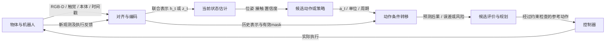
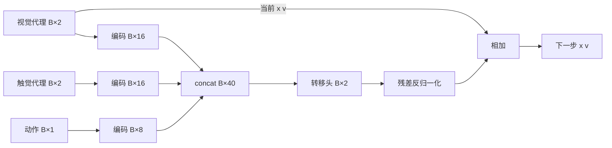
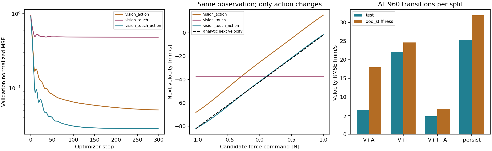
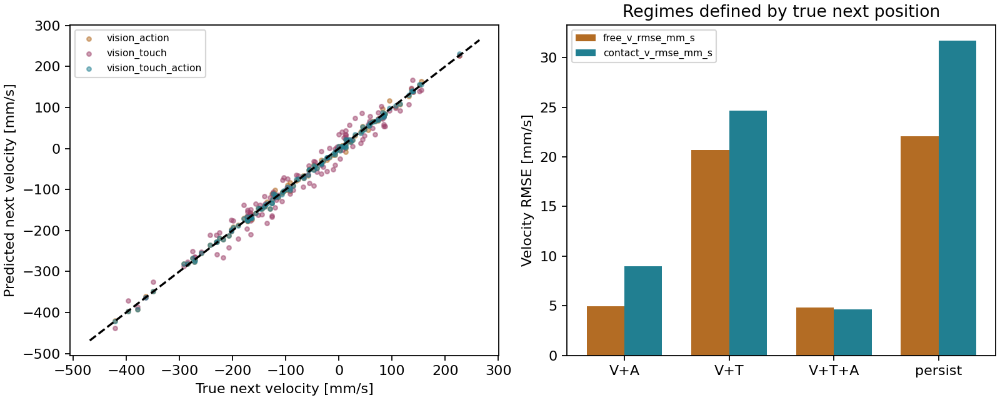
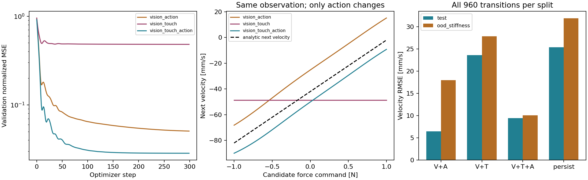

# D68 · 从融合当前状态到预测动作后果

[返回学习入口](../_index.md) ｜ [本周日程](../P3-项目实战-日程.md) ｜ [上一课 D67](../day67/Daily-Learning-Pack.md) ｜ [CPU 动力学实验](demo.py)

**融合模型回答“现在发生了什么”；动作条件预测器进一步回答“从现在出发，执行这个动作之后会怎样”。要把第二个问题回答好，既需要观测到相关状态，也需要明确动作、时间区间和可泛化的动力学关系。**

D64–D66讨论了融合结构与交叉注意，D67把融合输出放回位姿和接触任务的评价协议。今天在同一个RGB-D机械臂抓杯子的案例中，增加一条“预测动作后果”的分支：当前图像显示杯子位置，触觉提示局部接触，动作描述下一段夹爪运动或施力，模型预测随后状态的变化。模型输出供规划参考，仍需执行反馈来检验。

本课属于W10-D5、Π-2多模态感知项目。配套实验训练小型神经网络，使用可解释的一维合成接触系统；它不包含真实RGB图像、六维刚体动力学、触觉硬件或真机执行。Π-1的正式项目未完成项继续保留，不因进入Π-2而视为通过。

<details>
<summary>个人学习记录（保留你的预测、作答与实际数据）</summary>

<!-- learner-notes:start -->

- 运行前的预测：
- 改变触觉偏置后的解释：
- 我的自测答案：
- 真实系统接入时尚缺的字段和验证：

<!-- learner-notes:end -->

</details>

<!-- daily-pack-generated:start -->

## 0. 学习目标与路线

今天结束后，应能把“状态估计、策略、动作条件预测”写成三个不同函数；从力平衡推导一组离散转移方程并手算一步；实现视觉、触觉和动作三个分支的残差预测器；解释没有动作或触觉时产生的歧义；用独立episode和固定模型对照，区分接触参数改变、传感器偏置与未来信息泄漏。

| 顺序 | 知识主线 | 需要回答的问题 |
| --- | --- | --- |
| 宏观 | 从当前感知到动作后果 | 谁估计状态，谁提议动作，谁评价后果？ |
| 微观一 | 观测、状态、历史与动作契约 | 当前输入是否足够确定下一步？ |
| 微观二 | 一维接触动力学 | 为什么相同位置需要触觉和动作才能预测？ |
| 微观三 | 联合编码与残差转移 | 输入shape、损失量纲和训练信号是什么？ |
| 评价与工程 | 模态消融、接触分层与域偏移 | 融合究竟改善什么，又在哪些情况下误导？ |
| 实践与回归宏观 | 训练、动作扫描和单变量扰动 | 怎样把一个小模型接入完整机器人管线？ |

## 1. 宏观：在闭环中放入“如果执行这个动作”

### 1.1 三种函数，不要用同一个“智能模型”笼统代替

设$t$为参考时刻，$o_t$为观测，$h_t=(o_{\le t},a_{<t})$为历史，$\ell$为语言任务。常见模块可以写成：

| 模块 | 数学形式 | 输出含义 | 抓杯子中的例子 |
| --- | --- | --- | --- |
| 状态估计 | $q_\phi(s_t\mid h_t)$ | 当前状态或状态分布 | 杯子位姿、夹爪速度、接触情况 |
| 策略 policy | $\pi_\psi(a_t\mid h_t,\ell)$ | 建议采取的动作 | 再闭合2 mm，或沿杯壁调整 |
| 动作条件转移 | $p_\theta(s_{t+1}\mid s_t,a_t)$，或基于历史的版本 | 给定候选动作的后果 | 新位置、接触变化、滑移风险 |

$s_t$是建模状态，不等于某张图像；$o_t$受遮挡、噪声和传感器限制。真实环境未必满足“当前观测足够预测下一步”，所以转移器常需记忆或潜状态。策略与转移器也可以共享编码器，但共享参数不改变两者的输出语义。

> [!question] 先判断
> 一个网络输入RGB与触觉，输出“当前抓取稳定概率”；另一个网络输入相同观测和候选夹爪调整，输出“调整后保持抓取的概率”。哪个能直接比较两个调整动作？为什么只提高前者的准确率还不够？

第二个模型能对动作进行条件化。第一个若完全没有动作入口，对同一个观测只会输出同一个评分；它可以帮助停止或触发恢复，却无法凭自身区分两个未来动作。

### 1.2 完整管线中的位置



图回答的是“转移器服务哪个决策”。候选动作可以来自几何规划、BC、VLA或搜索；转移器提供后果估计，规划器决定是否采用。控制器处理具体执行，反馈重新修正状态。

今天只验证图中的一个小转移模块。若未来用它给候选动作评分，还要独立评估候选覆盖、碰撞约束、模型支持范围和任务成功；预测误差降低不能自动推出闭环成功率提高。

## 2. 微观：预测问题首先由数据契约定义

### 2.1 状态、观测和历史的不同角色

假设桌面上两个杯子外观和位置一样，其中一个空杯，另一个装满水。只看当前图像，某次抬升的后果可能不同；过去的受力、速度变化能提供质量线索。再如夹爪接触相同位置，软材料与硬材料产生的反力不同。触觉增加的信息可能恰好是视觉难以确定的接触参数。

一个工程表示可以包含：

$$
z_t=E_\phi\bigl(I_t,D_t,T_{t-L+1:t},q_t,\dot q_t,
m_t,\Delta\tau_t\bigr).
$$

$I,D,T$分别为RGB、深度、触觉；$q,\dot q$为本体状态；$m_t$为有效掩码；$\Delta\tau_t$为各模态的观测年龄。这个式子是设计接口，不声称这些数据在用户设备上已采到。$L$表示触觉历史长度；如果触觉发生滑动，单张纹理可能不足以判断方向，历史有明确作用。

潜状态转移可进一步写成：

$$
z_{t+1}\sim p_\theta(z_{t+1}\mid z_t,a_t),\qquad
\hat y_{t+1}=D_\eta(z_{t+1}).
$$

其中$D_\eta$是任务解码器，可以输出位姿、接触或局部几何；不一定生成像素。若$z_t$丢失了决定接触变化的信息，单纯增加转移网络层数不能恢复已经丢掉的证据。

### 2.2 动作不能只是一个浮点数组

至少要明确动作的类型、坐标系、单位、参考点、生效区间和执行反馈。三种看似都是“0.01”的动作完全不同：

| 动作 | 示例 | 进入模型前的必要解释 |
| --- | --- | --- |
| 位移增量 | $0.01$ m | 世界系还是夹爪系？TCP还是法兰？ |
| 速度命令 | $0.01$ m/s | 持续多久？是否被速度限制器修改？ |
| 力命令 | $0.01$ N | 目标力还是测得力？哪个方向？ |

本课实验$a_t=u_t$，单位N，作用于一维世界$x$轴，持续$\Delta t=0.02$ s；它是理想模型中的实际外力输入。实机日志中的command可能被限幅、延迟或控制器追踪误差改变，因此需要记录command与actual feedback，不能默认两者相等。

时间样本应为：

$$
(o_{\le t}\ \text{且在决策时已到达},\quad
a_{[t,t+\Delta t)},\quad
y_{t+\Delta t}).
$$

下一时刻触觉可以作为训练目标；若它作为预测输入，却在决策时不可获得，就是未来信息泄漏。离线训练可以读完整文件，但必须由数据加载器建立正确的因果切片。

### 2.3 没有同步动作的数据能做什么

只有视觉触觉配对时，可以学习表示、当前接触识别或基于历史的视频预测；若要学习显式机器人动作条件转移，还需同步的动作及其语义。不能把相邻帧编号差当成动作，也不能把触觉变化本身当成机器人发出的命令。

行为日志还有一个容易忽略的问题：专家往往在困难状态采用特定动作，动作与状态相关。观测数据中的$p(y\mid o,a)$是否能支持更换动作后的预测，取决于相关状态是否被观测、候选动作是否有数据覆盖等条件。给模型加一个动作输入，并不会自动获得任意动作的可靠因果效应。

本课合成生成器独立随机采样初态、刚度与动作序列，便于展示动作条件机制；这种实验控制在真实机器人数据中需要专门设计，而不能默认成立。

## 3. 微观：用一维接触把机制算清楚

### 3.1 从力平衡到一步转移

考虑一个沿$x$轴运动的质量块。$x>0$表示压入弹性接触面，$x\le0$表示离开接触。系统只在受压时有弹簧反力：

$$
f_c(x)=k[x]_+,\qquad [x]_+=\max(x,0).
$$

$k$单位N/m，$x$单位m，所以$f_c$单位N。把$x<0$也代入普通弹簧$kx$，会得到吸引物体回来的“拉力”；这不符合这里的单侧接触定义。

沿$x$方向的连续动力学为：

$$
m\dot v=u-bv-f_c(x),\qquad \dot x=v.
$$

$m$单位kg，$v$单位m/s，$u$单位N，$b$单位N·s/m。阻尼项$bv$与弹簧反力都以N进入力平衡。脚本采用半隐式欧拉离散化：

$$
v_{t+1}=v_t+\frac{\Delta t}{m}\left(u_t-bv_t-k[x_t]_+\right),
$$

$$
x_{t+1}=x_t+\Delta t\,v_{t+1}.
$$

“半隐式”表示先更新速度，再用新速度更新位置；若改用$v_t$更新位置，数值结果会不同。真实碰撞求解还涉及接触约束、摩擦和积分稳定性，本模型只有简化的单侧弹簧与阻尼，不能代表完整夹爪接触。

### 3.2 手算：相同状态，换动作就换未来

取$m=0.5$ kg，$b=1$ N·s/m，$k=50$ N/m，$\Delta t=0.02$ s，当前$x=0.01$ m、$v=0.02$ m/s。

先算接触力$f_c=50\times0.01=0.5$ N，阻尼力$bv=0.02$ N。若$u=0.8$ N：

$$
\Delta v=\frac{0.02}{0.5}(0.8-0.02-0.5)=0.0112\ {\rm m/s},
$$

$$
v_{t+1}=0.0312\ {\rm m/s},\qquad
x_{t+1}=0.01+0.02\times0.0312=0.010624\ {\rm m}.
$$

只把动作改为$u=-0.2$ N，则：

$$
\Delta v=0.04(-0.2-0.02-0.5)=-0.0288\ {\rm m/s},
$$

$$
v_{t+1}=-0.0088\ {\rm m/s},\qquad x_{t+1}=0.009824\ {\rm m}.
$$

两次输入图像和接触力相同，下一步速度方向却不同。**没有动作的预测器无法给这两个候选动作输出不同结果。**

### 3.3 同一个动作，缺少触觉也可能产生歧义

仍取$x=0.01$ m、$v=0.02$ m/s、$u=0.8$ N。若刚度变为$k=100$ N/m，接触反力为1 N，下一步速度变为：

$$
v_{t+1}=0.02+0.04(0.8-0.02-1)=0.0112\ {\rm m/s}.
$$

当前位置与速度完全一样，但触觉力不同，未来也不同。对这个局部一步模型，直接测到$f_c$就能减少未知$k$带来的歧义。它未必需要先显式辨识刚度；但长期预测中未来的接触力还会随状态变化，不能一直使用当前力。

在自由空间$x\le0$时$f_c=0$，触觉的额外信息可能很小。因此“触觉有没有用”应按接触阶段与具体目标检查，不能只报告一个全局分数。

### 3.4 为何MSE可能学到“平均未来”

对固定输入$c$，平方误差风险：

$$
R(\hat y\mid c)=\mathbb E[(Y-\hat y)^2\mid c]
$$

对$\hat y$求导并令其为零，得到$\hat y^*(c)=\mathbb E[Y\mid c]$。若省略动作，条件变成当前观测，模型可能在不同动作导致的后果之间折中。

例如同一观测下，下一个速度可能为$+0.03$或$-0.01$ m/s，且各占一半；最优均值是$0.01$ m/s，它既不等于任一具体候选动作的后果，也不能用于比较两动作。补充动作会拆分这两个条件分布；如果补充后仍有不可观测参数，则应考虑历史、概率预测或模型不确定性。

这也解释了为什么“网络足够大”不能解决所有问题：信息缺失与函数拟合不足是两类问题。

## 4. 微观：把联合编码器接到残差转移头

### 4.1 本课实际实现的输入

脚本使用特征层代理观测，不渲染RGB-D图像：

$$
o_t^V=[\tilde x_t,\tilde v_t],\quad
o_t^T=[\tilde f_t,\tilde c_t],\quad a_t=[u_t].
$$

视觉代理噪声标准差为0.3 mm与5 mm/s；触觉力噪声为0.015 N；接触位$\tilde c_t=\mathbf1[\tilde f_t>0.02\ {\rm N}]$从**测得力**产生。不能从仿真真值接触位取一个完美输入，再声称触觉分类已有噪声。

真实系统中，$o^V$可能由RGB-D位姿跟踪和速度滤波输出，$o^T$可能来自触觉编码器。这里刻意先在低维特征上隔离动作与接触信息的作用；特征提取误差、图像泛化和视觉遮挡并未完整覆盖。

### 4.2 张量shape与计算路径

令$B$为batch大小，完整输入按列拼成$X\in\mathbb R^{B\times5}$。

| 模块 | 输入 | 运算 | 输出 |
| --- | --- | --- | --- |
| 视觉分支 | `X[:, :2]`，$B×2$ | Linear(2,16)+Tanh | $B×16$ |
| 触觉分支 | `X[:, 2:4]`，$B×2$ | Linear(2,16)+Tanh | $B×16$ |
| 动作分支 | `X[:, 4:5]`，$B×1$ | Linear(1,8)+Tanh | $B×8$ |
| 联合表示 | 三个分支特征 | 沿最后一维concat | $B×40$ |
| 转移头 | $B×40$ | Linear(40,32)+Tanh+Linear(32,2) | $B×2$ |
| 物理量恢复 | 两维归一化残差 | 反归一化，再加当前视觉状态 | 下一步位置m、速度m/s |



图中传递的既有无量纲网络特征，也有物理状态；两者在反归一化节点明确分开。代码没有使用交叉注意，但可把前几课的融合器替换进来，只要输出shape、有效掩码与时间语义保持清楚。

### 4.3 为什么预测残差，怎样避免量纲混乱

目标取：

$$
r_t=y_{t+1}-[\tilde x_t,\tilde v_t].
$$

它与纯动力学增量不同，因为当前视觉含噪声，而脚本目标$y_{t+1}$使用生成器真值。网络同时学习局部转移和一定程度的去噪。真实数据若没有下一步真值，只能使用带测量误差的目标，并另外分析目标噪声。

输入各维先按训练集均值$\mu_X$、标准差$\sigma_X$归一化；残差各维也按训练集$\mu_r,\sigma_r$归一化：

$$
\bar X=(X-\mu_X)\oslash\sigma_X,\qquad
\bar r=(r-\mu_r)\oslash\sigma_r,
$$

$$
\mathcal L=\frac1{2B}\sum_{i=1}^B\sum_{j=1}^2
\bigl[f_\theta(\bar X_i)_j-\bar r_{ij}\bigr]^2.
$$

$\oslash$表示逐元素除法，$\sigma$用小正数下限防止除零。推理时：

$$
\hat y_{t+1}=[\tilde x_t,\tilde v_t]
+\mu_r+\sigma_r\odot f_\theta(\bar X_t).
$$

直接把m²与(m/s)²的误差相加，会由数值尺度隐含决定权重；标准化让训练尺度可控，却不保证符合任务代价。最终仍分别报告位置RMSE与速度RMSE，不能把无量纲loss当“毫米误差”。

> [!warning] 训练统计量不可以随测试场景重算
> 测试触觉出现0.2 N偏置时，如果偷偷重新减去测试均值，部分偏置会被消除，这已经引入额外适配。正式比较必须说明适配用的数据和预算。本实验训练统计量、权重与测试物理真值均固定，只改变测试触觉测量。

### 4.4 对照组改变的是哪项信息

三组网络均分配1490个参数、相同初始随机种子、同样的优化器步数与训练轨迹：

| 名称 | 保留分支 | 回答的问题 |
| --- | --- | --- |
| V+A | 视觉、动作；触觉编码置零 | 触觉额外提供什么？ |
| V+T | 视觉、触觉；动作编码置零 | 缺少动作能否比较动作后果？ |
| V+T+A | 三分支全部保留 | 完整信息能否改善转移？ |
| persistence | 直接输出当前视觉状态 | 不学习且假设状态不变的参照有多差？ |

分支在训练和推理时都按同一约定禁用。这是在分别训练不同信息集下的模型；它不同于只在部署时突然屏蔽一个训练时依赖的模态。虽然参数张量总数一样，被置零分支没有有效信息通路，**不能宣称有效容量完全相等**。这是小规模机制对照，不是严谨的大模型架构排名。

### 4.5 Learning五格卡

| 格子 | 本课落实 |
| --- | --- |
| 数据从哪来 | 一维单侧弹簧生成器，独立episode、随机刚度与力序列；非真实设备 |
| 学什么 | 当前多模态特征与动作到下一步状态残差 |
| 目标函数 | 按训练集统计量归一化的两维MSE |
| 训练与推理 | 训练有下一步真值作监督；推理只读当前观测与候选动作 |
| 泛化怎样测 | 未见episode、超出训练刚度范围、固定触觉偏置；不混作同一泛化结论 |

从监督来源看，这是使用合成状态标签的监督回归；从机器人用途看，它是模型学习；从架构看，它是多个MLP分支加转移头。这三个名称分属不同分类轴。

## 5. 从一步状态模型连接世界模型和VLA

### 5.1 状态转移、潜空间模型、后果评分各有边界

| 模型形式 | 预测目标 | 适合什么用途 | 本课是否实现 |
| --- | --- | --- | --- |
| 小型状态转移 | 下一步位置、速度等 | 误差分析、局部动作比较 | 是，一维一步 |
| 潜空间世界模型 | 下一潜状态及任务头 | 多步预测、规划或想象训练 | 只讲接口，没有完整实现 |
| 动作后果评分 | 候选动作后的成功概率 | 直接排序动作 | 机制比较，非本课训练目标 |
| 生成式视频模型 | 下一帧或未来视频 | 视觉预测、表征学习等 | 没有实现，像素相似不等于控制可靠 |

[World Models](https://worldmodels.github.io/)用视觉压缩、记忆预测与控制模块来说明表示、动态和行为的关系。这里借鉴的是分模块思考：仅有视觉编码器不足以构成可供动作推演的转移模型，转移误差还会影响控制。本文小例没有复现该论文的环境、概率模型或控制训练。

[V-JEPA 2官方仓库](https://github.com/facebookresearch/vjepa2)区分V-JEPA 2的视频潜特征预测预训练与V-JEPA 2-AC基于机器人轨迹的动作条件阶段。今天关注这两阶段的监督与接口差异；仓库中其他新版本不改变本课程的既定比较对象，也不据此声称本课小模型具有同样能力。

### 5.2 精读：动作后果预测如何变成重抓取决策

阅读[More Than a Feeling: Learning to Grasp and Regrasp using Vision and Touch](https://arxiv.org/html/1805.11085v1)的**IV-A End-to-end Outcome Prediction、IV-B Regrasp Optimization、VI-A Model Evaluation与VI-B Robot Grasp Evaluation**。重点看Fig.3和动作条件输入、评价层级。

该方法以视觉、触觉和候选调整动作预测后续抓取结果，再搜索候选调整。它学的是动作条件成功评分，不能直接等同于输出完整下一物理状态的模型。论文把离线预测评价与实际机器人抓取评价分开；我们也应保留这个证据边界。

阅读时留下三条自己的推理：当前抓取分类为何不能直接选择调整；动作输入需要什么坐标语义；离线分数提升为何还需闭环验证。无需照抄论文实验数字，更不能把论文机器人的成功率填写为本地实验结果。

### 5.3 VLA与转移模型的组合方式

VLA可以输出候选动作或动作chunk；动作条件模型可以评价这些候选后果。这是可选工程组合：

$$
a_t^{(1:M)}\leftarrow\pi_{\rm VLA}(h_t,\ell),\qquad
\hat y_{t+1}^{(j)}\leftarrow f_\theta(h_t,a_t^{(j)}).
$$

这里$M$是候选数，不是动作维度。候选在进入转移模型前需要反归一化到相同动作契约；例如VLA的末端位移增量不能直接作为本实验的力$u$。chunk的预测时间步也必须与执行周期一致。

评分可结合目标距离、接触约束和预测不确定性，再选择一个动作执行并重新观测。若模型只在小范围接触调整上训练，却被拿去比较大幅移动或撞击，它的评分可能毫无依据。更高模型分数没有越过IK、碰撞和控制限制的权限。

## 6. 微观：让评价回答机制，而非只给总分

### 6.1 按episode隔离，为什么960行不是960次独立试验

生成器每条episode有30步、共0.6 s，刚度在该episode中固定；六个独立力命令各保持五步。训练96条episode、验证32条、同分布测试32条、刚度OOD测试32条；各集合使用独立随机流。

训练有2880条转移，另外各有960条。相邻转移共享状态历史，不能把960条当成960次独立机器人抓取。若未来计算置信区间，应以episode或更高独立单位重采样，而非对每一行当作独立伯努利试验。

验证集用于选择checkpoint，不进入梯度更新；测试不选择超参数。脚本进行300次full-batch Adam更新，学习率0.008；训练集统计量不包含验证和测试。这里只有一个网络初始化种子，尚未评估多训练种子的波动。

### 6.2 物理单位、接触分层与不平衡

位置和速度分别报告：

$$
{\rm RMSE}_x=\sqrt{\frac1N\sum_i(\hat x_i-x_i)^2},\qquad
{\rm RMSE}_v=\sqrt{\frac1N\sum_i(\hat v_i-v_i)^2}.
$$

脚本输出mm与mm/s，因此从m或m/s乘1000。不要把均方误差MSE直接乘1000冒充RMSE；平方与开方顺序会改变量纲。

为判断触觉是否在接触区域有用，按**真实下一步位置**$x_{t+1}>0$分组，分别计算接触与自由状态速度误差。用真值分组是离线分析允许的；不能把这个分组真值传给推理网络。

还报告$\mathbf1[\hat x_{t+1}>0]$与真实接触符号的一致数。它是从位置阈值得到的硬判断，**不是单独训练的接触概率头，也没有概率校准**。下一步接触与否判对，不代表接触力、速度或安全性正确。

### 6.3 OOD刚度与传感器偏置是不同干预

训练、验证、同分布测试刚度$k\sim U(20,80)$ N/m；OOD测试为$U(100,150)$ N/m，改变的是环境动力学参数。触觉若仍准确，能够观测到更大的反力，所以多模态模型可能比单视觉更容易迁移。

另一组实验保持物理状态、动作和模型完全不变，只在测试触觉力加0.2 N，再由偏置后的测量重新计算接触位。这改变的是测量，不是物理刚度；模型可能把伪造的反力当成真实接触。两个实验都叫“分布变化”，但失败归因不同。

> [!warning] 不要把图中更低的柱子当成可靠性证明
> 图只对应此生成器、此输入噪声、此训练种子和此评价集合。没有视觉纹理、摩擦、转动和实际抓取结果，更没有执行候选动作验证规划收益。

## 7. 动手：先预测，再改变一个传感器变量

### 7.1 先写预测

运行前写下三个判断：

1. 同一观测下扫描$u=-1$到$1$ N，V+T曲线是否随动作变化？
2. OOD刚度增大时，视觉+动作模型为何可能比完整模型退化更多？
3. 若触觉力整体增加0.2 N，完整模型是否仍一定最好？偏差预期使预测速度偏大还是偏小？

在接触方程里，反力增大会让$\Delta v$更小。因此触觉正偏置若被网络当作真实力，预测速度可能向负方向偏；但实际偏移程度还受学习拟合和输入范围影响，需要读结果而不能把直觉写成实测。

### 7.2 依赖与运行

依赖Python、NumPy、Matplotlib和PyTorch；只走CPU，不需要CUDA或机器人。当前验证环境为Python3.11.15、NumPy1.26.4、Matplotlib3.10.9、PyTorch2.13.0.dev20260423。版本来自本机运行记录，并不要求为了本课安装开发版；其他版本应重新运行并记录差异。

在vault根目录执行：

```bash
python 3d_learning/day68/demo.py \
  --out _assets/3d_learning/day68/default

python 3d_learning/day68/demo.py \
  --test-touch-bias 0.2 \
  --out _assets/3d_learning/day68/bias02
```

输出写到指定目录；保留已有结果时换一个`--out`路径。实验不下载数据或模型，不连接硬件。训练/验证/测试/OOD随机种子分别680/681/682/683，模型初始化68。

### 7.3 已运行的默认结果

实际验证日期2026-11-11，以下为合成状态转移预测，不是机器人任务成功率。

| 输入组 | 测试位置RMSE，mm | 测试速度RMSE，mm/s | OOD速度RMSE，mm/s | 下一步接触一致数/全部转移 |
| --- | ---: | ---: | ---: | ---: |
| V+A | 0.3345 | 6.4602 | 17.9817 | 956/960 |
| V+T | 0.5439 | 21.9617 | 24.6179 | 949/960 |
| V+T+A | 0.3201 | 4.7779 | 6.7662 | 956/960 |
| persistence | 3.1402 | 25.3661 | 31.8702 | 917/960 |

测试真实下一步接触290条、自由670条。接触子集上V+A与完整模型的速度RMSE分别9.0029与4.6746 mm/s；自由子集为4.9714与4.8219 mm/s。完整模型在此例中的明显收益集中于接触，符合其额外信息来源；但整体同分布位置误差改善较小。



左图为checkpoint选择所用的验证损失；中图固定观测，只改变候选力；右图分别统计同分布和OOD全部转移。中图V+T是水平线，因为它没有动作通路；V+A响应动作但不知道当前真实刚度，完整模型更贴近解析下一步速度。这个扫描是函数响应检查，还不是实际闭环规划。



散点为每八条取一条以便显示，数值指标仍使用全部960条。右图用真值下一状态划分接触/自由，解释全局平均误差背后来自哪个区域；不能根据预测接触标签挑出“容易的接触样本”再评价。

### 7.4 单变量对照：触觉正偏置0.2 N

| 输入组 | 无偏置速度RMSE，mm/s | 加偏置速度RMSE，mm/s | 加偏置后的接触一致数 |
| --- | ---: | ---: | ---: |
| V+A | 6.4602 | 6.4602 | 956/960 |
| V+T | 21.9617 | 23.5701 | 946/960 |
| V+T+A | 4.7779 | 9.4284 | 953/960 |
| persistence | 25.3661 | 25.3661 | 917/960 |

偏置后完整模型在同分布测试上比V+A更差。这不是“触觉没用”的结论，而是显示：**模型利用的信息通路，也会传递该模态的系统误差。** 对接触位的影响同样保留，因为它是由测得力产生的下游特征。



中间完整模型曲线相对解析曲线向下偏，反映了把较大测量力当成更大反力的效果。左侧训练曲线不变，因为扰动只作用于测试；右侧是同一组评估初态下的误差变化。[偏置后的分层图](../../_assets/3d_learning/day68/bias02/regimes_and_residuals.png)继续区分接触和自由状态。

核对已确认三组模型的权重哈希在两次实验间逐项相同，训练数组、测试真值、视觉观测和动作数组一致；触觉力差值为0.2 N，接触位由测量阈值重新计算。脚本哈希与结果记录相符，因此比较不是“换数据又换模型”的混合干预。

### 7.5 运行记录、耗时口径与产物

- [默认完整指标](../../_assets/3d_learning/day68/default/results.json) / [偏置指标](../../_assets/3d_learning/day68/bias02/results.json)：包含版本、数据种子、训练配置、哈希、分层指标与CPU延迟。
- 默认预测及训练统计量 (not exported: excluded by publication policy) / 偏置预测 (not exported: excluded by publication policy)：便于逐样本复查，episode_id应与split身份一起使用，不把不同split中的局部编号混成同一episode。
- 模型权重 (not exported: excluded by publication policy)：模型参数；重新构建推理还需相邻NPZ内的归一化统计量、脚本中的结构和动作契约。
- [独立脚本](demo.py)：完整可复制代码也在下方。

CPU推理计时分别测batch=1与960，预热10次后重复100次，记录median与P95；包含NumPy归一化、张量转换、网络前向与输出反归一化，不包含采集、图像编码、ROS通信或控制器。它不是机器人端到端延迟，也不应拿训练耗时替代。实际测量值见JSON，硬件调度变化会影响结果。

全部模型的机器人试验数为0。本课训练输入共2880条合成转移；两次对照重用相同生成数据，不能把重跑次数当成增加了独立交互预算。

### 7.6 完整代码

> [!note]- 展开完整CPU脚本：保存为本目录demo.py即可运行
>
> ```python
> """D68: CPU multimodal one-step dynamics; synthetic feature observations only."""
> import argparse
> from datetime import datetime, timezone
> import hashlib
> import json
> from pathlib import Path
> import platform
> import time
>
> import matplotlib
> matplotlib.use("Agg")
> import matplotlib.pyplot as plt
> import numpy as np
> import torch
> from torch import nn
>
> DT, MASS, DAMPING = .02, .5, 1.
>
>
> def episodes(rng, count, stiffness, bias=0.):
>     """Independent 30-step episodes; vision proxy [x,v], touch proxy [force,contact]."""
>     rows, targets, ids = [], [], []
>     for e in range(count):
>         k = rng.uniform(*stiffness)
>         x, v = rng.uniform(-.02, .025), rng.uniform(-.08, .08)
>         commands = rng.uniform(-1., 1., 6)
>         for step in range(30):
>             u = commands[step // 5]
>             force = k * max(x, 0.)
>             ox, ov = x + rng.normal(0, .0003), v + rng.normal(0, .005)
>             measured_force = force + rng.normal(0, .015) + bias
>             obs = [ox, ov, measured_force, float(measured_force > .02), u]
>             vn = v + DT / MASS * (u - DAMPING * v - force)
>             xn = x + DT * vn  # semi-implicit Euler; simplified unilateral spring
>             rows.append(obs); targets.append([xn, vn]); ids.append(e)
>             x, v = xn, vn
>     return np.asarray(rows, np.float32), np.asarray(targets, np.float32), np.asarray(ids)
>
>
> class Dynamics(nn.Module):
>     def __init__(self, mode):
>         super().__init__()
>         self.mode = mode
>         self.vision = nn.Sequential(nn.Linear(2, 16), nn.Tanh())
>         self.touch = nn.Sequential(nn.Linear(2, 16), nn.Tanh())
>         self.action = nn.Sequential(nn.Linear(1, 8), nn.Tanh())
>         self.transition = nn.Sequential(nn.Linear(40, 32), nn.Tanh(), nn.Linear(32, 2))
>
>     def forward(self, x):
>         vis = self.vision(x[:, :2])
>         tac = self.touch(x[:, 2:4])
>         act = self.action(x[:, 4:5])
>         if self.mode == "vision_action":
>             tac = torch.zeros_like(tac)
>         if self.mode == "vision_touch":
>             act = torch.zeros_like(act)
>         return self.transition(torch.cat([vis, tac, act], dim=-1))
>
>
> def main():
>     ap = argparse.ArgumentParser(description=__doc__)
>     ap.add_argument("--test-touch-bias", type=float, default=0.)
>     ap.add_argument("--out", type=Path, default=Path("_assets/3d_learning/day68/default"))
>     args = ap.parse_args()
>     if not np.isfinite(args.test_touch_bias):
>         ap.error("bias must be finite")
>     args.out.mkdir(parents=True, exist_ok=True)
>     torch.set_num_threads(1)
>     torch.use_deterministic_algorithms(True)
>     train = episodes(np.random.default_rng(680), 96, (20, 80))
>     val = episodes(np.random.default_rng(681), 32, (20, 80))
>     test = episodes(np.random.default_rng(682), 32, (20, 80), args.test_touch_bias)
>     ood = episodes(np.random.default_rng(683), 32, (100, 150), args.test_touch_bias)
>     xmean, xstd = train[0].mean(0), np.maximum(train[0].std(0), 1e-6)
>     residual = train[1] - train[0][:, :2]
>     ymean, ystd = residual.mean(0), np.maximum(residual.std(0), 1e-6)
>     tx = torch.from_numpy((train[0] - xmean) / xstd)
>     ty = torch.from_numpy((residual - ymean) / ystd)
>     vx = torch.from_numpy((val[0] - xmean) / xstd)
>     vy = torch.from_numpy((val[1] - val[0][:, :2] - ymean) / ystd)
>
>     def predict(net, x):
>         with torch.no_grad():
>             delta = net(torch.from_numpy((x - xmean) / xstd)).numpy() * ystd + ymean
>         return x[:, :2] + delta
>
>     def score(pred, truth):
>         error = pred - truth
>         contact = truth[:, 0] > 0
>         correct = (pred[:, 0] > 0) == contact
>         return {"count": len(truth), "x_rmse_mm": float(np.sqrt(np.mean(error[:, 0]**2)) * 1000),
>                 "v_rmse_mm_s": float(np.sqrt(np.mean(error[:, 1]**2)) * 1000),
>                 "contact_correct": int(correct.sum()), "contact_count": int(contact.sum()),
>                 "contact_agreement": float(correct.mean()),
>                 "contact_v_rmse_mm_s": float(np.sqrt(np.mean(error[contact, 1]**2)) * 1000),
>                 "free_v_rmse_mm_s": float(np.sqrt(np.mean(error[~contact, 1]**2)) * 1000)}
>
>     models, report, histories, predictions = {}, {}, {}, {}
>     tic = time.perf_counter()
>     for mode in ["vision_action", "vision_touch", "vision_touch_action"]:
>         torch.manual_seed(68)
>         net = Dynamics(mode)
>         opt = torch.optim.Adam(net.parameters(), lr=.008)
>         history, best, best_state, best_epoch = [], float("inf"), None, None
>         for epoch in range(300):
>             net.train(); opt.zero_grad()
>             loss = ((net(tx) - ty)**2).mean()
>             loss.backward(); opt.step()
>             net.eval()
>             with torch.no_grad():
>                 vl = float(((net(vx) - vy)**2).mean())
>             history.append([float(loss.detach()), vl])
>             if vl < best:
>                 best, best_epoch = vl, epoch + 1
>                 best_state = {k: v.detach().clone() for k, v in net.state_dict().items()}
>         net.load_state_dict(best_state); net.eval(); models[mode] = net
>         histories[mode] = np.array(history)
>         report[mode] = {"best_epoch": best_epoch, "validation_normalized_mse": best,
>                         "total_parameters": sum(p.numel() for p in net.parameters()),
>                         "weights_sha256": hashlib.sha256(b"".join(v.numpy().tobytes() for v in best_state.values())).hexdigest()}
>         for name, data in [("test", test), ("ood_stiffness", ood)]:
>             pred = predict(net, data[0])
>             report[mode][name] = score(pred, data[1])
>             predictions[mode + "_" + name] = pred
>     training_seconds = time.perf_counter() - tic
>     # Wall-clock CPU batch inference, including normalization and NumPy conversion.
>     for mode, net in models.items():
>         latency = {}
>         for batch_size in (1, 960):
>             sample = test[0][:batch_size]
>             for _ in range(10):
>                 predict(net, sample)
>             timings = []
>             for _ in range(100):
>                 start = time.perf_counter()
>                 predict(net, sample)
>                 timings.append((time.perf_counter() - start) * 1000)
>             latency[str(batch_size)] = {"median_ms": float(np.median(timings)),
>                                         "p95_ms": float(np.quantile(timings, .95))}
>         report[mode]["cpu_prediction_latency_by_batch_size"] = latency
>     report["persistence"] = {name: score(data[0][:, :2], data[1])
>                              for name, data in [("test", test), ("ood_stiffness", ood)]}
>     actions = np.linspace(-1, 1, 81, dtype=np.float32)
>     sweep = np.tile([.015, 0, 70 * .015 + args.test_touch_bias, 1, 0], (81, 1)).astype(np.float32)
>     sweep[:, 4] = actions
>     truth_v = DT / MASS * (actions - 70 * .015)
>     fig, axes = plt.subplots(1, 3, figsize=(13, 4), layout="constrained")
>     colors = ["#b36c24", "#9d426b", "#217f91"]
>     for (mode, net), color in zip(models.items(), colors):
>         axes[0].plot(histories[mode][:, 1], label=mode, color=color)
>         axes[1].plot(actions, predict(net, sweep)[:, 1] * 1000, label=mode, color=color)
>     axes[0].set(xlabel="Optimizer step", ylabel="Validation normalized MSE", yscale="log")
>     axes[0].legend(fontsize=7)
>     axes[1].plot(actions, truth_v * 1000, "k--", label="analytic next velocity")
>     axes[1].set(xlabel="Candidate force command [N]", ylabel="Next velocity [mm/s]",
>                 title="Same observation; only action changes")
>     axes[1].legend(fontsize=7)
>     labels = list(models) + ["persistence"]
>     ix = np.arange(4)
>     for shift, split, color in [(-.18, "test", "#217f91"), (.18, "ood_stiffness", "#b36c24")]:
>         axes[2].bar(ix + shift, [report[m][split]["v_rmse_mm_s"] for m in labels],
>                     width=.36, label=split, color=color)
>     axes[2].set(xticks=ix, xticklabels=["V+A", "V+T", "V+T+A", "persist"],
>                 ylabel="Velocity RMSE [mm/s]", title="All 960 transitions per split")
>     axes[2].legend(fontsize=8)
>     fig.savefig(args.out / "action_and_dynamics.png", dpi=160); plt.close(fig)
>     fig, axes = plt.subplots(1, 2, figsize=(10, 4), layout="constrained")
>     for mode, color in zip(models, colors):
>         pred = predictions[mode + "_test"]
>         axes[0].scatter(test[1][::8, 1] * 1000, pred[::8, 1] * 1000, s=9, alpha=.5, label=mode, color=color)
>     lo, hi = test[1][:, 1].min() * 1000, test[1][:, 1].max() * 1000
>     axes[0].plot([lo, hi], [lo, hi], "k--")
>     axes[0].set(xlabel="True next velocity [mm/s]", ylabel="Predicted next velocity [mm/s]")
>     axes[0].legend(fontsize=7)
>     for shift, key, color in [(-.18, "free_v_rmse_mm_s", "#b36c24"), (.18, "contact_v_rmse_mm_s", "#217f91")]:
>         axes[1].bar(ix + shift, [report[m]["test"][key] for m in labels], .36, label=key, color=color)
>     axes[1].set(xticks=ix, xticklabels=["V+A", "V+T", "V+T+A", "persist"],
>                 ylabel="Velocity RMSE [mm/s]", title="Regimes defined by true next position")
>     axes[1].legend(fontsize=7)
>     fig.savefig(args.out / "regimes_and_residuals.png", dpi=160); plt.close(fig)
>     np.savez_compressed(args.out / "predictions.npz", **predictions, test_x=test[0], test_y=test[1],
>                         test_episode_id=test[2], train_x=train[0], train_y=train[1], train_episode_id=train[2],
>                         xmean=xmean, xstd=xstd, ymean=ymean, ystd=ystd)
>     torch.save({mode: net.state_dict() for mode, net in models.items()}, args.out / "weights.pt")
>     result = {"source": "synthetic_1d_unilateral_spring_feature_observations", "dt_s": DT, "mass_kg": MASS,
>               "damping_Ns_m": DAMPING, "test_touch_bias_N": args.test_touch_bias,
>               "created_utc": datetime.now(timezone.utc).isoformat(), "seed_train_val_test_ood": [680, 681, 682, 683],
>               "environment": {"python": platform.python_version(), "torch": torch.__version__,
>                               "numpy": np.__version__, "matplotlib": matplotlib.__version__, "device": "cpu"},
>               "split_episodes": {"train": 96, "validation": 32, "test": 32, "ood": 32},
>               "steps_per_episode": 30, "optimizer_steps_each": 300, "training_seconds": training_seconds,
>               "script_sha256": hashlib.sha256(Path(__file__).read_bytes()).hexdigest(),
>               "robot_attempts": 0, "metrics": report,
>               "limits": "One-step only; 1D spring; no rendered RGB, physical tactile sensor, rotation or closed-loop task success."}
>     (args.out / "results.json").write_text(json.dumps(result, indent=2) + "\n")
>     print(json.dumps(result, indent=2))
>
>
> if __name__ == "__main__":
>     main()
> ```

## 8. 回到宏观：接入真实系统时逐层定位失败

### 8.1 从特征代理替换为真实输入

一个可实现的适配顺序如下。首先从同步日志取RGB-D、触觉和本体状态，保留原始时间、到达时间和mask；再用已经验证的感知模块提取位姿、速度、触觉特征；然后把动作转换到统一坐标和周期；最后调用转移器并将预测与后续测量对齐比较。

真实位姿预测中，平移用m、速度用m/s；旋转可预测李代数增量$\Delta\omega\in\mathbb R^3$（rad），再用指数映射组合到$SO(3)$。例如右乘$\hat R_{t+1}=R_t\exp([\Delta\omega]_\times)$时，增量通常以当前局部坐标解释；左乘与右乘不能混用。不要把矩阵九个元素随意回归后直接当正交旋转。

只观察夹爪局部触觉，也不必然能恢复物体完整6D位姿；接触位置、物体模型与外部视觉仍需提供对应约束。本课没有训练这个六维转移扩展。

### 8.2 预测错了，先问错在何处

| 现象 | 优先检查 | 一个有区别的干预 |
| --- | --- | --- |
| 所有动作扫描几乎水平 | 动作是否被屏蔽、归一化错、时序错 | 固定观测只扫一个动作维 |
| 自由空间好，接触后差 | 接触状态、刚度、延迟与触觉质量 | 按真实接触分层并注入力偏置 |
| 当前位姿准，下一步总滞后 | 动作生效时间与积分周期 | 保持模型，校准时间轴后重算 |
| 离线很好，在线失败 | 未来帧输入、观测到达时间、控制执行误差 | 重建决策时真实可用的数据窗口 |
| 一步很好，长预测漂移 | 误差累积、潜状态不足、训练/推理分布差 | 做自由rollout并禁止未来真值回填 |

这些是排查次序，不是仅凭一个症状就下结论。比如“动作曲线水平”在真实饱和区可能是合理物理响应；需要在有可辨识动作作用的区间检查。

### 8.3 进入多步预测之前的关键边界

今天每条预测都重新获得真实当前观测，属于一步监督评价。明天做自由rollout时，模型要把预测当下一步输入；它不能每步再从日志读取未来触觉真值来“补齐状态”。

可行路线包括显式预测未来触觉/任务状态、在潜空间递推，或用足够的初始历史辨识参数并推演。选择哪种路线取决于状态是否闭合。**本课网络的输出只有下一步$x,v$，它没有直接输出下一步力，所以不能原封不动地递推完整五维观测并声称完成多模态世界模型。**

## 9. 今日总结：从信息到后果，再回到可验证决策

三句话带走：多模态观测帮助确定当前状态，动作说明接下来要施加什么变化，转移模型把两者连接到未来。触觉能减少接触参数歧义，也会把校准偏置带入预测。只有在独立数据、正确时间接口和受控干预下，预测收益才有可解释的证据。

最值得掌握的四点：

1. **状态估计、策略和转移的函数签名。** 它决定模块接口，也能防止把“知道现在”误当“会选择未来动作”。
2. **量纲与采样周期。** 力、位移、速度以及动作持续时间混淆时，训练loss再低也可能只是在拟合错误契约。
3. **接触分层与动作扫描。** 一个总分不足以证明模型在使用正确的信息，这两个检查能够把机制显露出来。
4. **同模态的收益与误差传播。** 融合不是单向获益；偏置对照能检验模型是否过度依赖错误测量。

最容易混淆的边界：没有动作的多模态预测不等于动作后果模型；一步teacher forcing不等于自由rollout；合成转移指标不等于机器人成功率。

本课可验收产出是一张带单位与时间的模块图、一份两组实验对照表、一段“为何0.2 N偏置会改变排序”的解释，以及可重跑的脚本和结果。只有你实际完成并解释这些产物，才记个人验收；当前讲义状态不替你勾选。

## 10. 自测：先回答，再展开文末答案

每题0/1/2分：0分为错误或不能说明理由，1分能说出主要结论，2分能完成推导、算例或迁移解释。建议达到16/20且第2、4、8、10题无概念性错误；这是建议线，不是本人的实际成绩。

1. 写出当前状态估计、策略与动作条件转移的输入输出。它们共享编码器时，差别是否消失？
2. 已知$m=0.5$、$b=1$、$k=50$、$x=0.01$、$v=0.02$、$u=0.8$、$\Delta t=0.02$（采用正文单位），计算半隐式欧拉的一步位置与速度。
3. 为什么视觉代理相同、动作相同，刚度不同仍会产生不同后果？当前触觉力解决了哪部分歧义？
4. 输入$B×5$经过16、16、8维编码后怎样融合？归一化残差输出如何恢复为物理下一状态？
5. 相同输入的两种未来速度为+0.03和−0.01 m/s，各一半。MSE最优预测是什么？为什么这不一定适合候选动作比较？
6. 为什么使用真实下一位置划分接触/自由子集是允许的，而把该接触位送进网络却可能泄漏？
7. 完整模型接触判断956/960，是否证明受力准确、抓取可靠？至少指出两个不成立的推论。
8. 如何证明触觉偏置实验只改变了指定变量？为什么测试集重新估计均值会改变这个实验问题？
9. 960条测试转移来自32个episode。怎样设计不夸大有效样本量的误差区间？还缺少哪种训练重复？
10. 将本课五维输入网络直接自由rollout时，下一步触觉输入从哪里来？为什么不能从测试日志取真实未来触觉补上？

## 11. 未理解问题与下一课第一步

如果仍不清楚“当前触觉能否让状态充分”，先用不同刚度、相同当前位置速度做反例，再检查历史信息；W10-D6继续检验多步闭合与漂移。若不清楚预测如何变成控制，在W13的MPC/模型候选评分中，用任务代价、候选覆盖和执行反馈连接起来。若不清楚真实视觉触觉如何编码，回到D58–D66的数据、对齐、联合编码与注意实现。

下一课D69 / W10-D6（原定2026-11-12）首先写出自由rollout的可用信息清单，再比较1、5、10步误差及有无触觉/深度的受控对照。课程按原日序推进，Π-1正式验收和Π-2真实数据验证仍独立记录。

> [!note]- 自测核对答案与判分标准
> 1. 状态估计$h_t\to s_t$或其分布；策略$(h_t,\ell)\to a_t$；转移$(s_t,a_t)$或$(h_t,a_t)\to s_{t+1}$分布。共享编码不改变输出语义；能给抓杯子实例得2分。
> 2. 反力0.5 N、阻尼0.02 N，$\Delta v=0.0112$ m/s，$v'=0.0312$ m/s，$x'=0.010624$ m。说清用新速度更新位置得2分。
> 3. $k[x]_+$不同导致加速度不同；触觉力提供当前反力，减小未知刚度歧义，但不能保证未来触觉或全部隐藏状态已知。
> 4. 最后一维拼接$B×40$，转移头输出$B×2$；$\hat y=o^V+\mu_r+\sigma_r\odot\hat{\bar r}$。统计量仅训练集拟合，输出分别m与m/s。
> 5. 均值0.01 m/s；它把动作导致的两种未来混合，不能给两个候选动作分配不同后果。说明条件输入缺失而非只怪网络容量得2分。
> 6. 评价时可以使用独立真值分组，但推理在动作前不能获得真实下一状态；把它作为当前输入会突破可用信息边界。
> 7. 这是下一位置符号硬判断，不是力误差、概率校准或闭环抓取结果；没有真实接触/机器人试验，不能证明可靠抓取。
> 8. 核对同一数据种子、训练/验证数组与统计量、权重哈希、测试真值/视觉/动作一致，只有触觉力增加0.2 N及其派生接触位变化。测试重估均值引入适配，已不是固定部署模型对偏置的同一问题。
> 9. 按独立episode重采样并明确32条轨迹的适用范围；还需多网络初始化/训练种子，以及真实场景或对象级独立评价。不能将相关960行直接当960次独立试验。
> 10. 需要模型预测未来触觉或闭合潜状态，也可另用有依据的动力学/参数模型。日志真值补充会退回带未来观测的条件评价，不能算自主自由rollout。

<!-- daily-pack-generated:end -->

