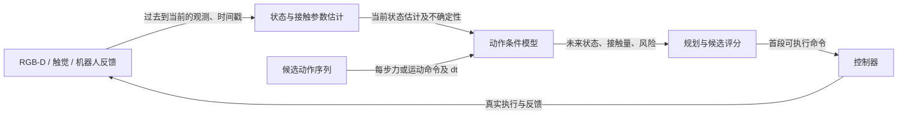
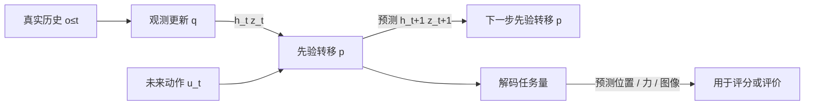
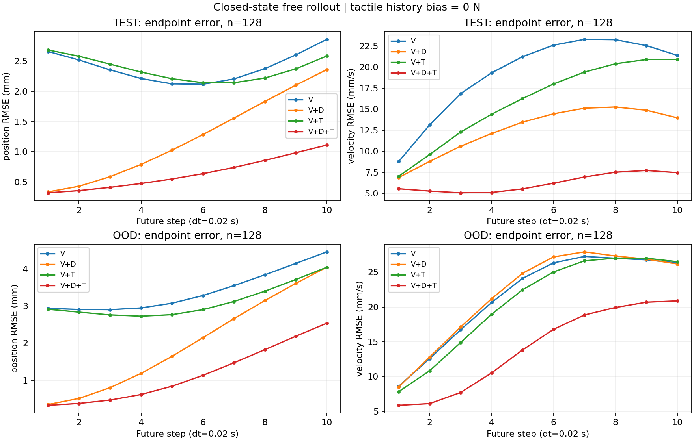
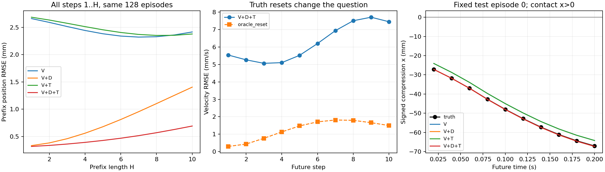
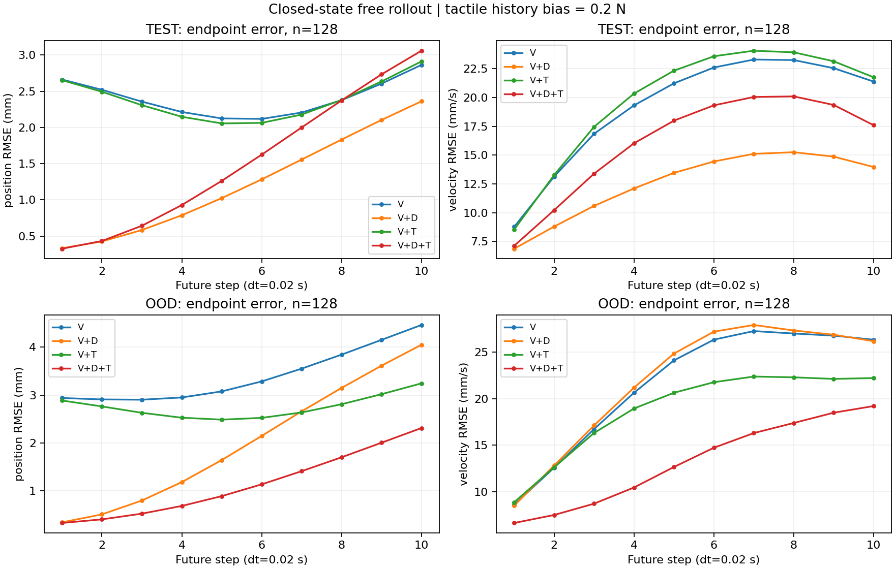
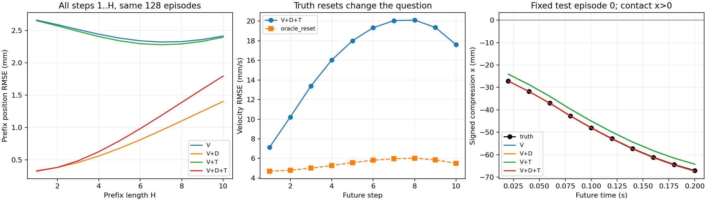

# D69 · 从一步预测到闭合状态的多步展开

[返回学习入口](../_index.md) ｜ [本周日程](../P3-项目实战-日程.md) ｜ [上一课 D68](../day68/Daily-Learning-Pack.md) ｜ [CPU多步预测实验](demo.py)

**多步预测的关键，是在最后一帧真实观测之后，靠模型自己维持完整的状态，并清楚报告误差怎样随预测步变化。深度能帮助确定“在哪里”，触觉能帮助辨认“接触了怎样的材料”，两者的互补与失效都需要受控实验。**

上一课把融合观测接到动作条件一步预测器；今天沿RGB-D机械臂抓杯子的主线，追问“如果继续执行这段动作，接触与运动会怎样”。下一课再将融合任务与动态预测拆成两份可核对的W10验收报告。

本课是W10-D6、P3项目Π-2的多步预测与模态消融。实验用可解释的混合状态估计器和一维解析接触模型，提供独立CPU入口；没有使用真实图像或机器人，也没有把已知方程的教学结果写成复杂接触物理验证。

<details>
<summary>个人学习记录（保留你的预测、解释与作答）</summary>

<!-- learner-notes:start -->

- 运行前对四组排序的预测：
- 触觉偏置与OOD结果的解释：
- 我的自测答案：
- 真实系统尚缺的字段与证据：

<!-- learner-notes:end -->

</details>

<!-- daily-pack-generated:start -->

## 0. 学习目标与路线

今天要完成的能力转换是：从“会调用一步预测器”，走到“能解释一整段预测使用了哪些信息，以及它的误差来自哪里”。你应能检查状态是否闭合，区分逐步真值喂入与自由展开，推导误差递推，计算第1、5、10步的端点误差，并设计触觉、深度的四组受控消融。

| 顺序 | 知识主线 | 要回答的问题 |
| --- | --- | --- |
| 宏观 | 感知—预测—规划—执行反馈 | 为什么一步准确还不足以评价一段动作？ |
| 机制一 | 闭合状态与历史估计 | 下一次调用需要的输入，从哪里来？ |
| 机制二 | 接触参数辨识与多模态互补 | 深度和触觉各自减少哪一种歧义？ |
| 机制三 | 自由展开与误差传播 | 初态、模型、动作、接触切换怎样影响未来？ |
| 评价 | 1/5/10步协议与四组消融 | 哪一个分母、哪一种误差、哪一种比较才对应问题？ |
| 实践 | 六帧历史到十步预测 | 在CPU上复现结果，并改变一个变量解释失效 |
| 回到宏观 | 工程接口与证据边界 | 这些结果距离真实抓杯子还有哪些差距？ |

## 1. 宏观：把“下一帧”放回一段动作中

### 1.1 同样的一步误差，可能导向不同的操作结果

机械臂正在贴近杯壁。此刻位置偏差只有0.5 mm，可能仍在抓取容差内；如果每次预测都把杯壁的位置向外推一点，十步后的接触时刻就可能明显错误。反过来，一个稳定反馈系统也可能逐渐消除初始偏差。**不能从一个一步误差数字推断整段动作的可靠性，也不能把“多步误差必然单调增长”当成规律。**

在操作系统里，世界模型的输入通常包含当前信息和一段候选动作。它输出未来的状态、特征或任务量，规划器再评价候选动作。这条预测支路与真实执行支路共享起点，但后续信息来源不同。



这张图回答“模型在哪个位置提供什么量”。今天实现的是估计与预测部分，候选动作由脚本预先给定；没有执行策略搜索，没有闭环抓取成功率。W13才会把预测放进同任务候选评分或MPC对照中。当前仍然保留Π-2的多模态感知目标，不把它替换成纯策略项目。

### 1.2 四种看似相近、其实不同的评价

| 方式 | 每一步模型使用什么 | 实际回答的问题 |
| --- | --- | --- |
| 一步评价 | 当前真实可用观测，预测下一步 | 已知当前信息时，局部转移是否准确？ |
| 逐步真值喂入（teacher forcing式评价） | 每一步重新获得真实状态或观测 | 连续若干个一步预测是否准确？ |
| 自由展开（free rollout） | 起点真实历史，此后自己的预测与给定动作 | 不补充未来观测时，一段后果预测是否可靠？ |
| 闭环重观测 | 执行一小段，再采集新观测重新预测 | 整个感知—控制系统如何纠偏？ |

Teacher forcing原本也描述序列模型训练时使用真实前缀的方式。本课说“teacher forcing式评价”，特指评测中反复用真实状态重置；它不是自由rollout。闭环重观测是合理的部署策略，但不能把其结果写成“起点之后从未见过观测的十步预测”。

> [!question] 先判断
> 代码每次先预测下一步位置，然后从数据集中拿出这一时刻的真实触觉，再继续预测。图中画出了十个预测点，它属于哪种协议？
>
> 它是混合了未来真实信息的展开。可以作为单独标明的诊断实验，不能列入无未来观测的自由rollout结果。

## 2. 微观：先让状态“闭合”，再谈展开十步

### 2.1 Day68的接口为什么不能直接套一个for循环

Day68的一步网络接收视觉位置/速度、测力、接触位与动作，输出下一步位置和速度。下一次调用仍需要测力和接触位，但前一次输出没有提供它们。单纯把输出再送回网络，输入维度和信息语义都不完整。

把第$j$步预测记为$\hat s_{t+j}$，动作记为$u_{t+j}$。一个闭合的递推接口至少应满足：

$$
\hat s_{t+j+1}=\hat f(\hat s_{t+j},u_{t+j}),\qquad
\hat o_{t+j}=\hat g(\hat s_{t+j}).
$$

$\hat f$需要的所有递推变量来自当前预测状态、已知输入或固定模型参数。$\hat g$生成当前预测状态所对应的观测量。所谓闭合是**接口与所选模型假设下的闭合**，不等于它已经包含真实世界的一切。

常见解决方式有三种：扩大显式状态并建模传感器输出；让网络同时预测下一步所需的全部观测/状态；用一个能自行转移的潜状态，再从中解码任务量。把缺少的量永远置零，只是在定义一个特殊假设；它是否合理需要单独验证。

### 2.2 本课选择可解释的混合模型

为了看清每一条信息路径，实验用已知结构的一维单侧弹簧系统，加上从历史数据辨识的接触刚度。它延续Day68的物理变量，但**没有加载或继续训练Day68的1490参数MLP**。两课数字的差异不构成神经网络与混合模型的公平排名。

状态定义为：

$$
s_t=[x_t,v_t,k]^\top.
$$

$x$是相对接触平面的有符号位移，单位m；$x>0$代表压入，$x\le0$代表未压入。$v$的单位m/s，$k$是当前episode不变的刚度，单位N/m。动作$u$是已实际作用于系统的有符号力，单位N；它不是关节角、归一化token或不带时间定义的“七维动作”。

质量$m=0.5\ \mathrm{kg}$、阻尼$b=1\ \mathrm{N\,s/m}$、步长$\Delta t=0.02\ \mathrm{s}$已知。定义$p_t=\max(x_t,0)$，接触力为$F_t=kp_t$。动力学为：

$$
\begin{aligned}
v_{t+1}&=v_t+\frac{\Delta t}{m}(u_t-bv_t-k\max(x_t,0)),\\
x_{t+1}&=x_t+\Delta t\,v_{t+1},\\
k_{t+1}&=k_t.
\end{aligned}
$$

先更新速度、再用新速度更新位置，叫半隐式Euler离散化。这里的“真实数据生成器”也采用同一离散方程，因此实验没有额外积分器失配；这是一项有利假设，不能据此声称已经识别真实机器人动力学。

预测得到$\hat x$和$\hat k$后，未来测力的模型均值为$\hat F=\hat k\max(\hat x,0)$。未来接触几何位可写为$\mathbb1[\hat x>0]$。这是预测量，不是读取未来传感器记录；也不意味着已生成具有真实光照、形变、迟滞和噪声的触觉图像。

> [!warning] 接触模型的边界
> 单侧线性弹簧没有切向摩擦、冲击恢复系数、复杂材料迟滞或六维接触力矩。$x=0$处力连续，导数有折点；不能把本实验的模式切换描述成模拟了碰撞冲量。

### 2.3 一个手算例：一次接触参数误差会改变什么

给定$x=0.010$ m、$v=0.020$ m/s、$k=50$ N/m、$u=0.8$ N，有$F=0.5$ N、阻尼力$bv=0.02$ N。于是：

$$
\Delta v=\frac{0.02}{0.5}(0.8-0.02-0.5)=0.0112\ \mathrm{m/s},
$$

$$
v'=0.0312\ \mathrm{m/s},\qquad x'=0.010624\ \mathrm m.
$$

假如位置、速度都正确，却误把刚度估为100 N/m，则$v'=0.0112$ m/s、$x'=0.010224$ m。一步位置只差0.4 mm，速度已差20 mm/s；继续展开时，这个速度差会影响后续位置和接触力。**只汇报位置误差，可能掩盖已经存在的动力学偏差。**

## 3. 微观：深度帮助定位，触觉帮助辨识——但都依赖假设

### 3.1 四种通道的语义要先说明

本课的“视觉”和“深度”都是数值代理，不是实际图像编码器输出。基础视觉V提供独立标定的米制位置与速度估计，噪声分别为3 mm和6 mm/s；深度D额外提供0.3 mm噪声的位置；触觉T提供0.015 N噪声的接触测力。

| 通道 | 每帧变量 | 单位 | 在本实验中用于什么 |
| --- | --- | --- | --- |
| V | $[x^V,v^V]$ | m、m/s | 所有组合共有的粗位置与速度 |
| D | $x^D$ | m | 改善历史压入量和当前位置估计 |
| T | $F^T$ | N | 结合历史压入量辨识刚度 |
| A | 未来$u_0,\ldots,u_9$ | N | 定义被预测的动作后果 |

无D组仍有米制V位置，因为本例明确假设视觉代理已有尺度标定。它不证明一般单目RGB可以无条件恢复绝对深度。真实RGB-D系统中，两路位置误差可能相关；本例使用独立噪声，只是为了隔离互补机制。

以当前时刻为0，历史六帧为$-0.10,-0.08,-0.06,-0.04,-0.02,0$ s。最后一帧是起点观测，未来第一步对应0.02 s。历史长度不是未来预测时长；10步对应0.20 s，而不是10 s。

### 3.2 两路位置怎样融合

若两个位置观测具有独立、无偏的高斯噪声，方差分别为$\sigma_V^2,\sigma_D^2$，最大似然/加权最小二乘估计为：

$$
\hat x_i=\frac{x_i^V/\sigma_V^2+x_i^D/\sigma_D^2}{1/\sigma_V^2+1/\sigma_D^2}.
$$

它来自对$\sum_r(x-x_i^r)^2/\sigma_r^2$求导并令导数为零。权重由精度而不是模态名称决定；无D时直接使用$x_i^V$。本例噪声标准差相差10倍，D权重为$100/101\approx0.9901$。

手算：V读数12 mm，D读数10 mm，融合位置为$(12+100\times10)/101\approx10.0198$ mm。D有1 mm系统偏置时，这个融合器会几乎完整继承偏置，因为它只根据预设随机噪声加权。把方差估小不等于把传感器变准。

### 3.3 由“位移—力”关系辨识刚度

在历史帧中，用$\hat p_i=\max(\hat x_i,0)$表示估计压入量。最简单的关系是$F_i\approx k\hat p_i$。加上向先验$k_0$收缩的正则项：

$$
J(k)=\sum_{i=1}^{6}(F_i^T-k\hat p_i)^2+\lambda(k-k_0)^2.
$$

对$k$求导：

$$
\frac12\frac{\partial J}{\partial k}
=-\sum_i\hat p_i(F_i^T-k\hat p_i)+\lambda(k-k_0)=0,
$$

得到：

$$
\hat k=\frac{\sum_i\hat p_iF_i^T+\lambda k_0}{\sum_i\hat p_i^2+\lambda}.
$$

这里$k_0$来自训练episode的平均刚度，$\lambda$只用独立验证集选择。因为分母$\sum p_i^2$的单位为m²，$\lambda$也应以m²解释，才能使目标两项都是N²；它不是能随单位变换原样照搬的神秘无量纲常数。

两帧压入量为0.01和0.02 m，测力为0.5和1.0 N，$k_0=60$ N/m，$\lambda=10^{-4}$ m²，则$\hat k=(0.025+0.006)/(0.0005+0.0001)\approx51.67$ N/m。没有正则时为50 N/m。弱压入时正则避免比值爆炸，但先验也会拉回真正偏离训练范围的刚度。

> [!question] 先算偏置
> 同样两帧的测力都多读0.2 N，$\hat k$增加多少？
>
> 增量为$\Delta k=0.2(0.01+0.02)/0.0006=10$ N/m。常值力偏置通过辨识器转成持续的刚度偏差，随后会影响整段rollout。

### 3.4 不可辨识和“自信但错误”是两种问题

若所有$\hat p_i=0$，测力对刚度没有提供有效斜率信息，公式回到$k_0$。没有接触不代表材料没有刚度，只代表这段历史不足以识别。即使历史有接触，位置噪声也进入了回归自变量；普通岭回归并没有正确处理这种errors-in-variables问题，不保证无偏。

无T组在本实验统一使用训练先验，不从历史速度变化反推刚度。真实系统也可能通过已知动作、加速度与位移辨识刚度；所以观察到T组改善，只能证明它改善了**这个估计器和协议**，不能证明“没有触觉就绝不可能预测接触”。

六帧同属一次episode，共享刚度。不能把它们当六个独立材料样本；训练、验证与测试按episode划分，不能随机打散帧后宣称获得独立测试。

## 4. 微观：从显式状态走向潜状态模型

### 4.1 真实图像太复杂时，闭合的不是像素，而是内部状态

显式的$[x,v,k]$具有很强的可解释性，但真实杯子接触还有遮挡、摩擦、接触位置等未观测因素。潜状态模型用内部变量承载历史信息，不要求每个维度都有物理命名。为了统一书写，本课将有观测的更新记为$q$、无新观测的预测记为$p$；这是一套课程记号，论文中的字母可能相反。

一种常见拆分为确定性记忆$h_t$与随机状态$z_t$：

$$
h_t=f_\theta(h_{t-1},z_{t-1},u_{t-1}),\quad
z_t\sim q_\phi(z_t\mid h_t,o_t),\quad
\hat z_t\sim p_\theta(z_t\mid h_t).
$$

看到当前观测时用$q$更新；离开最后一个观测时刻后，自由展开必须用$p$和预测得到的内部状态继续。解码器把$[h_t,z_t]$映射成图像、接触或奖励等需要的量。这是理解RSSM（循环状态空间模型）的关键信息路径。[PlaNet，§3与图2](https://proceedings.mlr.press/v97/hafner19a/hafner19a.pdf)



图中没有$o_{t+1}$到预测分支的箭头。潜变量不因为名字叫“状态”就自动充分：历史太短、损失只关心外观、训练动作覆盖不足，都可能让它漏掉控制所需信息。

### 4.2 训练时可见未来，不等于推理可以读取未来

监督学习可以用真实下一状态作标签；潜状态训练也可使用真实序列构造目标或后验。需要禁止的是：评测的自由预测路径把未来标签或后验当成输入。训练信息与部署信息的可用性必须分开记录。

多步损失的一种直接形式是：

$$
\mathcal L_H=\frac1H\sum_{j=1}^{H}w_j
\left\|D_y^{-1}\big(\hat y_{t+j\mid t}-y_{t+j}\big)\right\|_2^2.
$$

$D_y$是按训练数据或物理容差确定的尺度矩阵，让位置、速度、力的误差具有可比权重；$w_j$体现不同预测步的重要性。越远的预测通常越不确定，过度强调远期也可能损害局部拟合。多步训练改变目标，不自动保证控制可靠。

PlaNet的latent overshooting把多步潜状态预测纳入训练目标；该论文也明确说明最终RSSM方案没有采用这一项，不应写成所有RSSM必备或必然提升的组件。[PlaNet，§4、图3、式7](https://proceedings.mlr.press/v97/hafner19a/hafner19a.pdf)

Dreamer进一步在潜状态预测的轨迹中学习行为；其representation模型可使用观测，transition模型可无观测展开。论文图5展示先用少量图像提供上下文、之后只给动作的预测，帮助辨认信息流，但可视化本身不构成机器人成功率证据。今天没有实现Dreamer训练，也没有用学到的策略选择动作。[Dreamer，§2–4](https://arxiv.org/html/1912.01603v3)

## 5. 微观：误差如何从起点传到第十步

### 5.1 分清三类偏差

首先是初态估计误差，例如位置噪声、速度噪声和刚度辨识误差。其次是转移模型误差，例如遗漏摩擦或材料迟滞。第三类是动作与时间接口误差，例如把目标力当成实际力、采样周期错一倍，或动作执行延迟。

本课使用相同的解析转移生成真值和预测，主要隔离第一类；未来动作和步长也完全对齐。它没有测量复杂模型失配以及执行器延迟下的性能。实验更干净，能支撑的结论也更窄。

令$e_j=\hat s_{t+j}-s_{t+j}$，在同一动作$u_j$下定义局部模型误差$\delta_j=\hat f(s_{t+j},u_j)-f(s_{t+j},u_j)$。一阶展开为：

$$
e_{j+1}\approx A_j e_j+\delta_j,
\qquad A_j=\left.\frac{\partial\hat f}{\partial s}\right|_{s_{t+j},u_j}.
$$

若动作也有误差，另有$B_j\Delta u_j$项；不能用状态估计指标吸收后就忘记它的来源。

### 5.2 接触段的Jacobian告诉我们什么

固定刚度并处于$x>0$接触段时，对$[x,v]$的Jacobian为：

$$
A=
\begin{bmatrix}
1-\Delta t^2 k/m & \Delta t(1-\Delta t b/m)\\
-\Delta t k/m & 1-\Delta t b/m
\end{bmatrix}.
$$

对刚度误差的敏感方向为：

$$
\frac{\partial[x',v']^\top}{\partial k}
=\begin{bmatrix}-\Delta t^2\max(x,0)/m\\-\Delta t\max(x,0)/m\end{bmatrix}.
$$

第一行说明速度误差会积分成位置误差；第二行说明位置和刚度误差会改变预测接触力，进而改变速度。未接触段刚度相关项为零，解释了“自由运动阶段看不出刚度错误，接触之后突然明显”的现象。

代入$m=0.5$、$b=1$、$k=50$、$\Delta t=0.02$，得到$A=\begin{bmatrix}0.96&0.0192\\-2&0.96\end{bmatrix}$。矩阵的元素携带不同的物理单位；不能因为$-2$的绝对值大于1，就判定系统不稳定。固定接触模式下其特征值模约为$\sqrt{0.96}$，可能表现为衰减振荡；实际轨迹还可能离开接触段。

### 5.3 一个上界，与它不能承诺的事

先用尺度矩阵$D_s$把状态无量纲化，例如$\tilde s=D_s^{-1}s$；不能直接对m、m/s、N/m混合的裸向量套“误差大小”的直觉。若在考察区域内转移满足Lipschitz常数$L$，每步模型误差不超过$\epsilon$，则：

$$
\|\tilde e_H\|\le L^H\|\tilde e_0\|+
\epsilon\sum_{i=0}^{H-1}L^i.
$$

$L=1$时为$\|\tilde e_0\|+H\epsilon$；$L\ne1$时，求和为$(L^H-1)/(L-1)$。它是最坏情况界限，不是预测曲线，也不承诺真实RMSE每一步增加。误差可能相消、振荡；不同轨迹的接触时刻也不同。

### 5.4 接触切换为何难

真值$x=-0.1$ mm而预测$x=+0.1$ mm，位置只差0.2 mm，但几何接触位已不同。$k=50$ N/m时，真值接触力0、预测0.005 N，力仍然很小。二值状态可以翻转，连续力却没有跳变。用“接触准确率”与“力RMSE”观察，会得到不同敏感性。

跨过$x=0$之后，原接触段的局部Jacobian不再适用。高阶真实系统还可能有滑移、离开接触和撞击等事件；仅在某个模式内拟合很好，不能保证模式切换预测正确。

## 6. 评价：把第1、5、10步写成可复现协议

### 6.1 起点、动作和分母先固定

本课每个独立测试episode只有一个预测起点；提供六帧历史和未来十步预先给定动作，各组合使用完全相同的episode与动作。第1、5、10步分别对应0.02、0.10、0.20 s。不要让第十步只统计“还没预测发散的样本”。

对位置或速度的某个分量$y$，第$h$步端点RMSE定义为：

$$
\mathrm{RMSE}_{\mathrm{end}}(h)
=\sqrt{\frac1N\sum_{n=1}^{N}(\hat y_{n,h\mid0}-y_{n,h})^2}.
$$

整段到$H$步的误差定义为：

$$
\mathrm{RMSE}_{\mathrm{path}}(H)
=\sqrt{\frac1{NH}\sum_{n=1}^{N}\sum_{j=1}^{H}
(\hat y_{n,j\mid0}-y_{n,j})^2}.
$$

一个看最终位置，一个看沿途预测。两者都合理，但必须命名清楚。位置输出乘1000转为mm，速度乘1000转为mm/s；不能把两者直接平均成一个没有单位的“总误差”。

手算：单条轨迹五步位置误差依次为$[0,0,0,0,10]$ mm，末步误差为10 mm，整段RMSE为$\sqrt{100/5}\approx4.47$ mm。如果只说“预测误差4.47 mm”，读者无法判断最后一步是否可用。

### 6.2 1/5/10不是三个独立试验集

同一条轨迹在不同预测步的误差高度相关。多个重叠起点也会相关。如果要给置信区间，应按episode重采样，保留同一episode的完整误差序列，不能把128条轨迹的1280个未来点当1280个独立物体。

置信区间可以通过cluster bootstrap估计：抽取128个episode索引（可重复），对抽到的轨迹重新计算RMSE或配对差值，重复并取分位数。本课主脚本报告固定数据上的点估计，未以这些点估计宣称统计显著，也未声称跨模型初始化或真实材料均成立。

### 6.3 有无深度、有无触觉：完整2×2才看得到交互

| 编号 | 观测组合 | 位置估计 | 刚度估计 | 所有组共同拥有 |
| --- | --- | --- | --- | --- |
| 00 | V+A | V位置 | 训练先验 | V速度、同一动作序列、相同转移结构 |
| 10 | V+D+A | V与D融合 | 训练先验 | 同上 |
| 01 | V+T+A | V位置 | 历史位移—力辨识 | 同上 |
| 11 | V+D+T+A | V与D融合 | 历史位移—力辨识 | 同上 |

这里的消融评估整个“观测→估计→预测”流水线，不是对同一个已训练神经网络临时删输入。带T的两组分别只在验证集选正则；无T组使用同一训练先验。最终测试只能用冻结选择，不能根据测试曲线重选。

令$E_{dt}$是某个固定预测步、固定指标的误差，$d,t\in\{0,1\}$表示是否提供D、T。没有T时加D的收益为$E_{00}-E_{10}$；有T时加D的收益为$E_{01}-E_{11}$。交互量可定义为：

$$
I=(E_{01}-E_{11})-(E_{00}-E_{10})
=E_{01}+E_{10}-E_{11}-E_{00}.
$$

在“误差越小越好”的定义下，$I>0$表示D在有T时收益更大。这与常见差中差$E_{11}-E_{10}-E_{01}+E_{00}$符号相反，写公式即可避免口头“协同效应”的歧义。

本例有明确机制：D使压入量更准，压入量又是从T拟合刚度的自变量，因此D不仅改善初始位置，也可能改善T的解释。由于RMSE本身含平方与开方，交互量依赖选择的尺度；它不是传感器之间存在物理因果关系的证明。

### 6.4 训练期缺模态、测试期故障、域外材料分别报告

本课四组是固定观测配置的流水线比较。另一组测试只给历史测力加0.2 N偏置，保持先验、验证选择、物理真值与动作不变，这是部署传感器故障。OOD组改变材料刚度分布，这是物理域偏移。三种问题不能混成一个“泛化能力”平均值。

额外模态可能改善正常场景，也可能在失准时误导模型。重点不是证明融合永远有效，而是找到它改善哪类不确定性、失败时能否被检测，以及是否需要回退到更保守的预测。

## 7. 工程：明确谁能看到未来

### 7.1 一个容易审计的函数边界

```python
state0 = estimate(history_observations, frozen_config)
forecast = rollout(state0, future_actions, dt)
metrics = evaluate(forecast, future_truth)
```

`estimate`只接收截止当前的历史观测；`rollout`不接收数据集、未来测力、真实刚度或下一帧图像；只有`evaluate`读未来标签。如果传入整个episode字典再由内部随意索引，接口就难以证明没有泄漏。

最直接的检查是保持输入历史与动作不变，把未来真值改写为明显错误的数值，重新预测应逐位一致，评价指标应改变。这个检查只能证明当前实现经过了这一种泄漏检查，不代替所有数据流审计。

### 7.2 面向真实RGB-D与触觉的输入契约

| 字段 | 需要明确的内容 | 常见失败 |
| --- | --- | --- |
| 图像/深度 | 曝光时刻、K、畸变、深度单位、有效mask | 无效深度0被当作接触平面 |
| 位姿/速度 | 参考系、估计时刻、速度计算方式、协方差 | 世界系位置与末端系速度直接拼接 |
| 触觉/力 | 参考零点、单位、校准、到达时间、响应延迟 | 用未来到达的测力修正过去的决策 |
| 动作 | 目标与实际动作区别、起止时刻、单位与饱和 | 把指令当执行值，遗漏控制器延迟 |
| 预测 | 起点、dt、horizon、坐标系、模型版本 | 十步预测使用了两种不同的dt |
| 评价 | episode/object/split ID、全部目标与缺失原因 | 漏掉未返回的困难轨迹 |

接RealSense时，深度应先正确转换到米并配准；接ROS时，消息近似同步并不能修复设备时钟漂移、曝光差异和传输迟到。这些是D50、D57已经建立的接口问题。当前脚本不连接设备；真实适配需要用自己的日志证明这些字段，而不是把合成实验的精度直接当传感器精度。

### 7.3 四种闭合方式的取舍

| 方式 | 下一步如何获得所需量 | 优点 | 主要边界 |
| --- | --- | --- | --- |
| 本课显式混合模型 | 转移$x,v,k$并解码力 | 量纲清楚、便于定位误差 | 物理结构与参数恒定假设强 |
| 全观测联合预测 | 网络输出未来位置、力等 | 数据驱动、接口直接 | 通道之间可能物理不一致 |
| 潜状态模型 | 递推内部状态，再解码任务量 | 可承载历史与隐藏因素 | 可解释性和可识别性需验证 |
| 执行后重观测 | 新传感器更新估计再规划 | 能纠正实际偏差 | 属于闭环协议，不能冒充纯展开 |

真正的操作规划还需要碰撞几何、动作可达性、接触约束以及执行反馈。未来画面合理或状态误差小，都不足以绕过这些条件。

## 8. 动手：先预测，再运行，再只改一个变量

### 8.1 运行前写下三个判断

先在个人记录区回答：去掉D是否会只影响初始位置；去掉T是否会在所有预测步都更差；给T加正偏置是否一定使所有域的误差上升。最后一个问题尤其值得保留原答案，后面用实验修正直觉。

本课的最小实现只依赖NumPy与Matplotlib，不需要PyTorch、CUDA或任何设备。脚本同时生成合成数据、估计参数、跑四组预测、保存逐轨迹结果和图；它不是官方世界模型复现。

从笔记库根目录运行，已有环境有依赖时可直接执行：

```bash
python 3d_learning/day69/demo.py --out _assets/3d_learning/day69/my_default
python 3d_learning/day69/demo.py --touch-bias 0.2 --out _assets/3d_learning/day69/my_bias02
```

如果当前Python缺少依赖，可在自己的课程环境内安装：

```bash
python -m pip install numpy matplotlib
```

两次运行只改变`--touch-bias`。它仅作用于test/OOD的六帧历史触觉，训练集、验证集、动作和物理真值保持相同；每次重新执行参数估计也得到完全相同的结果。`my_default`等目录用于保留你自己的复跑产物，本文已验证附件存放在`default`和`bias02`。

### 8.2 数据与估计预算

| 项目 | 固定设置与用途 |
| --- | --- |
| 划分 | train256、val128、test128、OOD128个独立episode；种子690/691/692/693 |
| 历史起始状态 | 在$t=-0.10$ s抽样$x\sim U[-0.012,0.022]$ m、$v\sim U[-0.06,0.06]$ m/s |
| 材料 | train/val/test：$k\sim U[20,80]$ N/m；OOD：$k\sim U[100,150]$ N/m |
| 动作 | 每episode五个$U[-1,1]$ N命令，每个保持三个区间，共15个区间；前五个区间生成历史，后十个区间用于预测 |
| 传感器 | V位置3 mm、V速度6 mm/s、D位置0.3 mm、T力0.015 N的独立零均值高斯噪声 |
| 先验 | 仅用训练刚度标签计算$k_0=50.857411$ N/m；这是合成标签可得的条件 |
| 正则选择 | 候选$\lambda\in\{10^{-5},10^{-4},10^{-3}\}$ m²；分别最小化val第10步$[x/0.01,v/0.1]$的平均平方误差 |
| 固定选择 | 两个T组均选$10^{-5}$ m²；无T组的$\lambda$字段不参与实际刚度估计 |
| 物理范围 | T组将刚度裁剪到[5,200] N/m，是预声明的宽范围，不按训练最大值80截断OOD |
| 数据预算 | 共640个合成episode、每个15个转移区间，共9600个区间；训练先验实际只使用256个刚度标签 |
| 设备交互 | 真实机器人尝试0、真实传感器采集0；无梯度训练、无模型权重下载 |

注意历史中的过去动作参与数据生成，却没有输入本课的刚度辨识公式。这样做牺牲了一部分可利用的信息，换来最容易检查的位移—力关系。若以后加入动作/加速度辨识，必须将它列为新方法，而不是悄悄改变无T基线。

Learning五格卡可以写成：数据是独立合成episode；估计对象是当前$x,v,k$与未来轨迹；改善信号是物理回归残差和验证集终点误差；离线阶段估训练先验并选正则、推理阶段仅见历史与动作；泛化分为独立episode、域外刚度和测力偏置。它属于系统辨识与数据驱动参数选择，不是深度网络训练。

### 8.3 数据shape与核心代码

| 数组/函数 | shape | 解释 |
| --- | --- | --- |
| `truth` | `[B,16,3]` | 从历史起点到未来末端的$x,v,k$，供生成、训练先验、验证选择、评价及特权诊断；正式测试predict不读 |
| `obs` | `[B,16,4]` | V位置、V速度、D位置、T测力；只有前六帧可给正式预测 |
| `history` | `[B,6,4]` | 截止当前的观测，没有未来帧 |
| `future_actions` | `[B,10]` | 从当前开始的十个力输入 |
| `estimate`输出 | `[B,3]` | 当前$x,v,k$估计 |
| `rollout`输出 | `[B,10,3]` | 每个未来步的预测状态 |
| 端点指标 | `[10]`/每物理量 | 每步在同一B个episode上的RMSE |

`B=128`是本次测试批量，不是学习训练中的batch大小。数组采用NumPy浮点计算；把代码迁移到PyTorch时，维度语义不应改变。

核心递推只有这些语句：

```python
z = z0.copy()
for u in actions.T:
    z = step(z, u)       # z中包含自己估计的k
    out.append(z.copy())
```

`copy()`防止列表里所有条目错误指向同一个可变数组。`step`内部依据自己的$x,k$计算接触力，未来力需要导出时可由`prediction[..., 2] * maximum(prediction[..., 0], 0)`计算。代码中不存在用未来触觉补全下一次输入的分支。

完整可复制脚本见下方折叠区；与同目录[demo.py](demo.py)逐字一致。

<details>
<summary>完整CPU脚本（展开后可直接复制）</summary>

```python
#!/usr/bin/env python3
"""D69: causal multimodal identification + closed-state synthetic rollouts.
No network, hardware, real RGB/depth image, or learned contact physics.
"""
import argparse
import hashlib
import json
import platform
import time
from datetime import datetime, timezone
from pathlib import Path
import numpy as np
import matplotlib
matplotlib.use('Agg')
import matplotlib.pyplot as plt

DT, MASS, DAMP, HISTORY, HORIZON = .02, .5, 1., 6, 10
MODES = {'V': (False, False), 'V+D': (True, False),
         'V+T': (False, True), 'V+D+T': (True, True)}
LAMBDAS = [1e-5, 1e-4, 1e-3]  # m^2; declared before test inspection


def step(z, u):
    """z[...,3]=[x(m),v(m/s),k(N/m)], u[...] in newtons."""
    x, v, k = np.moveaxis(z, -1, 0)
    vn = v + DT / MASS * (u - DAMP * v - k * np.maximum(x, 0))
    return np.stack((x + DT * vn, vn, k), axis=-1)


def rollout(z0, actions):
    """Only estimated state and predeclared actions. No observations/truth."""
    z, out = z0.copy(), []
    for u in actions.T:
        z = step(z, u)
        out.append(z.copy())
    return np.stack(out, axis=1)


def make_data(seed, count, krange):
    rng = np.random.default_rng(seed)
    z0 = np.column_stack((rng.uniform(-.012, .022, count),
                          rng.uniform(-.06, .06, count), rng.uniform(*krange, count)))
    # 15 intervals; five force commands, each held for three intervals.
    actions = np.repeat(rng.uniform(-1, 1, (count, 5)), 3, axis=1)
    truth = np.concatenate((z0[:, None], rollout(z0, actions)), axis=1)
    x, v, k = np.moveaxis(truth, -1, 0)
    obs = np.stack((x + rng.normal(0, .003, x.shape),
                    v + rng.normal(0, .006, v.shape),
                    x + rng.normal(0, .0003, x.shape),
                    k * np.maximum(x, 0) + rng.normal(0, .015, x.shape)), axis=-1)
    return {'truth': truth, 'obs': obs, 'actions': actions}


def estimate(history, depth, tactile, prior, lam):
    assert history.shape[1:] == (HISTORY, 4)
    pos = history[:, :, 0]
    if depth:
        pos = (pos / .003**2 + history[:, :, 2] / .0003**2) / (1/.003**2 + 1/.0003**2)
    p = np.maximum(pos, 0)
    k = np.full(len(pos), prior)
    if tactile:
        k = (np.sum(p * history[:, :, 3], axis=1) + lam * prior) / (np.sum(p*p, axis=1) + lam)
        k = np.clip(k, 5., 200.)  # declared broad physical bounds, not training extrema
    return np.column_stack((pos[:, -1], history[:, -1, 1], k))


def predict(history, actions, mode, params):
    depth, tactile = MODES[mode]
    z0 = estimate(history, depth, tactile, params['prior'], params['lambda'][mode])
    return z0, rollout(z0, actions)


def inputs(data, bias=0.):
    hist = data['obs'][:, :HISTORY].copy()
    hist[:, :, 3] += bias
    return hist, data['actions'][:, HISTORY-1:].copy()


def fit(train, val):
    params = {'prior': float(train['truth'][:, 0, 2].mean()), 'lambda': {}, 'val_scores': {}}
    hist, actions = inputs(val)
    target = val['truth'][:, HISTORY:, :2]
    for mode, (d, t) in MODES.items():
        candidates = LAMBDAS if t else [LAMBDAS[0]]
        scores = []
        for lam in candidates:
            pred = rollout(estimate(hist, d, t, params['prior'], lam), actions)
            scores.append(float(np.mean(((pred[:, -1, :2]-target[:, -1]) / [.01, .1])**2)))
        params['lambda'][mode] = candidates[int(np.argmin(scores))]
        params['val_scores'][mode] = scores
    return params


def metrics(pred, truth):
    e = pred[:, :, :2] - truth[:, :, :2]
    rmse = np.sqrt(np.mean(e*e, axis=0)) * 1000
    prefix = np.sqrt(np.cumsum(np.mean(e*e, axis=0), axis=0) / np.arange(1, HORIZON+1)[:, None]) * 1000
    return {'endpoint_x_mm': rmse[:, 0].tolist(), 'endpoint_v_mm_s': rmse[:, 1].tolist(),
            'prefix_x_mm': prefix[:, 0].tolist(), 'prefix_v_mm_s': prefix[:, 1].tolist(),
            'contact_correct': ((pred[:, :, 0] > 0) == (truth[:, :, 0] > 0)).sum(axis=0).tolist(),
            'episodes': len(pred)}


def evaluate(data, params, bias):
    hist, actions = inputs(data, bias)
    truth = data['truth'][:, HISTORY:]
    results, saved = {}, {}
    for mode in MODES:
        z0, pred = predict(hist, actions, mode, params)
        results[mode] = metrics(pred, truth)
        results[mode]['initial_rmse_x_v_k'] = np.sqrt(np.mean((z0-data['truth'][:, HISTORY-1])**2, axis=0)).tolist()
        saved[mode] = pred
    # A diagnostic with privileged state resets; NOT a deployable rollout.
    prev = data['truth'][:, HISTORY-1:-1].copy()
    prev[:, :, 2] = estimate(hist, True, True, params['prior'], params['lambda']['V+D+T'])[:, None, 2]
    oracle = step(prev, actions)
    results['oracle_reset'] = metrics(oracle, truth)
    saved['oracle_reset'] = oracle
    return results, saved


def latency(history, actions, params):
    for _ in range(10):
        predict(history, actions, 'V+D+T', params)
    times = []
    for _ in range(100):
        t = time.perf_counter()
        predict(history, actions, 'V+D+T', params)
        times.append((time.perf_counter()-t)*1000)
    return {'median_ms': float(np.median(times)), 'p95_ms': float(np.percentile(times, 95)),
            'batch': len(history), 'warmups': 10, 'repeats': 100,
            'scope': 'initial observer + 10-step rollout; excludes IO and metrics'}


def figures(out, report, saved, test, bias):
    h = np.arange(1, HORIZON+1)
    fig, axes = plt.subplots(2, 2, figsize=(11, 7), constrained_layout=True)
    for row, split in enumerate(('test', 'ood')):
        for mode in MODES:
            r = report[split][mode]
            axes[row, 0].plot(h, r['endpoint_x_mm'], '-o', ms=3, label=mode)
            axes[row, 1].plot(h, r['endpoint_v_mm_s'], '-o', ms=3, label=mode)
        for col, unit in enumerate(('position RMSE (mm)', 'velocity RMSE (mm/s)')):
            axes[row, col].set(xlabel='Future step (dt=0.02 s)', ylabel=unit,
                                title=f'{split.upper()}: endpoint error, n=128')
            axes[row, col].grid(alpha=.2)
            axes[row, col].legend(fontsize=8)
    fig.suptitle(f'Closed-state free rollout | tactile history bias = {bias:g} N')
    fig.savefig(out/'rollout_errors.png', dpi=160)
    plt.close(fig)
    fig, axes = plt.subplots(1, 3, figsize=(14, 4), constrained_layout=True)
    for mode in MODES:
        axes[0].plot(h, report['test'][mode]['prefix_x_mm'], label=mode)
    axes[0].set(xlabel='Prefix length H', ylabel='Prefix position RMSE (mm)', title='All steps 1..H, same 128 episodes')
    axes[0].legend(fontsize=8)
    for mode, style in (('V+D+T', '-o'), ('oracle_reset', '--s')):
        axes[1].plot(h, report['test'][mode]['endpoint_v_mm_s'], style, label=mode)
    axes[1].set(xlabel='Future step', ylabel='Velocity RMSE (mm/s)', title='Truth resets change the question')
    axes[1].legend(fontsize=8)
    # Episode 0 is predeclared, never chosen by nicest/worst outcome.
    axes[2].plot(h*DT, test['truth'][0, HISTORY:, 0]*1000, 'k-o', label='truth')
    for mode in MODES:
        axes[2].plot(h*DT, saved[mode][0, :, 0]*1000, label=mode)
    axes[2].axhline(0, c='gray', lw=1)
    axes[2].set(xlabel='Future time (s)', ylabel='Signed compression x (mm)', title='Fixed test episode 0; contact x>0')
    axes[2].legend(fontsize=8)
    for ax in axes: ax.grid(alpha=.2)
    fig.savefig(out/'protocol_and_example.png', dpi=160)
    plt.close(fig)


def main():
    parser = argparse.ArgumentParser()
    parser.add_argument('--touch-bias', type=float, default=0., help='N; only test/OOD history')
    parser.add_argument('--out', type=Path, default=Path(__file__).resolve().parents[2]/'_assets/3d_learning/day69/default')
    args = parser.parse_args()
    args.out.mkdir(parents=True, exist_ok=True)
    data = {name: make_data(seed, n, kr) for name, seed, n, kr in
            [('train', 690, 256, (20.,80.)), ('val', 691, 128, (20.,80.)),
             ('test', 692, 128, (20.,80.)), ('ood', 693, 128, (100.,150.))]}
    params = fit(data['train'], data['val'])
    report = {'created_utc': datetime.now(timezone.utc).isoformat(), 'touch_bias_N': args.touch_bias,
              'python': platform.python_version(), 'numpy': np.__version__, 'matplotlib': matplotlib.__version__,
              'platform': platform.platform(), 'script_sha256': hashlib.sha256(Path(__file__).read_bytes()).hexdigest(),
              'parameters': params, 'config': {'dt_s': DT, 'mass_kg': MASS, 'damping_N_s_m': DAMP,
              'history_frames': HISTORY, 'future_steps': HORIZON, 'seeds': [690,691,692,693],
              'counts': [256,128,128,128], 'units': ['m','m/s','N/m','N'], 'physical_robot_trials': 0,
              'history_times_s': (np.arange(-5,1)*DT).tolist(), 'initial_x_m': [-.012,.022],
              'initial_v_m_s': [-.06,.06], 'train_val_test_k_N_m': [20,80], 'ood_k_N_m': [100,150],
              'noise_sd_vx_vv_dx_tf': [.003,.006,.0003,.015], 'action_range_N': [-1,1],
              'action_hold_steps': 3, 'k_clip_N_m': [5,200], 'lambda_candidates_m2': LAMBDAS,
              'train_intervals': 3840, 'val_intervals': 1920, 'test_intervals': 1920, 'ood_intervals': 1920}}
    arrays = {}
    for split in ('test', 'ood'):
        report[split], predictions = evaluate(data[split], params, args.touch_bias)
        for name, value in predictions.items(): arrays[split+'_'+name] = value
        for name, value in data[split].items(): arrays[split+'_'+name] = value
        if split == 'test': test_saved = predictions
    hist, actions = inputs(data['test'], args.touch_bias)
    arrays['test_input_history'], arrays['test_future_actions'] = hist, actions
    arrays['ood_input_history'], arrays['ood_future_actions'] = inputs(data['ood'], args.touch_bias)
    altered = {k: v.copy() for k, v in data['test'].items()}
    altered['truth'][:] = 999.  # including privileged k
    altered['obs'][:, HISTORY:] = -999.
    ha, aa = inputs(altered, args.touch_bias)
    for mode in MODES:
        assert np.array_equal(predict(hist, actions, mode, params)[1], predict(ha, aa, mode, params)[1])
    assert np.max(np.abs(rollout(data['test']['truth'][:, HISTORY-1], actions)-data['test']['truth'][:, HISTORY:])) < 1e-12
    report['checks'] = {'future_truth_and_observation_invariance': True, 'oracle_initial_state_reproduces_fixture': True}
    report['latency'] = [latency(hist[:1], actions[:1], params), latency(hist, actions, params)]
    report['model_sha256'] = hashlib.sha256(json.dumps(params, sort_keys=True).encode()).hexdigest()
    np.savez_compressed(args.out/'predictions.npz', **arrays)
    (args.out/'model.json').write_text(json.dumps(params, indent=2), encoding='utf-8')
    (args.out/'results.json').write_text(json.dumps(report, indent=2), encoding='utf-8')
    figures(args.out, report, test_saved, data['test'], args.touch_bias)
    for mode in MODES:
        r = report['test'][mode]
        print(mode, 'x_mm@1/5/10=', np.array(r['endpoint_x_mm'])[[0,4,9]].round(6),
              'v_mm_s@1/5/10=', np.array(r['endpoint_v_mm_s'])[[0,4,9]].round(6))
    print('lambda:', params['lambda'], 'causality checks passed; physical robot trials: 0')


if __name__ == '__main__':
    main()
```

</details>

### 8.4 已执行的四组结果：先看差异，再找机制

**已确认**：2026-11-12在macOS arm64、Python3.11.15、NumPy1.26.4、Matplotlib3.10.9的CPU上运行默认与偏置两组。以下为同分布128个独立测试episode，四种组合均使用全部128个起点；表中A对所有组都存在，图例省略A。

| 观测组合（均含A） | x@1 / 5 / 10（mm） | v@1 / 5 / 10（mm/s） | 第10步接触位正确数 / 总数 |
| --- | --- | --- | --- |
| V | 2.662 / 2.125 / 2.864 | 8.774 / 21.237 / 21.389 | 124 / 128 |
| V+D | 0.332 / 1.024 / 2.361 | 6.874 / 13.459 / 13.969 | 125 / 128 |
| V+T | 2.687 / 2.210 / 2.586 | 7.030 / 16.266 / 20.901 | 126 / 128 |
| V+D+T | 0.317 / 0.546 / 1.109 | 5.542 / 5.526 / 7.453 | 126 / 128 |




图中横轴是未来步数，左列位置误差单位mm，右列速度误差单位mm/s；上排test、下排OOD各128个episode。V组位置误差先下降再上升，直接说明“步数增加必然单调变差”不是普遍规律。D使起点更准，却不能替代对材料刚度的了解；T的作用依赖压入量是否可信，因此V+T未必在每个步数都优于V。

当前$x$估计RMSE由V的2.7502 mm降到有D的0.3092 mm；刚度RMSE由无T的17.2500 N/m降到V+T的14.5624，再降到完整组合的9.7826 N/m。后一变化解释了D为什么还能改善接触参数辨识。

按第10步位置误差计算，本课定义的交互量为$2.586176+2.360731-1.108541-2.863714\approx0.974652$ mm。它描述当前误差尺度上的互补表现，不提供显著性或真实传感器因果证明。

### 8.5 端点、整段、真值重置：三条曲线不能混用



左图是前1到H步合并后的误差。完整组合的第10步位置RMSE为1.108541 mm，整段1至10步RMSE为0.691305 mm；较小的整段平均值不能替代末端误差。

中图的`oracle_reset`每一步都把$x,v$重置成当前真实值，只保留起点估得的$k$再做一步预测。第10步速度误差为1.495514 mm/s，而自由展开为7.453207 mm/s。它是使用特权真值的诊断参照，不能作为可部署方法，也不是本实验做了teacher-forcing神经训练的证据；其数值更小并非一个普遍数学保证。

右图固定展示测试episode0，未按最好或最坏结果挑选。该轨迹未来全程处于自由空间，V与V+T、V+D与完整组合分别重合；在该段刚度不参与受力，不能用这一张单例图证明T没有价值。128条测试轨迹里，有69条在当前到未来十步之间发生几何接触位切换，因此汇总曲线覆盖了更多情形。

### 8.6 改一个变量：历史测力加0.2 N

| 条件 / 组合 | 默认x@10（mm） | 偏置+0.2 N后x@10（mm） | 比较含义 |
| --- | --- | --- | --- |
| 同分布 V（无T负对照） | 2.863714 | 2.863714 | 不应受测力偏置影响 |
| 同分布 V+D（无T负对照） | 2.360731 | 2.360731 | 不应受测力偏置影响 |
| 同分布 V+T | 2.586176 | 2.911787 | 固定模型与真值，仅改变历史测力 |
| 同分布 V+D+T | 1.108541 | 3.059704 | 固定模型与真值，仅改变历史测力 |
| 域外刚度 V+D+T | 2.537994 | 2.311182 | 固定模型与真值，仅改变历史测力 |




同分布完整组合第10步位置误差从1.108541变为3.059704 mm，超过无T的V+D组合2.360731 mm。两组模型参数JSON哈希相同，无T预测逐元素一致，物理真值与动作也相同；变化来自历史测力偏置经刚度估计传播。

但是OOD完整组合第10步位置误差从2.537994降为2.311182 mm。正测力偏置推高了估计刚度，在这批更硬的材料上可能部分抵消先验收缩带来的低估。这个结果**不能支持人为给传感器加偏置**：它只是某些误差偶然抵消，换一批材料或预测步就可能不成立。该解释是结合估计公式与本次结果的机制推断，不是新做的因果分解实验。



这张图再次显示：原来的模态组合排序可以改变；真值重置仍然会掩盖累计状态误差；固定自由空间单例对刚度变化不敏感。判断应依赖完整测试集合与分层协议，不能只选一条好看的轨迹。

### 8.7 验证文件与复跑判断

默认结果入口：[结果与环境](../../_assets/3d_learning/day69/default/results.json)、[估计器参数](../../_assets/3d_learning/day69/default/model.json)、逐轨迹数组 (not exported: excluded by publication policy)。偏置结果入口：[结果](../../_assets/3d_learning/day69/bias02/results.json)、数组 (not exported: excluded by publication policy)。

脚本内已执行两项断言：改写所有物理真值与未来观测，四组正式预测不变；把真值初态传入同一解析转移，则精确重现合成真值轨迹。前者检查当前实现的数据访问边界，后者检查离散方程和时间索引一致性；后者依赖使用同一个生成器，不构成独立物理验证。

另已核对默认与偏置的模型参数和基础数据一致，并从保存的NPZ重新计算端点/整段指标。注意NPZ保存的`obs`是未施加故障的基础观测，`test_input_history`和`ood_input_history`才是正式预测实际使用的、可能带偏置的历史。

本次默认完整流水线“历史估计+十步预测”的CPU延迟，在10次预热、100次重复下，batch1中位数约0.0615 ms、P95约0.0628 ms；batch128中位数约0.0756 ms、P95约0.0825 ms。不包含采集、I/O、评价和绘图，不能当作RGB-D机器人端到端延迟或严格实时保证。

复跑的判据是：得到四组完整表和两张图、因果性断言通过、无T分支不受测力偏置影响、你能依据公式解释T组变化。数值可能因浮点版本有末位差异；延迟随机器负载变化，不要求匹配到最后一位。

## 9. 回到宏观：把误差曲线变成工程判断

当完整组合优于无T时，先问是否真的更准确地估计了接触参数，而不是获得了额外未来信息。当第十步误差明显增大时，分别检查初态、材料参数、动作/时间接口与模型结构。当某个新传感器让结果退化时，先检查校准与分布变化，再考虑门控、重观测和模型结构，而不是默认继续增加融合权重。

对于RGB-D抓杯子，可以把位置/位姿、接触力或触觉潜特征、执行动作对齐到同一参考时刻，再建立预测接口。几何碰撞、IK和控制约束依旧属于执行链；本课没有把这些约束替换成“未来误差小就可以执行”。不擅自连接或运行真机，先用离线日志复核接口与评价。

本次建立的是一个完整可审计的教学闭环：观测历史进入估计器，闭合状态递推未来，正式四组测试预测路径与未来真值分离。但正式Π-2仍需要真实或明确标注的高质量数据、视觉触觉编码与融合、语言查询系统，以及分别报告感知和动态任务；合成数字不能代替这些项目产出。

## 10. 今日总结与可验收产出

三句话带走本课：**自由rollout要求下一步所需信息由模型自身闭合；深度与触觉的收益取决于它们减少的歧义及其校准；评价协议必须同时写清预测步、分母、信息来源和物理单位。**

| 最值得掌握的结论 | 为什么重要 |
| --- | --- |
| 接口闭合先于循环次数 | 避免用未来触觉补输入而得到虚假的多步性能 |
| 当前状态与材料参数都影响未来 | 初始位置很准，仍可能在接触后出现速度与轨迹错误 |
| 端点、整段、重置协议分开 | 它们回答不同问题，混用会误导规划容差判断 |
| 完整2×2及单变量故障对照 | 能看见互补机制，也能保留融合失效的证据 |
| 一维解析结果有明确边界 | 有利假设下的低误差不能直接代表真实抓取可靠性 |

三个最易混淆的边界：没有D不等于没有任何米制位置信息；未来接触力由状态解码不等于未来真实触觉可读；固定模态流水线消融不等于同一神经网络在测试时缺模态。

完成本课后应留下：一张标明“最后真实观测时刻”的预测信息流图；四组合1/5/10端点与整段结果表；一份测力偏置的配对对照说明；一段说明无接触历史为何不能辨识刚度的笔记。脚本与附件已经提供，你的个人预测、解释和自测作答另记，资料已生成不代表个人验收通过。

## 11. 自测：先独立作答

每题0/1/2分，共20分。建议达到16分，并能完整解释第1、6、9题再进入下一课；这是建议验收线，没有替你记录成绩。

1. Day68网络只输出$x,v$，为什么直接循环调用十次不一定构成自由rollout？至少给两种合法修补方法。
2. 本课状态为什么包含$k$？历史六帧都没有实际接触时，能否据此认定$k=0$？
3. 两路独立位置读数为12 mm和10 mm，标准差为3 mm和0.3 mm，融合结果是多少？若第二路有系统偏置，公式能自动消除吗？
4. 用$p=[0.01,0.02]$ m、$F=[0.5,1.0]$ N、$k_0=60$ N/m、$\lambda=10^{-4}$ m²计算刚度；测力统一加0.2 N后会增加多少？
5. 说明$e_{j+1}\approx A_je_j+\delta_j$每项含义。为什么这个式子不意味着RMSE随步数单调增加？为什么需要缩放状态？
6. 五步位置误差为$[0,0,0,0,10]$ mm，端点与整段RMSE分别是多少？128条episode的十步误差是否提供1280个独立试验？
7. 若$E_{00}=4,E_{10}=3,E_{01}=3.5,E_{11}=1.5$ mm，按本课定义交互量$I$是多少？它能证明什么，不能证明什么？
8. 完整模型在test测力偏置后更差，在OOD上却局部改善，能否宣布该偏置是有效域适配？需要哪些额外证据？
9. 阅读`predict`、`inputs`、`evaluate`：未来真值由哪个函数读？`oracle_reset`为什么不能混入四组主结果？怎样用数据篡改检测一类泄漏？
10. 把本课迁移到真实RGB-D抓杯子，你至少要增加哪四类字段或模型假设？指出其中一个可能让十步误差看似很低、却对控制无用的错误。

## 12. 未理解问题与下一课第一步

如果还不能解释“无D为什么仍有位置”，回查本课§3的传感器假设，以及D50的标定与尺度；不要把本例的数值代理当作任意单目算法。若对“有历史但仍不可辨识”不清楚，改变六帧的压入量后观察刚度估计与先验的关系。若端点与整段指标仍混淆，直接按保存的NPZ重算第6题对应的公式。

在W11语言引导系统中，语义目标需要接入已经对齐的感知状态；在W12–W13再验证候选动作评分与闭环用途，届时需要更真实的动力学与动作接口。今天没有完成这些未来任务，也未替Π-1的正式未完成项打勾。

下一课为**D70 / W10-D7：将融合任务和动态预测分别报告，并完成W10验收**。第一步是把D64–D69各自的输入、输出、训练/估计信号、独立评价及证据边界放入一张表，避免用本课预测误差代替D67的6D位姿和接触任务评价。

### 本课精读：带着信息流问题阅读

- [Learning Latent Dynamics for Planning from Pixels（PlaNet）](https://proceedings.mlr.press/v97/hafner19a/hafner19a.pdf)：读§3、式(2–4)、图2；画出有观测的推断与无观测的转移。再读§4、图3、式(7)，写清latent overshooting改变哪个训练目标，以及为什么不能把它当作最终RSSM的必选组件。
- [Dream to Control: Learning Behaviors by Latent Imagination（Dreamer）](https://arxiv.org/html/1912.01603v3)：读§2式(1)、§3及§4图5；标出representation与transition各自允许使用的输入，说明想象训练与本课固定动作评测的区别。图5的少量轨迹可视化不能替代定量评价。

这两篇用于核对代表机制；本课岭辨识、单位分析、数值算例和合成对照为教学设计，不冒充论文算法复现。精读完成与否需要你的阅读卡，不由资料生成自动登记。

> [!note]- 自测核对答案与判分标准
> 每题0分：核心概念错误或无有效解释；1分：结论/计算基本正确；2分：结论正确且能解释假设、机制或迁移边界。
>
> 1. 下一次仍需触觉等未输出量，直接读未来记录就泄漏。可扩展显式闭合状态并解码触觉，或联合预测下一次所需全部量，或用闭合潜状态；重观测必须另标闭环协议。
> 2. 相同$x,v,u$遇到不同材料会有不同后果；无接触历史不提供刚度斜率信息。估计压入量全零时回到先验，实际无接触但带噪观测不保证估计压入量全零。
> 3. 约10.0198 mm；不能自动去系统偏置，独立无偏噪声假设已被破坏。
> 4. $51.6667$ N/m；加0.2 N后增加10 N/m，变为$61.6667$ N/m。解释分子增量$\Delta F\sum p_i$，可得满分。
> 5. $A$传播已有状态误差，$\delta$为局部模型误差；振荡、相消和模式变化可使误差下降。位置、速度、刚度单位不同，缩放/加权后才有可解释范数。
> 6. 末步10 mm，整段约4.4721 mm；十步相关，独立单位仍是episode。置信区间按episode而非未来点重采样。
> 7. $I=3.5+3-1.5-4=1$ mm，描述该误差标度和测试协议下的互补；不自动证明显著、因果或跨域稳定。
> 8. 不能。偏置可能抵消某种先验误差；需独立验证集选适配、更多材料/偏置方向和幅度、完整步数与任务指标，再在未参与选择的测试集评价。
> 9. `evaluate`读取未来真值；`oracle_reset`还用真实$x,v$逐步重置，属于特权诊断。固定历史/动作，把未来观测和真值改写，正式预测应不变而指标改变；当前实现中四组预测通过此检查。
> 10. 例如时间戳与到达时间、相机标定/深度单位、坐标系与速度、触觉校准、实际动作/控制周期、接触摩擦/六维动力学。若用未来触觉、错误单位、只保留成功返回轨迹或混淆目标与实际动作，误差再低也不支持控制用途。

<!-- daily-pack-generated:end -->
