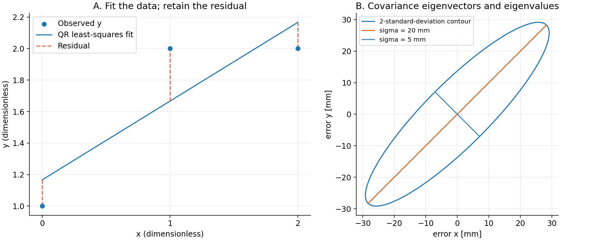
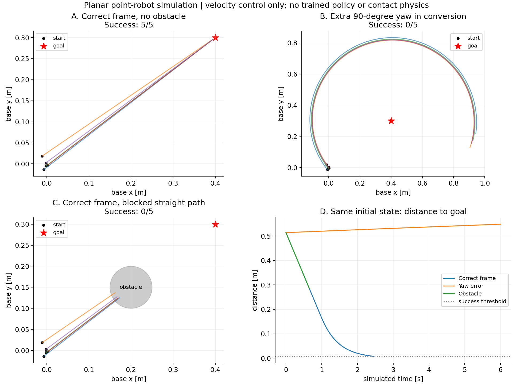
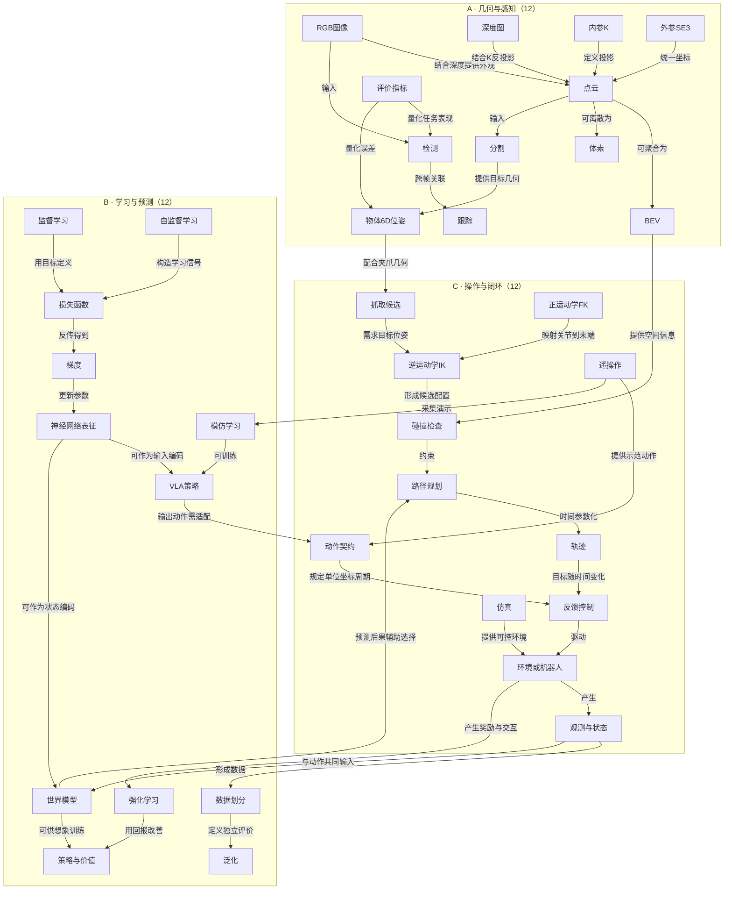

# D7 · 从“知道模块名称”到“能计算、能连接、能定位失败”

[返回学习入口](../_index.md) · [本周日程](../P1-第一周-扫盲日程.md) · [上一课：VLA、世界模型与BEV](../day6/Daily-Learning-Pack.md) · [数学与仿真实验](demo.py) · [PyTorch实验](torch_demo.py)

**第一阶段真正要建立的能力，是沿着“观测 → 表示 → 决策 → 动作 → 反馈”解释每个量的来源和意义，算清关键变换，并用实验区分算法能力、接口错误和评价漏洞。今天用数学、工具和一套闭环小仿真，把这条链条接牢。**

前六天已经给出 3D 表示、传感器、任务与指标、Learning、控制与操作、VLA 和世界模型的框架。现在回到机械臂抓杯子：即使检测框准确、模型输出正常，手仍可能伸错方向。问题可能是变换方向、动作单位、参数不可辨识、控制反馈，也可能是路径本身碰撞。

今天不会把数学写成独立于工程的术语表。旋转矩阵回答“同一方向在另一个坐标系怎样表示”；特征值回答“误差或变化在哪些方向被放大”；QR 回答“怎样从不完全一致的数据中估计参数”；自动微分回答“损失怎样影响参数”。最后把它们放进可运行的仿真，再进行 P1 的概念关系与闭卷回查。

<details>
<summary>个人学习记录（自动更新时保留）</summary>

<!-- learner-notes:start -->
**个人状态**：尚未提交本课答案或第一阶段验收；文件和代码已准备不等于本人已经掌握。

- 我的闭卷概念图：
- 我独立完成的手算：
- 我运行并修改的实验：
- 我实际读过的摘要与个人记录：
- 自测得分、错误原因与重做结果：
- 当前兴趣问题与可用资源：
<!-- learner-notes:end -->

</details>

<!-- daily-pack-generated:start -->

## 学习目标与路线

完成本课后，应能做到：

- 判断矩阵和向量的 shape 是否匹配，同时解释单位、参考系、时间戳是否匹配。
- 手算刚体变换、逆变换、点与位移向量的区别，并识别物体位姿和抓取位姿之间缺少的变换。
- 解释特征值、协方差、QR 与最小二乘在机器人系统中的实际用途。
- 从一个明确损失推导梯度，再用 CPU PyTorch 核对它；知道哪些操作会改变或切断梯度。
- 运行一个观测—控制—状态更新的小仿真，用受控改变量解释失败。
- 重建至少 30 个概念及其关系，整理摘要阅读证据与 P1 缺口，为 D8 的投影几何做好准备。

| 顺序 | 知识主线 | 要回答的问题 |
| --- | --- | --- |
| 1 | 宏观闭环 | 数学与工具分别在哪条数据边上发挥作用？ |
| 2 | 刚体变换 | 物体点、位移、旋转、抓取坐标怎样连接？ |
| 3 | 李群直觉 | 为什么不能随意给旋转矩阵加一个矩阵？ |
| 4 | 特征值与误差 | 哪个方向更不确定，误差怎样传播？ |
| 5 | QR 与优化 | 数据不完全一致或信息不足时，参数能否估计？ |
| 6 | 自动微分与张量 | 怎样验证公式、代码和训练目标一致？ |
| 7 | 仿真与故障定位 | 正确反馈为什么仍可能失败？ |
| 8 | 概念图、摘要与闭卷 | 哪些关系能独立解释，哪些还需要回查？ |

## 1. 宏观：把一周知识压缩成一条可以检查的链

### 1.1 在流程图的箭头上写出“传什么”


这是一种教学组合，不要求所有真实系统都把 VLA、世界模型和显式规划器同时放进去。关键是：**删掉或合并模块以后，原来由它负责的约束，必须仍有明确的处理位置。**

“端到端”描述某一段映射或训练方式，不能消除单位和执行周期；“有世界模型”描述存在预测器，不能证明碰撞检查可靠；“有 BEV”描述空间组织方式，不能证明所有灰色网格都可通行。

### 1.2 四个检查轴：shape、语义、时间、证据

假设模块输出 `[1,7]`，下游正好接收 `[1,7]`，仍至少存在四种不同问题：

| 检查轴 | 要核对的内容 | 同 shape 仍可能出现的错误 |
| --- | --- | --- |
| 数学形状 | batch、点数、通道、坐标维、动作维 | `[B,N,3]` 被当成 `[B,3,N]` |
| 物理语义 | 单位、参考系、绝对/增量/速度、夹爪定义 | 七关节角被当成末端六维增量加夹爪 |
| 时间对应 | 采样周期、观测年龄、动作实际执行时刻 | 图像和关节反馈来自不同瞬间 |
| 证据状态 | 合成/真实、训练/验证/测试、计划/已执行 | 发出动作被记为抓取成功 |

学习模型能改善某些误差，但不负责替你猜这些字段。本课所有算例都先固定这四个轴，再讨论计算是否正确。

## 2. 微观：刚体变换不是“把三个数换个名字”

### 2.1 列向量、坐标系与齐次坐标

本课使用列向量。记 $p_c\in\mathbb R^3$ 为一个点在相机系 $c$ 中的坐标，$p_b$ 为同一点在基座系 $b$ 中的坐标：

$$
p_b=R_{bc}p_c+t_{bc}.
$$

$R_{bc}\in\mathbb R^{3\times3}$ 把相机系方向表示为基座系方向；$t_{bc}\in\mathbb R^3$ 是相机原点在基座系的位置，单位 m。写成齐次形式：

$$
T_{bc}=
\begin{bmatrix}
R_{bc}&t_{bc}\\
0&1
\end{bmatrix},
\qquad
\bar p_b=T_{bc}\bar p_c,\quad
\bar p=[p^\top,1]^\top.
$$

底部的 1 让平移可以进入一次矩阵乘法。这里不是给空间额外增加一个自由度，而是换一种表达仿射运算的方式。

合法旋转满足：

$$
R^\top R=I,\qquad \det R=+1.
$$

正交条件保证长度和夹角；行列式条件排除反射。`diag(1,1,-1)` 虽然正交，但行列式为 −1，是镜像变换。

### 2.2 手算：一个相机点怎样回到基座

设：

$$
R_{bc}=
\begin{bmatrix}
0&-1&0\\
1&0&0\\
0&0&1
\end{bmatrix},
\quad
t_{bc}=
\begin{bmatrix}0.4\\0.1\\0\end{bmatrix}\mathrm m,
\quad
p_c=
\begin{bmatrix}0.2\\0\\0.6\end{bmatrix}\mathrm m.
$$

先旋转得到 $(0,0.2,0.6)$ m，再平移：

$$
p_b=(0.4,0.3,0.6)^\top\ \mathrm m.
$$

逆变换不是把 $t$ 简单取负：

$$
T_{cb}=T_{bc}^{-1}=
\begin{bmatrix}
R_{bc}^\top&-R_{bc}^\top t_{bc}\\
0&1
\end{bmatrix}.
$$

因为应先减去平移，再逆旋转：

$$
p_c=R_{bc}^\top(p_b-t_{bc}).
$$

可以用它做往返检查：$T_{cb}T_{bc}\bar p_c\approx\bar p_c$。往返检查能发现某些实现错误，但若正反两边共同使用同一份错误外参，依然可能互相抵消；还需要已知物理点验证。

### 2.3 点与位移向量不能使用同一条平移规则

对两个点取差：

$$
\Delta p_b
=p_{b,2}-p_{b,1}
=R_{bc}(p_{c,2}-p_{c,1})
=R_{bc}\Delta p_c.
$$

平移项抵消。因此点的齐次末位为 1；方向或位移向量的齐次末位为 0。

若相机系位移是 $(0.01,0,0)$ m，上面的旋转将它变成基座系 $(0,0.01,0)$ m。若错误地再加 $t_{bc}$，会把一厘米微调变成向相机原点位置附近的大幅跳转。

这是增量动作接口最常见的几何陷阱之一。对于速度，也要结合速度类型、参考点和坐标变换定义处理；完整刚体 twist 的变换比单独三维位移更复杂，不能把今天的位移公式不加条件地推广到所有六维速度。

### 2.4 变换组合有顺序，物体位姿还不是抓取位姿

若已知相机到基座 $T_{bc}$、物体到相机 $T_{co}$：

$$
T_{bo}=T_{bc}T_{co}.
$$

中间坐标下标 $c$ 衔接。若抓取坐标系 $g$ 相对物体的候选变换为 $T_{og}$：

$$
T_{bg}=T_{bc}T_{co}T_{og}.
$$

$T_{og}$ 描述夹爪应怎样相对物体摆放。它可能来自夹爪几何、抓取采样或学习模型，仍需检查宽度、接近方向、可达性和碰撞。只有目标点，不能唯一确定完整夹爪姿态。

矩阵乘法通常不交换。例如在二维中，令点 $p=(1,0)$，平移向量 $t=(1,0)$，旋转为 90°：

$$
R(p+t)=(0,2),\qquad Rp+t=(1,1).
$$

差异是实际几何差异，不是记号问题。

本节几何约定可对照 [Modern Robotics：齐次变换矩阵](https://modernrobotics.northwestern.edu/nu-gm-book-resource/3-3-1-homogeneous-transformation-matrices/)。本页数字和机器人例子是独立构造的练习。

## 3. 微观：李群与李代数，解决旋转更新的约束问题

### 3.1 为什么旋转不能像普通权重一样任意相加

一个旋转矩阵有 9 个元素，但自由度只有 3。9 个数必须共同满足正交和行列式约束。

取 $R=I$，绕 $z$ 轴一个小量 $\delta=0.1$，直接加反对称矩阵：

$$
R_{\mathrm{approx}}=
\begin{bmatrix}
1&-0.1&0\\
0.1&1&0\\
0&0&1
\end{bmatrix}.
$$

于是：

$$
R_{\mathrm{approx}}^\top R_{\mathrm{approx}}
=\operatorname{diag}(1.01,1.01,1),\qquad
\det R_{\mathrm{approx}}=1.01.
$$

它包含长度变化，已经不再是严格旋转。这种一阶表达可以用于局部推导，却不能无条件当作有限旋转长期累积。

### 3.2 把三个局部参数映射回合法旋转

$SO(3)$ 是三维旋转矩阵的集合。它既具有连续几何结构，也能通过乘法组合，因此是一个李群。今天先抓住工程意义：**旋转在受约束空间上，局部小更新可以用三维向量描述。**

对旋转向量 $\phi=(\phi_x,\phi_y,\phi_z)^\top$，定义：

$$
[\phi]_\times=
\begin{bmatrix}
0&-\phi_z&\phi_y\\
\phi_z&0&-\phi_x\\
-\phi_y&\phi_x&0
\end{bmatrix}.
$$

它满足 $[\phi]_\times p=\phi\times p$。令 $\theta=\|\phi\|$，通过矩阵指数：

$$
R=\exp([\phi]_\times)
=I+\frac{\sin\theta}{\theta}[\phi]_\times
+\frac{1-\cos\theta}{\theta^2}[\phi]_\times^2.
$$

这是 Rodrigues 公式。注意 `exp` 是矩阵指数，不是逐元素取指数。$\theta\rightarrow0$ 时两个系数分别趋向 1 和 $1/2$；代码使用小角度展开避免除零与相减损失精度。

取 $\phi=(0,0,0.1)$，结果是：

$$
R=
\begin{bmatrix}
\cos0.1&-\sin0.1&0\\
\sin0.1&\cos0.1&0\\
0&0&1
\end{bmatrix}.
$$

这一次长度和夹角保持。实现入口见实验中的 `rotation_vector`；完整机制可对照 [Modern Robotics：旋转的指数坐标](https://modernrobotics.northwestern.edu/nu-gm-book-resource/3-2-3-exponential-coordinates-of-rotation-part-2-of-2/)。

### 3.3 左乘和右乘，决定增量在哪个坐标系表达

两种更新：

$$
R_{\mathrm{new}}=\exp([\delta\phi_b]_\times)R,
\qquad
R_{\mathrm{new}}=R\exp([\delta\phi_c]_\times).
$$

前者的微小旋转在固定侧参考系表达，后者在随体侧参考系表达；记号和具体系统约定必须一起说明。不要只把这两种代码当成可以随手互换的写法。

对于一个已经绕 $z$ 转了 90° 的工具，沿工具 $x$ 的一厘米平移会对应基座 $y$，沿基座 $x$ 的一厘米平移则仍沿基座 $x$。这个直觉也提示你为什么“局部更新”必须写参考系。

三维刚体变换集合是 $SE(3)$。其局部参数可有 6 维，但这不等于“任意六个数都是同一种 pose”。旋转向量、欧拉角、位置加角度、twist、神经网络的旋转 6D 表示，需要分别识别。

尤其是 $SE(3)$ 指数映射的平移部分与旋转存在耦合；不能把局部六维向量的前三项不加说明地当作矩阵 $T$ 里的最终平移。P1 到这里应能识别对象、约束和更新方向；完整雅可比与位姿优化将在后续几何课程推导。

## 4. 微观：特征值究竟在告诉我们什么

### 4.1 沿特殊方向看线性变换

对方阵 $A$，若非零向量 $v$ 满足：

$$
Av=\lambda v,
$$

$v$ 是特征向量，$\lambda$ 是对应特征值。意思是：沿这个方向作用一次 $A$，方向保持在同一条直线上，变化集中体现为缩放或符号反转。

例子 $A=\operatorname{diag}(0.9,0.5)$：第一轴每次保留 90%，第二轴保留 50%。对离散误差系统 $e_{t+1}=Ae_t$，对应分量分别按 $0.9^t$、$0.5^t$ 衰减。

如果特征值是 −0.9，符号会交替，但幅度仍衰减；若为 1.1，则对应分量增长。多维系统可能有复特征值，对应旋转和缩放。**“负特征值意味着不稳定”并不是离散系统的一般规则。**

在线性、定常、离散系统里，所有特征值模严格小于 1 是渐近稳定的关键条件；实际非线性控制还要考虑局部有效域、饱和、延迟和时变性。矩阵短期也可能出现暂态放大，不能只凭一个数字忽略具体轨迹。

### 4.2 协方差的特征方向，就是分布的主要展开方向

对二维误差随机向量 $e$：

$$
C=\mathbb E[(e-\mu)(e-\mu)^\top].
$$

对观测样本，可用相应样本协方差估计；采用 $1/N$ 还是 $1/(N-1)$ 要说明估计约定。以下直接给出一个误差协方差，单位为 mm²：

$$
C=
\begin{bmatrix}
212.5&187.5\\
187.5&212.5
\end{bmatrix}.
$$

因为对角相同、非对角相同：

$$
v_1=\frac1{\sqrt2}(1,1)^\top,\quad\lambda_1=400,
\qquad
v_2=\frac1{\sqrt2}(-1,1)^\top,\quad\lambda_2=25.
$$

沿两方向的标准差是 $\sqrt{400}=20$ mm 和 $\sqrt{25}=5$ mm。误差不是一个圆，而是沿 45° 方向更长。

若只报“平均误差不错”，夹爪仍可能在某一接近方向容易失败；方向性误差有时比单一总分更能解释工程问题。

### 4.3 点云 PCA、误差协方差和参数不确定性不能混用

数学形式相似，不表示随机变量相同：

- 对点坐标计算协方差，描述几何形状的展开方向；平面点云的最小特征值方向可用于估计法向，但依赖局部平面、噪声与采样等条件。
- 对重复测量误差计算协方差，描述测量误差分布。
- 对参数估计构造近似协方差，描述模型与噪声假设下的参数不确定性。

一个物体很细长，不等于相机沿长轴一定测得不准；平面法向特征值小，也不能直接宣称所有外参都估计精确。**先确定协方差是对谁统计，再解释特征值。**



左图将在下一节解释拟合与残差；右图采用上面的协方差，画出沿主轴两倍标准差的轮廓。这是尺度示意，不直接称为 95% 置信区域；概率覆盖还取决于维度、分布假设和具体阈值。

基础定义与方向解释可回查 [MIT 线性代数：特征值与特征向量](https://ocw.mit.edu/courses/18-06sc-linear-algebra-fall-2011/resources/lecture-21-eigenvalues-and-eigenvectors/)。

## 5. 微观：把像素误差、标定误差算成操作误差

### 5.1 一像素有多大，取决于距离和焦距

从针孔模型反投影：

$$
X=\frac{(u-c_x)Z}{f_x}.
$$

暂时把 $f_x,c_x$ 看作固定量，对 $u,Z$ 求偏导：

$$
\frac{\partial X}{\partial u}=\frac Z{f_x},
\qquad
\frac{\partial X}{\partial Z}=\frac{u-c_x}{f_x}.
$$

当 $Z=1$ m、$f_x=600$ px 时，一像素对应约 1.667 mm 的横向变化。若 $u-c_x=60$ px、深度标准差为 5 mm，它对 $X$ 的标准差贡献约为 0.5 mm。

在小扰动、两项独立且均值偏差已另处理的假设下：

$$
\sigma_X^2
\approx
\left(\frac Z{f_x}\right)^2\sigma_u^2
+
\left(\frac{u-c_x}{f_x}\right)^2\sigma_Z^2.
$$

取 $\sigma_u=1$ px，得到：

$$
\sigma_X\approx\sqrt{1.667^2+0.5^2}
\approx1.740\ \mathrm{mm}.
$$

这是**单轴标准差估算**，不是最大误差或真实设备测评。若两项相关，应使用完整协方差的 $J\Sigma J^\top$，而不是直接相加方差；若存在系统偏差，也不能把它当作零均值噪声处理。

### 5.2 一度的外参旋转误差，为什么可能超过图像误差

对 $Rp$ 的小旋转误差：

$$
\delta p\approx\delta\phi\times(Rp).
$$

当误差轴与点方向垂直、杠杆臂长度 0.5 m、角误差为 1°：

$$
\|\delta p\|\approx0.5\times\frac{\pi}{180}
\approx8.73\ \mathrm{mm}.
$$

若转轴平行于该点方向，影响会更小；8.73 mm 是这个几何条件下的一阶量级，不是任何 1° 误差的固定后果。

这解释了一个常见现象：像素定位看起来准确，到了机械臂基座系却错过细小目标。提高检测分数之前，应该先量化几何链里哪一项主导了误差。

### 5.3 回查 D1/D2 的三个边界

| 容易说过头的话 | 更准确的说法 | 可检查的证据 |
| --- | --- | --- |
| “内参就是一个 K，标定结束了” | $K$ 与畸变参数分别定义；还需外参、时间与处理后图像对应关系 | 重投影、独立点检查、不同距离/视角的误差 |
| “点云渲染不可微，所以几何不能学习” | 可微性取决于具体操作及求导变量 | 是对点坐标、颜色、特征还是相机参数求导？ |
| “物体 6D 位姿就是抓取的六个数” | 物体、夹爪、动作与旋转表示各有定义 | 是否给出 $T_{og}$、动作模式、参考系和单位？ |

相机参数的模型与接口可参见 [OpenCV：相机标定与三维重建](https://docs.opencv.org/4.x/d9/d0c/group__calib3d.html)。本节没有给用户设备标定质量作出判断；真实误差必须来自独立量测。

## 6. 微观：QR 与最小二乘，让“估计参数”变成可解释的几何

### 6.1 为什么不能要求每条带噪数据都完全满足模型

用一条直线解释三个无量纲样本：

$$
(x,y)=(0,1),(1,2),(2,2),\qquad
y\approx\beta_0+\beta_1x.
$$

写成：

$$
A=
\begin{bmatrix}1&0\\1&1\\1&2\end{bmatrix},
\quad
\beta=
\begin{bmatrix}\beta_0\\\beta_1\end{bmatrix},
\quad
y=
\begin{bmatrix}1\\2\\2\end{bmatrix}.
$$

$A$ 是 $[3,2]$，$\beta$ 为 $[2,1]$，$y$ 为 $[3,1]$。三个点不共线，因此一般不存在 $A\beta=y$ 的精确解。最小二乘改问：

$$
\hat\beta=\arg\min_\beta\|A\beta-y\|_2^2.
$$

几何意义是把 $y$ 投影到 $A$ 的列空间中，得到能由模型表示的最佳近似。

### 6.2 QR 把“相关的列”换成“正交的坐标”

薄 QR 分解：

$$
A=QR_{\mathrm{qr}},\qquad
Q\in\mathbb R^{3\times2},\quad Q^\top Q=I_2,
\quad
R_{\mathrm{qr}}\in\mathbb R^{2\times2}.
$$

这里 $R_{\mathrm{qr}}$ 是上三角矩阵，**不是前面表示空间旋转的 $R_{bc}$**。QR 名称相同的字母不能跨语境混用。

对本例第一列归一化：

$$
q_1=\frac1{\sqrt3}(1,1,1)^\top.
$$

第二列 $a_2=(0,1,2)^\top$ 在 $q_1$ 上的投影系数为 $\sqrt3$。减掉投影：

$$
u_2=a_2-\sqrt3q_1=(-1,0,1)^\top,\quad
q_2=\frac1{\sqrt2}(-1,0,1)^\top.
$$

因此：

$$
R_{\mathrm{qr}}=
\begin{bmatrix}
\sqrt3&\sqrt3\\
0&\sqrt2
\end{bmatrix},
\qquad
Q^\top y=
\begin{bmatrix}
5/\sqrt3\\
1/\sqrt2
\end{bmatrix}.
$$

解上三角系统 $R_{\mathrm{qr}}\beta=Q^\top y$：

$$
\hat\beta_1=\frac12,\qquad
\hat\beta_0=\frac76.
$$

先算最后一行，再回代第一行，就是 back substitution（回代）。

### 6.3 为什么投影后解这个系统就足够

把误差分成列空间内部和正交补两个部分：

$$
\|A\beta-y\|^2
=
\|R_{\mathrm{qr}}\beta-Q^\top y\|^2
+
\|(I-QQ^\top)y\|^2.
$$

第二项与 $\beta$ 无关，表示模型无法解释的数据分量。最小化只需让第一项为零，前提是上三角系统可解。

取残差 $r=y-A\hat\beta$：

$$
r=(-1/6,\ 1/3,\ -1/6)^\top,\qquad
\|r\|=\sqrt{1/6}\approx0.408248.
$$

它满足：

$$
A^\top r=0.
$$

这给出了比“程序没有报错”更有意义的验证：残差应该与设计矩阵的每一列正交。上一节图中的红色虚线显示每个样本的残差。

### 6.4 信息不足和数值不稳，是两件相关但不同的事

若所有 $x=1$，$A$ 两列相同，只能辨认 $\beta_0+\beta_1$，无法分别确定截距和斜率。增加同一位置的数据数量，也不会产生原本缺失的方向信息。

如果 $x$ 只在非常窄的区间变化，两列可能接近相关。数学上或许仍有唯一解，但对数据噪声和浮点误差敏感。

正规方程：

$$
(A^\top A)\beta=A^\top y
$$

有助于推导，但显式形成 $A^\top A$ 会在满列秩、二范数条件下把条件数平方：

$$
\kappa_2(A^\top A)=\kappa_2(A)^2.
$$

QR 避免这一步，但不是所有 QR 实现都同样稳定。教学脚本使用小规模修正 Gram–Schmidt，真实工程通常使用经过验证的 Householder QR、带主元的方法或 SVD，并检查秩、残差和尺度。

**把求逆换成更强的库函数，不能凭空创造缺失数据。** 点几乎共线、标定姿态缺少变化、动力学训练中动作总为零，都会形成不同程度的不可辨识问题。

基础流程可回查 [MIT：正交矩阵与 Gram–Schmidt](https://ocw.mit.edu/courses/18-06sc-linear-algebra-fall-2011/pages/least-squares-determinants-and-eigenvalues/orthogonal-matrices-and-gram-schmidt/)；张量实现可使用 [PyTorch 的最小二乘接口](https://docs.pytorch.org/docs/2.14/generated/torch.linalg.lstsq.html)，具体 driver 与设备条件应按安装版本检查。

## 7. 微观：从梯度手算到 PyTorch，区分数学目标与代码行为

### 7.1 同一个问题，也可以用梯度下降求解

继续使用上面的数据，取：

$$
L(\beta)=\frac1{2N}\|A\beta-y\|^2,\qquad N=3.
$$

链式法则得到：

$$
\nabla_\beta L
=\frac1N A^\top(A\beta-y).
$$

在 $\beta=(0,0)^\top$ 时：

$$
\nabla_\beta L
=(-5/3,-2)^\top.
$$

若学习率 $\eta=0.2$，一步更新为：

$$
\beta^+=\beta-\eta\nabla L=(1/3,0.4)^\top.
$$

QR 是直接求解这个小线性最小二乘问题；梯度下降是沿目标函数逐步更新。深度网络通常没有同样简单的线性闭式解，但训练仍需要明确损失、梯度和更新规则。

### 7.2 自动微分不是“框架自动判断你的任务”

自动微分沿已构建的计算图应用链式法则。它可以正确计算一个**写错了语义的函数**的导数。

例如：

```python
prediction = A @ beta       # [N, 1]
loss = 0.5 * (prediction - y).square().mean()
loss.backward()            # 把梯度累积到需要梯度的叶子张量
optimizer.step()           # 按优化器规则更新参数
```

如果 $y$ 实际为 `[N]`，而 prediction 是 `[N,1]`，广播可能把差值扩展成 `[N,N]`，不再是一一对应的残差。代码可能继续运行，损失也可能下降，任务却已经变了。

因此 shape 检查应写在损失前：

```python
assert prediction.shape == y.shape == (N, 1)
```

`backward()` 通常累积梯度，所以独立更新前要清零；如果有意做梯度累积，则应按设定管理批次和缩放。前向、反向和更新是三个不同动作。

### 7.3 几个工具语义要明确

| 操作 | 实际作用 | 容易混淆之处 |
| --- | --- | --- |
| `requires_grad=True` | 要求跟踪相应张量的梯度 | 不是自动选择合适训练目标 |
| `detach()` | 得到不继续沿原图反传的张量 | 适合记录值；放错位置可能断开训练链 |
| `torch.no_grad()` | 在作用域中停止记录反向图 | 不等于切换所有模块的训练/推理行为 |
| `model.eval()` | 切换会依赖模式的模块行为 | 本身不等于关闭梯度 |
| `optimizer.zero_grad()` | 清理上一次梯度累积 | 不能代替前向或参数更新 |
| `torch.linalg.lstsq` | 按线性最小二乘求解 | 不会自动修复数据泄漏和物理字段错误 |

可核对 [PyTorch 自动微分教程](https://docs.pytorch.org/tutorials/beginner/basics/autogradqs_tutorial.html)。本课附带代码固定 CPU 和 float64，便于与手算核对；不是在规定所有深度模型都应该用双精度训练。

### 7.4 可微性要问“对谁、经过什么操作”

考虑点特征 $f_i$ 被聚合到网格：

$$
b_j=\sum_{i:\,\operatorname{cell}(p_i)=j}f_i.
$$

如果网格归属固定，对特征 $f_i$ 求导是明确的；但由 floor 得到的 `cell(p)` 对位置的小变化通常保持不变，在边界处突变，不能期待它给出平滑的位置梯度。

若改成连续权重聚合：

$$
b_j=\sum_i w_j(p_i)f_i,
$$

只要 $w_j$ 的定义具有相应可微性质，就可能把梯度传到位置。此时又引入了核宽度、可见性、遮挡等建模选择。

同样，分类的置换不变与分割的置换等变是输出关系，不是可微性的同义词：

$$
f(PX)=f(X)\quad\text{（整云分类）},
\qquad
g(PX)=Pg(X)\quad\text{（逐点输出）}.
$$

$P$ 重排输入点。分割结果应该随点一起重排，而不是在数组位置上完全不变。

### 7.5 Learning 三对象的五格卡，重新定位训练

| 五格问题 | 目标检测/分割 | 模仿学习或 VLA 策略 | 世界模型 |
| --- | --- | --- | --- |
| 数据从哪来 | 图像/点云及相应标注或其他监督 | 观测、语言、状态与演示动作 | 观测/状态、动作和后续转移 |
| 学什么 | 目标、类别、区域或点标签 | 条件动作分布 | 条件未来状态或潜表征 |
| 改善信号 | 任务相应的分类、回归等损失 | 动作误差、token 损失或生成式目标 | 预测误差及模型相应目标 |
| 训练/推理差别 | 标注在部署时不可用 | 专家未来动作在部署时不可用 | 真实未来在 rollout 中不可反复偷看 |
| 泛化怎么测 | 按场景、对象和协议划分 | 新初态、新对象与闭环成功 | 新状态动作、扰动、不同预测跨度 |

结构名称不回答监督来源。CNN、Transformer 可以出现在不同列；有 reward 字段也不等于已经进行强化学习。

## 8. 工程：用一个最小仿真把输入、动作与反馈接起来

### 8.1 本课仿真的物理边界

这里模拟平面中的**点机器人**接近目标。它保留位置、速度命令、坐标变换、限速、碰撞终止和时间截断；不模拟机械臂关节、惯性、夹爪、RGB 渲染或接触力。

我们把上游感知简化为理想的“相机平面坐标中的目标相对位移”。因此这是传感器接口的数学代理，不应称作真实 RGB-D 检测系统。

状态：

$$
p_t=(x_t,y_t)^\top\in\mathbb R^2,\qquad \text{单位 m}.
$$

目标 $p_g=(0.4,0.3)$ m，真实相机相对基座偏航为 90°。观测：

$$
o_t=R_{bc}^\top(p_g-p_t)\in\mathbb R^2.
$$

控制器只接收这个二维观测，不直接读取仿真器内部的真实世界位置；世界位置仅用于动力学、评价和绘图。

### 8.2 闭环控制与离散状态更新

控制器使用估计旋转 $\hat R_{bc}$：

$$
u_t=k\hat R_{bc}o_t,\qquad k=2\ \mathrm{s^{-1}}.
$$

这里 $u_t$ 是速度，单位 m/s。执行前做范数限幅：

$$
\bar u_t=u_t\min\left(1,\frac{u_{\max}}{\|u_t\|}\right),
\qquad u_{\max}=0.35\ \mathrm{m/s}.
$$

零向量单独按零处理；代码用小分母保护。状态更新：

$$
p_{t+1}=p_t+\Delta t\,\bar u_t,\qquad \Delta t=0.05\ \mathrm s.
$$

在无饱和、正确坐标和理想观测时：

$$
e_{t+1}=(1-k\Delta t)e_t=0.9e_t,\qquad e_t=p_g-p_t.
$$

这把特征值和控制联系起来了：两个轴的离散误差乘子都是 0.9。开始时速度可能饱和，不能把这条局部线性递推不加条件地用于整个轨迹。

### 8.3 坐标旋转错了，为什么反馈可能不再缩小误差

若 $\hat R_{bc}R_{bc}^\top=R_\delta$，忽略饱和时：

$$
e_{t+1}=(I-k\Delta t R_\delta)e_t.
$$

在二维中，这个更新对任意方向的长度缩放因子为：

$$
q=\sqrt{1-2h\cos\delta+h^2},\qquad h=k\Delta t.
$$

于是收缩要求 $q<1$。取 $h=0.1$：

- $\delta=0$：$q=0.9$，方向正确。
- $\delta=20^\circ$：仍然收缩，但有旋转成分，路径和步数改变。
- $\delta=90^\circ$：$q=\sqrt{1.01}>1$，理想无饱和离散误差不再缩小。

这不是“坐标差一点都必然完全失败”。它说明误差大小、增益、周期和离散更新共同影响行为。本课实测使用限速，因此完整轨迹以仿真输出为准。

### 8.4 到达、碰撞和时间截断是不同事件

本课成功条件是距离小于 8 mm，且没有碰撞或越界。障碍物实验把圆心 $(0.2,0.15)$ m、半径 0.05 m 的圆放在直线路径上。每步检查上一位置到新位置的整条线段是否穿过圆，避免只看终点而漏掉穿越。

```text
reset(seed) -> observation, info
step(action) -> observation, reward, terminated, truncated, info
```

`terminated` 表示达到任务定义的终止状态，如成功、碰撞或工作空间越界；`truncated` 表示达到外部步数上限，本课为 120 步。后者不是“任务本身进入终止物理状态”的同义词。

该返回形式参考 [Gymnasium 环境接口](https://gymnasium.farama.org/api/env/)，但我们的类没有继承或注册为 Gymnasium Env，也没有安装该依赖。后续接入真实框架还需定义 observation/action spaces 和运行官方检查器。

reward 定义为归一化距离的负值，加成功奖励、减碰撞惩罚。这里它仅被记录，**控制器的参数没有通过 reward 学习**。因此运行环境加手写控制器，不应被标成“已经训练 RL”。

### 8.5 受控实验的结果与结论



图 A/B/C 分别显示相同五组初态的轨迹；为看清运动，各子图坐标范围按轨迹显示，请读轴上的数值。图 D 对比同一个初态的目标距离。横轴是仿真时间，不是模型运行耗时。

| 实验 | 唯一主要改动 | 成功数/尝试数 | 总交互步数 | 终止原因 |
| --- | --- | --- | --- | --- |
| 正确坐标、无障碍 | 基线 | 5/5 | 242 | 到达阈值 |
| 坐标额外旋转 90° | 只改控制器的坐标转换 | 0/5 | 600 | 达到步数上限 |
| 正确坐标、路径有障碍 | 只加入固定障碍物 | 0/5 | 61 | 碰撞 |

五组起点使用种子 7–11，每个坐标在 $[-0.02,0.02]$ m 内均匀采样，目标与控制参数保持一致。数据和动力学都是合成的，5/5 不能解释为真实机器人 100% 成功。

两个失败给出不同工程行动：

- 坐标错误应检查变换定义和数据链，不应先训练更复杂策略。
- 直线有障碍时，反馈方向正确也不会自动绕行；需要规划、避障或具备相应能力的策略。提高控制增益无法把几何不可行的直线路径变成可行路径。

如果再加入世界模型，可以用于评估候选运动后果；但仍要检查模型是否真实看到了障碍和动作。一个不会表达障碍的状态预测器，不能只凭低位置误差承担碰撞判断。

## 9. 动手：先手算，再运行，再验证改变的原因

### 9.1 三个开始前的预测

先不运行代码，在个人记录区写下：

1. 相机点 $(0.2,0,0.6)$ 经过本课变换后的位置，以及逆变换顺序。
2. 直线最小二乘的两个参数；为什么残差不会全为零？
3. 三组仿真中，哪组会到达、哪组会超时、哪组会碰撞？分别缺少了什么能力或正确条件？

### 9.2 CPU 标准库入口

在笔记库根目录执行：

```bash
python3 -B 3d_learning/day7/demo.py --output _assets/3d_learning/day7/results.json
```

无需额外 Python 包、GPU、数据下载或机器人。`-B` 避免产生字节码缓存。终端会打印环境、变换结果、QR 参数、三组成功数/尝试数及检查结果；逐步轨迹、执行步数和控制计算计时写入 [results.json](../../_assets/3d_learning/day7/results.json)。

更换初态种子：

```bash
python3 -B 3d_learning/day7/demo.py --seed 23
```

该命令只输出终端，不覆盖默认结果。记录里 23 表示随后使用 23–27 五个初态种子。

### 9.3 只改变一个变量，并作出解释

| 改变量 | 怎么改 | 先预测什么 | 验证方式 |
| --- | --- | --- | --- |
| 旋转误差 | 将实验列表中的 `90` 改为 `20` | 会完全失败还是变慢到达？ | 比较到达步数和轨迹 |
| 障碍位置 | 把圆心从 `[0.2,0.15]` 移到远离直线处 | 是否仍应碰撞？ | 检查轨迹与线段距离 |
| 参数信息 | 将 QR 设计矩阵第二列改成全 1 | 解是否还能唯一确定？ | 应拒绝相关列，而不是输出貌似精确的参数 |
| 动作模式 | 在纸上把速度误当位移直接相加 | 0.05 s 周期下每步会放大多少？ | 对照正确的 `dt * velocity` |

上述动作模式改动只用于这个合成环境。实际机器人动作模式不可通过试错猜测。

**已执行的改变量结果：**种子 7 时，正确坐标 49 步到达；20° 坐标误差 53 步到达；90° 误差 120 步超时，终点距离约 0.548645 m。将起点种子换为 23–27，三组结果仍分别为 5/5、0/5、0/5。这些是当前合成任务的现象，不是对任意任务的保证。

### 9.4 PyTorch 核对：用不同求解路径验证同一数学问题

在已有 PyTorch 的 Python 环境中运行：

```bash
python -B 3d_learning/day7/torch_demo.py
```

本次使用已有环境的 Python 3.11.15、PyTorch `2.13.0.dev20260423`，固定 CPU、float64 和随机种子 7。没有为了本课安装或升级依赖；这个实际版本记录也不是对你其他环境的升级建议。

实验比较三个结果：

| 检查项 | 结果 |
| --- | --- |
| 初始 autograd 梯度 | $(-1.6666667,-2)$，与手算一致 |
| 500 次 SGD 更新 | $\beta\approx(1.1666667,0.5)$ |
| `torch.linalg.lstsq` | 与 QR 和 SGD 结果一致到设定容差 |
| 最终 $L=\|A\beta-y\|^2/(2N)$ | $1/36\approx0.0277778$ |

没有 PyTorch 的解释器仍可运行标准库实验并手算梯度。要运行张量扩展，先切换到已有兼容环境并核对 `python -c "import torch; print(torch.__version__)"` 的输出；不要求把所有深度学习框架装进当前默认解释器。

### 9.5 绘图与验证边界

两张图由 [plot_demo.py](plot_demo.py) 生成，依赖 NumPy 与 Matplotlib。当前使用既有 Matplotlib 3.10.9 环境验证。若解释器已有依赖：

```bash
python -B 3d_learning/day7/plot_demo.py
```

绘图脚本读取默认结果文件，不重新运行控制实验。数学图中的协方差是明确定义的示例矩阵，不是由这五次控制实验统计得到。

**已确认，2026-09-11：**标准库脚本在 Python 3.14.3 / macOS 执行通过；另完成零/极小/一般旋转向量的正交检查、逆变换往返、QR 残差正交、相关列拒绝、限速和非数动作拒绝检查。PyTorch 梯度与最小二乘核对通过。

结果中的 `controller_mean_us` 只测这段 Python 速度计算的本机耗时，不包含感知、通信或设备执行；短函数计时受测量开销和系统状态影响，不能当成机器人端到端时延。仿真没有交互训练预算，只有上述评价交互步数。

### 9.6 完整最小代码

先阅读 `rotation_vector`、`qr_fit` 和 `PlanarReach.step`，再看控制器和实验汇总。以下代码与同目录文件一致。

> [!note]- 完整可复制代码：demo.py
>
> ```python
> #!/usr/bin/env python3
> """Day 7: rotation, QR fitting and a planar sensor-control simulator.
>
> Standard library only. Point robot, velocity command, no contact dynamics.
> All positions in metres, velocity in m/s, rotation angles in radians.
> """
> import argparse
> import json
> import math
> import platform
> import random
> import time
> from pathlib import Path
>
>
> def dot(a, b):
>     return sum(x * y for x, y in zip(a, b))
>
>
> def matvec(a, x):
>     return [dot(row, x) for row in a]
>
>
> def transpose(a):
>     return list(map(list, zip(*a)))
>
>
> def matmul(a, b):
>     return [[dot(row, col) for col in zip(*b)] for row in a]
>
>
> def rotation_vector(w):
>     theta = math.sqrt(dot(w, w))
>     x, y, z = w
>     skew = [[0, -z, y], [z, 0, -x], [-y, x, 0]]
>     square = matmul(skew, skew)
>     if theta < 1e-8:
>         aa, bb = 1 - theta * theta / 6, 0.5 - theta * theta / 24
>     else:
>         aa, bb = math.sin(theta) / theta, (1 - math.cos(theta)) / theta**2
>     return [[float(i == j) + aa * skew[i][j] + bb * square[i][j]
>              for j in range(3)] for i in range(3)]
>
>
> def qr_fit(design, target):
>     # Modified Gram-Schmidt for a small full-column-rank teaching example.
>     columns = transpose(design)
>     q = []
>     count = len(columns)
>     r = [[0.0] * count for _ in range(count)]
>     for j, col in enumerate(columns):
>         v = col[:]
>         for i, qi in enumerate(q):
>             r[i][j] = dot(qi, v)
>             v = [a - r[i][j] * b for a, b in zip(v, qi)]
>         r[j][j] = math.sqrt(dot(v, v))
>         if r[j][j] <= 1e-12 * max(1.0, math.sqrt(dot(col, col))):
>             raise ValueError("columns are dependent or numerically unresolved")
>         q.append([a / r[j][j] for a in v])
>     qty = [dot(qi, target) for qi in q]
>     beta = [0.0] * count
>     for j in reversed(range(count)):
>         beta[j] = (qty[j] - sum(r[j][k] * beta[k]
>                                for k in range(j + 1, count))) / r[j][j]
>     residual = [y - yp for y, yp in zip(target, matvec(design, beta))]
>     return {"beta": beta, "Q": transpose(q), "R": r, "residual": residual,
>             "residual_norm": math.sqrt(dot(residual, residual))}
>
>
> def segment_distance(a, b, center):
>     delta = [y - x for x, y in zip(a, b)]
>     length2 = dot(delta, delta)
>     fraction = 0.0 if length2 == 0 else max(
>         0.0, min(1.0, dot([c - x for c, x in zip(center, a)], delta) / length2))
>     closest = [x + fraction * d for x, d in zip(a, delta)]
>     return math.dist(closest, center)
>
>
> class PlanarReach:
>     """reset/step-style teaching interface; not a registered Gymnasium Env."""
>     dt, max_speed, threshold, max_steps = 0.05, 0.35, 0.008, 120
>     goal = [0.4, 0.3]
>     camera_yaw = math.pi / 2
>     obstacle_center, obstacle_radius = [0.2, 0.15], 0.05
>
>     def __init__(self, obstacle=False):
>         self.obstacle = obstacle
>         self.finished = True
>
>     def observation(self):
>         # Camera-frame target displacement; the policy does not read world p.
>         world_error = [g - p for g, p in zip(self.goal, self.position)]
>         c, s = math.cos(self.camera_yaw), math.sin(self.camera_yaw)
>         return [c * world_error[0] + s * world_error[1],
>                 -s * world_error[0] + c * world_error[1]]
>
>     def reset(self, seed=7):
>         rng = random.Random(seed)
>         self.position = [rng.uniform(-0.02, 0.02) for _ in range(2)]
>         self.steps, self.finished = 0, False
>         return self.observation(), {"seed": seed}
>
>     def step(self, velocity):
>         if self.finished:
>             raise RuntimeError("reset is required before another step")
>         if len(velocity) != 2 or not all(math.isfinite(v) for v in velocity):
>             raise ValueError("velocity must contain two finite values")
>         norm = math.sqrt(dot(velocity, velocity))
>         scale = min(1.0, self.max_speed / max(norm, 1e-12))
>         actual = [v * scale for v in velocity]
>         old = self.position[:]
>         self.position = [p + self.dt * v for p, v in zip(old, actual)]
>         self.steps += 1
>         collision = self.obstacle and segment_distance(
>             old, self.position, self.obstacle_center) <= self.obstacle_radius
>         distance = math.dist(self.position, self.goal)
>         outside = any(abs(p) > 1 for p in self.position)
>         success = distance < self.threshold and not collision and not outside
>         terminated = success or collision or outside
>         truncated = self.steps >= self.max_steps and not terminated
>         self.finished = terminated or truncated
>         reason = ("success" if success else "collision" if collision else
>                   "workspace" if outside else "timeout" if truncated else "running")
>         # Dimensionless cost uses a reference length of 1 metre.
>         reward = -distance / 1.0 + float(success) - float(collision)
>         info = {"distance_m": distance, "reason": reason, "success": success,
>                 "executed_velocity_m_s": actual}
>         return self.observation(), reward, terminated, truncated, info
>
>
> def episode(seed, yaw_bias_deg=0.0, obstacle=False):
>     env = PlanarReach(obstacle)
>     obs, _ = env.reset(seed)
>     records = [{"step": 0, "position_m": env.position[:],
>                 "distance_m": math.dist(env.position, env.goal)}]
>     controller_times = []
>     while not env.finished:
>         start = time.perf_counter()
>         yaw = env.camera_yaw + math.radians(yaw_bias_deg)
>         c, s = math.cos(yaw), math.sin(yaw)
>         velocity = [2 * (c * obs[0] - s * obs[1]),
>                     2 * (s * obs[0] + c * obs[1])]
>         controller_times.append(time.perf_counter() - start)
>         obs, reward, terminated, truncated, info = env.step(velocity)
>         records.append({"step": env.steps, "position_m": env.position[:],
>                         "distance_m": info["distance_m"], "reward": reward})
>     return {"seed": seed, "yaw_bias_deg": yaw_bias_deg, "obstacle": obstacle,
>             "success": info["success"], "reason": info["reason"],
>             "terminated": terminated, "truncated": truncated, "steps": env.steps,
>             "controller_mean_us": 1e6 * sum(controller_times) / len(controller_times),
>             "records": records}
>
>
> def run(seed=7):
>     rotation = rotation_vector([0, 0, math.pi / 2])
>     point = [0.2, 0, 0.6]
>     translation = [0.4, 0.1, 0]
>     base = [a + b for a, b in zip(matvec(rotation, point), translation)]
>     recovered = matvec(transpose(rotation), [a - b for a, b in zip(base, translation)])
>     assert math.dist(recovered, point) < 1e-12
>     fit = qr_fit([[1, 0], [1, 1], [1, 2]], [1, 2, 2])
>     assert math.dist(fit["beta"], [7 / 6, 0.5]) < 1e-12
>     assert max(abs(x) for x in matvec([[1, 1, 1], [0, 1, 2]],
>                                      fit["residual"])) < 1e-12
>     try:
>         qr_fit([[1, 1], [1, 1], [1, 1]], [1, 2, 2])
>     except ValueError:
>         pass
>     else:
>         raise AssertionError("rank-deficient data must be rejected")
>     assert segment_distance([0, 0], [1, 0], [0.5, 0]) == 0
>     experiments = {}
>     for name, bias, obstacle in [("correct_frame", 0, False),
>                                  ("yaw_error_90deg", 90, False),
>                                  ("straight_line_obstacle", 0, True)]:
>         episodes = [episode(seed + i, bias, obstacle) for i in range(5)]
>         experiments[name] = {"successes": sum(e["success"] for e in episodes),
>                              "attempts": len(episodes),
>                              "interaction_steps": sum(e["steps"] for e in episodes),
>                              "episodes": episodes}
>     return {"environment": {"python": platform.python_version(), "os": platform.system(),
>                             "seed_start": seed, "data": "synthetic", "device": "CPU"},
>             "geometry": {"R_base_camera": rotation, "t_base_camera_m": translation,
>                          "point_camera_m": point, "point_base_m": base,
>                          "round_trip_error_m": math.dist(recovered, point)},
>             "qr": fit, "simulation": experiments, "checks": "passed"}
>
>
> if __name__ == "__main__":
>     parser = argparse.ArgumentParser(description=__doc__)
>     parser.add_argument("--seed", type=int, default=7)
>     parser.add_argument("--output", type=Path)
>     args = parser.parse_args()
>     report = run(args.seed)
>     if args.output:
>         args.output.parent.mkdir(parents=True, exist_ok=True)
>         args.output.write_text(json.dumps(report, indent=2, allow_nan=False) + "\n")
>     print("Environment:", report["environment"])
>     print("Base point:", report["geometry"]["point_base_m"])
>     print("QR beta:", report["qr"]["beta"], "residual norm:", report["qr"]["residual_norm"])
>     for name, case in report["simulation"].items():
>         print(name, f"{case['successes']}/{case['attempts']}",
>               "steps:", case["interaction_steps"],
>               "reasons:", [e["reason"] for e in case["episodes"]])
>     print("Numerical checks:", report["checks"])
> ```

> [!note]- 完整可复制代码：torch_demo.py
>
> ```python
> #!/usr/bin/env python3
> """CPU autograd cross-check for Day 7's analytical least-squares example."""
> import json
> import torch
>
> torch.set_num_threads(1)
> torch.manual_seed(7)
> dtype = torch.float64
> x = torch.tensor([[1., 0.], [1., 1.], [1., 2.]], dtype=dtype, device="cpu")
> y = torch.tensor([[1.], [2.], [2.]], dtype=dtype, device="cpu")
> theta = torch.zeros((2, 1), dtype=dtype, device="cpu", requires_grad=True)
> prediction = x @ theta
> assert prediction.shape == y.shape == (3, 1)
> loss = 0.5 * (prediction - y).square().mean()
> loss.backward()
> initial_gradient = theta.grad.detach().clone()
> expected_gradient = torch.tensor([[-5 / 3], [-2.]], dtype=dtype)
> assert torch.allclose(initial_gradient, expected_gradient)
>
> optimizer = torch.optim.SGD([theta], lr=0.2)
> for _ in range(500):
>     optimizer.zero_grad(set_to_none=True)
>     prediction = x @ theta
>     loss = 0.5 * (prediction - y).square().mean()
>     loss.backward()
>     optimizer.step()
>
> with torch.no_grad():
>     reference = torch.linalg.lstsq(x, y).solution
>     final_loss = 0.5 * (x @ theta - y).square().mean()
>     assert torch.allclose(theta, reference, atol=1e-8, rtol=1e-8)
> print(json.dumps({"torch": torch.__version__, "device": str(theta.device),
>                   "dtype": str(dtype), "seed": 7, "iterations": 500,
>                   "initial_gradient": initial_gradient.flatten().tolist(),
>                   "fitted_beta": theta.detach().flatten().tolist(),
>                   "lstsq_beta": reference.flatten().tolist(),
>                   "final_loss": final_loss.item(), "checks": "passed"}, indent=2))
> ```

## 10. 回到宏观：把至少 30 个概念连成有方向的关系图

### 10.1 先画自己的图，再看参考图

概念图的评分对象是**关系是否正确**，不是模型名数量。每条边应能读成一句话，例如“深度结合内参反投影成点云”“专家动作监督条件策略”“世界模型在动作条件下预测下一状态”。

下图包含 36 个概念节点，分成三个区域。跨区域箭头说明感知、学习和执行并不是互不相干的知识岛。它是参考答案之一，不要求照抄布局。



图里的“可”“辅助”很重要：不是每个系统都必须经过这条边。例如 BEV 可以辅助碰撞，但单纯点计数不够；世界模型可以辅助规划，但不是所有预测器都具备可用精度。

### 10.2 五个领域各说清一个闭环问题

| 领域 | 应能解释的问题 | 合格回答必须包含 |
| --- | --- | --- |
| RL | 策略为什么会改变下一次看到的数据？ | 动作影响状态分布；回报用于改善策略；离线指标与闭环区别 |
| 仿真 | 环境究竟提供了什么？ | 状态转移、观测、动作、奖励、reset 与终止；物理边界 |
| 多模态 | RGB、深度、语言、触觉怎样共同帮助任务？ | 信息互补、对齐条件、融合位置和缺失模态 |
| 控制 | 已知目标为什么还需要反馈？ | 执行误差与扰动；误差、采样周期、动作定义 |
| 导航 | 找到目标为什么不等于能到达？ | 定位/地图、可通行性、路径/轨迹、局部执行与动态障碍 |

自驾可以作为导航、跟踪和 BEV 的系统例子，但后续第四个项目已经选择多臂协作；这里不更改项目分支。

### 10.3 三条必须跨区域解释的关系

1. **感知误差 → 动作结果。** 目标像素经过深度和外参成为抓取目标；单位或旋转误差最终可能表现为未抓住。
2. **数据分布 → 闭环性能。** 模仿学习只在专家轨迹附近表现好，部署时偏离后可能遇到训练未覆盖的观测；不能只看动作 MSE。
3. **预测表示 → 决策可用性。** 世界模型若只保留位置而丢掉接触或障碍信息，预测位置准确也未必足够规划操作。

## 11. 论文工具回查：让摘要记录成为能复用的证据

### 11.1 一篇记录至少回答五个问题

不要把摘要复制成笔记。用下面的阅读顺序形成自己的解释：

1. 核对题目、作者、年份和原始链接，确认论文身份。
2. 读摘要与主图，写出输入、输出、关键中间量。
3. 找到它实际优化的目标，以及实验在验证什么主张。
4. 找到一项局限：数据、平台、任务、传感器、计算或评价范围。
5. 写出与当前抓杯子管线的连接，以及一个尚未验证的迁移问题。

论文正文、项目页和代码仓库各有作用：正文说明方法与实验协议，项目页帮助定位架构与演示，源码回答接口和具体计算。名字类似、作者相同或演示漂亮，都不能代替身份与版本核对。

若用文献管理器，把原始 URL/DOI、题目和年份保存为条目元数据；笔记中保留可直接打开的来源。代码复现时额外记录 commit、checkpoint 和环境。P1 的摘要记录与 P2 的精读不能直接画等号。

### 11.2 今天的五篇摘要卡

这五篇补齐本周参考阅读安排中的基础感知、重建与学习主线。它们是教学入口，**未替你勾选“已读”**。

| 来源 | 今天具体看哪里 | 本课提供的机制概括 | 需要写下的边界 |
| --- | --- | --- | --- |
| [PointNet：Deep Learning on Point Sets for 3D Classification and Segmentation](https://stanford.edu/~rqi/pointnet/)（2017） | Abstract、PointNet Architecture、分类与分割结构图 | 逐点特征结合对称聚合，整云描述与逐点输出需要不同的置换关系 | 为什么分类不变、分割等变？输入无序不等于随意丢失几何关系 |
| [NeRF：Representing Scenes as Neural Radiance Fields for View Synthesis](https://www.matthewtancik.com/nerf)（2020） | Abstract & Method、射线查询与体渲染主图 | 输入位置与视角方向，输出密度和颜色，经射线渲染监督新视角合成 | 静态视图合成为什么不自动具备动作条件动力学？ |
| [DAgger：A Reduction of Imitation Learning and Structured Prediction to No-Regret Online Learning](https://proceedings.mlr.press/v15/ross11a.html)（2011） | 摘要；正文算法流程中数据聚合与专家反馈 | 在学习器会访问的状态上获取专家动作，再聚合数据训练 | 专家访问或标注预算是什么？为何这不是简单重复旧演示？ |
| [Proximal Policy Optimization Algorithms](https://arxiv.org/abs/1707.06347)（2017） | 摘要、代理目标与训练流程 | 环境采样与策略优化交替进行，用相应目标约束更新行为 | 本课手写控制器为何不能称为 PPO？代理目标与最终任务表现如何区分？ |
| [Playing Atari with Deep Reinforcement Learning](https://arxiv.org/abs/1312.5602)（2013） | 摘要、输入到价值输出的网络与学习流程 | 从图像输入学习动作相关价值，再据此选动作 | 离散游戏动作与连续机械臂动作有什么接口差异？不要混用后续论文版本细节 |

### 11.3 本周 15 篇的核对方式

已有 [Day 5 摘要卡](../day5/Daily-Learning-Pack.md) 安排控制/规划与遥操作的五篇，[Day 6 摘要卡](../day6/Daily-Learning-Pack.md) 安排 RT-2、OpenVLA、$\pi_0$、DreamerV3、Lift-Splat-Shoot 五篇，本课再给出五篇阅读入口。

验收按实际**不同论文**计数。若前几天已经读过本课某篇，复习不会额外变成一篇；把既有阅读记录关联回来即可。若还未完成，保留缺口与下一步，不能因为自动生成了十五个标题就报告十五篇已读。

每篇个人记录可以直接追加在本课受保护的个人区，或链接已有权威笔记；不必为计数创建十五个空文件。

## 12. 第一阶段验收：把材料、实验和个人掌握分开

### 12.1 验收矩阵

| P1 项目 | 明确标准 | 本次交付提供了什么 | 仍由个人完成的证据 |
| --- | --- | --- | --- |
| 概念关系 | 至少 30 概念，有正确关系和跨域连接 | 36 节点参考图、五域解释题 | 独立绘图，解释至少三条跨域因果链 |
| 摘要阅读 | 15 篇不同论文的个人记录 | 三天的参考安排与本课五篇机制卡 | 实际读过、用自己的话提炼、能指出边界 |
| 数学基础 | 能计算并解释变换、特征方向、QR、局部旋转更新 | 手算、代码与答案 | 不看正文完成对应题目与纠错 |
| DL 工具 | 读懂 tensor shape、loss、gradient、update | CPU autograd 与 QR 对照代码 | 解释广播错误和梯度累积，并运行或手算 |
| 可运行实验 | 有输入、命令、结果、改变量和解释 | 数学实验与记录文件 | 自己重跑并记录至少一个改变 |
| 仿真 demo | 理解 obs/action/state/reward/reset/终止 | 平面点机器人闭环已验证 | 解释仿真假设，区分碰撞、超时和成功 |
| 兴趣与资源 | 有可操作问题、资源和限制 | 下方资源卡与问题示例 | 根据实际项目填写 |

本课仿真是最小数学环境，不能记成 MuJoCo/PyBullet 三维接触引擎已配置，也不能记成真实抓取已验证。后续高保真操作和真实迁移仍按原计划推进。

### 12.2 当前学习位置与未确认项

课程位置为 **P1 / W1-D7 / 全局 Day 7**。D1、D2 有历史学习与批改记录；D3 至 D7 有已准备材料。当前没有足够个人作答证据将整阶段标为通过。

需要保留的回查项是：可微性取决于操作与变量；分类置换不变与分割等变；$K$ 和畸变参数分开；标定/手眼误差要量化；物体位姿、抓取位姿与旋转 6D 表示分开。

日历课程仍按既定节奏进入 D8，不把“已排到下一课”解释成已经掌握前一课。未完成项留在个人记录中继续补齐；不擅自重排原课程或删除历史记录。

### 12.3 兴趣与资源卡：把方向变成可检验的问题

| 字段 | 可填写的具体内容 | 示例，非用户事实 |
| --- | --- | --- |
| 兴趣问题 | 当前最想解释的一个失败或比较 | 位姿误差增大时，哪种抓取候选筛选更稳？ |
| 输入资源 | 真实可用的图像、深度、标定、动作日志 | 有 RGB-D 回放，但暂时没有同步夹爪反馈 |
| 运行资源 | 已验证环境、设备后端和内存边界 | CPU 小实验已跑；官方 VLA 资源需另确认 |
| 验证条件 | 是否能回放、仿真或操作硬件 | 先离线和仿真，不能把未授权真机算可用 |
| 成功标准 | 可测的输出而不是“效果更好” | 报告位姿误差、可达率、碰撞率、成功数/尝试数与时延 |
| 下一步 | 与原课程衔接的最小动作 | D8 先验证投影与反投影，保存误差检查结果 |

这里的“兴趣问题”服务于原四项目主线，不新增替代项目；实际偏好由你填写，不能由材料生成器替你认定。

## 13. 今日总结：保留能用于判断的五条结论

**第一句：**矩阵运算必须同时满足形状和物理语义，变换方向、点与位移、旋转约束都不能省略。

**第二句：**特征值、QR 和梯度是理解误差、估计参数、训练模型的不同工具；计算正确仍需数据提供足够信息。

**第三句：**闭环实验把感知、表征、动作与反馈连接起来，失败要按接口、规划、控制和模型能力分别归因。

五个最重要的知识点及其价值：

1. **用参考系和单位追踪每条数据边。** 这能在训练复杂模型之前发现许多决定性系统错误。
2. **用局部参数更新受约束的几何对象。** 旋转不是九个任意数字，李群/李代数给优化与运动学提供了正确更新入口。
3. **用特征方向理解误差结构。** 一个平均指标可能掩盖对抓取最敏感的方向，而协方差的解释必须与统计对象一致。
4. **用残差、秩和独立求解核对估计。** QR、梯度下降和库函数得到一致结果，比单次运行没有异常更能支撑正确性。
5. **用同条件改变量区分失败原因。** 坐标错误、路径碰撞与策略能力不足，需要不同的修复方法和证据。

三个最容易混淆的边界：

- **算法可运行 ≠ 数据可辨识。** 所有 $x$ 相同，再强的求解器也无法唯一确定截距和斜率。
- **loss 下降 ≠ 任务语义正确。** 广播、数据泄漏、单位错误都可能与下降曲线同时存在。
- **反馈闭环 ≠ 全栈能力完整。** 指向目标的控制器能够纠正位置误差，却不自动具备绕障或接触操作能力。

今天应留下：自己的概念图；变换、QR 与梯度手算；一份改变量实验记录；个人摘要清单；资源卡；自测与纠错。代码和参考图已经随文件提供，个人学习产出仍需要由实际作答形成。

## 14. 闭卷自测：先完成，再展开末尾答案

本课采用 10 题，每题 0/1/2 分，共 20 分。建议达到 16 分，并且第 1、2、8 题均不为 0。该线仅为本课学习建议，不替代上面的整阶段产出验收。

1. **变换与方向。** 使用本课 $R_{bc},t_{bc}$，计算 $p_c=(0.2,0,0.6)$ m 的基座坐标，以及 $\Delta p_c=(0.01,0,0)$ m 的基座位移。为什么后者不能加平移？逆变换的平移块是什么？
2. **位姿与旋转。** 已有 $T_{bc},T_{co}$，要得到夹爪候选 $T_{bg}$ 还缺什么？为什么直接给旋转矩阵的元素加小量可能失效？至少区分物体位姿、抓取位姿、旋转 6D 表示三个对象。
3. **特征值。** 对本课二维误差协方差，给出两个特征值、主方向和标准差。若一个离散误差模式的乘子是 −0.9，它会怎样变化？为何不能把点云形状协方差直接解释成标定不确定性？
4. **误差传播。** $Z=1$ m、$f_x=600$ px、$u-c_x=60$ px、$\sigma_u=1$ px、$\sigma_Z=5$ mm。假设两项独立，求 $\sigma_X$。0.5 m 的垂直杠杆臂上，1° 外参小旋转约产生多少位置偏差？
5. **QR。** 对 $(0,1),(1,2),(2,2)$ 拟合 $y=\beta_0+\beta_1x$，给出 $\hat\beta$、残差和残差应满足的关系。如果所有 $x=1$，哪一个参数组合仍可识别？
6. **梯度与 shape。** 对 $L=\|A\beta-y\|^2/(2N)$，在 $\beta=0$ 时求梯度和学习率 0.2 的一次更新。若预测为 `[3,1]`、标签为 `[3]`，差值可能变成什么 shape？为什么这不是想要的损失？
7. **表示与可微性。** 写出整云分类与逐点分割在点重排下应满足的关系。固定网格归属时，对点特征可微是否意味着对点坐标也有平滑梯度？解释原因。
8. **仿真与控制。** 写出本课观测、动作与状态更新的定义。正确坐标且未饱和时，误差乘子是多少？为何正确坐标下仍会撞障碍？区分 terminated 与 truncated。
9. **Learning / VLA / 世界模型。** 本课环境有 reward，为何不是已经训练了 RL？VLA 与动作条件世界模型分别输出什么？一个静态 NeRF 为什么不能仅凭可渲染场景就承担动作后果预测？
10. **综合迁移。** 抓杯子系统离线动作误差很低，实际却总在杯子右侧闭合。给出一条“先接口、再几何、再模型”的排查链，设计一个只改一个变量的实验，并说明记录哪些指标才能支撑结论。

## 15. 未理解问题与下一课衔接

| 还值得追问的问题 | 后续位置 | 可以现在保留的具体问题 |
| --- | --- | --- |
| 投影几何为何会丢掉深度？ | D8 起，W2 几何 | 同一个像素对应哪一族三维点？ |
| 旋转与平移怎样联合优化？ | W2/W3 几何与运动学 | 左/右扰动的雅可比为何不同？ |
| 数据退化如何出现在实际标定？ | W2 标定、W4 BA | 哪些相机/机器人运动能增加可辨识信息？ |
| RL 与 IL 的目标、采样和部署怎样不同？ | W5、W12–W14 | 有奖励日志但不更新策略时，到底做了什么？ |
| 几何表征怎样改变抓取成功率？ | W7–W8 与后续受控项目实验 | 固定位姿误差时，表征或筛选哪个环节贡献更大？ |

**下一课是全局 D8 / W2-D1 / P2：投影、齐次坐标与动作空间。** 第一件事是从 $s[u,v,1]^\top=K[R\mid t]\bar p$ 出发，分清齐次比例、相机深度和刚体坐标变换，再把公式落实到像素与三维点的往返计算。

进入 P2 后仍保留原几何、深度、标定、检测、位姿、重建和多模态路线；VLA、世界模型和操作算法沿前置关系继续加深。D7 未完成项保留为个人缺口，不会自动变成“验收通过”。

> [!note]- 闭卷自测答案与判分标准（完成作答后展开）
>
> **1.** 点为 $(0.4,0.3,0.6)$ m；位移为 $(0,0.01,0)$ m。位移是两点之差，平移相消。逆变换平移块为 $-R_{bc}^\top t_{bc}$。算对点和位移得 1 分，能解释平移及逆变换得 2 分。
>
> **2.** 缺少夹爪相对物体候选 $T_{og}$，组合为 $T_{bg}=T_{bc}T_{co}T_{og}$，还需可达性和碰撞验证。任意相加可能破坏 $R^\top R=I,\det R=1$；物体/夹爪位姿是不同坐标系的几何关系，旋转 6D 是一种旋转参数化而非完整位姿或通用动作。组合正确得 1 分，能区分表示和约束得 2 分。
>
> **3.** 特征值为 400、25 mm²，方向分别是 $(1,1)/\sqrt2$、$(-1,1)/\sqrt2$，标准差为 20、5 mm。−0.9 模式交替符号并衰减。点云形状与标定误差统计的随机变量不同。数值正确得 1 分，离散稳定性和协方差语义也正确得 2 分。
>
> **4.** $\sigma_X\approx\sqrt{1.667^2+0.5^2}=1.740$ mm；旋转项约 8.73 mm。前者依赖小扰动和独立性，后者依赖垂直杠杆臂与小角度。算对得 1 分，说明假设和标准差/偏差区别得 2 分。
>
> **5.** $\hat\beta=(7/6,1/2)^\top$，$r=y-A\hat\beta=(-1/6,1/3,-1/6)^\top$，满足 $A^\top r=0$。所有 $x=1$ 时只可识别 $\beta_0+\beta_1$。参数正确得 1 分，残差与不可辨识解释正确得 2 分。
>
> **6.** 梯度为 $(-5/3,-2)$，更新为 $(1/3,0.4)$。广播可能形成 `[3,3]`，将不同样本互相配对，改变目标。手算正确得 1 分，shape 及错误含义正确得 2 分。
>
> **7.** 分类满足 $f(PX)=f(X)$，分割满足 $g(PX)=Pg(X)$。固定归属时对特征的聚合可有梯度；floor 分桶对位置通常局部不变、边界突变，不能提供平滑位置更新。置换关系正确得 1 分，能指出求导变量与操作差异得 2 分。
>
> **8.** 观测是相机系目标相对位移，动作是基座系二维速度，状态按 $p_{t+1}=p_t+\Delta t\,\bar u_t$ 更新。未饱和正确坐标乘子为 0.9；直线反馈不具备绕障规划。terminated 是任务定义终止，truncated 是外部步数截断。公式与单位正确得 1 分，能解释碰撞及终止类型得 2 分。
>
> **9.** 本课手写控制器没有用回报更新参数。VLA 产生条件动作，世界模型预测动作条件下的未来状态/观测等；静态 NeRF 的场景表达与视图渲染并不提供所需的动作条件动态机制。分清策略/预测得 1 分，能解释训练与表征边界得 2 分。
>
> **10.** 先查动作模式、单位、反归一化、参考系和时间；再用已知点查深度、外参及 $T_{og}$；最后检查训练/部署分布、目标选择、动作块和恢复能力。可固定图像、初态和控制器，只替换经独立验证的外参，比较基座目标偏差、末端实测误差、成功数/尝试数及失败方向。顺序合理得 1 分，实验能把几何因素与模型能力区分且有实测指标得 2 分。
<!-- daily-pack-generated:end -->
