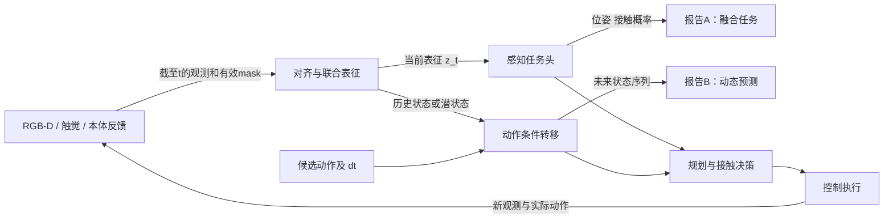
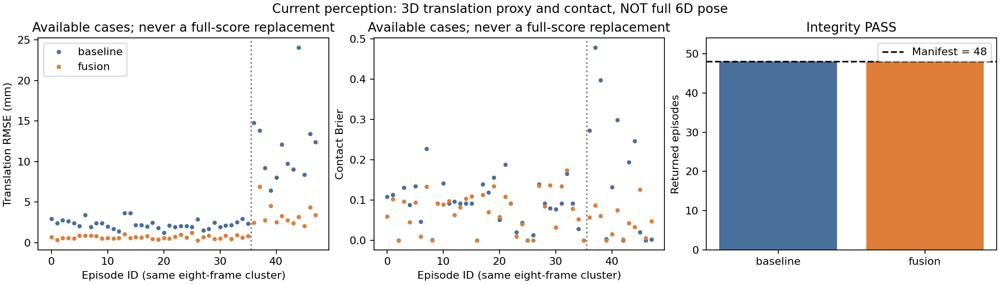
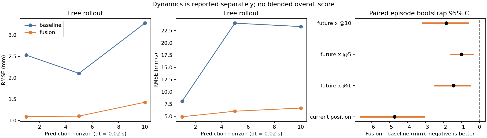
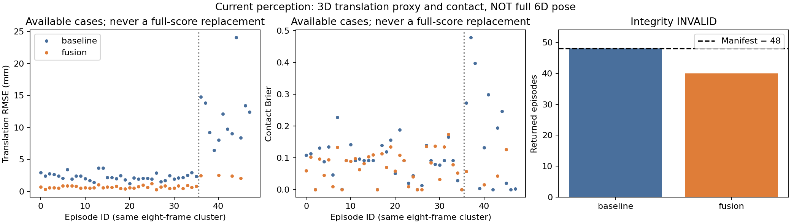
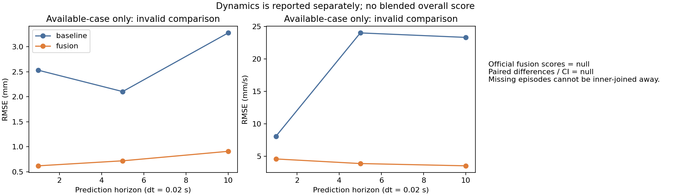

# D70 · 从多模态实验到可信的双任务结论

[返回学习入口](../_index.md) ｜ [本周日程](../P3-项目实战-日程.md) ｜ [上一课 D69](../day69/Daily-Learning-Pack.md) ｜ [CPU配对评价实验](demo.py)

**“看清当前状态”和“预测动作后果”是两个不同的能力。W10要留下两份能独立核对的结论：融合是否改善当前感知，动态模型能在什么信息条件下预测多久，以及这些结论离真实机器人应用还有多远。**

上一课把历史观测变成闭合状态，完成1、5、10步预测与触觉/深度消融。今天沿RGB-D机械臂抓杯子的案例，进一步解释怎样从多组数字中得到可信的工程判断。重点是比较问题、统计单位、完整分母和证据边界，而不是把所有指标压成一个看似清晰的总分。

本课属于W10-D7、P3项目Π-2的周收束。明天按原路线进入W11的CLIP/VLM语言查询；当前课程资料推进与个人学习验收分别记录，Π-1尚缺的正式证据也继续保留。

<details>
<summary>个人学习记录（保留你的判断与自测作答）</summary>

<!-- learner-notes:start -->

- 我对“融合更好”的具体定义：
- 删去困难episode前后的解释：
- 我的融合报告与动态预测报告：
- 我的自测答案、仍未理解的问题：

<!-- learner-notes:end -->

</details>

<!-- daily-pack-generated:start -->

## 0. 学习目标与路线

完成本课后，应能把一个多模态系统拆成当前感知与未来预测两个评价对象；把位姿、接触概率、轨迹误差分别写成有单位、有分母的指标；正确实现按episode配对重采样；识别缺失结果造成的选择偏差；把代码通过、模型效果和个人学习验收放回各自需要的证据中。

| 顺序 | 知识主线 | 需要回答的问题 |
| --- | --- | --- |
| 宏观 | 两条输出支路 | 当前估计准确，为什么仍可能预测错误？ |
| 微观一 | 表征、融合与任务头 | 共享编码器是否意味着共享评价标准？ |
| 微观二 | 位姿、接触与轨迹指标 | 每个数字究竟在测什么？ |
| 微观三 | 配对差值和组级bootstrap | 提升是否只是测试样本选择造成的？ |
| 微观四 | 完整分母与多目标判断 | 漏失结果、单位变换会怎样改变结论？ |
| 实践 | 双报告与故障注入 | 能否让评价程序拒绝虚假的“改进”？ |
| 回到宏观 | W10证据与W11接口 | 哪些已验证、哪些仍缺证据？ |

## 1. 宏观：同一个机器人，两种待证明的能力

### 1.1 当前杯子在哪里，与继续用力会怎样

RGB-D让机器人估计杯子位姿，触觉提示接触位置、压力或滑移。多模态感知回答当前时刻的状态。动态模型还需要动作、时间间隔及可能隐藏的接触参数，才能回答接下来会发生什么。

用$h_t$表示截止时刻$t$的观测历史，$u_{t:t+H-1}$表示未来候选动作，两个任务可写成：

$$
\hat y_t=g_\phi(h_t),\qquad
\hat y_{t+1:t+H\mid t}=f_\theta(h_t,u_{t:t+H-1}).
$$

$y_t$可以是物体位姿或接触状态；未来目标也可以包含速度、力或任务风险。两个函数允许共享编码器，但输入信息、标签时间和评价目标不同。



图中两份报告分别对应两条输出支路；它们不是两套毫无关系的系统。当前状态误差会传向未来，但未来预测还可能因为参数、动作接口或转移结构错误而失败。

### 1.2 一个最小反例

两个估计器都把当前杯子压入量估为10 mm、速度估为20 mm/s。A知道材料刚度50 N/m，B误以为100 N/m。当前位置误差都为零，但在同一力输入下预测速度不同。D69已给出$m=0.5$ kg、$b=1$ N·s/m、$\Delta t=0.02$ s、$u=0.8$ N时的结果：A下一步速度31.2 mm/s，B为11.2 mm/s。

因此“当前位姿很准”不推出“动作后果很准”。反方向也不成立：一个保守模型在几乎静止的测试集上预测未来位置很好，未必具有精确的当前6D位姿能力。**报告必须标明它覆盖的任务分布。**

## 2. 微观：把W10的结构、目标和输出重新接起来

### 2.1 从单模态基线到联合编码

D64先问融合是否比单模态更有用；D65进一步训练联合表征；D66把交叉注意中的对应关系与有效mask写成代码。一个典型结构可以写成：

$$
z_V=E_V(o^V),\quad z_T=E_T(o^T),\quad
z=\operatorname{Fuse}(z_V,z_T,m),\quad
\hat y^{\mathrm{pose}}=H_P(z),\quad\hat p^{\mathrm{contact}}=H_C(z).
$$

$m$表示真实的可用性和padding信息。它不应由测试标签构造，也不能把全空token伪装成有效观测。Fusion可以是拼接、加权、门控或交叉注意；算法名没有直接给出有效性证明。

| 中间量 | 示例shape | 应解释的内容 |
| --- | --- | --- |
| 视觉token | `[B,Nv,D]` | token来自哪些像素/点、是否带位置编码 |
| 触觉token | `[B,Nt,D]` | 触点/图像块的定义、时间与参考零点 |
| 交叉注意权重 | `[B,Nv,Nt]` | 哪个视觉查询读取哪些触觉值 |
| 物体位姿 | `R:[B,3,3], t:[B,3]` | 参考系、长度单位、旋转约束与对称 |
| 接触概率 | `[B]`或`[B,C]` | 二分类还是多状态，概率是否校准 |
| 动态输出 | `[B,H,d_y]` | 预测起点、步长、是否自由展开 |

这些是工程设计示例，不是已经确认的用户项目架构。本周各教学脚本只实现其中不同的部分，不能因为图能画成一个整体，就声称所有模块已经端到端联调。

### 2.2 一个训练loss不能替代所有任务的评价

共享编码器常用多任务目标：

$$
\mathcal L=\alpha\mathcal L_{\mathrm{pose}}+
\beta\mathcal L_{\mathrm{contact}}+\gamma\mathcal L_{\mathrm{dyn}}.
$$

训练时这些权重决定优化侧重点。共享参数梯度为各任务梯度的加权和；若两个梯度方向相反，降低一个任务的损失可能干扰另一个。用两个一维梯度$+2$与$-3$举例，等权合并为$-1$，并不代表两个任务都改善。

loss下降还可能来自标签比例、尺度或容易样本变多。评价应保持各任务的物理语义，例如位置误差mm、旋转误差deg、接触概率Brier分数、未来第10步误差mm。给出这些向量，才能讨论取舍。

> [!warning] 本周成果不能互相替代
> D65的位置代理误差不是完整6D位姿指标；D66的合成对应准确率不是语言理解；D68的一步预测不是D69的自由rollout；D69的解析混合模型也不是继续训练D68网络。周报告应写清每个结果的真实出处和任务边界。

### 2.3 误差传播给两份报告建立联系

若未来转移在局部可线性化，$\delta z_0$为当前状态误差，则：

$$
\delta z_H\approx A_{H-1}\cdots A_0\delta z_0+
\sum_{j=0}^{H-1}A_{H-1}\cdots A_{j+1}\delta f_j.
$$

第一项来自当前估计，第二项来自各步模型误差。空乘积按单位矩阵处理。若还存在执行动作误差，需要额外加动作Jacobian对应项。所有变量应处于一致坐标和缩放单位中。

这个分解解释了为什么需要两份报告：报告A帮助定位初态误差；报告B检验这些误差加上模型偏差后会如何演变。单独降低A中的某个平均误差，不保证B的任务关键方向也改善。杯子轴向平移和夹爪接近方向的偏差对抓取可能有不同代价。

## 3. 微观：融合报告的数字应怎样定义

### 3.1 平移、旋转与物体表面误差

平移向量误差为$e_t=\|\hat t-t\|_2$，单位m或mm。批量三维向量RMSE可以定义为：

$$
\operatorname{RMSE}_{\mathrm{vec}}=
\sqrt{\frac1N\sum_{i=1}^{N}\|\hat t_i-t_i\|_2^2}.
$$

另一种实现先对三个坐标一起取平均，再开方，相当于$\operatorname{RMSE}_{\mathrm{vec}}/\sqrt3$。两者都可能被称为“位置RMSE”，所以必须提供公式。

手算：一条样本误差向量为$[3,4,0]$ mm，向量误差5 mm，按坐标均方根为$\sqrt{25/3}\approx2.887$ mm。把两个值放同一列比较，就是指标定义不一致。

旋转的测地角误差为：

$$
e_R=\arccos\!\left(\operatorname{clip}\left(
\frac{\operatorname{tr}(\hat R R^\top)-1}{2},-1,1\right)\right).
$$

结果先是rad，转deg需乘$180/\pi$。前提是两矩阵确在$SO(3)$上；随便九个网络输出不能直接使用该公式。对称物体则需在声明的允许对称集合内比较，否则某些外观等价姿态会被错误惩罚。

ADD、ADD-S、MSSD等表面误差进一步把姿态变化转成模型表面位移。它们的平均/最大、对应规则和对称处理不同；一个任意阈值的ADD通过率不能冒充完整BOP官方成绩。参照[BOP挑战2019的评价定义](https://bop.felk.cvut.cz/challenges/bop-challenge-2019/)时，要同时记录数据划分、目标列表、对称集合和阈值协议。

### 3.2 接触分类与接触概率分别回答什么

二分类阈值$c=\mathbb1[p\ge\tau]$得到TP、FP、FN、TN。正类F1为：

$$
F_1=\frac{2\mathrm{TP}}{2\mathrm{TP}+\mathrm{FP}+\mathrm{FN}}.
$$

若数据中大部分时刻无接触，全部预测无接触也可能有较高准确率，却完全漏掉真实接触。因此应记录正负数量、召回、误报以及阈值。全负集合中的F1还需要预声明零分母处理。

概率质量可用Brier分数：

$$
\operatorname{BS}=\frac1N\sum_{i=1}^{N}(p_i-y_i)^2,
\quad y_i\in\{0,1\}.
$$

例如标签$[1,0]$，概率$[0.8,0.3]$，阈值0.5时全判对，但BS为$(0.04+0.09)/2=0.065$。换成$[0.51,0.49]$仍全判对，BS约0.2401。分类正确数相同，概率质量显著不同。BS综合反映概率预测的多种性质，不能把一个低BS单独称为完整校准证明。

若漏接触代价$C_{FN}$远高于误报代价$C_{FP}$，在“概率可信、二元决策、正确判断损失为0”的简化条件下，预测接触的期望损失为$C_{FP}(1-p)$，预测不接触为$C_{FN}p$，于是阈值为：

$$
\tau=\frac{C_{FP}}{C_{FP}+C_{FN}}.
$$

例如$C_{FN}=9,C_{FP}=1$，阈值0.1。现实机器人还需处理控制动作、持续时间与安全约束；公式是决策代价的解释工具，不是可以直接写入真机的控制参数。

### 3.3 当前融合报告的最小内容

先明确输入模态和目标，再列与单模态基线相同目标上的结果；把正常、缺模态、噪声/偏置条件分开。为每项结果保留样本ID、失败数、单位与阈值。附上误差最大的例子和任务关键分层，而不是只给平均值。

正式Π-2若报告6D位姿，必须有真实的旋转与平移输出、相应对象/对称条件和评价实现。今天的小实验将明确使用三维平移与接触代理来练习报告方法；它不会填补完整6D模型的证据缺口。

## 4. 微观：动态报告还必须交代信息从哪里来

### 4.1 先声明预测协议

预测起点是$t$，模型允许使用$h_t$，之后只给定动作。第$h$步端点位置RMSE是：

$$
E_x(h)=\sqrt{\frac1N\sum_i
(\hat x_{i,t+h\mid t}-x_{i,t+h})^2}.
$$

整段到$H$步的RMSE为：

$$
E_x(1{:}H)=\sqrt{\frac1{NH}\sum_i\sum_{h=1}^{H}
(\hat x_{i,t+h\mid t}-x_{i,t+h})^2}.
$$

前者检验指定未来时刻，后者总结沿途误差。第10步在$\Delta t=0.02$ s下是0.20 s；换成0.10 s步长，就成了1 s，不能继续把两者当同一难度。

### 4.2 标签可以用于打分，不能回到自由展开输入中

D69通过扩大状态为$[x,v,k]$并自行计算未来接触力，避免了缺少未来触觉输入的问题。有真实观测的重置诊断与无未来观测的rollout应独立列出。允许训练使用未来标签，不允许正式测试预测路径读取它们。

未来动作也有语义：如果它们是策略根据未来真实状态才会选出的动作，离线回放可以做“给定已记录动作的条件预测”，但不自动等于部署时自主规划的能力。本课动作预先抽样，因而不存在这个未来动作选择依赖。

### 4.3 拆开域偏移与系统故障

材料刚度变化是环境动力学分布变化；触觉偏置是传感器变化；时间戳错位是接口变化。它们可能同时出现，但最初受控实验应一次只改变一个因素。D69中测力偏置在同分布变差、在部分域外材料上局部变好，说明误差可能抵消，不能只凭某一个域的平均数断言模型更可靠。

动态报告应包含1/5/10步曲线、同批起点、有无动作/模态对照、自由展开协议、失效分层和运算代价。没有闭环动作选择与执行，就把机器人任务成功数写成“未测”，不能把低RMSE当成抓取成功率。

## 5. 微观：怎样证明一个方法比另一个好

### 5.1 比较目标必须先固定

“融合更好”需要补全四个条件：对什么任务、在什么样本分布、相对于什么基线、用什么指标。如果两次实验连数据划分、初态或指标单位都不同，就无法把数字差归因于融合结构。

这里采用配对比较：方法A和B处理完全相同的episode，每个episode共享真值、动作和测试条件。配对减少了“这次测试对象本来就容易”的干扰，但并不消除模型训练随机性或整个测试集代表性的问题。

训练时用相同种子也不保证初始化或数据扰动完全相同。一个分支多抽了一次随机数，就可能改变后续随机序列。D59/D63用独立随机流生成错配，就是为了避免“改变配对，同时意外改变初始化”。应检查实际数据/参数，而不只写一句seed一致。

### 5.2 RMSE的配对差值为什么不能直接平均每条RMSE

设第$i$个episode有$M$个评价点，方法A的组内均方误差为$q_i^A=M^{-1}\sum_j(e_{ij}^A)^2$。各episode长度相同或选择等episode权重时，总体RMSE为：

$$
R_A=\sqrt{\frac1N\sum_i q_i^A},\qquad
\Delta=R_B-R_A.
$$

本课约定$\Delta<0$表示B误差更低。注意$\sqrt{\operatorname{mean}(q)}$与$\operatorname{mean}(\sqrt q)$不同。

手算：两条episode的$q=[1,9]$ mm²，总体RMSE为$\sqrt5\approx2.236$ mm；先开方再平均为$(1+3)/2=2$ mm。后者是“平均episode RMSE”，也可以是合理目标，但必须换名称，不能静默替换。

如果episode长度不同，按全部帧加权会让长序列更重要；等episode权重让每段任务同等重要。应在看结果之前根据应用目标确定。用户真正关心“一次抓取会怎样”，通常不能让一个长时间静止片段淹没很多短而困难的接触事件。

### 5.3 配对cluster bootstrap的每一步

Bootstrap（自助重采样）用已有样本近似研究样本变化造成的统计波动。cluster意味着保持一整个相关组，paired意味着两种方法使用同一组抽样索引。

1. 固定N个完整episode，保留A/B在每组内的全部误差。
2. 有放回抽取N个episode编号，例如`[2,0,2,1,...]`。
3. 对A/B应用同一组编号，重新计算两个RMSE，再相减得到$\Delta^*$。
4. 重复预声明的次数，得到差值分布；百分位区间用2.5%和97.5%分位数。

```python
idx = rng.integers(0, N, size=(repeats, N))
r_a = np.sqrt(q_a[idx].mean(axis=1))
r_b = np.sqrt(q_b[idx].mean(axis=1))
delta_boot = r_b - r_a
interval = np.quantile(delta_boot, [0.025, 0.975])
```

`q_a,q_b`的shape为`[N]`，重采样矩阵为`[repeats,N]`。对第1/5/10步，可以分别保留每个episode的对应误差再重复此过程。区间是在同一统计量上重算出来的，不是把两个单方法置信区间的端点机械相减。

[SciPy bootstrap官方文档](https://docs.scipy.org/doc/scipy/reference/generated/scipy.stats.bootstrap.html)区分配对重采样和百分位、basic、BCa等区间方法。这里手写的是episode级配对百分位法；不把它称为BCa，也不在帧维度盲目重采样。

### 5.4 为什么按帧重采样可能过分自信

同一episode往往共享相机外参误差、触觉零漂和对象形状。设每段有M帧，组内误差相关系数近似为$\rho$，一个简化的等组大小模型给出均值方差的放大因子：

$$
\mathrm{DEFF}=1+(M-1)\rho,
\qquad N_{\mathrm{eff}}\approx\frac{NM}{1+(M-1)\rho}.
$$

它只是等相关模型的直觉公式，不是任意非线性RMSE的精确有效样本数。如果N=20、M=10、$\rho=0.8$，看起来有200帧，按该近似有效量只有$200/8.2\approx24.39$，远不是200个独立任务。

在实际评价中，直接按episode抽样比先猜一个相关系数更容易保持结构。正相关常使逐帧独立抽样低估波动，但不能保证任何有限样本中的帧级区间都更窄。若多个episode来自同一个物体或同一标定批次，还可能需要按物体/批次分组，或者层级重采样；“episode”不是永远正确的最小独立单位。

### 5.5 一个区间不包含0，究竟说明到哪一步

在当前数据生成/抽样结构与统计方法下，它表明观测到的配对差值相对重采样波动有一定稳定性。它不是“B有95%概率永远更好”，也不包含未测量的分布偏移、训练种子变化或真实机器人故障。

同时测试许多指标、许多预测步，再只挑区间最漂亮的一项，会引入选择问题。预先声明主要指标与次要诊断，完整报告趋势；需要正式显著性结论时，再设计适当的多重比较控制。今天不靠一个区间替用户宣布项目验收通过。

## 6. 微观：缺失结果怎样制造虚假的改进

### 6.1 评价先从目标清单开始

Manifest是应被评价的目标清单，至少记录`episode_id`、目标时刻、数据划分、对象/场景、评价资格及协议版本。结果表应能逐一对应清单，存在明确失败或缺失状态。简单地把A、B文件做inner join，只保留双方都返回的样本，可能恰好删掉困难目标。

设N=4个目标的绝对误差为$[1,1,1,9]$ mm。完整RMSE为$\sqrt{84/4}\approx4.583$ mm；删去最后一条只看返回结果，RMSE变为1 mm。算法没有进步，统计对象却变了。

> [!question] 先判断
> bootstrap区间也可以在剩下三条样本上算得很窄。它能证明这个1 mm可信吗？
>
> 它只描述被筛选样本的波动，不能修复遗漏困难样本的选择偏差。重复采样坏分母不会生成缺失证据。

### 6.2 缺失误差不能随意填0，也不能默认为某个大值

如果计划有N个目标，已知误差平方和为S，缺失m个，且误差非负，那么完整RMSE至少为$\sqrt{S/N}$。若没有物理上界，无法给有限上界；若协议事先规定误差不超过U，才可写：

$$
\sqrt{S/N}\le R\le\sqrt{(S+mU^2)/N}.
$$

给上例只知道三条误差1、1、1，则$N=4,S=3,m=1$，下界$\sqrt{3/4}\approx0.866$ mm；若确有事先定义的$U=10$ mm，上界为$\sqrt{103/4}\approx5.074$ mm。不能把已返回均值1 mm当完整估计。

对“是否满足阈值”的判定，协议可以规定未返回预测记失败；这时能报告全目标召回。对连续误差，必须明确缺失处理或报告未知，不能凭空捏造误差。BOP等基准有自己的目标与评价规则，不能用本课教学门禁替代官方实现。

### 6.3 数据完整性与算法能力是两层判断

本课脚本先检查目标ID是否完整、是否重复或多出，再门控正式比较；轨迹另有有限性断言，JSON输出拒绝NaN。缺失时保留“已返回样本诊断”，但正式指标与配对区间记为null并说明原因。这样调用者无法把看似更低的数字当成完整测试结论。

完整性通过也只是说明“这份结果足以按声明协议计算”，不是证明预测一定准确。正式项目还需要正确任务、真实或合适的高质量数据、受控基线、复现证据与个人解释。两者不能用一个布尔值合并。

## 7. 微观：不要让总分掩盖工程取舍

### 7.1 单位变化就能改变排名的“总分”没有稳定含义

方法A位置误差2 mm、接触BS0.3，B为3 mm、0.1。直接相加得到A=2.3、B=3.1，A更小；把位置改用米，A=0.302、B=0.103，B更小。只改了单位，所谓最优方法就换了。

按容差归一化可以消除这类单位问题，例如$e_x/\tau_x$，但容差和权重本身仍然代表应用偏好。它们应在测试之前根据任务设定，并做敏感性分析；不能为了让自己的方法胜出而调权。

### 7.2 Pareto与约束比无解释总分更清楚

若A在所有关心指标都不差于B，并至少有一个更好，A支配B。若A位置更准、B接触更准，二者可能都在Pareto前沿，需要根据任务代价取舍。更低的动态RMSE若同时带来更高延迟，也可能错过控制周期。

一种工程规则是先满足约束，再优化主要目标：例如在独立验证阶段确认延迟、完整分母与接触漏报满足约束，再比较任务关键位姿误差。阈值必须来自应用与评价设计；本课程不凭合成例为用户真机设定允许误差。

### 7.3 报告应保留至少四种状态

| 状态 | 当前能回答什么 | 不能推出什么 |
| --- | --- | --- |
| 资料已生成 | 讲义和代码是否完整可读 | 用户已掌握 |
| 教学代码已验证 | 当前环境中的计算与对照是否可复现 | 官方模型、真实设备已验证 |
| 项目证据已满足 | 指定数据/任务/基线/接口是否有实际证据 | 更广分布永远有效 |
| 个人验收已完成 | 用户实际作答、解释与产出是否达标 | 所有未来任务自动通过 |

这张表用于解释证明责任，不把周课写成行政检查。今天要学会的是：每一个技术结论都能指向它需要的实验，而不是把不同类型的“完成”混在一起。
## 8. 动手：先预测，再让评价程序识别“删难例”

### 8.1 实验问题与生成机制

实验只验证两件事：在相同合成episode上如何分别评价感知与动态预测，以及怎样阻止缺失结果被当成改进。这里使用**固定估计器、已知弹簧方程和有噪声的数值观测**。没有训练视觉/触觉网络，没有复用D68的权重，没有RGB图像、深度图、真实触觉或接触物理模拟器。

每个episode先抽取初始穿透量$x\sim U[-0.008,0.018]$ m、速度$v\sim U[-0.05,0.05]$ m/s和刚度$k\sim U[20,80]$ N/m。正$x$表示进入单侧弹簧区域，负$x$表示离开。初始时刻为$-0.14$ s，经过7个历史区间到$t=0$，随后预测10个未来区间。质量$m=0.5$ kg、阻尼$b=1$ N·s/m、步长$\Delta t=0.02$ s，力输入$u\sim U[-0.8,0.8]$ N，每3步保持一个值。

离散动力学采用半隐式Euler：

$$
F_t=k\max(x_t,0),\quad
v_{t+1}=v_t+\frac{\Delta t}{m}(u_t-bv_t-F_t),\quad
x_{t+1}=x_t+\Delta t\,v_{t+1}.
$$

这是带阻尼的解析数值系统；质量、刚度、动作力的单位必须闭合。该系统没有杯子网格、摩擦锥、刚体碰撞或夹爪执行器。未来预测误差小，部分原因正是估计器知道真实生成方程的结构。

为了练习三维平移评价，另定义位置$\mathbf p=[0.45+x,y,z]$ m；每个episode的$y,z$为不同的常量。位置不是物体完整6D位姿，也没有旋转标签。视觉V与深度D都是已换算到固定世界系的三维位置代理。它们分别加入episode共享偏置和逐帧噪声；共享偏置让帧间误差相关。

| 观测 | 共享噪声标准差 | 逐帧噪声标准差 | shape |
| --- | --- | --- | --- |
| V三维位置 | 1.2 mm | 0.8 mm | `[48,8,3]` |
| D三维位置 | 0.35 mm | 0.25 mm | `[48,8,3]` |
| 速度 | 4 mm/s | 2 mm/s | `[48,8]` |
| T测力 | 0.01 N | 0.01 N | `[48,8]` |

所有噪声均为零均值正态；V、D前36个episode使用表中尺度，后12个同时放大5倍。速度和测力噪声不随这个分层放大。全组的数量与顺序事先固定，默认/drop对照复用完全相同数据。

### 8.2 两个估计器究竟有什么差别

baseline使用V位置、共同速度观测和固定刚度先验50 N/m；fusion位置为$\hat{\mathbf p}_F=0.08\mathbf p_V+0.92\mathbf p_D$，再用T历史估计刚度。权重是教学设定，没有在本测试集上搜索最优值。

定义历史估计穿透量$a_j=\max(\hat p_{F,j,x}-0.45,0)$，测力为$\tilde F_j$。fusion最小化带先验的标量目标：

$$
\min_k\sum_{j=1}^{8}(\tilde F_j-a_jk)^2+\lambda(k-k_0)^2.
$$

对$k$求导并令其为零，得到：

$$
\hat k=\operatorname{clip}\left(
\frac{\sum_j a_j\tilde F_j+\lambda k_0}{\sum_j a_j^2+\lambda},5,200\right),\quad
\lambda=10^{-5}\ \mathrm{m}^2,\ k_0=50\ \mathrm{N/m}.
$$

分母单位m²，分子N·m，所以比值为N/m。没有足够穿透时，数据对刚度约束很弱，先验会占主要作用。手算一帧$a=0.01$ m、测力0.5 N，估计恰为50 N/m；测力变成0.6 N，估计为$(0.006+0.0005)/0.00011\approx59.09$ N/m。多一个测力偏置，会直接进入未来速度预测。

两方法都从最后历史位置和速度出发，用自身估计的$k$展开10步。未来力来自预测状态，不读取未来触觉或真实$k$。因此差别是初态/参数估计，转移方程完全相同；这不是两种不同神经世界模型的竞赛。

接触真值定义为$y=\mathbb1[F>0.05\ \mathrm N]$，是**超过测力阈值的标签**，不是精确的几何首次接触时刻。baseline用$\hat F=50\max(\hat p_{V,x}-0.45,0)$，fusion用历史测力；两者转为固定概率分数：

$$
p=\sigma((\hat F-0.05)/0.06).
$$

分母单位N，保证指数输入无量纲。该sigmoid未经独立概率校准；评价BS是在评价分数质量，不能宣称模型已经具有可信接触置信度。

### 8.3 评价单元、张量与两个输出报告

“当前感知”在本实验是对8个历史时刻**逐帧估计当时状态**并汇总，不是只评价最后$t=0$一帧。动态预测只以$t=0$为共同起点。

| 数据/输出 | shape与语义 |
| --- | --- |
| `state` | `[48,18,2]`，8个历史/当前状态与10个未来状态，列为x、v |
| `action` | `[48,10]`，预测区间的预先生成动作力 |
| `position`、估计位置 | `[48,8,3]`，米制世界系位置 |
| `probability`、接触标签 | `[48,8]`，无量纲 |
| `trajectory` | `[48,10,2]`，自由展开x与v |
| episode损失 | 每项`[48]`，位置存m²、速度存(m/s)²、BS无量纲 |
| bootstrap编号 | `[2000,48]`，两方法共享索引 |

`report.json`分别保存`fusion`和`dynamics`，没有混合总分。字段名中的`mm`描述最终报告单位；台账中的原始平方损失仍存SI单位，转换发生在`aggregate()`中。三维位置先对三个坐标平方求和，再对8帧平均；48组等长，所以本例等episode加权与全帧加权一致。

本例普通episode bootstrap对当前经验混合分布重采样，每次高噪声组占比可能改变。如果部署协议明确要求固定75%/25%构成，则需要在两个层内分别抽样并保持各层数量；如果要回答“新物体泛化”，还需改成物体级划分和重采样。不能把本例区间直接解释为这些新问题的答案。

学习五格卡如下，避免把评价程序当成训练算法：

| 对象 | 数据从哪来 | 学什么 | 目标或改善信号 | 训练与推理 | 泛化怎样测 |
| --- | --- | --- | --- | --- | --- |
| 固定融合估计器 | 有噪声位置与测力代理 | 没有学习编码器；每段辨识k | 测力残差与先验正则 | 无跨episode参数训练；历史估计后展开 | 新噪声、偏置、刚度与真实数据需另测 |
| D68 MLP | 独立合成转移组 | 下一步状态 | 一步预测loss | 训练统计冻结后测试 | 独立episode、OOD和触觉偏置；不自动具备自由展开 |
| D70评价器 | manifest、两方法预测、真值 | 不学习策略 | 指标定义与完整性 | 冻结规则，重算误差与区间 | 用缺失/重复/额外ID注入验证；不产生机器人泛化证据 |

### 8.4 先预测，再运行，再改变一个变量

> [!question] 先写下预测
> 1. 有较低噪声D与测力T时，哪些指标可能改善？是否保证所有episode都更好？
> 2. 只删除fusion位置误差最大的8条记录，不改变任何预测，报告中的位置误差会怎样？接触BS一定也改善吗？
> 3. 这时应允许给出正式“fusion优于baseline”的配对区间吗？

依赖为Python 3、NumPy、Matplotlib，CPU即可。进入本课目录后运行；如果当前Python尚无依赖，可在自己选用的环境中安装，无需CUDA：

```bash
python3 -m pip install numpy matplotlib
python3 demo.py --out ../../_assets/3d_learning/day70/my_default
python3 demo.py --drop-hard 8 --out ../../_assets/3d_learning/day70/my_drop8
```

`my_`目录保留本次已验证的默认附件。第二条实验只改变`--drop-hard`：先生成相同完整预测，再根据fusion三维位置episode MSE删去最难8条返回记录。用真值选择删除对象是**故意注入的评价故障**，不是可接受的部署策略。数据、模型参数、所有保留预测必须相同。

运行后读manifest及两张台账，先核对48个目标ID，再读报告。`integrity`记录每种方法的返回量、缺失/额外/重复ID；预测轨迹有有限性断言，JSON写入也拒绝NaN。示例针对固定shape的合成输入，不是能够直接吞入任意外部台账的完整生产审计器。

正式fusion指标、差值和CI只有配对ID完整时输出。baseline在两次实验均完整，保留自身指标；fusion剩余样本值仅放在`naive_available_case`中。若把这两个不同样本集合的值相减，就重新犯了配对比较错误。

### 8.5 本次已执行结果：融合报告

实际创建与验证日期2026-11-13。默认数据种子700，bootstrap种子701，共2000次。环境为macOS arm64、Python 3.11.15、NumPy 1.26.4、Matplotlib 3.10.9，CPU执行。

| 当前感知指标 | baseline | fusion | fusion−baseline | 配对百分位95%区间 |
| --- | ---: | ---: | ---: | --- |
| 三维平移向量RMSE / mm | 6.630561 | 1.922090 | −4.708471 | [−6.581981, −3.072718] |
| 接触BS | 0.107915 | 0.066245 | −0.041670 | [−0.068993, −0.017072] |
| 返回episode / 目标episode | 48/48 | 48/48 | 不作差值排名 | 完整性通过 |



图1左、中每点是一段8帧的汇总误差，不是一次机器人抓取。虚线分隔36个普通噪声组与12个高噪声组，说明为什么平均值背后仍需查看困难分层；右图保证两方法有同一完整分母。融合改善在此固定配置中有证据，不能据此认为门控或多模态在新噪声下总会改善。

### 8.6 本次已执行结果：动态报告

| 指标 | baseline | fusion | 单位 |
| --- | ---: | ---: | --- |
| x@1 / 0.02 s | 2.530312 | 1.088616 | mm |
| x@5 / 0.10 s | 2.102926 | 1.104058 | mm |
| x@10 / 0.20 s | 3.276268 | 1.427360 | mm |
| v@1 | 8.069911 | 4.907618 | mm/s |
| v@5 | 24.023978 | 6.035920 | mm/s |
| v@10 | 23.331872 | 6.684648 | mm/s |
| x整段1:10 | 2.505357 | 1.186247 | mm |
| v整段1:10 | 21.667973 | 6.131307 | mm/s |

x@10差值−1.848908 mm，配对区间[−3.141667, −0.648412] mm；其余完整区间在[默认机器报告](../../_assets/3d_learning/day70/default/report.json)中。位置与速度保持独立单位，当前感知的三维误差也不与未来一维误差直接排名。



图2左、中把预测步长与误差对应，右图所有横轴量均为mm、含义是融合减基线。第5步位置误差可能低于第1步；动力学收缩、相位或误差抵消都会让特定步长非单调，不能机械要求每个测试曲线严格递增。只有按实际时间和完整协议分析，才知道该现象意味着什么。

### 8.7 只删除记录后的结果与解释

删除8条最难位置记录后，fusion仅返回40/48。已有预测逐位不变，但返回样本上的位置RMSE降到1.020675 mm，x@10降到0.907469 mm；接触BS反而升到0.071730。这说明按一个指标选容易样本，并不保证另一个指标也更容易。



图3直接显示丢失的episode与40/48分母。位置改善来自选择对象，不是输入信息、估计器或转移方程发生了变化。



图4左、中只显示已返回样本诊断，右侧明确正式fusion、差值和CI均为null。**null表示缺少完成该结论所需的证据，不表示误差为零。** 这与完整默认报告的`project=pending_real_data_and_task_evidence`也是不同原因：前者是当前实验结果不完整，后者是正式项目证据尚不足。

本次验证确认默认/drop8的基础数据、参数hash和manifest相同，baseline台账完全相同，fusion保留40行完全相同。独立从台账与真值重算10项指标及全部配对区间吻合；缺失、重复、额外ID注入均被审计拒绝，篡改未来真值和真实刚度不影响正式预测。验证记录见[verification.json](../../_assets/3d_learning/day70/verification.json)。

这两次运行共用48个合成episode，不记成96个独立任务。每次对应384个感知帧、336个历史区间和480个未来区间；训练更新0、真实机器人尝试0、接触物理模拟器试验0。没有测量机器人任务成功率；不能把48/48完整输出解释为48次成功。

默认记录的baseline/fusion计算耗时约0.084583/0.088125 ms，范围仅为一次48组历史输入和10步预测的CPU调用；不包含数据生成、采集、同步、评价、bootstrap或绘图。单次计时受调度和预热影响，**不用于比较两方法速度，也不是sensor-to-action延迟**。工程延迟应另用多次重复、分位数和明确的端到端计时点验证。

### 8.8 完整可复制脚本

主要实现位于`episode_losses()`、`aggregate()`、`audit()`与`paired_report()`。前者保存每段平方误差，聚合器只在总体平均之后开根号；审计器先确认目标ID；区间计算对同一组索引重算两方法差值。无需SciPy即可运行，但统计方法与SciPy默认BCa不同。

脚本SHA256：`4a400cbea9878576008ff9e1e3f0138b581cddd2eb0ce1e4b67bbbf9029a7997`。以下代码与同目录[demo.py](demo.py)逐字一致。

<details>
<summary>完整 CPU 脚本（点击展开）</summary>

```python
#!/usr/bin/env python3
"""D70: separate fusion/dynamics ledgers; paired episode bootstrap on CPU.
Synthetic analytic spring + fixed estimators; no model training or robot trials.
"""
import argparse
import hashlib
import json
import platform
import time
from pathlib import Path
import numpy as np
import matplotlib
matplotlib.use("Agg")
import matplotlib.pyplot as plt

DT, MASS, DAMP, N, FRAMES, H = .02, .5, 1., 48, 8, 10
METHODS = ("baseline", "fusion")
CONFIG = dict(dt_s=DT, mass_kg=MASS, damping_Ns_m=DAMP, stiffness_prior_N_m=50.,
              depth_weight=.92, ridge_m2=1e-5, contact_threshold_N=.05,
              probability_temperature_N=.06, stiffness_clip_N_m=[5., 200.])


def digest(a):
    return hashlib.sha256(a if isinstance(a, bytes) else a.tobytes()).hexdigest()


def step(s, u, k):
    v = s[..., 1] + DT / MASS * (u - DAMP * s[..., 1] - k * np.maximum(s[..., 0], 0))
    return np.stack([s[..., 0] + DT * v, v], axis=-1)


def make_data(seed):
    r = np.random.default_rng(seed)
    k = r.uniform(20., 80., N)
    state = np.zeros((N, FRAMES + H, 2))
    state[:, 0] = np.stack([r.uniform(-.008, .018, N), r.uniform(-.05, .05, N)], -1)
    action = np.repeat(r.uniform(-.8, .8, (N, 6)), 3, axis=1)[:, :FRAMES + H - 1]
    for t in range(FRAMES + H - 1):
        state[:, t + 1] = step(state[:, t], action[:, t], k)
    p = np.zeros((N, FRAMES, 3))
    p[:, :, 0] = .45 + state[:, :FRAMES, 0]
    p[:, :, 1] = r.uniform(-.04, .04, (N, 1))
    p[:, :, 2] = r.uniform(.20, .30, (N, 1))
    force = k[:, None] * np.maximum(state[:, :FRAMES, 0], 0)
    scale = np.where(np.arange(N) < 36, 1., 5.)[:, None, None]
    # Shared episode bias makes the eight frame errors correlated.
    visual = p + scale * (.0012 * r.normal(size=(N, 1, 3)) + .0008 * r.normal(size=p.shape))
    depth = p + scale * (.00035 * r.normal(size=(N, 1, 3)) + .00025 * r.normal(size=p.shape))
    velocity = state[:, :FRAMES, 1] + .004 * r.normal(size=(N, 1)) + .002 * r.normal(size=(N, FRAMES))
    tactile = force + .01 * r.normal(size=(N, 1)) + .01 * r.normal(size=force.shape)
    return dict(state=state, position=p, force=force, contact=(force > .05).astype(float),
                visual=visual, depth=depth, velocity=velocity, tactile=tactile,
                action=action[:, FRAMES - 1:], stiffness=k)


def predict(obs, future_action, fusion):
    # Only historical observations and proposed actions enter prediction.
    p = .08 * obs["visual"] + .92 * obs["depth"] if fusion else obs["visual"].copy()
    penetration = np.maximum(p[:, :, 0] - .45, 0.)
    k = np.full(N, 50.)
    if fusion:
        k = np.clip((np.sum(penetration * obs["tactile"], axis=1) + 1e-5 * 50.) /
                    (np.sum(penetration ** 2, axis=1) + 1e-5), 5., 200.)
    f = obs["tactile"] if fusion else 50. * penetration
    prob = 1. / (1. + np.exp(-np.clip((f - .05) / .06, -40, 40)))
    s = np.stack([p[:, -1, 0] - .45, obs["velocity"][:, -1]], -1)
    trajectory = np.zeros((N, H, 2))
    for t in range(H):
        s = step(s, future_action[:, t], k)
        trajectory[:, t] = s
    return dict(position=p, probability=prob, trajectory=trajectory, stiffness=k)


def episode_losses(data, pred):
    e = pred["trajectory"] - data["state"][:, FRAMES:]
    losses = {"position_mm": np.mean(np.sum((pred["position"] - data["position"]) ** 2, -1), -1),
              "contact_brier": np.mean((pred["probability"] - data["contact"]) ** 2, -1)}
    for h in (1, 5, 10):
        losses[f"x{h}_mm"] = e[:, h - 1, 0] ** 2
        losses[f"v{h}_mm_s"] = e[:, h - 1, 1] ** 2
    losses["x_path_mm"] = np.mean(e[:, :, 0] ** 2, -1)
    losses["v_path_mm_s"] = np.mean(e[:, :, 1] ** 2, -1)
    return losses


def aggregate(loss, key, axis=None):
    value = np.mean(loss, axis=axis)
    return value if key == "contact_brier" else 1000. * np.sqrt(value)


def audit(expected, returned):
    missing, extra = sorted(set(expected) - set(returned)), sorted(set(returned) - set(expected))
    duplicate = len(returned) != len(set(returned))
    return dict(valid=not (missing or extra or duplicate), expected=len(expected), returned=len(returned),
                missing_ids=missing, extra_ids=extra, duplicate_ids=duplicate)


def paired_report(losses, keep, rng, reps, valid):
    indices = rng.integers(0, N, (reps, N))
    result = {}
    for key in losses["baseline"]:
        a, b = losses["baseline"][key], losses["fusion"][key]
        naive = {m: float(aggregate(losses[m][key][keep[m]], key)) for m in METHODS}
        delta = aggregate(b[indices], key, 1) - aggregate(a[indices], key, 1)
        result[key] = dict(baseline=naive["baseline"], fusion=naive["fusion"] if valid else None,
                           delta_fusion_minus_baseline=float(aggregate(b, key) - aggregate(a, key)) if valid else None,
                           paired_episode_percentile95=np.quantile(delta, [.025, .975]).tolist() if valid else None,
                           naive_available_case=naive)
    return result


def figures(out, losses, metrics, keep, valid):
    colors = ["#496f9c", "#df7d38"]
    fig, axes = plt.subplots(1, 3, figsize=(13, 3.7), constrained_layout=True)
    for j, key in enumerate(("position_mm", "contact_brier")):
        for m, color in zip(METHODS, colors):
            vals = np.sqrt(losses[m][key]) * 1000 if j == 0 else losses[m][key]
            axes[j].plot(keep[m], vals[keep[m]], ".", color=color, label=m)
        axes[j].set(xlabel="Episode ID (same eight-frame cluster)", ylabel="Translation RMSE (mm)" if j == 0 else "Contact Brier",
                    title="Available cases; never a full-score replacement")
        axes[j].axvline(35.5, color="gray", linestyle=":")
    axes[0].legend()
    axes[2].bar(METHODS, [len(keep[m]) for m in METHODS], color=colors)
    axes[2].axhline(N, color="black", linestyle="--", label="Manifest = 48")
    axes[2].set(ylim=(0, N + 6), ylabel="Returned episodes", title="Integrity PASS" if valid else "Integrity INVALID")
    axes[2].legend()
    fig.suptitle("Current perception: 3D translation proxy and contact, NOT full 6D pose")
    fig.savefig(out / "fusion.png", dpi=160)
    plt.close(fig)
    fig, axes = plt.subplots(1, 3, figsize=(13, 3.7), constrained_layout=True)
    for j, prefix in enumerate(("x", "v")):
        for m, color in zip(METHODS, colors):
            vals = [metrics[f"{prefix}{h}_" + ("mm" if j == 0 else "mm_s")]["naive_available_case"][m] for h in (1, 5, 10)]
            axes[j].plot([1, 5, 10], vals, "o-", color=color, label=m)
        axes[j].set(xlabel="Prediction horizon (dt = 0.02 s)", ylabel="RMSE (mm)" if j == 0 else "RMSE (mm/s)",
                    title="Free rollout" if valid else "Available-case only: invalid comparison")
    axes[0].legend()
    keys = ["position_mm", "x1_mm", "x5_mm", "x10_mm"]
    if valid:
        for i, key in enumerate(keys):
            lo, hi = metrics[key]["paired_episode_percentile95"]
            axes[2].plot([lo, hi], [i, i], "-", color=colors[1], linewidth=3)
            axes[2].plot(metrics[key]["delta_fusion_minus_baseline"], i, "o", color="black")
        axes[2].axvline(0, color="gray", linestyle="--")
        axes[2].set(yticks=range(4), yticklabels=["current position", "future x @1", "future x @5", "future x @10"],
                    xlabel="Fusion - baseline (mm); negative is better", title="Paired episode bootstrap 95% CI")
    else:
        axes[2].axis("off")
        axes[2].text(.04, .62, "Official fusion scores = null\nPaired differences / CI = null\nMissing episodes cannot be inner-joined away.", transform=axes[2].transAxes)
    fig.suptitle("Dynamics is reported separately; no blended overall score")
    fig.savefig(out / "dynamics.png", dpi=160)
    plt.close(fig)


def main():
    ap = argparse.ArgumentParser(description=__doc__)
    ap.add_argument("--seed", type=int, default=700)
    ap.add_argument("--bootstrap", type=int, default=2000)
    ap.add_argument("--drop-hard", type=int, default=0)
    ap.add_argument("--out", type=Path, default=Path(__file__).resolve().parents[2] / "_assets/3d_learning/day70/default")
    args = ap.parse_args()
    if not 0 <= args.drop_hard < N or args.bootstrap < 1000:
        ap.error("Require 0 <= drop-hard < 48 and bootstrap >= 1000")
    args.out.mkdir(parents=True, exist_ok=True)
    data, predictions, latency = make_data(args.seed), {}, {}
    obs = {k: data[k] for k in ("visual", "depth", "velocity", "tactile")}
    for m in METHODS:
        start = time.perf_counter()
        predictions[m] = predict(obs, data["action"], m == "fusion")
        latency[m] = 1000 * (time.perf_counter() - start)
    losses = {m: episode_losses(data, predictions[m]) for m in METHODS}
    keep = {m: np.arange(N) for m in METHODS}
    if args.drop_hard:
        removed = np.argsort(losses["fusion"]["position_mm"])[-args.drop_hard:]
        keep["fusion"] = np.setdiff1d(keep["fusion"], removed)
    expected = [f"ep{i:03d}" for i in range(N)]
    checks = {m: audit(expected, [expected[i] for i in keep[m]]) for m in METHODS}
    valid = all(v["valid"] for v in checks.values())
    metrics = paired_report(losses, keep, np.random.default_rng(args.seed + 1), args.bootstrap, valid)
    # Explicitly reject ground-truth dependencies in the official predictor API.
    assert set(obs) == {"visual", "depth", "velocity", "tactile"}
    assert all(np.all(np.isfinite(p["trajectory"])) for p in predictions.values())
    manifest = dict(expected_episode_ids=expected, frames_per_episode=FRAMES, future_steps=H,
                    history_t_s=(np.arange(FRAMES) * DT - (FRAMES - 1) * DT).tolist(),
                    future_t_s=(np.arange(1, H + 1) * DT).tolist(), coordinate="fixed synthetic world, +x penetration",
                    observation_units=dict(position="m", velocity="m/s", tactile="N"), action="force N, zero-order hold dt",
                    split="independent synthetic evaluation episodes; no training/validation fit", config=CONFIG,
                    loss_storage_units={k: "dimensionless" if k == "contact_brier" else "(m/s)^2" if k.startswith("v") else "m^2" for k in metrics},
                    contact_probability="fixed sigmoid score, not independently calibrated",
                    resampling="paired episodes from empirical 36 normal / 12 noisy mixture; not individual frames")
    report = dict(day=70, seed=args.seed, bootstrap_seed=args.seed + 1, bootstrap_reps=args.bootstrap,
                  evidence="synthetic analytic spring and fixed estimators; not a trained multimodal model",
                  environment=dict(python=platform.python_version(), numpy=np.__version__, matplotlib=matplotlib.__version__, platform=platform.platform()),
                  script_sha256=digest(Path(__file__).read_bytes()), data_sha256=digest(b"".join(data[k].tobytes() for k in sorted(data))),
                  parameter_sha256=digest(json.dumps(CONFIG, sort_keys=True).encode()), drop_hard=args.drop_hard,
                  integrity=dict(status="pass" if valid else "invalid", methods=checks),
                  fusion={k: metrics[k] for k in ("position_mm", "contact_brier")},
                  dynamics={k: v for k, v in metrics.items() if k not in ("position_mm", "contact_brier")},
                  latency_ms=latency, latency_scope="one CPU batch of 48 histories and ten-step predictions; excludes data, evaluation, bootstrap and plotting; not sensor-to-action latency",
                  trial_counts=dict(synthetic_episodes=N, perception_frames=N*FRAMES, history_intervals=N*(FRAMES-1), future_intervals=N*H, robot_attempts=0, physical_simulator_trials=0, training_updates=0),
                  acceptance=dict(material_integrity="pass" if valid else "invalid", project="pending_real_data_and_task_evidence", personal="not_assessed"))
    for name, value in (("manifest.json", manifest), ("report.json", report)):
        (args.out / name).write_text(json.dumps(value, indent=2, ensure_ascii=False, allow_nan=False) + "\n")
    for m in METHODS:
        with (args.out / f"{m}_ledger.jsonl").open("w") as handle:
            for i in keep[m]:
                row = dict(episode_id=expected[i], losses={k: float(v[i]) for k, v in losses[m].items()},
                           predictions={k: np.asarray(v[i]).tolist() for k, v in predictions[m].items()})
                handle.write(json.dumps(row, allow_nan=False) + "\n")
    np.savez(args.out / "truth.npz", **data)
    figures(args.out, losses, metrics, keep, valid)
    print(json.dumps(report, indent=2, ensure_ascii=False, allow_nan=False))


if __name__ == "__main__":
    main()
```

</details>

## 9. 回到宏观：W10应留下什么工程结论

### 9.1 两份报告的结论句，要能追溯到不同证据

报告A可以这样写：“在指定目标列表及正常/缺模态条件下，比较视觉基线与融合模型的当前位姿和接触输出；给出完整召回、平移/旋转或表面误差、接触概率与错误分层。”报告B则写：“从指定历史窗口与共同预测起点出发，在未来观测不可用时，比较给定动作下1/5/10步和整段误差，同时说明动作来源与域偏移。”

本课已填入的是合成代理实例：A有3D平移与接触分数；B有已知弹簧方程的x/v自由展开。正式Π-2报告不能删去这些限定词，换成“真实视觉触觉系统已完成”。

| W10原定知识/实验 | 已具备的教学证据 | 正式系统还需要什么 |
| --- | --- | --- |
| D64 融合架构与基线 | 早/晚融合与质量门控合成对照；强触觉噪声下门控可劣于视觉 | 真实模态及独立质量估计；缺模态与噪声分层 |
| D65 联合编码器 | 小型联合训练、多任务梯度与错配位置代理 | 同步真实样本、任务头、冻结划分与基线 |
| D66 交叉注意 | 合成对应投影可训练、mask与全空处理已验证 | 真实视觉触觉对应及下游收益；不能宣称语言语义能力 |
| D67 6D位姿与接触评价 | SO(3)/声明对称、完整分母、接触概率评价fixture | 实际模型输出和独立数据；fixture本身不是训练的位姿网络 |
| D68 多模态一步预测 | 1490参数三分支MLP的一步合成转移与触觉偏置对照 | 真实动作同步、更多动力学条件，不能直接补未来触觉做rollout |
| D69 1/5/10步与模态消融 | 历史估计[x,v,k]，解析方程自由展开；2×2触觉/深度对照 | 学习转移模型或真实系统上的独立检验 |
| D70 双任务报告 | 完整分母、配对区间、删难例注入与两份独立报告 | 真实项目数据的同协议复现与用户实际解释 |

表中“已具备”只描述课程资料和已运行教学代码。D68与D69采用不同模型和数据条件，不能把它们的速度RMSE放在排行榜里，声称后一天模型胜出。D70也没有替代D69的触觉/深度2×2消融：本例同时改变D/T及参数估计，只证明整体估计器差异，不能单独归因给某一个模态。

### 9.2 抓杯子的失败怎样沿两份报告定位

若画面中的杯子轴已经偏了，首先查坐标、时间、ROI、外参以及报告A的分层误差。若当前状态正确，但继续施力后的运动错了，查报告B的动作单位、执行周期、接触参数、预测状态是否闭合。若两份离线报告都不错而实际仍失败，则需要检查规划碰撞、控制饱和、延迟和执行反馈；此时继续堆叠感知模态未必解决问题。

例如报告A给出低平移误差，却漏掉杯柄造成的方向歧义，抓取规划仍会失败；又例如报告B只覆盖0.20 s的温和力输入，规划器却在0.8 s大力动作上使用它，就超出了证据范围。**有边界的模型可以有用，但边界必须与下游使用方式匹配。**

### 9.3 接入真实系统的最小契约

外部工程仍应放在vault外的`multimodal_robot_perception`。每日脚本只作为教学参考。建议数据入口保存`episode_id/object_id/session_id`、观测采集与到达时间、RGB-D/触觉/本体字段及可用mask、K与畸变参数、坐标变换、动作单位/参考系/保持区间、真值来源和数据划分。

感知输出与动态输出分开保存：前者是指定时间的SE(3)及接触预测，后者是以某个历史时刻为条件、在某个动作序列下的未来预测。二者共享样本ID与协议版本，但不能共用一个没有任务含义的`score`。缺失、未校准、超出动作域和过期观测应有显式状态，不用零数组伪装正常结果。

真实数据接入之后先冻结目标清单与划分，再执行无硬件的离线评价。未来真机执行需要单独的系统接入与授权，本课没有连接机器人。

## 10. 今日总结与可验收产出

当前感知确定“机器人现在相信什么”，动态预测检验“这个信念与动作结合后会导向什么”。配对比较必须保持同一目标和统计单位，完整分母比漂亮均值更先决定结论是否可用。W10的材料已经形成可运行的教学证据链，正式Π-2、Π-1遗留项与个人学习验收继续按各自证据记录。

值得带走的四个结论：

- **输出任务决定指标。** 三维平移、旋转、接触概率和未来轨迹各有语义，单一loss或总分不能代替它们。
- **聚合方式决定被回答的问题。** 平均平方再开根、先开根再平均、按帧加权与按episode加权会得到不同统计量。
- **区间不能修复选择偏差。** 组级配对bootstrap保持相关结构，但缺失难例和错误目标分布仍需要单独处理。
- **证据范围决定下游能如何使用。** 已知方程上的低误差、训练网络的一步精度、真实闭环任务成功是不同层次的事实。

最易混淆的边界：返回48/48是完整性，不是48次成功；概率分数有较低Brier不等于已经完成校准；配对区间不包含0不等于所有模态、对象与动作条件下都有效。

可验收产出为两份有任务/单位/分母/信息条件的报告、一组默认与故障注入的对照、以及一段说明“结果支持什么、不能支持什么”的解释。建议把你的解释写在开头个人记录中；未收到作答，本课`learning_status`保持`not_assessed`，没有个人分数。

## 11. 自测：从定义到迁移

每题0/1/2分：0分为缺答或关键概念错误；1分为能复述结论但缺计算/理由；2分为答对且能给出相应计算、反例或迁移条件。共20分，建议达到16分，且第4、6、8题均不为0；这只是建议验收线，不是已经取得的成绩。

1. 抓杯子场景中，当前感知和动作条件预测各输出什么？给一个“当前准确但未来错误”的原因。
2. 一条三维平移误差为[3,4,0] mm，向量RMSE与逐坐标RMSE各是多少？为什么不能直接比较两种实现？
3. 标签[1,0]、预测概率[0.8,0.3]的Brier分数是多少？阈值0.5时分类全对是否意味着概率已校准？
4. 两个等长episode上baseline绝对误差[0,10] mm、fusion误差[6,6] mm。总体RMSE和平均episode RMSE分别怎样排名？配对bootstrap应重算哪个量？
5. 20个episode、各10帧、组内相关系数0.8，在简化均值模型下有效样本量约多少？若多个episode来自同一物体，重采样单位还要怎样考虑？
6. 48个目标只返回40个，返回样本误差变小。能否报告正式整体性能更好？为什么重采样剩余40个也不解决问题？
7. 两方法的指标为A=(2 mm, BS 0.3)、B=(3 mm, BS 0.1)。为什么直接求和会因单位变化而反转？应怎样组织选择？
8. 本课动态预测允许输入哪些量？若给每一步未来真实接触力而仍称自由rollout，错误在哪里？
9. D70默认fusion的两类误差都改善，是否证明D、T各自都有效、D68网络能自由展开，以及真实杯子能抓稳？分别说明还缺什么。
10. 明天加入语言查询后，用户说“抓那个红色杯子”，哪些评价目标会新增，哪些原有报告仍必须保留？

## 12. 未理解问题、一手精读与下一课第一步

以下是可供记录的具体疑问，不是对你学习状态的推断：若不同物体有不同episode数量，究竟希望平均“一帧”还是“一个物体”？若预测误差小却动作选择差，应该如何评价候选评分？若语言查询选错了目标，即使后续位姿与动态模型都精确，系统报告应该怎样定位失败？

第一问可在W10报告复核与W11独立对象评价中落实；第二问在W13世界模型评分/MPC同任务对照中检验；第三问从W11语言定位管线开始拆解。下一课D71的第一步是把语言句子变为候选对象匹配问题，先建立固定候选集合和正确目标ID，再讨论CLIP/VLM嵌入与相似度，保持原日序。

本课精读选择具体段落，阅读结果需由你自行记录，不因教材提供链接而计入“已精读”：

| 一手材料 | 精读范围 | 带回讲义的具体问题 |
| --- | --- | --- |
| [BOP Challenge 2020 on 6D Object Localization](https://arxiv.org/pdf/2009.07378.pdf) | §2.1任务、§2.2位姿误差、§2.3对称、§2.4聚合 | 目标、对称和阈值怎样共同决定AR？为何协议定义的无量纲召回聚合不同于把mm与BS相加？ |
| [BOP 2019官方协议](https://bop.felk.cvut.cz/challenges/bop-challenge-2019/) | §6.1结果格式与time、§7.3性能分数 | t的单位是什么？方法含上游检测时，推理耗时应怎样记？本课单次NumPy调用为何不能冒充该类端到端耗时？ |
| [SciPy bootstrap官方文档](https://docs.scipy.org/doc/scipy/reference/generated/scipy.stats.bootstrap.html) | `paired`、`axis`、`method`参数及paired示例 | 相同重采样索引保留了什么？默认BCa与本课percentile有什么区别？ |

上述是代表性历史评价论文/协议及当前查阅的接口文档，不声称最新排行榜或以库默认值替代评价设计。来源于2026-11-13核验；本课未调用SciPy，独立NumPy实现与记录的环境已运行。

> [!note]- 自测核对答案与评分提示（作答后展开）
> 1. 当前输出位姿/接触等状态，未来输出给定动作下的状态序列。2分需说明隐藏刚度、摩擦或动作接口错误可使相同当前状态产生不同未来；只写两类名词为1分。
> 2. 向量5 mm；逐坐标$\sqrt{25/3}=2.887$ mm。2分需说明除数是否包含3会改变统计定义；只有数值为1分。
> 3. BS=$[(0.8-1)^2+(0.3-0)^2]/2=0.065$。分类全对不证明概率校准，需独立足量样本比较预测概率与事件频率。计算或边界只答一项为1分。
> 4. 总体RMSE baseline=$\sqrt{50}=7.071$、fusion=6 mm，fusion好；平均episode RMSE baseline=5、fusion=6 mm，baseline好。2分需写明bootstrap重算事先声明的原统计量，并对两方法使用相同episode索引；不把两种聚合混用。
> 5. $200/[1+9(0.8)]=24.39$，只是等相关均值模型近似。2分还需提出按物体/session或层级重采样，匹配泛化目标；只给有效量为1分。
> 6. 不能；少掉的8条可能就是困难样本。返回样本统计只能诊断，正式比较应遵守缺失协议或无效/null，bootstrap只能再现所选40条。2分需把完整分母与选择偏差都解释清楚。
> 7. mm求和A=2.3、B=3.1；改米后A=0.302、B=0.103，排名反转。2分需提出分别报告、按预设容差归一化/约束/Pareto与任务代价选择，并承认权重不是客观事实。
> 8. 历史V/D位置、速度、T与预先给定未来动作；未来力由预测状态和估计k生成。真实未来接触力是部署预测时不可用的信息，加入后变成特权条件评价。2分需明确训练标签可用、测试预测输入不可泄漏。
> 9. 三项均不能。D/T单独贡献需受控模态消融；D68未来触觉/状态闭合需另设计；真实抓稳需正确任务数据、规划控制与接触闭环证据。答出两项为1分，三项及原因齐全为2分。
> 10. 新增语言目标匹配/定位评价及歧义与拒识；保留目标位姿/接触和动作条件预测报告，并用对象ID追踪错误在哪一段发生。2分需指出语言选错与位姿估错是不同失败；只说加一个准确率为1分。

<!-- daily-pack-generated:end -->
