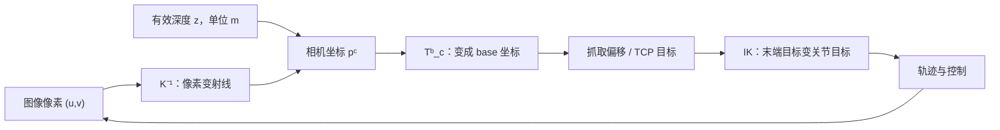
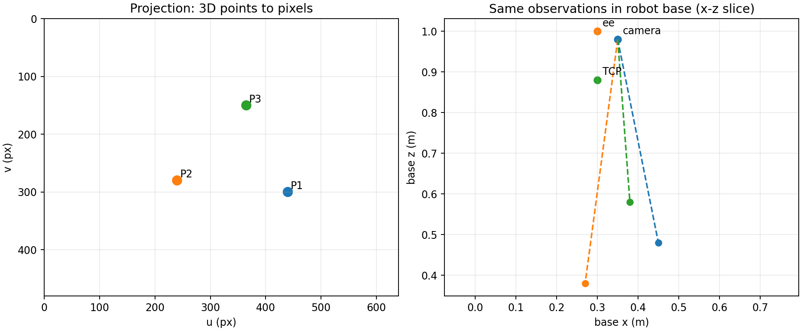
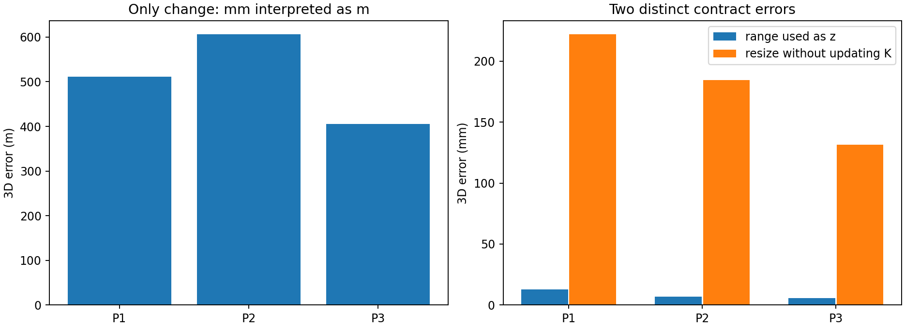

# Day 8 · 从像素射线到机器人坐标

[返回学习入口](../_index.md) ｜ [原定 P2 日程](../P2-深度理解-日程.md) ｜ [上一课 Day 7](../day7/Daily-Learning-Pack.md) ｜ [下一课 Day 9](../day9/Daily-Learning-Pack.md) ｜ [CPU 实验](demo.py)

**今天把一件事做扎实：相机看到的一个像素，经过深度、坐标变换与工具定义，怎样成为机器人能理解的空间目标。** 同一个三维点可以有不同坐标；同一组数字也可能因为单位或参考系不同，代表完全不同的位置。

> [!info] 课程位置与补写说明
> 本课对应原计划 W2-D1，原定日期 2026-09-12；于 2026-09-22 补写，保持 Day 8 的主题和顺序。原任务是齐次坐标、投影矩阵、坐标变换与点投影/反投影；新增 base/ee/camera/TCP、动作空间和 Learning 输入/参数/目标/单位。实验已实跑；个人学习、笔记和自测仍待完成。

<details>
<summary>个人笔记区（保留自己的理解与疑问）</summary>

<!-- learner-notes:start -->
- 我对坐标变换的解释：
- 我实际使用的深度单位与深度定义：
- 我的实验修改、结果和疑问：
<!-- learner-notes:end -->

</details>

<!-- daily-pack-generated:start -->

## 0. 今天要建立的能力

学完后，应能独立完成四件事：

1. 从 $K$ 和相机坐标推导像素位置，解释为什么单个像素只能确定一条射线。
2. 写出并检查 $T^A_B$ 的方向、相乘顺序和逆变换，不靠“看起来能对齐”判断正确。
3. 把 camera 中的三维点变成 base 中的目标，区分 ee 法兰与 TCP；解释末端位移和关节角为什么不能直接互换。
4. 用一个真实数值反例，证明单位、深度定义和图像尺寸是算法输入契约的一部分。

Day 7 回查了数学和工具；本课开始把几何变成可复用模块。Day 9 将用两条射线恢复深度，再把感知目标送进二连杆运动学。**今天先保证坐标有意义，明天再求几何交点和关节解。**

## 1. 宏观：把“杯子在这里”拆成四次翻译

机器人抓杯子的最小链路：



第一段是**测量解释**：像素和深度如何对应同一个表面。第二段是**坐标表达**：相机量与机器人量怎样转换。第三段是**任务定义**：杯子表面点不自动等于夹爪中心的目标。第四段才是**执行方法**。

| 量 | 表示什么 | 典型 shape | 必须携带的信息 |
| --- | --- | --- | --- |
| 图像 | 颜色观测 | $H\times W\times3$ | 通道顺序、尺寸、时间戳 |
| 深度图 | 每像素的深度测量 | $H\times W$ | 光轴 z 或 range、尺度、无效值 |
| 像素坐标 | 图像采样位置 | $N\times2$ | $(u,v)$ 顺序、对应哪张图 |
| 点云 | 三维点集合 | $N\times3$ | 坐标系、米/毫米、有效 mask |
| 刚体变换 | 两坐标系的关系 | $4\times4$ | source、target、测量时刻 |
| 关节配置 | 机器人构型 | $n$ | 关节顺序、角度/位移单位 |
| TCP 位姿 | 工具任务点的空间配置 | $4\times4$ 或位置+旋转 | base/ee 参考、TCP 定义 |

**shape 对得上不代表语义对得上。** 一个 $(3,)$ 向量可能是像素齐次坐标、米制位置、平移增量、欧拉角或 Rodrigues 旋转向量；矩阵库不会替你区别。

## 2. 齐次坐标：为什么要多放一个数

### 2.1 平移不能只用三阶矩阵表示

三维旋转可写成 $p'=Rp$。但加上平移后为 $p'=Rp+t$，它不是关于 $p$ 的线性映射：原点可以变成非零点。把点扩展为：

$$
\bar p=\begin{bmatrix}x&y&z&1\end{bmatrix}^{\mathsf T},
\qquad
T=\begin{bmatrix}R&t\\0&1\end{bmatrix}
$$

就得到：

$$
T\bar p=
\begin{bmatrix}Rp+t\\1\end{bmatrix}.
$$

这使旋转和平移能用一次矩阵乘法表达，也能连续相乘。$R\in SO(3)$ 要满足 $R^\mathsf TR=I,\det R=1$；$T\in SE(3)$ 还要求最后一行是 $(0,0,0,1)$。随便一个 $4\times4$ 矩阵并不都是刚体变换。

### 2.2 点与方向不同

位置用 $[p;1]$，方向用 $[v;0]$：

$$
T[p;1]=[Rp+t;1],\qquad T[v;0]=[Rv;0].
$$

相机报告一个抓取点，需要旋转和平移；报告“沿相机 z 方向移动 1 cm”的**同一点的位移向量**，只需旋转。把位移也加上相机安装平移，会凭空加出几十厘米。

这里说的是普通三维方向/位置增量。完整刚体 twist 包含线速度和角速度，改变参考原点时会有叉乘项，需要伴随矩阵；不能把六维 twist 的变换简化为对前后三维各乘一个 $R$。本课先把点与方向分开，后续操作课程再展开 twist。

### 2.3 齐次点的比例与刚体点的第四维

投影几何中的 $[u,v,1]^\mathsf T$ 与 $[2u,2v,2]^\mathsf T$ 表示同一个像素点：最后要除以第三维。同理，一个三维齐次点 $[X,Y,Z,W]$ 在 $W\ne0$ 时表示 $(X/W,Y/W,Z/W)$。

这不意味着机器人位置可以任意乘尺度。**齐次向量的比例等价，是表示上的冗余；机器人三维位置的米制尺度，是物理信息。** 刚体变换通常保持输入点第四维为 1；投影丢掉的深度要靠额外测量或约束恢复。

## 3. 变换方向：把上标和下标当作类型检查

本课统一约定：

$$
p^A=T^A_Bp^B.
$$

这里参与 $4\times4$ 矩阵乘法的点使用齐次四维形式；为突出参考系，上式省略了点上的齐次横线。若使用三维点，等价形式是 $p^A=R^A_Bp^B+t^A_B$。

$T^A_B$ 把 B 坐标系中的表示变成 A 坐标系中的表示。它的平移列是 **B 原点在 A 中的位置**；旋转的三列是 B 的三根轴在 A 中的方向。

### 3.1 链式相乘与求逆

$$
T^{base}_{camera}
=
T^{base}_{ee}T^{ee}_{camera}.
$$

从右往左作用：camera → ee → base。中间坐标名可以“消去”，类似单位约分。顺序反过来一般错误，因为旋转和平移不交换。

$$
(T^A_B)^{-1}
=
T^B_A
=
\begin{bmatrix}
R^\mathsf T&-R^\mathsf Tt\\
0&1
\end{bmatrix}.
$$

逆变换不是只把 $t$ 取负：原平移用 A 系表达，求逆后必须改用 B 系表达。例如绕 z 旋转 $90^\circ$，$t=(1,0,0)$ 时，逆平移是 $(0,1,0)$，并不是 $(-1,0,0)$。

[Modern Robotics 3.3.1](https://modernrobotics.northwestern.edu/nu-gm-book-resource/3-3-1-homogeneous-transformation-matrices/)区分了位姿表示、换参考系和移动刚体三种用途。精读时重点看下标抵消及左乘/右乘动画；本课采用被动坐标变换的固定约定，不能把主动旋转直觉随意混进来。

### 3.2 手算：同一个杯子点

实验给定：

$$
R^{base}_{ee}=\operatorname{diag}(1,-1,-1),\quad
t^{base}_{ee}=(0.30,0.10,1.00)\text{ m},
$$

$$
R^{ee}_{camera}=I,\quad t^{ee}_{camera}=(0.05,0,0.02)\text{ m}.
$$

这是一个朝下看的相机：camera 的 $z$ 正向在 base 中朝下。注意这里的旋转行列式为 $+1$，是真旋转，不是镜像。

相乘得：

$$
R^{base}_{camera}=\operatorname{diag}(1,-1,-1),\quad
t^{base}_{camera}=(0.35,0.10,0.98)\text{ m}.
$$

相机点 $p^{camera}=(0.10,0.05,0.50)$ m：

$$
p^{base}=(0.10,-0.05,-0.50)+(0.35,0.10,0.98)
=(0.45,0.05,0.48)\text{ m}.
$$

再把 base 点用逆矩阵变回 camera，必须回到原数值。这叫**往返检查**，能发现实现错误，但两个地方一致使用错误外参时仍可能通过；它不等价于真实标定验证。

## 4. 相机投影：一个像素是一条射线

### 4.1 从相似三角形得到针孔模型

在相机 optical 坐标中，$z$ 向前，$x$ 向图像右侧，$y$ 向下。对于相机前方 $Z_c>0$ 的点：

$$
u=f_x\frac{X_c}{Z_c}+c_x,\qquad
v=f_y\frac{Y_c}{Z_c}+c_y.
$$

$f_x,f_y$ 单位为像素；$c_x,c_y$ 是主点。焦距的毫米值和像素焦距不是同一个数。

$$
K=
\begin{bmatrix}
f_x&0&c_x\\0&f_y&c_y\\0&0&1
\end{bmatrix},
\qquad
Z_c\begin{bmatrix}u\\v\\1\end{bmatrix}=Kp^{camera}.
$$

假设镜头畸变已处理、skew 为 0。若点原来在 base：

$$
Z_c\tilde p=K[R^{camera}_{base}\mid t^{camera}_{base}]\bar p^{base}
=P\bar p^{base},\quad P\in\mathbb R^{3\times4}.
$$

**投影矩阵 $P$ 与刚体矩阵 $T$ 不同。** $T$ 在三维中换参考系，可求逆；$P$ 把三维压成二维，没有一个通用逆把像素变回唯一三维点。对 $P$ 做伪逆，并不会凭空补回深度。

### 4.2 一个数字算例

取 $f_x=f_y=600$ px，$(c_x,c_y)=(320,240)$ px，$p^c=(0.10,0.05,0.50)$ m：

$$
u=600\times0.10/0.50+320=440,\quad
v=600\times0.05/0.50+240=300.
$$

点 $(0.20,0.10,1.00)$ 和 $(0.40,0.20,2.00)$ 也投影到 $(440,300)$。它们共线于相机光心，却处在不同距离。这正是深度歧义的来源。

### 4.3 向量化实现与边界

将 $N$ 个点按行存为 $X\in\mathbb R^{N\times3}$，计算 `h = X @ K.T`，再 `uv = h[:, :2] / h[:, 2:3]`。数学式写列向量，代码存行向量，因此有转置；不是两个不同模型。

投影前检查：

- $Z_c>0$，避免把相机背后的点作为可见点。
- 坐标有限，避免 NaN/Inf 污染后续统计。
- 图像边界是否有效；在相机前方仍可能落到图像外。
- 可见性需要遮挡判断；投影成功不说明点在最前表面。

本课脚本只做正深度检查，未实现 z-buffer。真实点云投影要处理多个点落在同一像素，以及前后遮挡。

## 5. 反投影：深度定义和图像坐标必须配套

### 5.1 optical z 的反投影

对已去畸变像素：

$$
r=K^{-1}[u,v,1]^\mathsf T
=
\left[\frac{u-c_x}{f_x},\frac{v-c_y}{f_y},1\right]^\mathsf T,
$$

$$
p^{camera}=z\,r.
$$

$r$ 的第三维为 1，但通常不是单位向量。若传感器给的是沿射线的欧氏距离 $\rho$：

$$
p^{camera}=\rho\frac r{\|r\|}.
$$

两者关系是 $\rho=z\|r\|$。同一个像素离主点越远，混淆 range 和 z 的影响越明显；在主点附近两者接近，容易形成“中心看着对、边上越来越偏”的现象。

在前面的点上，$z=0.5$ m，$\rho=\sqrt{0.1^2+0.05^2+0.5^2}\approx0.51235$ m。把 $\rho$ 当 z 代入，会把三维点往射线外侧推，误差约 **12.65 mm**。

### 5.2 缩放、裁剪后必须同步内参

理想连续坐标下，把图像缩小到一半：

$$
u'=0.5u,\quad v'=0.5v,\quad
f'_x=0.5f_x,\ f'_y=0.5f_y,\ c'_x=0.5c_x,\ c'_y=0.5c_y.
$$

裁剪左上角偏移 $(a,b)$，则新主点变为 $(c_x-a,c_y-b)$。实际图像库的像素中心重采样约定可能带半像素偏移，应与预处理实现对应；本课实验采用理想连续缩放，不隐藏这个假设。

畸变像素不能直接用上式当理想针孔像素。`undistortPoints` 默认返回归一化坐标时，也不能再重复乘 $K^{-1}$；若指定新的投影矩阵，返回量的含义又不同。Day 12 会系统处理畸变与标定。

### 5.3 RGB-D 对齐不是“尺寸一致”就完成

目标 mask 若来自 RGB，相应深度必须在 RGB 相机像素系中对齐，或者通过两传感器外参进行投影关联。两个 $640\times480$ 数组索引相同，并不保证同一光线。RealSense 等设备的深度 scale、深度和彩色内参及外参应来自实际配置；本课不假设某台设备 scale 永远固定。

## 6. base、ee、camera、TCP：坐标链中的四个角色

| 坐标系 | 常见物理含义 | 哪些量可能随运动变 |
| --- | --- | --- |
| base | 机械臂基座参考 | 移动底盘场景下相对 world 会变 |
| ee | 末端连杆/法兰参考 | 随关节配置改变 |
| camera | 相机光学参考 | 腕部相机随 ee；固定相机相对 base 常量 |
| TCP | 工具任务点，如夹爪指尖中心 | 相对 ee 为工具标定偏移，换工具后可能改变 |

腕部相机：

$$
T^b_c(q)=T^b_e(q)T^e_c.
$$

固定外部相机：通常直接使用标定得到的 $T^b_c$，无需乘当前 ee。两种安装不要套同一条公式。

如果工具偏移为 $T^e_{tcp}$，则当前 TCP：

$$
T^b_{tcp}=T^b_eT^e_{tcp}.
$$

若规划器输入的是法兰目标，而任务给的是 TCP 目标：

$$
T^{b}_{e,\mathrm{goal}}
=T^{b}_{tcp,\mathrm{goal}}(T^e_{tcp})^{-1}.
$$

本例 TCP 相对 ee 沿 z 偏移 0.12 m。当前 ee 高度 1.00 m，TCP 高度是 0.88 m；把二者混用会留下 **12 cm** 的确定性偏差。提高检测精度无法修复工具定义错误。

### 6.1 关节动作与末端动作

关节目标可为 $q^\star\in\mathbb R^n$；末端目标可为 $T^\star\in SE(3)$。连接它们的是运动学：

$$
T=f(q),\qquad q^\star\in f^{-1}(T^\star).
$$

逆映射可能多解、无解；加入关节限位和碰撞后，可用解更少。**检测到一个可见物体，不代表它处于机器人的可操作工作空间。**

动作还要区分绝对和增量，例如 $p_{t+1}^{b}=p^\star$ 与 $p_{t+1}^{b}=p_t^b+\Delta p^b$。若增量用 camera 表示，则 $\Delta p^b=R^b_c\Delta p^c$。本例 $\Delta p^c=(0,0,0.01)$ m 对应 base 中 $(0,0,-0.01)$ m。把向下接近错当成向上抬起，是参考系错，不是策略“没学好”。

## 7. Learning 扫盲：把输入、参数和目标分开

把一个深度预测器写成 $\hat z=f_\theta(I)$：

- **输入**是图像 $I$，可能还需要内参、相机元数据或历史。
- **参数**是 $\theta$，训练阶段由优化器调整。
- **训练目标**是希望预测接近何种标签，例如米制 optical z。
- **推理输出**是 $\hat z$；训练标签在推理时通常不可见。
- **评价与使用**分别看误差和任务效用，不能只看训练 loss。

| 五格卡 | 本课例子 |
| --- | --- |
| 数据 | 对齐的 RGB、深度、相机内参、有效 mask |
| 学什么 | 图像到度量深度的映射 |
| 监督/目标 | 在合法像素上逼近真实 optical z |
| 训练时做什么 | 根据误差更新模型参数 |
| 推理时做什么 | 固定参数输出深度，再经过几何和单位检查 |

若训练标签以毫米表示，模型输出却按米解释，几何接口会产生千倍错误。若用 `(z-μ)/σ` 做归一化，推理时必须还原为 $z=\hat z_{\rm norm}\sigma+\mu$；$\mu,\sigma$ 的来源和单位要保存。归一化只改变数值表达，不会校正错误内参或错误工具外参。

VLA 的动作输出也需要这个契约：模型输出的 0.1 是 0.1 m、0.1 rad、归一化动作还是离散 token？世界模型还需要知道动作作用在哪个参考系和哪个时间间隔。今天把语义钉住，后续才讨论复杂网络。

## 8. 动手：四个正确实现与三个受控错误

### 8.1 运行与产物

在 vault 根目录，用已有 NumPy/Matplotlib 环境：

```bash
python -B 3d_learning/day8/demo.py
MPLCONFIGDIR=/tmp/3d-learning-mpl python -B 3d_learning/day8/plot_demo.py
```

[主脚本](demo.py)只依赖 NumPy；[绘图脚本](plot_demo.py)读取保存结果。实际验证环境：Python 3.11.15、NumPy 1.26.4、Matplotlib 3.10.9。默认产物写到本课附件目录，脚本可从任意工作目录启动；主脚本可用 `--out-dir` 输出到新的实验目录。

[原始结果 JSON](../../_assets/3d_learning/day8/results.json) ｜ 数值数组 (not exported: excluded by publication policy)



左图是三个三维点投影后的像素，图像 v 向下。右图是 base 中 x-z 截面；ee、camera、TCP 是不同原点。虚线只是相机到观测点的视线，不是机械臂轨迹。



两幅图采用不同纵轴单位：左图是米，右图是毫米。不要因柱形高度相似就认为风险相同；单位错误远大于另外两种几何契约错误。

### 8.2 已运行的真实结果

| 检查 | 实际输出 | 解释 |
| --- | --- | --- |
| 投影→反投影最大误差 | $3.10\times10^{-17}$ m | 理想针孔、同一 K、给定正确 z 下数值闭合 |
| 第一个点像素 | $(440,300)$ px | 与手算一致 |
| 第一个点 base 坐标 | $(0.45,0.05,0.48)$ m | 与坐标链手算一致 |
| 毫米深度被当成米 | 三点误差 511.835、606.023、405.180 m | 只改变单位解释，其他输入完全相同 |
| range 被当 optical z | 12.652、6.703、5.664 mm | 错误随光线方向变化 |
| 图像缩半却沿用旧 K | 221.892、184.391、131.540 mm | 不只是随机噪声，而是系统性偏差 |
| camera 的 +z 增量 1 cm | base 的 z 增量 −1 cm | 增量方向必须旋转 |

这个实验没有拟合标定参数、采集真实深度或控制机器人；它验证的是几何模块与接口错误反例。接近零的回投误差是合成数据的内部一致性，不能当真实设备精度。

### 8.3 自己改一个变量

先保持相机点、外参、深度和图像 K 不变，只将图像缩放从 0.5 改成 0.75；分别同步和不同步 K，记录第一点误差。然后恢复，单独把 `delta_cam` 改成 $(0.01,0,0)$，预测 base 方向后运行核对。

不要一次改两个变量。产出表至少含：变量、预期、实测、为何变化。AI Coding 可以帮助重构函数，但你要亲自说清 `T_bc` 的方向、`uv` 的 shape 和深度单位；否则一个漂亮封装只会把错误藏深。

### 8.4 完整 CPU 主脚本

> [!note]- 完整 CPU 主脚本（与 demo.py 一致）
>
> ```python
> """Day 8: metric projection, coordinate chains, and unit contracts. CPU only."""
> from pathlib import Path
> import argparse
> import json
> import platform
> import numpy as np
> 
> 
> def transform(R, t):
>     T = np.eye(4)
>     T[:3, :3], T[:3, 3] = R, t
>     return T
> 
> 
> def inverse(T):
>     R, t = T[:3, :3], T[:3, 3]
>     return transform(R.T, -R.T @ t)
> 
> 
> def apply(T, xyz):
>     return np.asarray(xyz) @ T[:3, :3].T + T[:3, 3]
> 
> 
> def project(K, xyz):
>     if np.any(xyz[:, 2] <= 0):
>         raise ValueError("Projection requires positive optical z")
>     h = xyz @ K.T
>     return h[:, :2] / h[:, 2:3]
> 
> 
> def unproject(K, uv, z):
>     z = np.asarray(z)
>     if np.any(~np.isfinite(z)) or np.any(z <= 0):
>         raise ValueError("Depth must be finite positive optical z")
>     rays = np.c_[uv, np.ones(len(uv))] @ np.linalg.inv(K).T
>     return rays * z[:, None]
> 
> 
> def main():
>     default = Path(__file__).resolve().parents[2] / "_assets/3d_learning/day8"
>     p = argparse.ArgumentParser()
>     p.add_argument("--out-dir", type=Path, default=default)
>     args = p.parse_args()
>     args.out_dir.mkdir(parents=True, exist_ok=True)
>     K = np.array([[600., 0., 320.], [0., 600., 240.], [0., 0., 1.]])
>     # Optical z points downward in base; proper rotation det(R)=+1.
>     T_be = transform(np.diag([1., -1., -1.]), [.3, .1, 1.])
>     T_ec = transform(np.eye(3), [.05, 0., .02])
>     T_et = transform(np.eye(3), [0., 0., .12])
>     T_bc, T_bt = T_be @ T_ec, T_be @ T_et
>     pc = np.array([[.1, .05, .5], [-.08, .04, .6], [.03, -.06, .4]])
>     uv = project(K, pc)
>     back = unproject(K, uv, pc[:, 2])
>     pb = apply(T_bc, pc)
>     closed = apply(T_bc, apply(inverse(T_bc), pb))
>     # Controlled ablation: identical pixels/K/pose, change only depth units.
>     raw_mm = pc[:, 2] * 1000.
>     correct = apply(T_bc, unproject(K, uv, raw_mm * .001))
>     wrong = apply(T_bc, unproject(K, uv, raw_mm))
>     # Range is not optical z: same ray, Euclidean distance differs.
>     ranges = np.linalg.norm(pc, axis=1)
>     range_as_z = unproject(K, uv, ranges)
>     ray = np.c_[uv, np.ones(len(uv))] @ np.linalg.inv(K).T
>     range_correct = ray / np.linalg.norm(ray, axis=1, keepdims=True) * ranges[:, None]
>     delta_cam = np.array([0., 0., .01])
>     delta_base = T_bc[:3, :3] @ delta_cam
>     # Resize/crop affects K; pixel centers follow ideal continuous coordinates.
>     scale = .5
>     K_half = K.copy()
>     K_half[:2] *= scale
>     resized_back = unproject(K_half, uv * scale, pc[:, 2])
>     stale_K_back = unproject(K, uv * scale, pc[:, 2])
>     assert np.max(np.abs(back - pc)) < 1e-12
>     assert np.max(np.abs(closed - pb)) < 1e-12
>     assert np.max(np.abs(correct - pb)) < 1e-12
>     assert np.max(np.abs(range_correct - pc)) < 1e-12
>     assert np.max(np.abs(resized_back - pc)) < 1e-12
>     assert np.isclose(np.linalg.det(T_bc[:3, :3]), 1.)
>     result = {
>         "environment": {"python": platform.python_version(), "numpy": np.__version__},
>         "units": {"xyz": "m", "pixels": "px", "rotation": "rad"},
>         "T_base_camera": T_bc.tolist(), "T_base_tcp": T_bt.tolist(),
>         "pixel_uv": uv.tolist(), "points_base_m": pb.tolist(),
>         "roundtrip_max_error_m": float(np.max(np.linalg.norm(back-pc, axis=1))),
>         "unit_error_m": np.linalg.norm(wrong-correct, axis=1).tolist(),
>         "range_as_z_error_m": np.linalg.norm(range_as_z-pc, axis=1).tolist(),
>         "stale_K_resize_error_m": np.linalg.norm(stale_K_back-pc, axis=1).tolist(),
>         "camera_delta_m": delta_cam.tolist(), "base_delta_m": delta_base.tolist(),
>         "scope": "synthetic pinhole geometry; no calibration fit or robot execution",
>     }
>     (args.out_dir / "results.json").write_text(json.dumps(result, indent=2)+"\n")
>     np.savez(args.out_dir / "arrays.npz", K=K, pc=pc, pb=pb, uv=uv, T_bc=T_bc,
>              T_be=T_be, T_bt=T_bt, correct=correct, wrong=wrong,
>              range_error=np.linalg.norm(range_as_z-pc, axis=1),
>              stale_K_error=np.linalg.norm(stale_K_back-pc, axis=1))
>     print(json.dumps(result, indent=2))
> 
> 
> if __name__ == "__main__":
>     main()
> ```

## 9. 工程检查：错误会从哪里进入系统

把感知输出送给操作模块前，建议用一个明确的数据结构：

```python
target = {
    "position": [0.45, 0.05, 0.48],
    "frame_id": "base",
    "position_unit": "m",
    "reference_point": "observed_surface_point",
    "stamp_s": 0.0,  # 教学占位；真实系统必须填采集时刻
}
```

注意最后一项仍是观测表面点，尚不是 TCP 抓取目标。需要增加抓取接近方向、工具偏移、开口宽度、可达性和碰撞检查，才能进入执行层。

| 现象 | 优先核查 | 为什么 |
| --- | --- | --- |
| 全部点整体偏一块 | 外参方向、平移、TCP 定义 | 常呈固定或姿态相关偏差 |
| 中心较好、边缘较差 | 畸变、range/z、预处理后的 K | 误差与视角或像素半径有关 |
| 物体远近比例不对 | 深度 scale、单位、度量/相对深度 | 尺度错误沿视线放大 |
| 静止正常、运动时飘 | 时间戳、腕部相机位姿同步 | 使用了不同时间的坐标链 |
| 同一个动作随姿态转向 | 增量属于 base 还是 ee | 数值一样但参考轴不同 |

这些是诊断优先级，不是仅凭症状就能确定原因。实际需要用独立测量点和静/动态对照检查。

## 10. 原文材料与精读任务

1. [OpenCV Camera Calibration and 3D Reconstruction](https://docs.opencv.org/4.x/d9/d0c/group__calib3d.html)：只精读开头针孔模型、Homogeneous Coordinates、Homogeneous Transformations 三段。画出 $P_w\to P_c\to(u,v)$，标注哪一步丢失深度；核对返回外参方向。在线文档为当前 4.x，实际脚本环境为 4.10.0，本课没有依赖新版本接口。
2. [Modern Robotics 3.3.1](https://modernrobotics.northwestern.edu/nu-gm-book-resource/3-3-1-homogeneous-transformation-matrices/)：看齐次变换定义、逆变换、左乘和右乘示例；自行给一个“不交换”的数值反例。
3. 阅读记录保留“问题—公式假设—代码对应—失败边界”四格。**本课没有指定必须读一篇学习论文；原计划本日以几何推导和模块实现为主，论文集中精读仍在原周后续课程中完成。**

## 11. 回到宏观：今日重点、难点与产出

今天最值得留下五个知识点：

1. **像素确定射线，深度确定射线上的点。** 这解释了反投影为什么需要额外信息。
2. **变换有方向，链路有类型。** 上下标匹配比死记乘法顺序更可迁移。
3. **点、方向、位姿不同。** 这是把视觉结果转换成动作时最容易混用的三种量。
4. **TCP 是任务参考点。** 法兰位置准确也不代表夹爪指尖准确。
5. **单位属于模型接口。** 它不会因为用了深度网络、VLA 或归一化就自动正确。

三处难点再用一句直觉抓住：齐次比例等价不等于物理尺度任意；矩阵往返正确不等于外参真实；目标三维点不等于可执行关节动作。

今日产出：

- 一张从像素到 base/TCP 的坐标链图，写清每个矩阵方向。
- 可以运行的投影、反投影、变换与逆变换模块。
- 一张单位/深度定义/内参预处理错误对照表，附自己的单变量结果。
- 自测作答与误区修正，不把脚本通过等同于本人已掌握。

## 12. 自测：先答，再看文末答案

1. 为什么 $(u,v)$ 和 K 不能唯一确定三维点？加入什么信息才可恢复？
2. $T^A_B$ 的平移列是什么意思？写出其逆矩阵，解释为什么不能只取 $-t$。
3. 用本课 K 和 $p^c=(0.1,0.05,0.5)$ 手算像素，再反投影回去。
4. 给定 $T^b_e,T^e_c,T^e_{tcp}$，分别写当前相机位姿、当前 TCP 位姿，以及由目标 TCP 求法兰目标的公式。
5. 相机 z 轴在 base 中朝下。预测 camera 中 $(0,0,0.02)$ m 增量在 base 中是什么。为什么不加外参平移？
6. RGB 缩小一半，深度仍在原图坐标。能否用缩小后 mask 的数组索引直接读取原深度？至少指出两个需要处理的因素。
7. 某深度模型输出在训练集归一化后 RMSE 很低，真实机器人却抓偏。列出三项几何/接口检查，并说明哪项无法靠重新归一化修复。
8. 设计一次最小对照实验，区分“深度单位错”和“TCP 偏移错”；描述应固定什么、观察什么，不能只写“调参数”。

## 13. 未理解问题与下一课

在个人笔记中留下最具体的一项：是“我还不能把某个公式的 source/target 写清”，还是“我不知道某相机 API 的深度是 z 还是 range”。前者需要重画坐标链，后者需要查实际设备/API 文档和观测验证。

下一课 [Day 9](../day9/Daily-Learning-Pack.md)保持原顺序：对极几何、E/F 和三角化；新增二连杆 FK/IK 与误差迭代。今天的一条射线，将变成明天两台相机的交会约束；今天的 base 目标，将变成 IK 的输入。

## 14. 参考答案与判分标准

> [!note]- 完成自测后展开：每题 0 / 1 / 2 分，总分 16 分
> **统一标准**：0 分为结论错误或缺失；1 分为结论正确但公式、条件或解释不完整；2 分为关键结论、条件与工程含义均正确。建议 13 分以上且第 2、4、5 题无方向性错误后继续；这是自我检查标准，不是已通过记录。
>
> 1. 单像素对应光心射线，未知沿射线尺度。增加正确 optical z/range，或带已知几何的多视角/平面约束；相对深度还需度量尺度。
> 2. B 原点在 A 中的坐标。逆为 $[R^\mathsf T,-R^\mathsf Tt;0,1]$，逆平移要在新的参考系中表达。
> 3. $(440,300)$；$K^{-1}[440,300,1]^\mathsf T=(0.2,0.1,1)$，乘 0.5 回到原点。
> 4. $T^b_c=T^b_eT^e_c$；$T^b_{tcp}=T^b_eT^e_{tcp}$；$T^b_{e,g}=T^b_{tcp,g}(T^e_{tcp})^{-1}$。
> 5. $(0,0,-0.02)$ m。它是同一点的位移向量、齐次末维为 0，平移项不作用。
> 6. 不可直接索引。处理像素缩放/裁剪映射、RGB-depth 的几何对齐与对应 K；还要处理有效深度和时间对应。能指出前两类为满分基础。
> 7. 例如反归一化/单位、z 与 range、K 与畸变、外参方向、TCP、时间戳。归一化不能修复错误标定或 TCP 定义。
> 8. 固定外参和工具，改变已知目标距离，检查误差是否随深度成比例；再固定目标并改变末端姿态，检查误差是否随工具偏移旋转。需要独立真值，不能只看图像重投影。清楚区分受控变量与两种预测才得 2 分。
<!-- daily-pack-generated:end -->
