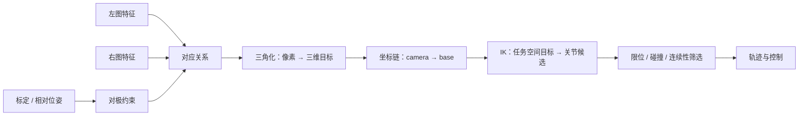
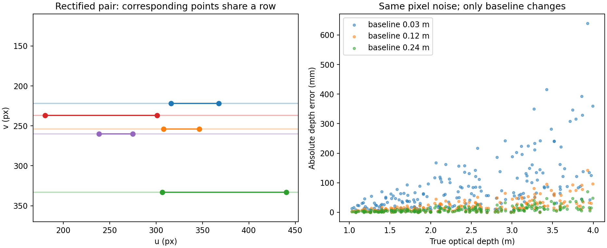
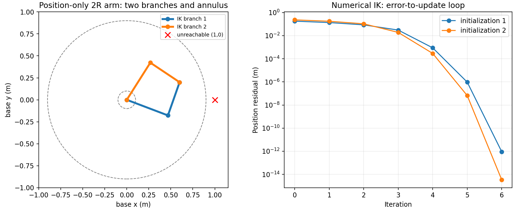

# Day 9 · 两条射线、两个关节与几何约束

[返回学习入口](../_index.md) ｜ [原定 P2 日程](../P2-深度理解-日程.md) ｜ [上一课 Day 8](../day8/Daily-Learning-Pack.md) ｜ [下一课 Day 10](../day10/Daily-Learning-Pack.md) ｜ [CPU 实验](demo.py)

**今天把“看见目标”和“到达目标”各推进一步：两台相机通过共同观测恢复空间位置；机械臂通过几何约束把空间位置变成关节配置。** 两个问题都存在退化、多解和误差放大，不能只靠解出一个数字宣布成功。

> [!info] 课程位置与补写说明
> 本课对应原计划 W2-D2，原定日期 2026-09-13，于 2026-09-22 补写。原主题为对极约束、E/F、三角化的解释与推导；新增二维二连杆 FK/IK、数值 IK 迭代和感知目标/关节目标的区别。没有把后续课程提前替换进来。实验已运行，个人验收仍待完成。

<details>
<summary>个人笔记区</summary>

<!-- learner-notes:start -->
- 我画出的对极平面与两条射线：
- 二连杆手算与迭代结果：
- 我的疑问、实验修改和错题：
<!-- learner-notes:end -->

</details>

<!-- daily-pack-generated:start -->

## 0. 今天要带走什么

1. 从三个向量共面的事实推导 $x_2^\mathsf TE x_1=0$，区分归一化相机坐标与像素坐标。
2. 写出 $F=K_2^{-\mathsf T}EK_1^{-1}$，说明 E/F 限制匹配位置，却不直接提供度量深度。
3. 手写 DLT 三角化，解释小基线/远目标为何病态，并检查正深度与重投影。
4. 推导二维二连杆 FK 和两分支 IK，识别不可达目标，并跟踪数值 IK 的位置残差。
5. 明确感知坐标和动作坐标之间需要外参、工具定义与运动学，不把三角化结果直接当关节命令。

Day 8 建好了单相机投影、反投影和坐标链。今天需要它们作为前置；Day 10 接着讨论“已知三维模型如何求相机位姿”“图像怎样找到对应点”，并推导数值 IK 中使用的雅可比。

## 1. 宏观：三角化和 IK 是两种不同的逆问题



三角化的未知量是空间点；IK 的未知量是关节角。前者被图像射线约束，后者被连杆长度与关节结构约束。**几何约束能排除不可能解，但不保证剩下的解就是实际需要的解。**

| 问题 | 已知 | 未知 | 典型非唯一性 |
| --- | --- | --- | --- |
| 单图反投影 | 像素、K | 深度/三维点 | 一整条射线 |
| 双目三角化 | 对应像素、两相机矩阵 | 三维点 | 平行射线/噪声使问题不稳定 |
| 相对位姿估计 | 匹配点、可选 K | R、平移方向 | 平移的绝对尺度未知 |
| 二连杆 IK | 连杆长度、目标位置 | 两个关节角 | 肘上/肘下两解，或不可达 |

本课实验**直接给定相机外参**，不运行从匹配估计 E/F 的鲁棒算法。因此“对极残差为零”验证的是公式实现，不是匹配质量或位姿估计能力。

## 2. 对极几何：为什么匹配从二维搜索变成一条线

### 2.1 先画平面，暂时忘掉矩阵

两个相机光心为 $C_1,C_2$，某个三维点为 $X$。这三个点一般确定一个平面，叫**对极平面**。它与两张成像平面相交，得到两条对极线。

只看左像素 $u_1$，真实三维点可以在左射线的任意深度处；把这条三维射线投到右图，轨迹是一条线。因此右图对应点 $u_2$ 必須落在这条线附近。它不需要遍历整幅图，但沿线仍可能有多个相似纹理。

**对极约束不是匹配结果。** 例如同一条桌面纹理线上有十个重复格子，它们都满足几何线约束；还需要外观、邻域、视差范围、一致性和遮挡判断。

两相机基线穿过成像平面的点叫 epipole；所有对极线经过它。平行且校正后的理想双目，epipole 可在无穷远，对极线表现为平行水平线。不存在“epipole 必须在画面里”的要求。

### 2.2 坐标约定必须先写清

将相机 1 作为三维参考，令：

$$
p_2=Rp_1+t.
$$

这里 $R,t$ 把相机 1 坐标变到相机 2；$t$ 是相机 1 原点在相机 2 中的坐标，不是随口说的“相机 2 向右移动多少”。若相机 2 在相机 1 的右方 $b$ 米、方向相同，那么 $R=I,t=(-b,0,0)$。

去畸变后，将像素归一化：

$$
x_1=K_1^{-1}[u_1,v_1,1]^\mathsf T,\quad
x_2=K_2^{-1}[u_2,v_2,1]^\mathsf T.
$$

$x_1,x_2$ 是三维光线方向的非单位表示，第三维为 1，不是米制三维点。空间点满足：

$$
z_2x_2=z_1Rx_1+t.
$$

## 3. Essential Matrix：由共面推导 E

### 3.1 消去两个深度

将上式与 $t$ 做叉积，平移与自身的叉积为零：

$$
t\times(z_2x_2)=z_1(t\times Rx_1).
$$

也可以直接利用共面：$x_2$ 与 $t,Rx_1$ 同处一个平面，因而与平面法向量 $t\times Rx_1$ 垂直：

$$
x_2^\mathsf T(t\times Rx_1)=0.
$$

定义叉乘矩阵：

$$
[t]_\times=
\begin{bmatrix}
0&-t_z&t_y\\
t_z&0&-t_x\\
-t_y&t_x&0
\end{bmatrix},
\quad [t]_\times v=t\times v.
$$

于是：

$$
E=[t]_\times R,\qquad x_2^\mathsf TEx_1=0.
$$

E 是 $3\times3$ **本质矩阵**，作用于归一化相机坐标。对非零平移的理想 E，rank 为 2，两个非零奇异值相等。它的几何自由度是 5：旋转 3 个，平移方向 2 个；矩阵整体乘一个非零数不改变约束。

### 3.2 为什么 E 不能给你真实基线

若将 $t$ 变成 $10t$，E 变成 $10E$，等式右边依然是零。仅凭这些图像约束无法区别 10 cm 基线与 1 m 基线及相应放大后的场景。

这不是“算法还不够好”，而是几何存在尺度自由度。真实双目相机的已知基线、已知物体尺寸、度量深度、惯性/运动约束等可以提供额外尺度信息，但必须明确它来自哪里。VLA 或世界模型使用的米制动作不会自动给一组无尺度重建补上可信长度。

### 3.3 从 E 恢复 R/t 还要筛解

理想 E 的分解产生候选相对位姿，通常需要三角化后检查同一批点是否在两相机前方，即 **cheirality（正深度）**。这个筛选不能恢复平移长度，也不能在低视差或错误匹配时保证精确解。

纯旋转时 $t=0$，这里的 E 为零，无法用基线三角化恢复深度；旋转能对齐视线方向，却没有新视差。两张图“变化很大”不代表一定具有可恢复深度的信息。

## 4. Fundamental Matrix：把相机坐标换成像素坐标

令齐次像素为 $\tilde u_i=[u_i,v_i,1]^\mathsf T$，代入归一化关系：

$$
\tilde u_2^\mathsf T
K_2^{-\mathsf T}EK_1^{-1}\tilde u_1=0.
$$

定义：

$$
F=K_2^{-\mathsf T}EK_1^{-1}.
$$

F 是 **基础矩阵**，作用于像素坐标；$l_2=F\tilde u_1$ 是右图对极线，满足 $a u_2+b v_2+c=0$。因此：

$$
d(\tilde u_2,l_2)
=
\frac{|a u_2+b v_2+c|}{\sqrt{a^2+b^2}}.
$$

这是像素距离，比裸代数残差 $\tilde u_2^\mathsf TF\tilde u_1$ 更好解释；后者会随 F 的任意尺度变化。本课报告代数残差只用于无噪声恒等式检查，不设通用数值阈值来判断实际匹配好坏。

| 对比 | E | F |
| --- | --- | --- |
| 输入坐标 | 去畸变归一化相机坐标 | 去畸变后的对应像素坐标 |
| 与内参关系 | 几何中已消去 K | 内含两相机的内参影响 |
| 理想约束 | rank 2，两个非零奇异值相等 | rank 2，整体尺度任意 |
| 自由度 | 5 | 7 |
| 直接作用 | 射线之间的共面约束 | 像素到另一图对极线 |

**“图像已经双目校正”不等于 E=F。** 只有坐标本身使用了对应的归一化表示时，才能消去内参。校正后的像素仍可能有焦距和主点；不要把“水平线”与“无内参”混为一谈。

### 4.1 如何从匹配求 F：理解约束即可

令 $\tilde u_1=(u,v,1)$、$\tilde u_2=(u',v',1)$，展开得到一个关于 F 九个元素的线性方程：

$$
[u'u,\ u'v,\ u',\ v'u,\ v'v,\ v',\ u,\ v,\ 1]\,f=0.
$$

八点法用至少八对匹配建立矩阵，SVD 取最小奇异值方向，再把 F 投影到 rank 2。实际数值计算还应先把两图坐标平移、尺度归一化，然后反变换。匹配有离群点时要配合鲁棒估计；“八点”是这个算法的输入要求，不是所有求 F 方法统一的最少点数。

[OpenCV 对极几何教程](https://docs.opencv.org/4.x/da/de9/tutorial_py_epipolar_geometry.html)可用于查对极线绘制和点对应流程。精读时自己补全本课的坐标约定，不把代码能画线当作恢复了度量位姿。

## 5. 三角化：两条射线怎样变成空间点

### 5.1 理想平行双目的直接算式

左右相机方向一致、焦距相同、主点对齐，右相机在左相机 x 正向 $b$ 米：

$$
u_L=f\frac XZ+c_x,\qquad
u_R=f\frac{X-b}Z+c_x.
$$

相减：

$$
d=u_L-u_R=\frac{fb}{Z},
\qquad Z=\frac{fb}{d}.
$$

例如 $f=600$ px、$b=0.12$ m、$d=36$ px，则 $Z=2$ m。$d$ 与 $f$ 使用相同像素单位，得到的 Z 沿用 b 的米制单位。若主点不同，需要先减去主点差，不能机械套 $fb/(u_L-u_R)$。

### 5.2 任意双目的 DLT

设两个已知相机矩阵 $P_1,P_2\in\mathbb R^{3\times4}$，待求三维齐次点 $\bar X\in\mathbb R^4$。投影满足：

$$
\tilde u_i\times(P_i\bar X)=0.
$$

每幅图取两个独立方程：

$$
A=
\begin{bmatrix}
u_1P_{1,3}-P_{1,1}\\
v_1P_{1,3}-P_{1,2}\\
u_2P_{2,3}-P_{2,1}\\
v_2P_{2,3}-P_{2,2}
\end{bmatrix}\in\mathbb R^{4\times4}.
$$

求：

$$
\min_{\|\bar X\|=1}\|A\bar X\|^2.
$$

若 $A=U\Sigma V^\mathsf T$，最小奇异值对应的右奇异向量就是解，即 `Vh[-1]`。最后除以第四维得到 $(X,Y,Z)$。若第四维接近零，表示可能接近无穷远，应显式报告无效/病态，而不是强行除出巨大数。

DLT 最小化的是**代数误差**，并非最佳像素重投影误差；有噪声时两条射线通常不相交。真实系统可把 DLT 用作初值，再最小化多视图重投影损失：

$$
\min_X\sum_i\|\pi(P_i\bar X)-u_i\|^2.
$$

需要鲁棒损失、观测不确定性和离群点处理时，应明确增加的假设。多一台相机也不是无条件提升：错误外参会引入系统偏差。

### 5.3 误差传播：相机视差与机器人误差共用一条链

由 $Z=fb/d$：

$$
\frac{\partial Z}{\partial d}=-\frac{fb}{d^2}
=-\frac{Z^2}{fb},\qquad
\sigma_Z\approx\frac{Z^2}{fb}\sigma_d.
$$

若左右像素各自有独立标准差 $\sigma_u$，则 $\sigma_d\approx\sqrt2\sigma_u$。目标距离翻倍，其他条件不变，深度标准差约增至四倍；基线翻倍则约减半。

以本课 $\sigma_u=0.2$ px、$Z=3$ m、$f=600$ px、$b=0.12$ m，得 $\sigma_d\approx0.283$ px，$\sigma_Z\approx0.0354$ m。厘米级不确定性进入 base 坐标后，就会影响抓取接近高度和避障裕量。

这是小误差一阶近似。若视差接近零，噪声能使分母跨零，误差分布严重不对称，不能继续把线性标准差当可靠描述。加大基线还会增加遮挡和匹配难度；实验只测基线对几何条件的影响，没有模拟这些实际代价。

## 6. 从感知目标转向二连杆：先做 FK

机器人位于平面 base 中，两段长度 $l_1,l_2$，关节角 $q_1,q_2$。$q_1$ 相对 base x 轴；$q_2$ 相对第一连杆，第二杆绝对朝向为 $q_1+q_2$。

$$
x=l_1\cos q_1+l_2\cos(q_1+q_2),
$$
$$
y=l_1\sin q_1+l_2\sin(q_1+q_2).
$$

这叫 **Forward Kinematics，正运动学**，从关节配置求末端位置。角度传给 `sin/cos` 时必须用弧度。

手算 $l_1=0.5,l_2=0.4$ m，$q_1=0,q_2=\pi/2$：第一杆沿 x 伸出 0.5 m，第二杆沿 y 伸出 0.4 m，末端为 $(0.5,0.4)$ m，朝向为 $\pi/2$。位置是二维，朝向还有一维；两个自由度一般不能随意满足三个独立约束。

**本课 IK 只指定平面位置，不指定完整末端姿态。** 对六自由度抓取，不能把二维位置可达的直觉直接等同于指定夹爪朝向也可达。

## 7. 解析 IK：为什么有两解、无解和边界退化

### 7.1 由余弦定理解肘角

令 $r^2=x^2+y^2$。两杆长度与目标距离形成三角形：

$$
r^2=l_1^2+l_2^2+2l_1l_2\cos q_2,
$$

$$
c_2=\frac{x^2+y^2-l_1^2-l_2^2}{2l_1l_2},
\qquad q_2=\pm\arccos c_2.
$$

然后把目标方向分成肩角和三角形内部偏角：

$$
q_1=
\operatorname{atan2}(y,x)-
\operatorname{atan2}(l_2\sin q_2,l_1+l_2\cos q_2).
$$

使用 `atan2(y,x)` 保留象限，不能用 `arctan(y/x)` 替代：后者在 $x=0$ 出问题，也丢失相反方向的信息。

### 7.2 本课抓取目标的两组解

目标 $(x,y)=(0.6,0.2)$ m，$l_1=0.5,l_2=0.4$ m：

$$
c_2=\frac{0.36+0.04-0.25-0.16}{0.4}=-0.025.
$$

得到两组（弧度）：

$$
q^{(1)}=(-0.36271348,\ 1.59579893),
$$

$$
q^{(2)}=(1.00621459,\ -1.59579893).
$$

两组 FK 都回到同一个位置，但肘部位置和末端朝向不同。选择哪一个，需要当前关节、限位、碰撞、任务姿态和运动连续性。相邻目标逐点独立取任意分支，可能突然从“肘上”跳到“肘下”，即使末端位置看起来平滑。

### 7.3 可达集合是圆环

忽略限位和碰撞、只约束平面位置时：

$$
|l_1-l_2|\le r\le l_1+l_2.
$$

这里可达半径范围为 $[0.1,0.9]$ m。$(1,0)$ m 太远；$(0.02,0)$ m 又太靠近基座，长杆不能被短杆完全抵消。

若 $|c_2|>1$，要返回不可达。只允许对极小浮点越界进行 `clip`；把任意 $c_2=1.2$ 裁成 1，会把真实无解伪装成边界解。边界处两分支可能合并，并与下一课的奇异位形相关。

关节角的 $2\pi$ 周期表示会产生数值上不同、几何等价的配置。实际机器人还要依据关节实际行程和连续关节定义处理，不能只做统一取模。

## 8. 数值 IK：把“大目标”变成一串“小纠正”

解析 IK 适合这个简单结构；复杂机构常用数值法。设 $p=f(q)$，目标为 $p^\star$：

1. 用初值 $q_k$ 做 FK。
2. 算残差 $e_k=p^\star-f(q_k)$。
3. 在当前位置线性化：$f(q_k+\Delta q)\approx f(q_k)+J(q_k)\Delta q$。
4. 求一个能减小残差的 $\Delta q$。
5. 更新 $q_{k+1}=q_k+\alpha\Delta q$，重新计算，而不是一次相信线性近似。

本课先用有限差分近似每一列：

$$
J_{:,j}\approx
\frac{f(q+\epsilon e_j)-f(q-\epsilon e_j)}{2\epsilon},
$$

再取 $\Delta q=J^\dagger e$，并将每次关节增量范数限制为 0.2 rad。Day 10 将推导解析 J 和阻尼最小二乘，解释为什么限步与阻尼有必要。

```text
q = 初始关节
重复：
    e = 目标位置 - FK(q)
    若 ||e|| 足够小：返回成功
    J = 当前 q 下的局部导数
    dq = 伪逆(J) @ e
    dq = 按本次步长上限缩放(dq)
    q = q + dq
超过迭代上限：返回未收敛，并保留残差
```

这里的伪代码有显式成功/失败状态；教学脚本保存最终残差并用断言检查两个已知可达目标。实际复用时应增加状态返回、限位、最大时间、停滞检测和碰撞约束。

### 8.1 初值与收敛意味着什么

本例从 $(0,1)$ 与 $(1,-1)$ 出发，都在 6 次更新后收敛，但分别到不同分支。**数值 IK 的初值就是一种解的偏好**；将上一时刻解作为初值可以提高连续性，但不是全局保证。

小残差说明指定位置约束满足了，不说明关节速度、末端方向、力矩或碰撞满足。迭代未收敛也不自动证明目标几何不可达；可能只是坏初值、奇异附近、步长或优化设置有问题。解析圆环判定与迭代失败要分别记录。

## 9. 动手：同一组像素噪声，只改变基线

### 9.1 运行与文件

```bash
python -B 3d_learning/day9/demo.py
MPLCONFIGDIR=/tmp/3d-learning-mpl python -B 3d_learning/day9/plot_demo.py
```

[主脚本](demo.py)使用 NumPy；[绘图脚本](plot_demo.py)使用 Matplotlib。实际验证环境：Python 3.11.15、NumPy 1.26.4、Matplotlib 3.10.9，seed=9，无模型下载、无设备控制。

[结果 JSON](../../_assets/3d_learning/day9/results.json) ｜ 数值数组 (not exported: excluded by publication policy)

实验生成 200 个深度在 1–4 m 的点，两图每坐标加标准差 0.2 px 的独立噪声。比较基线 0.03、0.12、0.24 m。三组使用**完全相同的点与噪声样本**，只改变基线；不会把随机样本变化误算成基线收益。



左图将校正后两图的少量对应点叠在同一坐标轴，线段长度表示视差，不是物体运动。右图显示同一批点的深度误差；远处误差更容易扩大，短基线最明显。

| 基线 | 无噪声最大三维误差 | 噪声下深度 RMSE | 正深度比例 |
| --- | --- | --- | --- |
| 0.03 m | $6.40\times10^{-14}$ m | 124.083 mm | 100% |
| 0.12 m | $1.87\times10^{-14}$ m | 30.336 mm | 100% |
| 0.24 m | $1.07\times10^{-14}$ m | 15.129 mm | 100% |

基线从 0.12 m 加倍到 0.24 m，RMSE 约减半，符合局部误差传播。正深度比例都是 100%，但误差仍差很多：**正深度是合法性检查，不是精度指标。**



左图的两个虚线圆构成可达位置圆环；两个关节分支到达同一目标。红叉在外圆外，所以解析 IK 返回空集合。右图显示两种初值的迭代残差；中间残差不是线性下降，收敛由局部几何决定。

真实输出：两个数值 IK 均更新 6 次，最终位置误差分别 $9.18\times10^{-13}$ m、$3.42\times10^{-15}$ m；解析两分支与数值解一致。这里是双精度合成几何精度，不是机械臂能达到的控制精度。

### 9.2 自己完成的改变量任务

先在原脚本副本中只把像素噪声从 0.2 改到 0.4 px，保持 seed、点、基线相同。写下“若处于小误差区，RMSE 约翻倍”的预测，再核对偏离程度。之后恢复噪声，仅把 IK 目标改成 $(0.02,0)$，用圆环判定和解析返回值说明为何不可达。

扩展任务：选一个可达目标，对数值 IK 使用五个不同初值，记录收敛/停滞、最终残差、所在分支。不要将迭代上限内没有收敛的样本全都标成“不可达”。

### 9.3 完整 CPU 主脚本

> [!note]- 完整 CPU 主脚本（与 demo.py 一致）
>
> ```python
> """Day 9: epipolar geometry, DLT triangulation, planar IK. CPU only."""
> from pathlib import Path
> import json
> import platform
> import numpy as np
> 
> OUT=Path(__file__).resolve().parents[2]/"_assets/3d_learning/day9"
> L1,L2=.5,.4
> 
> def skew(t):
>     x,y,z=t
>     return np.array([[0.,-z,y],[z,0.,-x],[-y,x,0.]])
> 
> def project(P,X):
>     h=np.c_[X,np.ones(len(X))] @ P.T
>     return h[:,:2]/h[:,2:]
> 
> def triangulate(P1,P2,u1,u2):
>     xyz=[]
>     for a,b in zip(u1,u2):
>         A=np.stack([a[0]*P1[2]-P1[0],a[1]*P1[2]-P1[1],
>                     b[0]*P2[2]-P2[0],b[1]*P2[2]-P2[1]])
>         _,_,vh=np.linalg.svd(A)
>         h=vh[-1]
>         if abs(h[3])<1e-12: raise ValueError("Point at infinity")
>         xyz.append(h[:3]/h[3])
>     return np.array(xyz)
> 
> def fk(q):
>     q1,q2=q
>     return np.array([L1*np.cos(q1)+L2*np.cos(q1+q2),
>                      L1*np.sin(q1)+L2*np.sin(q1+q2)])
> 
> def analytical_ik(xy):
>     x,y=xy; c=(x*x+y*y-L1*L1-L2*L2)/(2*L1*L2)
>     if c < -1.-1e-12 or c > 1.+1e-12: return []
>     angle=np.arccos(np.clip(c,-1.,1.))
>     return [np.array([np.arctan2(y,x)-np.arctan2(L2*np.sin(q2),L1+L2*np.cos(q2)),q2])
>             for q2 in [angle,-angle]]
> 
> def numerical_ik(target,q0):
>     q=np.array(q0,dtype=float); history=[]
>     for _ in range(100):
>         e=target-fk(q); history.append(float(np.linalg.norm(e)))
>         if history[-1]<1e-9: break
>         # Finite differences here; Day10 derives the analytic Jacobian.
>         eps=1e-6
>         J=np.column_stack([(fk(q+np.eye(2)[i]*eps)-fk(q-np.eye(2)[i]*eps))/(2*eps) for i in range(2)])
>         dq=np.linalg.pinv(J)@e
>         dq*=min(1.,.2/max(np.linalg.norm(dq),1e-12))
>         q+=dq
>     return q,np.array(history)
> 
> def main():
>     OUT.mkdir(parents=True,exist_ok=True)
>     rng=np.random.default_rng(9)
>     K=np.array([[600.,0.,320.],[0.,600.,240.],[0.,0.,1.]])
>     X=rng.uniform([-.3,-.2,1.],[.3,.2,4.],(200,3))
>     P1=K@np.c_[np.eye(3),np.zeros(3)]
>     # Same samples/noise at every baseline: baseline is the only variable.
>     noise1=rng.normal(0.,.2,(len(X),2)); noise2=rng.normal(0.,.2,(len(X),2))
>     baseline_results=[]; estimates=[]
>     for baseline in [.03,.12,.24]:
>         t=np.array([-baseline,0.,0.]); P2=K@np.c_[np.eye(3),t]
>         u1,u2=project(P1,X),project(P2,X)
>         E=skew(t); F=np.linalg.inv(K).T@E@np.linalg.inv(K)
>         residual=np.einsum("ni,ij,nj->n",np.c_[u2,np.ones(len(X))],F,np.c_[u1,np.ones(len(X))])
>         clean=triangulate(P1,P2,u1,u2)
>         noisy=triangulate(P1,P2,u1+noise1,u2+noise2)
>         baseline_results.append({"baseline_m":baseline,
>             "max_epipolar_residual":float(np.max(np.abs(residual))),
>             "clean_max_3d_error_m":float(np.max(np.linalg.norm(clean-X,axis=1))),
>             "noisy_depth_rmse_m":float(np.sqrt(np.mean((noisy[:,2]-X[:,2])**2))),
>             "positive_depth_fraction":float(np.mean(noisy[:,2]>0))})
>         estimates.append(noisy)
>         assert np.max(np.abs(clean-X))<1e-10
>         assert np.max(np.abs(residual))<1e-10
>     goal=np.array([.6,.2]); solutions=np.array(analytical_ik(goal))
>     numerical=[]; histories=[]
>     for q0 in [[0.,1.],[1.,-1.]]:
>         q,h=numerical_ik(goal,q0); numerical.append(q); histories.append(h)
>         assert h[-1]<1e-8
>     assert len(analytical_ik([1.,0.]))==0
>     assert np.max(np.linalg.norm(np.array([fk(q) for q in solutions])-goal,axis=1))<1e-12
>     report={"environment":{"python":platform.python_version(),"numpy":np.__version__},
>             "seed":9,"pixel_noise_std":.2,"triangulation":baseline_results,
>             "goal_m":goal.tolist(),"analytical_ik_rad":solutions.tolist(),
>             "numeric_ik_rad":[q.tolist() for q in numerical],
>             "numeric_iterations":[len(h)-1 for h in histories],
>             "numeric_final_error_m":[float(h[-1]) for h in histories],
>             "unreachable_goal_m":[1.,0.],"unreachable_solutions":0,
>             "scope":"known stereo extrinsics; no E/F estimation, collision checks or robot execution"}
>     (OUT/"results.json").write_text(json.dumps(report,indent=2)+"\n")
>     np.savez(OUT/"arrays.npz",X=X,estimates=np.array(estimates),u1=u1,u2=u2,
>              solutions=solutions,goal=goal,h0=histories[0],h1=histories[1])
>     print(json.dumps(report,indent=2))
> 
> if __name__=="__main__": main()
> ```

## 10. 工程位置：3D 感知怎样真的影响操作

在 RGB-D/双目系统中，Detection/Segmentation 提供“哪一片像素属于目标”，Tracking 提供跨时刻实例关联；它们不替代两相机之间的几何对应。一个二维检测框中心不一定对应同一个三维表面，尤其是遮挡、透明物体和左右视点差较大时。

三角化后建议依次保留：

1. 对应质量和对极距离；
2. 左右正深度；
3. 重投影误差；
4. 三角化视线夹角或等价的不确定性线索；
5. camera→base 外参版本和时间戳；
6. 目标到 TCP 定义；
7. IK 残差、分支和关节约束状态。

不要只保存最终 $(x,y,z)$，丢掉置信信息。世界模型若把不可靠的单帧三角化当准确状态，预测也会继承误差；VLA 若输出末端目标，也要经过同样的几何契约才能对接传统控制。

**两类“多解”不同**：重复纹理导致的对应歧义，是感知数据关联问题；肘上/肘下导致的 IK 多解，是机械结构问题。对前者增加关节约束可能帮助任务选择，但不能代替视觉验证；对后者改善图像精度也不能消除结构本身的多解。

## 11. 精读材料与输出卡

- [OpenCV Epipolar Geometry](https://docs.opencv.org/4.x/da/de9/tutorial_py_epipolar_geometry.html)：读 Basic Concepts 的光心、对极线和对极点图；再看 `computeCorrespondEpilines` 的输入来自哪张图。产出一张图，明确 $l_2=F\tilde u_1$ 与 $l_1=F^\mathsf T\tilde u_2$。
- [Modern Robotics 6.2 Numerical Inverse Kinematics, Part 1](https://modernrobotics.northwestern.edu/nu-gm-book-resource/6-2-numerical-inverse-kinematics-part-1-of-2/)：精读 Newton–Raphson 的线性化、初值与伪逆段。用本课二维 $f(q)$ 重写，而不是只记视频中的符号。
- [OpenCV 相机模型和三维重建接口](https://docs.opencv.org/4.x/d9/d0c/group__calib3d.html)：定位 `triangulatePoints`，核对输出是齐次三维点，以及输出参考系来自所给投影矩阵。本课手写 DLT，不调用这个接口。

本课自己的推导与受控实验是主要学习材料；以上官方材料用于核对定义和实现边界。原计划的周论文精读不因这三项教材阅读而视为自动完成。

## 12. 总结、重点与容易混淆处

用三句话回到整条系统：

- 对极约束把“可能匹配在哪里”限制到一条线，三角化再根据两视图和已知相机几何恢复位置。
- 相同像素噪声会因基线和目标距离产生完全不同的深度误差；一个合法三维点仍可能不够准确。
- IK 把 base 中的目标位置变成关节候选；有解之后仍需选择、约束和规划。

今日五个重点是 **坐标归一化、E/F 的尺度、DLT 的目标函数、IK 的两分支、数值迭代的初值**。前两个决定你到底解的是什么量；中间一个决定噪声下“最佳”的含义；后两个决定机器人会怎么折叠和能否稳定求解。

三处难点：

1. **E/F 不是深度表。** 它们约束对应关系，没有直接存每个点的 Z。
2. **三角化可以数值稳定地算出错误点。** 错误对应也能给低代数误差；要检查多种证据。
3. **IK 未收敛与不可达不是同义词。** 前者是这次求解过程的结果，后者是约束集合的性质。

今日产出：手画对极平面；一页 E/F/DLT 推导；基线对照结果；二连杆 FK 手算、两组 IK 解和不可达图；八题自测与自己的未理解问题。

## 13. 自测

1. 一个左像素为什么只把右匹配限制在一条线，而不能直接确定唯一右像素？
2. 本课 $p_2=Rp_1+t$ 约定下，推导 $E=[t]_\times R$。右相机向右移 b 时 t 的符号是什么？
3. 已知两个 K 和 E，写 F。输入 E 的点是什么坐标？为什么将 E 整体乘 5 不会给出五倍可靠基线？
4. $f=600$ px、$b=0.12$ m、$d=24$ px，求深度。若距离翻倍、像素噪声不变，深度标准差近似变几倍？
5. DLT 的 A 是什么 shape、最小化什么误差？拿到齐次点后至少检查哪三项？
6. 对 $l_1=0.5,l_2=0.4$，手算 $q=(0,\pi/2)$ 的末端位置。目标 $(0.02,0)$ 为什么无解？
7. 同一个 $(0.6,0.2)$ 目标两组 IK 都有很小位置误差，如何决定使用哪个？至少给出三个合理因素。
8. 相机三角化稳定、IK 却经常“失败”。设计诊断顺序，区分坐标单位错、几何不可达、数值求解失败；说明每一步需要什么证据。

## 14. 未理解问题与下一课

若你卡在 E 的推导，回到 $z_2x_2=z_1Rx_1+t$，先画共面向量，再写叉积。若卡在 IK 的符号，先用 $q_1=0,q_2=\pi/2$ 这种可以画图的极简姿态核对，不要直接调优化器。

下一课 [Day 10](../day10/Daily-Learning-Pack.md)：已知三维点与二维像素，用 PnP 求相机/物体相对位姿；从图像窗口匹配到视差深度；解析雅可比、奇异点和阻尼最小二乘。今天使用的局部线性模型将在下一课被真正拆开。

## 15. 参考答案与判分标准

> [!note]- 完成后再看：每题 0 / 1 / 2 分，总分 16 分
> 0 分：核心结论错误或未答；1 分：结论对但缺推导、条件或工程说明；2 分：结论、条件与解释完整。建议至少 13 分且第 2、3、6 题无概念性错误；未实际作答不计通过。
>
> 1. 未知深度沿左射线变化，投到右图形成对极线；外观、遮挡和重复纹理使线上仍可能有多个候选。
> 2. 三个向量 $x_2,t,Rx_1$ 共面，$x_2^\mathsf T(t\times Rx_1)=0$。平移为 $(-b,0,0)$，不是 $(b,0,0)$。
> 3. $F=K_2^{-\mathsf T}EK_1^{-1}$；E 使用去畸变归一化相机坐标。整体尺度在零约束中不可辨识，真实基线需外部尺度来源。
> 4. $Z=3$ m；距离翻倍时 $\sigma_Z$ 在小误差条件下约变四倍。
> 5. 两视图时 A 为 $4\times4$，求单位齐次向量最小代数残差。检查第四维、双相机正深度、重投影；再检查视差/夹角和匹配可靠性。
> 6. 末端 $(0.5,0.4)$ m；内半径是 0.1 m，所以 0.02 m 太靠近基座，不在圆环内。
> 7. 当前关节距离与连续性、关节限位、环境/自碰撞、目标朝向、工具/负载约束。不能仅按位置残差或任意固定分支选择。
> 8. 先用已知标定点核对米制和 camera→base；再用解析工作空间或明确约束检查不可达；最后固定同一合法目标比较初值、步长、条件数、残差曲线与终止原因。感知稳定只是重复性，仍需独立精度检查。
<!-- daily-pack-generated:end -->

