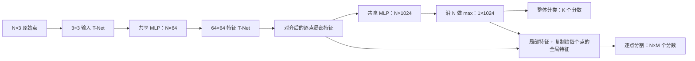
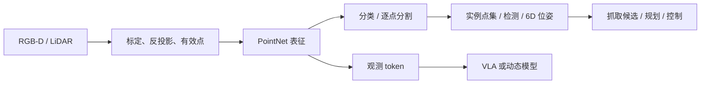

# 1·PointNet：一堆顺序会变的点，怎样得到稳定的理解？

[返回首页](../../Home.md) ｜ [主学习计划](../../3d_learning/3D感知与机器人学习计划.md) ｜ [D15 配套讲义与 CPU 实验](../../3d_learning/day15/Daily-Learning-Pack.md)

> [!summary] 先记结论
> PointNet 最重要的不是“用 MLP 处理 xyz”，而是把点云当成**集合**：每个点经过同一个特征函数，再用对顺序不敏感的 max pooling 合成整体特征。这套“**逐元素映射 + 对称聚合**”的思维，是读懂后续点集网络的起点。
>
> 它解决的是**点集表征**，不会直接给出 6D 位姿、抓取位姿或机器人动作；它对局部几何的建模也很弱。

## 为什么它排在第 1 篇？

**建议**：把 PointNet 作为整条 3D 学习线的第一篇网络论文，因为它同时教会三件后续反复出现的事：

1. 输入不只是 tensor shape，还有必须满足的**对称性**。
2. 网络结构应与任务输出匹配：整体分类要置换不变，逐点分割要置换等变。
3. 一个方法的优点和短板往往来自同一个设计：max pooling 带来简洁、高效和部分稳定性，也会丢掉局部结构与点的数量信息。

它还是 [PointNet++](https://arxiv.org/abs/1706.02413)、Frustum PointNets 及许多点云检测/位姿管线的直接前置知识。

## 论文卡

| 字段 | 内容 |
| --- | --- |
| 原题 | *PointNet: Deep Learning on Point Sets for 3D Classification and Segmentation* |
| 作者 | Charles R. Qi, Hao Su, Kaichun Mo, Leonidas J. Guibas；前两位为共同一作 |
| 发表 | CVPR 2017；arXiv 预印本首次提交于 2016-12-02，引用会议版时年份用 2017 |
| 官方论文 | [CVF Open Access](https://openaccess.thecvf.com/content_cvpr_2017/html/Qi_PointNet_Deep_Learning_CVPR_2017_paper.html) · [arXiv HTML](https://arxiv.org/html/1612.00593v2) · [DOI](https://doi.org/10.1109/CVPR.2017.16) |
| 作者资料 | [Stanford 项目页](https://web.stanford.edu/~rqi/pointnet/) · [原始代码](https://github.com/charlesq34/pointnet) |
| 主问题 | 不先体素化或渲染多视图，能否直接对无序点集学习？ |
| 任务 | 物体分类、部件分割、室内场景语义分割 |
| 一句话答案 | 用共享逐点 MLP 提取特征，用逐通道 max pooling 生成与点序无关的全局描述子。 |

**已确认**：题名、作者、会议、结构、实验数字均按上述原论文和作者项目页核对。下文的“工程含义”与“和机器人的关系”是基于论文的**个人理解**，不是论文原文结论。

## 1. 论文真正在解什么问题？

一幅图像是规则网格：像素的上下左右关系固定，卷积核可以在网格上滑动。原始点云则更像一个集合：

$$
S=\{x_i\}_{i=1}^{N},\qquad x_i\in\mathbb R^d
$$

最基本时 $d=3$，即 xyz；也可加 RGB、法向量、强度等通道。但它有三个不同于图像的约束：

### 1.1 无序（unordered）

把点在数组里换一个存储顺序，几何物体没有变。因此整体分类不能依赖“第 17 行”这种人为索引。

### 1.2 点之间有几何关系

点虽然无序，但并非互不相干。距离近的点往往组成局部曲面、边缘或部件。**PointNet 意识到了这个问题，但基础结构并没有显式构建局部邻域**；这正是后续 PointNet++ 要补的空缺。

### 1.3 坐标变换

整个物体平移或旋转后，语义类别通常不变，但 xyz 数值会变。PointNet 用学习式对齐网络 T-Net 缓解这个问题，并没有从结构上严格保证 SE(3) 不变性。

论文之前的常见做法是把点云体素化后用 3D CNN，或把 3D 物体渲染成多视图后用 2D CNN。这些方法可用，但分别带来体素分辨率/立方级计算量，或将 3D 信息投影为 2D 后的信息与逐点任务接口问题。PointNet 的选择是：**直接吃点。**

## 2. 核心结构：逐点映射 + 对称聚合

对于整体分类，希望学到一个集合函数 $f(S)$。PointNet 的核心可写成：

$$
f(S)\approx \gamma\!\left(\underset{x_i\in S}{\operatorname{MAX}}\;h(x_i)\right)
$$

- $h$：对每个点使用**同一组权重**的 MLP，得到逐点特征。代码中也常写成 kernel size 为 1 的 `Conv1d`。
- `MAX`：在点维度上做逐特征通道最大值，与输入顺序无关。
- $\gamma$：将全局描述子映射为类别分数或其他整体输出。

### 2.1 一张图看懂分类与分割



这张图回答两个问题：

- **整个物体是什么？** 用 max 后的全局特征回答。
- **每个点是什么？** 把全局特征复制回每个点，与该点的局部特征拼接后再分类。

这是论文 Figure 2 的概念主干。论文附录 C 说明，用于 ShapeNet Part 最终实验的版本还拼接了已知物体大类的 16 维 one-hot，并汇集多层局部特征；不要把概念图当成所有实验的逐层实现。

### 2.2 一个手算例：max 为什么不怕换顺序？

假设共享 MLP 已经把三个点变成三维特征：

| 点 | $h_1$ | $h_2$ | $h_3$ |
| --- | ---: | ---: | ---: |
| $p_1$ | 2 | 0 | 1 |
| $p_2$ | -1 | 3 | 0 |
| $p_3$ | 1 | 2 | 4 |

逐通道取最大值后：

$$
u=\operatorname{MAX}\{h(p_1),h(p_2),h(p_3)\}=(2,3,4)
$$

无论行顺序怎样改，$u$ 都不变。但这个例子也立刻暴露了代价：

- 第 1/2/3 个通道分别由 $p_1/p_2/p_3$ “赢得”，它们是这个例子的**关键点**。
- 再复制一个已有点，max 不变；因此基础 PointNet 不擅长表示“这类点到底有多少”。
- 加入一个在某个通道上激活异常大的离群点，全局特征可能被改写。

## 3. “置换不变”和“置换等变”不是一件事

设 $X\in\mathbb R^{N\times d}$ 是点集矩阵，$\Pi$ 是只负责换行的置换矩阵。

### 整体分类：置换不变

$$
f(\Pi X)=f(X)
$$

点序改变，整体类别分数不应改变。

### 逐点分割：置换等变

$$
F(\Pi X)=\Pi F(X)
$$

输入中的点怎样换行，对应的逐点预测就应怎样换行。它不应固定不动。

**工程含义**：验证分割网络时，必须先用同一个 $\Pi$ 把新旧输出重新对齐；否则会把正确的等变行为误判为错误。

## 4. T-Net 到底做了什么？

PointNet 在原始坐标和中间特征上各放了一个小型 PointNet，分别预测 $3\times3$ 和 $64\times64$ 变换矩阵，尝试把不同样本对齐到较一致的空间。

特征变换的维度较大，论文加入了正则项：

$$
\mathcal L_{reg}=\left\|I-AA^\top\right\|_F^2
$$

它鼓励预测矩阵 $A$ 接近正交矩阵，避免特征变换随意压瘪信息。

> [!warning] 不要过度解读 T-Net
> - 它是从数据中学出来的对齐，不是“对所有 3D 旋转严格不变”的数学保证。
> - $\mathcal L_{reg}$ 只是软约束，不保证每次输出都是完美的正交变换。
> - 在机器人操作中，物体朝向本身可能决定抓取方向；不能未加分析就把所有朝向信息消掉。

## 5. 理论部分怎样读才不会读过头？

### 5.1 定理 1：对连续集合函数的近似能力

论文证明，对 Hausdorff 距离意义下的连续集合函数，只要 max pooling 前的特征维度 $K$ 足够大，形如

$$
\gamma\!\left(\operatorname{MAX}_{x_i\in S}h(x_i)\right)
$$

的结构可以任意逼近该函数。

**正确理解**：这是架构表达能力的结果。  
**错误外推**：因此有限数据上训练的 PointNet 一定能学好任意点云任务。定理不保证优化成功、样本外泛化或现实传感器的域迁移性能。

### 5.2 定理 2：关键点集与上界形状

设聚合后的 $K$ 维向量为：

$$
u_j=\max_{x_i\in S}h_j(x_i),\qquad j=1,\ldots,K
$$

每个通道的最大值至少由一个点贡献。这些通道“赢家”的并集构成关键点集 $\mathcal C_S$，且 $|\mathcal C_S|\le K$。论文还定义了不会超过当前各通道最大激活的上界形状 $\mathcal N_S$。在论文的条件下，若

$$
\mathcal C_S\subseteq T\subseteq\mathcal N_S,
$$

则聚合特征与最终输出保持不变。

**直觉**：丢掉没有贡献任何通道最大值的点，可能不影响全局描述子。  
**边界**：这不等于“可以随意丢点”；如果关键点被遮挡，或离群点抢到某个通道的最大值，特征仍会改变。

## 6. 实验证据：论文证明了什么？

下表只记论文中对理解方法最有用的证据，不把 2017 年结果当作当前 SOTA。

| 问题 | 论文证据 | 可以得出的结论 | 不能得出的结论 |
| --- | --- | --- | --- |
| 直接点集输入能做物体分类吗？ | ModelNet40：平均类别准确率 86.2%，总体准确率 89.2% | 在该数据与协议下，简单点集架构已有很强竞争力 | 现代真实 LiDAR/RGB-D 上仍是最优 |
| 能做精细的逐点任务吗？ | ShapeNet Part：在输入已知物体大类 one-hot 并按该类别的部件标签预测时，平均 IoU 83.7% | “局部 + 全局”特征可用于部件分割 | 在不知物体大类时仍有 83.7%，或已完整解决局部几何建模 |
| 学习式对齐有用吗？ | ModelNet40：无变换 87.1%；同时用输入/特征变换 89.2% | 在该消融中，两级对齐与更好结果相关 | T-Net 严格保证任意旋转不变 |
| 对丢点稳定吗？ | ModelNet40 鲁棒性实验：删除 50% 点时，按最远点/随机方式的准确率分别下降 2.4/3.8 个百分点 | max 结构与关键点机制在该设定下带来一定稳定性 | 对任何遮挡、离群点或敌对扰动都鲁棒 |
| 计算是否随点数可扩展？ | 论文对 PointNet 给出关于输入点数 $N$ 的 $O(N)$ 时间/空间复杂度 | 逐点共享计算和一次聚合易于并行与扩展 | 在任意硬件、框架和数据预处理下都有相同实时速度 |

**阅读实验的三个关键限定**：

1. ModelNet40 分类使用从 CAD 网格表面采样的 1024 个点，并归一化到单位球；它不等同于带有遮挡、反光、混叠和标定误差的真实机器人视觉输入。
2. 论文的鲁棒性数字都依赖具体训练与测试协议。尤其对离群点的结果包含训练时见过相应扰动的条件，不应概括为无条件抗离群点。
3. 论文所说的“直接输入原始点集”是指不先体素化或渲染多视图，不是完全不做预处理；ModelNet40 实验仍包含表面采样、单位球归一化、绕竖直轴旋转和坐标抖动。

## 7. 这篇论文的五个边界

### 7.1 没有显式局部邻域

在全局 max 之前，每个点基本独立地过共享 MLP。网络没有先组织“某点周围的一群邻居”，因而不擅长表示细粒度局部形状。这是 PointNet++ 使用分层采样、分组和局部 PointNet 的主要动机。

### 7.2 max 擅长“有没有”，不擅长“有多少”

重复一个不改变通道最大值的点，全局特征不变。点密度、频次与细致的空间分布可能被压掉。

### 7.3 无序不等于对旋转不变

打乱行只改索引，旋转会真正改变 xyz。共享 MLP + max 只自然保证前者的对称性，不自然保证后者。

### 7.4 静态表征不是动态预测

PointNet 将一帧点集编码为语义特征，不包含“执行动作 $a_t$ 之后会发生什么”的转移模型。世界模型可以使用 PointNet 式编码器，但两者不能等同。

### 7.5 语义预测不是机器人动作

“这是杯子”或“这些点属于杯把”仍然缺少物体位姿、夹爪候选、可达性、碰撞、轨迹与控制反馈。PointNet 是感知链的一个部件，不是完整操作系统。

## 8. 把 PointNet 放回当前学习计划



| 学习位置 | PointNet 的作用 | 必须补上的东西 |
| --- | --- | --- |
| P1：3D 表示扫盲 | 理解点云为什么不能直接照搬 2D 卷积 | 坐标系、尺度、传感器噪声 |
| P2-W3：3D 检测与 6D 位姿 | 建立逐点编码、对称聚合、分割特征的基线 | PointNet++ 局部邻域、检测头、对称物体位姿指标 |
| 项目 Π-1：感知系统 | 编码切出的物体点集，或作为检测/位姿模块的骨干 | 时间戳、外参、单位、置信度、下游误差传播 |
| VLA | 把点集变成可供策略使用的特征/token | 语言条件、本体状态、时序、动作头；不能丢掉动作所需坐标 |
| 世界模型 | 可作为单帧观测编码器 | 历史、动作条件、状态转移与多步 rollout |

**个人判断**：对机器人学习，PointNet 最持久的价值不是今天还要不要把它当成最强 backbone，而是它提供了一个可检查的思考框架：**输入是什么数学对象→应保留什么对称性→怎样聚合→丢了什么信息→下游动作还缺什么**。

## 9. 建议的原文阅读路线

不必第一遍从头到尾逐句翻译，按下列顺序更容易建立主干：

1. **Abstract + Figure 1/2**：先说清输入、两类输出和主干结构。
2. **第 4.1 节**：把无序、点间交互、变换不变性三个问题分开。
3. **第 4.2 节**：紧盯对称函数、局部/全局特征拼接和 T-Net。
4. **第 4.3 节 + Figure 7**：先理解关键点集的直觉，再读定理条件。
5. **Table 1/2/5/6 和鲁棒性实验**：分别回答效果、对齐、稳定性和计算代价。
6. **附录 C**：最后再看层宽、变换网络和训练超参数，避免一开始被实现细节淹没。

## 10. 最小动手任务

已有的 [D15 完整讲义](../../3d_learning/day15/Daily-Learning-Pack.md) 和 [CPU 实验脚本](../../3d_learning/day15/demo.py) 正好对应这篇论文。脚本只验证结构性质，使用随机权重，不声称复现论文精度。

> [!caution] 环境状态
> D15 讲义记录的 CPU 验证环境为 Python 3.11.15、NumPy 1.26.4、PyTorch 2.13.0.dev20260423 和 Matplotlib 3.10.9，验证日期为 2026-09-22。本笔记在 2026-09-24 复查时，系统默认 `python` 因缺少 `torch` 未能复跑；因此必须选择现有的机器学习 Python 环境，不把历史结果当作当前默认环境已验证。

从 vault 根目录先做依赖检查；只有第一条成功后再运行实验：

```bash
python -c 'import torch, numpy, matplotlib; print(torch.__version__)'
python -B 3d_learning/day15/demo.py --out-dir /tmp/pointnet-paper-check
```

完成下列四组对照：

1. **重排**：打乱点序，验证分类 logits 不变；把分割输出对齐后验证等变性。
2. **错误聚合**：把 max 临时替换为取第 1 个点特征，观察为什么重排测试失败，然后恢复。
3. **坐标变换**：对整云平移或旋转，验证“点序不变性”不能推出“刚体变换不变性”。
4. **padding 与离群点**：对无效点在 max 前正确 mask；再用一个极端点检查 max 是否被改写。

最小产出：

- 一张 `[B,N,3] → [B,N,C] → [B,C]` 的 shape 流程图。
- 用自己的话解释“分类不变、分割等变”。
- 一张四行实验表：改了什么、什么应保持、实际差值、原因。
- 三个不能由 PointNet 单独解决的机器人问题。

## 11. 闭卷自测

1. 为什么不建议简单按 xyz 对点排序，然后当作固定长序列处理？
2. 用一行公式证明逐通道 max 不依赖点序。
3. 分类网络与分割网络对置换的要求分别是什么？
4. 为什么 T-Net 不等于严格的旋转不变性？
5. 关键点集 $\mathcal C_S$ 和聚合维度 $K$ 有什么关系？
6. 为什么丢掉很多非关键点可能无影响，加入一个离群点却可能改变结果？
7. PointNet++ 最直接地补了 PointNet 的哪个结构缺口？
8. 已有一个准确的逐点杯子分割结果，为什么还不能直接下发机器人关节命令？

<details>
<summary>参考答案</summary>

1. 高维几何中的排序往往对小扰动不连续；小幅移动一个点可能让整个序列的位置关系突变，且序列索引不是稳定的几何语义。
2. 对任意置换 $\pi$，$\max_i h(x_{\pi(i)})=\max_i h(x_i)$；每个特征通道都成立。
3. 分类要 $f(\Pi X)=f(X)$；逐点分割要 $F(\Pi X)=\Pi F(X)$。
4. T-Net 是数据驱动的预测器，正交项也只是软约束；架构本身没有对所有 SE(3) 变换给出群不变/等变保证。
5. 关键点是各通道 max 的贡献者并集，去重后有 $|\mathcal C_S|\le K$。
6. 非关键点没有改变任一通道最大值；离群点却可能在某些通道上成为新的最大值贡献者。
7. 它加入分层采样、邻域分组和局部 PointNet，显式建模局部几何与多尺度结构。
8. 分割只给出语义归属；还需坐标系与时间戳、物体/抓取位姿、IK、碰撞与可达性、轨迹和闭环控制。

</details>

## 12. 读完后应能复述的三句话

1. **PointNet 将点云当成集合，用共享逐点函数和对称 max 聚合保证整体输出对点序不变。**
2. **分割不是“所有输出都不动”，而是输入点怎样重排，逐点预测就怎样重排。**
3. **PointNet 的简洁性与短板都来自全局 max：它高效且对一些丢点稳定，但不显式建模局部邻域，也不等于旋转不变、位姿估计或机器人策略。**

## 来源与进一步阅读

- [CVPR 2017 正式页面](https://openaccess.thecvf.com/content_cvpr_2017/html/Qi_PointNet_Deep_Learning_CVPR_2017_paper.html)：发表信息、PDF、补充材料与 BibTeX。
- [arXiv v2 HTML 全文](https://arxiv.org/html/1612.00593v2)：本笔记中的结构、定理、实验协议和数字均由此核对。
- [Stanford 作者项目页](https://web.stanford.edu/~rqi/pointnet/)：结构图、结果可视化、代码和演讲入口。
- [原始 TensorFlow 代码](https://github.com/charlesq34/pointnet)：用于对照网络层、数据与训练脚本；运行前需自行核对其时代依赖。
- [库内 D15 讲义](../../3d_learning/day15/Daily-Learning-Pack.md)：不复制原论文摘要，重点补了 tensor shape、实现、padding mask、动手对照和机器人接口。
