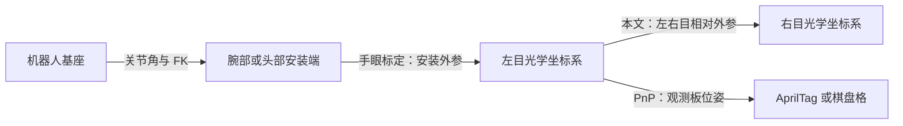

# 双目在线自标定：论文精读与动态标定学习路线

[返回首页](../../Home.md) · 本地论文 PDF (not exported: excluded by publication policy) · 标定仓库对比 (not exported: private project or unreviewed conversation/memory)

**先记结论：** 这篇论文解决“左右相机的相对安装姿态变化后，怎样用自然场景图像恢复双目极线校正”。核心是直接优化校正后对应点的纵向错位，得到左右相机之间的旋转和**平移方向**。它适合作为在线自标定的入门，但没有直接解决机器人手眼标定、时间同步、米制基线长度恢复，也没有给出完整的时变外参跟踪系统。

老师所说的“动态标定”可能包含不同范围。读完本篇，应能清楚回答：**标定谁和谁、哪些参数未知、它们是否真的随时间变化、观测来自哪里、怎样证明标得准。**

## 1. 来源与阅读范围

| 项目 | 内容 |
| --- | --- |
| 原题 | *Dive Deeper into Rectifying Homography for Stereo Camera Online Self-Calibration* |
| 作者 | Hongbo Zhao、Yikang Zhang、Qijun Chen、Rui Fan |
| 版本 | arXiv 首次提交 2023-09-19；本地文件为 v4，对应 2024-03-04 修订版，共 7 页 |
| 原始来源 | [arXiv v4](https://arxiv.org/abs/2309.10314v4) · [DOI](https://doi.org/10.48550/arXiv.2309.10314) |
| 作者入口 | [项目页](https://mias.group/StereoCalibrator/) · [StereoCalibrator 代码](https://github.com/TongjiZhaohb/StereoCalibrator) |
| 本笔记证据 | 全文阅读，核对第 2–4 页公式、第 5 页表 I/II 与第 6 页图 4；基础和扩展资料另列一手链接 |

**已确认：** 本文数值来自本地 PDF；没有运行作者算法或复现实验。以下区分“论文报告”“数学解读”和“工程建议”。作者网站的简化作者列表不完整，作者信息以 PDF 和 arXiv 为准。

## 2. 先把“动态标定”拆开

| 概念 | 实际含义 | 与本论文、当前仓库的关系 |
| --- | --- | --- |
| 运动采集、离线标定 | 移动机器人或相机，收集多姿态数据，最后求一组固定参数 | 现有腕部/头部仓库主要属于这一类；机器人动起来不等于外参动态估计 |
| 在线自标定 | 使用运行中的传感器数据更新参数估计，通常不摆标定板 | 本篇单对双目图像求解属于此方向；多对结果还可聚合 |
| 时变外参标定 | 安装关系受振动、温度、柔性形变影响，需估计 $T(t)$ | 本篇提供可重复求解的基础，但未建立漂移状态、变化检测与跟踪时延评测 |
| 时空联合标定 | 同时估计刚体变换和时间偏移，必要时还估计滚动快门读出时间 | 本篇假设同步采集，不求时间偏移；这是后续学习的独立重点 |
| 运动学坐标更新 | 固定安装外参乘以关节角对应的 FK，实时得到相机在基座中的位姿 | 头动时 $T_{base,camera}$ 变化，不代表相机支架的安装外参正在重新标定 |

**建议：** 向老师复述时先说清本篇属于“**双目、无专用靶标、已知内参、在线估计相对旋转和平移方向**”，再讨论是否要继续研究时间偏移和真正的机械外参漂移。

## 3. 读懂论文所需的基础

### 3.1 内参、畸变和外参各管什么

针孔模型可写成：

$$
s\begin{bmatrix}u\\v\\1\end{bmatrix}
=K\begin{bmatrix}R&t\end{bmatrix}
\begin{bmatrix}X\\Y\\Z\\1\end{bmatrix},\qquad
K=\begin{bmatrix}f_x&0&c_x\\0&f_y&c_y\\0&0&1\end{bmatrix}.
$$

- **内参 $K$：** 相机坐标怎样投到像素平面。改变图像缩放或裁剪，需要对应调整内参。
- **畸变 $D$：** 镜头导致的非理想投影。raw 图像、去畸变图像、rectified 图像必须分别配套正确的 $K,D$。
- **外参 $T$：** 两个坐标系之间的刚体变换，含旋转和平移。必须写明方向与平移单位。

本笔记统一用 ${}^{A}T_B$ 表示把 B 系坐标转换到 A 系，满足 $p_A={}^{A}T_Bp_B$。基础模型和 OpenCV 的变换方向可查[官方 calib3d 文档](https://docs.opencv.org/4.13.0/d9/d0c/group__calib3d.html)。

### 3.2 双目外参与手眼外参是两条不同的边

**腕部 eye-in-hand：** 相机跟手运动，标定板固定。令 $B$ 为基座、$G$ 为末端、$C$ 为相机、$P$ 为板：

$$
{}^{B}T_{G,i}\,{}^{G}T_C\,{}^{C}T_{P,i}={}^BT_P.
$$

未知的是固定安装变换 ${}^{G}T_C$，板在基座中的位姿也可以一起估计。消去固定板位姿，可得到经典 $AX=XB$ 关系。

**固定相机 eye-to-hand：** 相机不动，板固定在手上：

$$
{}^{B}T_{G,i}\,{}^{G}T_P={}^BT_C\,{}^{C}T_{P,i}.
$$

若板安装位姿未知，就同时求 ${}^{B}T_C$ 和 ${}^{G}T_P$。旧头部仓库把安装端设为 `head_pitch`；新 PlanB 仓库则直接拟合所选臂 FK 基系下的相机位姿，详细区别见独立仓库分析 (not exported: private project or unreviewed conversation/memory)。

头部可以转动时，长期有效的表达应是：

$$
{}^{B}T_C(t)={}^BT_H(q(t))\,{}^HT_C.
$$

这里 ${}^{H}T_C$ 是安装常量，变化来自头部关节角 $q(t)$。**把当前头角下的 ${}^{B}T_C$ 当成任何头角都能用的安装外参，会出错。**

### 3.3 为什么双目要先做极线校正

理想校正后的同一空间点，左右图像应满足 $v'_l=v'_r$。匹配算法于是沿同一行搜索，视差为 $d=u'_l-u'_r$；在标准校正模型下：

$$
Z=\frac{f_xb}{d}.
$$

$b$ 是物理基线长度。外参错误会造成纵向错位，破坏一维匹配的前提；即使网络还能输出视差，也不能据此断言深度正确。

**数学解读：** 小视差误差带来的深度误差近似为 $|\delta Z|\approx Z^2|\delta d|/(f_xb)$，距离越远越敏感。校正对齐与米制尺度是两个验收项：只让左右点落在同一行，仍不等于已知正确的基线长度。

## 4. 论文的方法：把外参估计改写成“让对应点同高”

### 4.1 输入、输出和假设

**输入：** 一对同步双目图像中的对应点，以及已知的左右内参；多对图像时，每对先独立估计。实际使用时还要保证像素已经按正确畸变模型处理。

**输出：** 左右相机的相对旋转 $R$、单位平移方向 $\hat t$，以及用于图像校正的旋转。视觉约束本身不提供米制基线 $b$。

**假设：** 内参在实验中固定；对应点可靠且分布能约束所求参数；左右图像同步。论文自采数据使用全局快门和硬件同步，因此不能直接外推到明显不同步、严重滚动快门的输入。

### 4.2 从两个校正旋转得到左右目相对外参

论文第 2 页式 (5) 将校正单应矩阵写成：

$$
H_l=K'R_lK_l^{-1},\qquad H_r=K'R_rK_r^{-1}.
$$

$R_l,R_r$ 是把原左右目分别旋转到校正坐标系的变换，$K'$ 是共同的虚拟内参。这里的单应性来自**虚拟相机旋转**，不要求整幅场景都在同一平面。

按论文三维相机坐标 $p^{C_r}=Rp^{C_l}+t$ 的方向约定，有：

$$
R=R_r^{-1}R_l,\qquad \hat t=-R_r^Te_x.
$$

因此作者选择优化两个校正旋转，再恢复左右目外参。虽然用了两个三维旋转向量，物理上可观测的相对几何仍是 **3 个旋转自由度 + 2 个平移方向自由度**，不是恢复了 6 个带尺度的自由度。

### 4.3 残差：只惩罚纵向不对齐

令去畸变后的归一化视线为 $q_{l,i}=K_l^{-1}\tilde p_{l,i}$、$q_{r,i}=K_r^{-1}\tilde p_{r,i}$，论文式 (9)–(11) 的核心可改写为：

$$
e_i=
\frac{e_y^TR_lq_{l,i}}{e_z^TR_lq_{l,i}}
-\frac{e_y^TR_rq_{r,i}}{e_z^TR_rq_{r,i}}.
$$

这不需要预先知道每个点的三维深度，因为分式中的尺度会抵消。$e_i$ 是归一化纵坐标之差；转换成像素纵向误差时，应考虑共同内参中的 $f_y$。

作者另加 $e_0=e_y^TR_re_z$ 约束，用于限定校正姿态。**数学解读：** 两个校正旋转存在共同绕基线旋转的冗余；这个额外约束帮助固定该自由度，不能把它理解为又增加了一项独立的三维测量。

### 4.4 求解：旋转上的 LM 与鲁棒权重

把 $R_l,R_r$ 用旋转向量表达，对残差一阶线性化，使用 Levenberg–Marquardt 更新；Huber 权重减小大残差对应点的影响。旋转通过指数映射更新，避免把旋转矩阵的 9 个元素当成独立变量随意优化。

从实现角度理解，就是：**当前校正 → 计算对应点的上下偏差 → 求小旋转修正 → 重新校正 → 迭代收敛。**

论文认为这种参数化较直接优化 $R,t$ 的基线方法更稳定。但“更稳定”来自其对比实验，不能解释为任意初始化、任意特征分布都保证成功；LM 也不是一般非凸问题的全局最优保证。

### 4.5 多对图像：聚合多个单对结果

论文式 (21) 对单位平移方向做归一化向量和：

$$
\hat t^*=\frac{\sum_{k=1}^{M}\hat t^k}{\left\|\sum_{k=1}^{M}\hat t^k\right\|}.
$$

旋转则先分成轴和角，对轴做类似聚合，再用角度的中心趋势值重建 $R^*$。正文没有充分明确这里究竟采用均值还是中位数，复现时需要核对代码版本。

**理解边界：** “global optimum”在这里指给定一批单位向量后，余弦相似度聚合目标的闭式解，不等于完整图像标定问题的全局最优，也不是所有图像联合 BA。该聚合隐含同一窗口应共享近似相同外参；若相机支架中途变形，把变化前后全部平均会掩盖变化。

**数学解读：** 向量和接近零、平移方向符号不一致、旋转角接近零导致轴不稳定，都需要额外处理。真正追踪 $T(t)$ 时还需窗口选择、先验、异常拒绝和变化检测；这些属于后续系统设计。

## 5. 实验说明了什么，没说明什么

### 5.1 实验设置与有代表性的结果

论文第 4–6 页报告：自采约 6,000 对、1920×1200 双目图像；两台 MindVision 全局快门相机，FPGA 20 Hz 硬件同步；室内外采集、左相机五种安装视角。另用 KITTI 2015 和论文称为 Middlebury 2021 的数据，构造四种额外的 5° 旋转视角。主要数值比较对象是 Ling 与 Shen 的 IROS 2016 方法。

| 证据位置 | 基线 → 本文 | 能支持的结论 |
| --- | --- | --- |
| 表 I，Indoor 1 / Middle View | $e_t$: 0.2897 → 0.0562 rad；$e_\theta$: 0.0398 → 0.0071 rad | 在该组实验中，方向与旋转向量误差明显下降 |
| 表 II，KITTI / Middle View | $e_t$: 0.0715 → 0.0130 rad；$e_\theta$: 0.0030 → 0.0014 rad | 公共数据上的改进不只出现在自采场景 |
| 表 II，Middlebury / Right View | $e_\theta$: 0.0006 → 0.0008 rad | 并非每一项都优于基线，不能写“全面胜出” |
| 图 4 | 未校正、基线校正、本文校正的视差图对比 | 校正后错误区域减少的定性证据；不等于统一深度误差指标上的完整验证 |

作者报告室内平均 $e_\theta/e_t$ 分别下降 47.63% / 72.90%，室外分别下降 72.78% / 76.48%。这些是**相对该基线、该数据协议的平均改进**，不是机器人末端毫米精度，也不是今天所有方法的排名。

论文把室内较差表现归因于移动采集造成的模糊和对应点误差；这是作者分析，不是排除其他因素后的严格因果证明。20 Hz 是采集同步频率，正文没有据此证明算法以 20 FPS 端到端实时运行。

### 5.2 四个指标必须按公式读

| 指标 | 论文定义 | 阅读时的注意点 |
| --- | --- | --- |
| $e_t$ | $\arccos(\hat t_{gt}^T\hat t^*)$ | 平移**方向夹角**，单位 rad；不能换成毫米位置误差 |
| $e_\theta$ | $\|\theta^*-\theta_{gt}\|_2$ | 旋转向量差；一般不等于 SO(3) 的旋转测地距离 |
| $\sigma_t$ | $\sqrt{M^{-1}\sum_k\arccos(\hat t_{gt}^T\hat t^k)^2}$ | 式 (25) 实际是相对真值误差的均方根 |
| $\sigma_\theta$ | $\sqrt{M^{-1}\sum_k\|\theta^k-\theta_{gt}\|_2^2}$ | 式 (26) 同样是均方根，没有减误差均值 |

**数学解读：** 正文把后两项称为 standard deviation，但公式并不是通常统计定义下去均值的标准差。它们同时包含偏差与波动，不能仅解释为“输出抖动”。自己的实验建议同时报告偏差、RMSE、真实标准差和失败率；旋转误差可另用 $\|\log(R_{gt}^TR_{est})^\vee\|$。

### 5.3 复现前要注意的原文细节

- 第 3 页式 (11) 的 $e_0$ 使用 $\theta_r$，式 (12) 第一项却印成 $\theta_l$，式 (14) 的 $J_0$ 又对应右侧。**已确认存在符号不一致**，不能直接逐字抄公式写代码。
- **数学核查：** 按式 (19) 的左乘增量，$e_0=e_y^TR_re_z$ 对增量的导数应为 $-e_y^T[R_re_z]_\times$，式 (14) 印成正号。令 $R_r=I$ 可得 $e_0\approx-\delta\theta_x$；复现时应做数值差分检查，不能仅照抄原文 Jacobian。
- 第 3 页式 (19) 附近有重复的 $\hat\theta_l$ 和“insufficiently small”收敛措辞。实现应自行明确更新对象、步长阈值与最大迭代次数。
- 第 2 页式 (8) 的叉乘构造没有显式写归一化步骤；若用于构造旋转矩阵，应验证正交性、行列式和退化方向。
- 第 7 页 Middlebury 对应参考文献写的是 2014 数据论文，而正文采用 2021 名称；复现时需要锁定作者实际使用的数据文件和版本。
- 作者代码页目前列有 `py_calibrator.py` 与 `stereo_calib_pytorch.py`，后者说明采用批量张量/GPU 优化。**本次只核对公开入口，未运行或验证该版本性能。** [作者仓库](https://github.com/TongjiZhaohb/StereoCalibrator)

## 6. 放到自己的机器人上，最值得迁移的是什么

**直接相关：** 若头部双目相机的左右镜头相对位姿受震动影响，本文可作为监控纵向视差与重新校正的研究基线。

**方法上相关：** 它强调根据下游几何任务设计残差、使用鲁棒权重、把单帧估计与多帧融合分开评估，这些思路可迁移到手眼标定。

**不能直接替代：** 它不使用机械臂 FK，也不估计 `wrist→camera`、`head_pitch→camera`、`base→camera` 或 `ee→tag`。不能把它输出的左右目相对外参填进机器人的手眼 YAML。

现有流程升级时，应优先补齐三类基础能力：

1. **数据合同。** 每帧记录图像曝光/采集时间、关节状态时间、frame 名称、米/毫米、四元数顺序、分辨率、raw/rectified 状态及匹配的 $K,D$。Tag 黑色边长必须与求解参数一致。
2. **可观测性。** 采集姿态要有多个方向的旋转与足够视角覆盖。增加大量重复姿态不能补回缺失的约束；旧手眼问题尤其应关注非平行旋转轴与固定安装假设。
3. **独立验证。** 用未参与拟合的姿态检查闭环误差、像素重投影、实际三维测量和不同头角下的一致性。训练残差很小不代表外参一定正确。

**数量级示例（自行计算，不是论文实验）：** 若运动速度为 0.5 m/s、图像和 FK 错位 20 ms，单纯时间错配就可能造成约 1 cm 的位置偏差；若旋转外参误差为 0.5°，在 1 m 距离处可带来约 8.7 mm 的横向误差。因此“先停稳再采样”是在减轻时间误差，尚未估计或消除时间偏移。

## 7. 基础与前沿扩展

以下作为后续阅读地图，区分已成熟的基础方法与近年研究方向；不声称穷尽截至 2026-10-16 的全部最新成果。

| 推荐资料 | 应学内容 | 分类与适用边界 |
| --- | --- | --- |
| Furgale、Rehder、Siegwart，*Unified Temporal and Spatial Calibration for Multi-Sensor Systems*，IROS 2013；[ETH 原始条目](https://www.research-collection.ethz.ch/items/487b06bb-dcbe-411d-ab46-8580147273ac) | Kalibr 相关基础：把时间偏移和空间变换放入连续时间批量估计 | 离线、运动采集、时空联合；不是实时手眼漂移跟踪器 |
| Geneva 等，*OpenVINS: A Research Platform for Visual-Inertial Estimation*，ICRA 2020；[作者论文](https://pgeneva.com/downloads/papers/Geneva2020ICRA.pdf)、[官方文档](https://docs.openvins.com/) | 视觉惯性滤波中的在线相机内参、相机–IMU 外参和时间偏移估计 | 在线更新估计值；需良好初值和激励，不直接输出法兰手眼外参 |
| Yang、Geneva、Zuo、Huang，*Online Self-Calibration for Visual-Inertial Navigation: Models, Analysis, and Degeneracy*，T-RO 2023；[作者论文](https://yangyulin.net/papers/2023_tro_full_calib.pdf) | 什么参数可观测，纯平移、单轴转动等运动为何退化 | 是视觉惯性模型的理论；迁移到机械臂时须重新检查测量模型 |
| Chen 等，*iKalibr: Unified Targetless Spatiotemporal Calibration for Resilient Integrated Inertial Systems*，arXiv 2024 / T-RO 2025；[论文](https://arxiv.org/abs/2407.11420)、[作者仓库](https://github.com/Unsigned-Long/iKalibr) | 至少含一个 IMU 的多传感器无靶标、连续时间时空联合标定 | 离线批量优化；不是在线外参曲线估计，也不能直接替换相机–编码器手眼标定 |
| Kumar 等，*Flow-Guided Online Stereo Rectification for Wide Baseline Stereo*，CVPR 2024；[CVF 论文](https://openaccess.thecvf.com/content/CVPR2024/papers/Kumar_Flow-Guided_Online_Stereo_Rectification_for_Wide_Baseline_Stereo_CVPR_2024_paper.pdf)、[FloSR](https://github.com/anushl9o5/FloSR) | 用图像特征、相关体和垂直光流约束学习左右目相对旋转 | 离线训练、在线推断；代码的 `use_6D` 是旋转表示，不是完整带尺度 6DoF 标定 |
| Nobre、Heckman，*FastCal: Robust Online Self-Calibration for Robotic Systems*，ISER 2018 / arXiv 2019；[论文](https://arxiv.org/abs/1902.10585) | 信息量选择、不可观测方向处理和旧数据时间衰减 | 显式考虑外参漂移，适合补充本文的固定窗口聚合；不是直接可用的灵猴手眼包 |

**阅读优先级建议：** 先看本文与 Kalibr 的时空概念，再看可观测性论文；有在线系统需求再看 OpenVINS / FastCal；最后比较 iKalibr 的统一建模和 FloSR 的学习方法。表中与腕部、头部项目的联系是工程推论，不是这些论文已经验证过当前机器人的结论。

### 7.1 从离线空间标定走向时空联合标定

空间外参之外，还可把时间偏移 $\Delta t$ 放入模型，例如比较相机时刻 $t$ 与机器人状态 $q(t+\Delta t)$。连续时间轨迹可以插值任意时刻，并融合不同频率的观测；**连续时间描述的是轨迹表示，不自动代表在线算法。**

在自己的系统里，先让停稳采样建立空间基线，再研究连续运动时的时间对齐，比一开始把 FK 误差、相机误差、时间误差全部丢给一个优化器更容易诊断。

### 7.2 在线更新要服从可观测性

在线滤波/滑窗优化可以把内外参及时间偏移加入状态，但没有足够运动激励时，这些变量可能互相补偿。需要决定何时更新、何时冻结，保留可信初值，并监控不确定性，而不是每帧都无条件覆盖标定结果。

### 7.3 学习式匹配与几何约束结合

学习方法可以从光流或图像对预测校正旋转、提供更好的匹配，几何优化则给出可解释的投影约束。要分清网络在预测校正矩阵、左右目相对外参，还是直接预测深度；这三者不自动等价，跨相机、跨焦距和振动分布的泛化需另测。

### 7.4 真正的时变外参与机器人运动学联合标定

**研究建议：** 可考虑 $T_{mount,camera}(t)$ 的缓慢漂移先验、突变检测，以及关节零偏/连杆参数与相机外参联合估计。但参数更多可能使问题更不可辨识。应先固定可信项，检查雅可比的秩/条件数，设计有信息量的运动，再逐步放开变量。

工程上更有价值的目标是：**知道什么时候外参失效、误差来自哪一层、是否有足够证据更新，以及更新后下游三维误差是否真的改善。**

## 8. 建议的学习顺序与验收问题

| 顺序 | 学习动作 | 应交付的小结 |
| --- | --- | --- |
| 1：坐标与投影 | 画出腕部、头部、左右目、Tag 的坐标图；推导上面的两条手眼闭环 | 能说清任意 $T$ 的方向、单位、哪些项固定 |
| 2：精读本文 | 阅读 III-A/B 和式 (5)、(9)、(11)、(17)；再看表 I/II | 用自己的话解释为什么纵向残差能约束双目姿态、为什么没有尺度 |
| 3：离线复现 | 固定公开代码版本，用有真值的数据注入旋转扰动、像素噪声和外点 | 报告校正前后纵向误差、旋转误差、方向误差、失败率与运行时间 |
| 4：动态问题 | 给序列引入分段外参变化或时间偏移，对比全序列平均和滑窗估计 | 分开评价估计噪声、漂移、突变恢复时间与深度误差 |
| 5：连接本机仓库 | 先补采集时间戳与数据格式，再做未参与拟合的验证 | 明确下一步研究的是手眼时间同步，还是左右目在线自校正 |

这些是学习建议，本次没有执行复现、采集或机器人运动。

读完后应能回答：

1. 为什么只看两张自然图像不能确定基线是多少米？
2. 为什么本文使用两个旋转，却只恢复 5 个物理自由度？
3. 为什么“左右点同一行”不意味着机器人抓取坐标准确？
4. 为什么论文的多帧闭式聚合不能直接当作时变外参跟踪器？
5. 为什么图像与 FK 不同步时，优化器可能给出残差尚可但物理含义错误的外参？
6. 当头部转动时，应更新 FK 链上的哪一项，哪一项仍是固定安装标定？

**下一步优先项：** 用本文建立“双目校正”的概念，同时把现有仓库里的“空间安装外参、头部 FK、数据时间戳”三条线分开。完整仓库取舍与 PlanB 的当前限制见标定仓库对比 (not exported: private project or unreviewed conversation/memory)。
